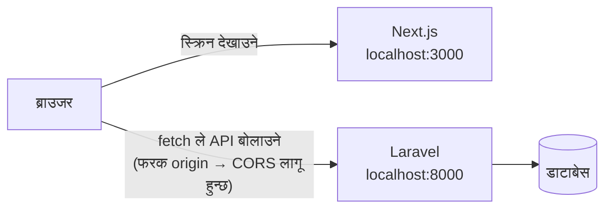
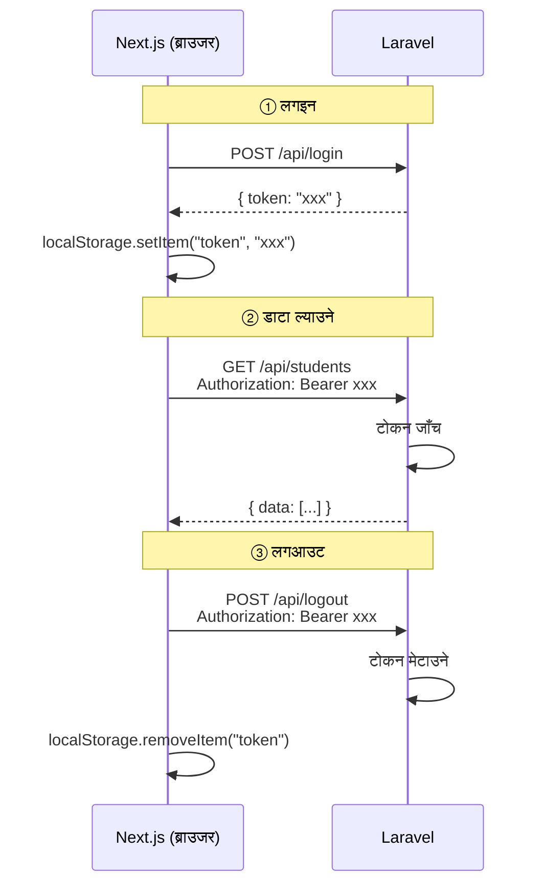

# कक्षा 17〜22｜Next.js परिचय → Laravel API सँग जोड्ने

> 🇯🇵 मूल प्रति (जापानी भाषामा): [2026_07_02.md](<../../../2年生_システム開発実践/前期/2026_07_02/2026_07_02.md>) <!-- original-ja-link -->

---

## कक्षा 17: Mock संस्करणलाई API सँग जोड्ने

### आजको लक्ष्य
- Next.js प्रोजेक्ट बनाउन सक्ने
- App Router कसरी काम गर्छ भनेर बुझेको हुने
- कक्षा 16 मा बनाएको Mock संस्करणको स्क्रिनलाई साँचो Laravel API सँग जोड्न सक्ने

> **आजको मुख्य कुरा：**  
> कक्षा 16 मा बनाएका कम्पोनेन्टहरू (LoginForm, StudentList, AddStudentForm)  
> **लगभग जस्ताको तस्तै प्रयोग गर्न सकिन्छ।** बदलिने भनेको डाटा ल्याउने तरिका मात्र हो।

---

### 0. Mock संस्करण र API संस्करणको फरक हेरौं

| | कक्षा 16 (Mock संस्करण, React) | कक्षा 17 (API संस्करण, Next.js) |
|--|--|--|
| डाटा ल्याउने | कोडभित्रको निश्चित array | `fetch()` बाट Laravel API बाट ल्याउने |
| लगइन | निश्चित मानसँग मिलाउने | `POST /api/login` बाट टोकन लिने |
| विद्यार्थी थप्ने | array मा थप्ने | `POST /api/students` बोलाउने |
| विद्यार्थी मेटाउने | array बाट हटाउने | `DELETE /api/students/{id}` बोलाउने |
| स्क्रिनको रूप | **पूरै उस्तै** | **पूरै उस्तै** |

---

### 1. Next.js प्रोजेक्ट बनाउने

#### 1-1. इन्स्टल गर्ने

टर्मिनलमा तलको कमाण्ड चलाउनुहोस् (`my-app` भन्दा **फरक फोल्डरमा** बनाउँछौं)।

```bash
npx create-next-app@latest school-frontend
```

केही प्रश्नहरू सोधिन सक्छन्। प्रश्न सोधिएमा तल देखाइएअनुसार जवाफ दिनुहोस्।

```
Would you like to use TypeScript?             → Yes  ← TypeScript प्रयोग गर्ने
Would you like to use ESLint?                 → Yes
Would you like to use Tailwind CSS?           → Yes  ← इन्स्टल गरेर राख्ने
Would you like your code inside a src/ dir?   → No   ← रुटमै app/ फोल्डर राख्ने
Would you like to use App Router?             → Yes
Would you like to use Turbopack?              → No
Would you like to customize the import alias? → No
```

> **TypeScript बारे**  
> फाइलको extension `.tsx` (TypeScript) हुन्छ। आधारभूत कोड JavaScript सँग लगभग उस्तै हो।  
> type लेख्नुपर्ने ठाउँमा, त्यही बेला व्याख्या गर्दै जान्छौं।
>
> **Tailwind CSS बारे**  
> इन्स्टल त गर्छौं, तर यो पटक inline स्टाइल प्रयोग गर्छौं। Tailwind लाई पछिको अध्ययनमा प्रयोग गर्न सकिन्छ।

#### 1-2. इन्स्टल गरेर सुरु गर्ने

```bash
# प्रोजेक्ट फोल्डरमा जाने
cd school-frontend

# डेभलपमेन्ट सर्भर सुरु गर्ने (create-next-app ले प्याकेजहरू आफैं इन्स्टल गरिसकेको हुन्छ)
npm run dev
```

`http://localhost:3000` खोल्दा Next.js को नमुना स्क्रिन देखियो भने सफल भयो।

---

### 2. फोल्डर संरचना हेरौं

```
school-frontend/
├── app/                         ← पेज फाइलहरू राख्ने ठाउँ (routing)
│   ├── layout.tsx               ← सबै पेजमा साझा HTML ढाँचा
│   ├── page.tsx                 ← / मा जाँदा देखिने पेज
│   ├── login/
│   │   └── page.tsx             ← /login को पेज
│   └── students/
│       └── page.tsx             ← /students को पेज
├── components/                  ← कक्षा 16 जस्तै ठाउँ
│   ├── LoginForm.tsx
│   ├── StudentList.tsx
│   └── AddStudentForm.tsx
└── package.json
```

**कक्षा 16 सँगको फरक：**

| कक्षा 16 (React + Vite) | कक्षा 17 (Next.js) |
|--|--|
| `src/App.jsx` मुख्य हो | `app/page.tsx` टप पेज हो |
| पेज 1 वटा मात्र (SPA) | फोल्डर = URL बन्छ (`login/page.tsx` → `/login`) |
| `index.html` बाट सुरु हुन्छ | `layout.tsx` ले HTML को ढाँचा सम्हाल्छ |

---

### 3. कक्षा 16 का कम्पोनेन्टहरू कपी गर्ने

पहिले `src/components/` फोल्डर बनाएर, कक्षा 16 मा बनाएका फाइलहरू कपी गर्छौं।

```
school-frontend/components/ मा तलका फाइलहरू कपी गर्ने：
  ├── LoginForm.tsx      ← कक्षा 16 को LoginForm.jsx कपी गर्ने (extension .tsx मा बदल्ने)
  ├── StudentList.tsx    ← कक्षा 16 को StudentList.jsx कपी गर्ने (extension .tsx मा बदल्ने)
  └── AddStudentForm.tsx ← कक्षा 16 को AddStudentForm.jsx कपी गर्ने (extension .tsx मा बदल्ने)
```

> **extension बारे**  
> TypeScript प्रयोग गर्ने भएकाले, फाइलको extension सबै `.tsx` (JSX भएको फाइल) बनाउँछौं।  
> कोडको सामग्री कक्षा 16 को `.jsx` बाट लगभग जस्ताको तस्तै कपी गर्न सकिन्छ।

कपी गरेका हरेक फाइलको **पहिलो लाइनमा** `"use client";` थप्नुहोस्।

```js
"use client";  // ← यो 1 लाइन थप्ने!
import { useState } from "react";
// ... बाँकी कक्षा 16 को कोड जस्ताको तस्तै
```

> **`"use client"` भनेको के हो？**  
> Next.js ले डिफल्टमा कोड सर्भरतिर चलाउँछ।  
> `useState` वा `onClick` जस्ता "ब्राउजरको सुविधा" प्रयोग गर्ने कम्पोनेन्टमा  
> सुरुमै `"use client"` लेखेर "यो ब्राउजरमा चलाउने" भनेर जनाउँछौं।

---

### 4. layout.js बदल्ने

`app/layout.tsx` खोलेर, भित्रको सबै मेटाएर तलको कोडमा बदल्नुहोस्।

```tsx
export const metadata = {
  title: "生徒管理アプリ",
};

export default function RootLayout({
  children,
}: {
  children: React.ReactNode;
}) {
  return (
    <html lang="ja">
      <body style={{ margin: 0, fontFamily: "sans-serif", background: "#f4f6f8" }}>
        {children}
      </body>
    </html>
  );
}
```

> **`{ children }: { children: React.ReactNode }` भनेको के हो？**  
> यो TypeScript को type परिभाषा हो। "children मा React को एलिमेन्ट आउँछ" भनेर जनाइरहेको छ।  
> `React.ReactNode` को अर्थ "JSX वा स्ट्रिङ जस्ता, React ले देखाउन सक्ने सबै कुरा" हो।

---

### 5. टप पेज (/) लाई लगइनमा redirect गर्ने

`app/page.tsx` खोलेर, भित्रको सबै मेटाएर तलको कोडमा बदल्नुहोस्।

```tsx
import { redirect } from "next/navigation";

// / मा पुग्दा आफैं /login मा पठाउने
export default function Home() {
  redirect("/login");
}
```

---

### 6. लगइन पेज बनाउने (/login)

`app/login/` फोल्डर बनाएर, `page.tsx` नयाँ बनाउनुहोस्।

```
app/login/page.tsx  ← नयाँ बनाउने
```

तलको कोड कपी गरेर पेस्ट गर्नुहोस्।

```tsx
"use client";

import { useState } from "react";
import { useRouter } from "next/navigation";

export default function LoginPage() {
  const router = useRouter(); // अर्को पेजमा जान प्रयोग गर्ने
  const [email, setEmail] = useState("test@example.com");
  const [password, setPassword] = useState("password");
  const [error, setError] = useState("");
  const [loading, setLoading] = useState(false);

  async function handleSubmit(e) {
    e.preventDefault();
    setError("");
    setLoading(true);

    // ★ कक्षा 16 सँगको फरक: निश्चित मानको जाँच → साँचो API बोलाउने
    const res = await fetch("http://localhost:8000/api/login", {
      method: "POST",
      headers: {
        "Content-Type": "application/json",
        "Accept": "application/json",
      },
      body: JSON.stringify({ email, password }),
    });

    const data = await res.json();
    setLoading(false);

    if (res.ok) {
      // ★ टोकनलाई ब्राउजरमा सेभ गरेर राख्ने
      localStorage.setItem("token", data.token);
      localStorage.setItem("userName", data.user?.name || "ユーザー");
      // /students पेजमा जाने
      router.push("/students");
    } else {
      setError("メールアドレスまたはパスワードが違います");
    }
  }

  return (
    <div style={{
      maxWidth: "400px", margin: "80px auto",
      background: "white", padding: "32px",
      borderRadius: "8px", boxShadow: "0 2px 8px rgba(0,0,0,0.1)"
    }}>
      <h2 style={{ marginBottom: "24px", textAlign: "center" }}>ログイン</h2>

      <form onSubmit={handleSubmit}>
        <div style={{ marginBottom: "16px" }}>
          <label style={{ display: "block", marginBottom: "6px", fontWeight: "bold" }}>
            メールアドレス
          </label>
          <input
            type="email"
            value={email}
            onChange={(e) => setEmail(e.target.value)}
            style={{ width: "100%", padding: "10px", border: "1px solid #ccc", borderRadius: "6px", fontSize: "1em", boxSizing: "border-box" }}
          />
        </div>

        <div style={{ marginBottom: "16px" }}>
          <label style={{ display: "block", marginBottom: "6px", fontWeight: "bold" }}>
            パスワード
          </label>
          <input
            type="password"
            value={password}
            onChange={(e) => setPassword(e.target.value)}
            style={{ width: "100%", padding: "10px", border: "1px solid #ccc", borderRadius: "6px", fontSize: "1em", boxSizing: "border-box" }}
          />
        </div>

        {error && (
          <p style={{ color: "#D32F2F", fontSize: "0.9em", marginBottom: "12px" }}>
            {error}
          </p>
        )}

        <button
          type="submit"
          disabled={loading}
          style={{ width: "100%", padding: "12px", background: loading ? "#aaa" : "#1976D2", color: "white", border: "none", borderRadius: "6px", fontSize: "1em", fontWeight: "bold", cursor: loading ? "not-allowed" : "pointer" }}
        >
          {loading ? "ログイン中..." : "ログイン"}
        </button>
      </form>
    </div>
  );
}
```

**कक्षा 16 को `LoginForm.tsx` सँगको फरक：**

| | कक्षा 16 (Mock) | कक्षा 17 (API) |
|--|--|--|
| प्रमाणीकरणको तरिका | निश्चित मानसँग मिलाउने | `fetch("http://localhost:8000/api/login")` |
| लगइन पछि | `setIsLoggedIn(true)` | `localStorage.setItem("token", ...)` + पेजमा जाने |
| पेजमा जाने | सर्तअनुसार स्क्रिन बदल्ने | `router.push("/students")` |

---

### 7. विद्यार्थी व्यवस्थापन पेज बनाउने (/students)

`app/students/` फोल्डर बनाएर, `page.tsx` नयाँ बनाउनुहोस्।

```
app/students/page.tsx  ← नयाँ बनाउने
```

तलको कोड कपी गरेर पेस्ट गर्नुहोस्।

```tsx
"use client";

import { useState, useEffect } from "react";
import { useRouter } from "next/navigation";
import StudentList from "@/components/StudentList";
import AddStudentForm from "@/components/AddStudentForm";

export default function StudentsPage() {
  const router = useRouter();
  const [students, setStudents] = useState([]);
  const [userName, setUserName] = useState("");
  const [loading, setLoading] = useState(true);
  const [addError, setAddError] = useState(""); // ← थप्दा आएको एरर देखाउन

  // ★ useEffect: पेज देखिँदा 1 पटक मात्र चल्छ
  useEffect(() => {
    const token = localStorage.getItem("token");

    // टोकन छैन भने लगइन पेजमा फर्काउने
    if (!token) {
      router.push("/login");
      return;
    }

    setUserName(localStorage.getItem("userName") || "ユーザー");
    loadStudents(token);
  }, []); // [] = सुरुमा 1 पटक मात्र चलाउने

  // विद्यार्थी सूची API बाट ल्याउने
  async function loadStudents(token) {
    setLoading(true);

    const res = await fetch("http://localhost:8000/api/students", {
      headers: {
        "Accept": "application/json",
        "Authorization": `Bearer ${token}`, // ★ टोकनलाई हेडरमा राख्ने
      },
    });

    // 401 = टोकन अमान्य → लगइन पेजमा फर्काउने
    if (res.status === 401) {
      router.push("/login");
      return;
    }

    const data = await res.json();
    setStudents(data.data); // Laravel API ले { data: [...] } को रूपमा फर्काउँछ
    setLoading(false);
  }

  // विद्यार्थी थप्ने
  async function handleAdd(newStudent) {
    const token = localStorage.getItem("token");
    setAddError(""); // ← एरर रिसेट गर्ने

    const res = await fetch("http://localhost:8000/api/students", {
      method: "POST",
      headers: {
        "Content-Type": "application/json",
        "Accept": "application/json",
        "Authorization": `Bearer ${token}`,
      },
      body: JSON.stringify(newStudent),
    });

    if (res.ok) {
      loadStudents(token); // ★ थपेपछि सूची फेरि ल्याएर स्क्रिन अपडेट गर्ने
    } else {
      // ★ असफल हुँदा API को एरर विवरण स्क्रिनमा देखाउने
      const data = await res.json();
      if (data.errors) {
        const messages = Object.values(data.errors).flat().join(" / ");
        setAddError(messages);
      } else {
        setAddError(`エラーが発生しました（HTTP ${res.status}）`);
      }
    }
  }

  // विद्यार्थी मेटाउने
  async function handleDelete(id) {
    const token = localStorage.getItem("token");

    const res = await fetch(`http://localhost:8000/api/students/${id}`, {
      method: "DELETE",
      headers: {
        "Accept": "application/json",
        "Authorization": `Bearer ${token}`,
      },
    });

    if (res.ok) {
      loadStudents(token); // ★ मेटाएपछि सूची फेरि ल्याएर स्क्रिन अपडेट गर्ने
    }
  }

  // लगआउट
  async function handleLogout() {
    const token = localStorage.getItem("token");

    await fetch("http://localhost:8000/api/logout", {
      method: "POST",
      headers: {
        "Accept": "application/json",
        "Authorization": `Bearer ${token}`,
      },
    });

    localStorage.removeItem("token");
    localStorage.removeItem("userName");
    router.push("/login");
  }

  if (loading) {
    return (
      <div style={{ textAlign: "center", padding: "80px", color: "#888" }}>
        読み込み中...
      </div>
    );
  }

  return (
    <div style={{ background: "#f4f6f8", minHeight: "100vh" }}>

      {/* हेडर (कक्षा 16 जस्तै रूप) */}
      <header style={{
        background: "#1565C0", color: "white",
        padding: "16px 32px",
        display: "flex", alignItems: "center"
      }}>
        <h1 style={{ fontSize: "1.2em" }}>生徒管理アプリ（Next.js API版）</h1>
        <div style={{ marginLeft: "auto", display: "flex", alignItems: "center", gap: "12px" }}>
          <span style={{ fontSize: "0.9em" }}>● ログイン中：{userName}</span>
          <button
            onClick={handleLogout}
            style={{ background: "#D32F2F", color: "white", border: "none", borderRadius: "6px", padding: "6px 14px", cursor: "pointer" }}
          >
            ログアウト
          </button>
        </div>
      </header>

      {/* मुख्य सामग्री (कक्षा 16 कै कम्पोनेन्ट प्रयोग गर्ने) */}
      <main style={{ padding: "32px", maxWidth: "900px", margin: "0 auto" }}>
        <AddStudentForm onAdd={handleAdd} />
        {/* ★ थप्न असफल हुँदा API को एरर सन्देश देखाउने */}
        {addError && (
          <p style={{ color: "#D32F2F", marginBottom: "16px", fontWeight: "bold" }}>
            ⚠ {addError}
          </p>
        )}
        <StudentList students={students} onDelete={handleDelete} />
      </main>

    </div>
  );
}
```

**कक्षा 16 को `App.tsx` सँगको फरक：**

|                            | कक्षा 16 (Mock)            | कक्षा 17 (API)                         |
| -------------------------- | --------------------- | --------------------------------- |
| सुरुको डाटा                      | `INITIAL_STUDENTS` array | `useEffect` → `fetch` बाट ल्याउने         |
| थप्ने                         | array मा push              | `POST /api/students` → फेरि ल्याउने        |
| मेटाउने                         | array लाई filter            | `DELETE /api/students/{id}` → फेरि ल्याउने |
| StudentList/AddStudentForm | **पूरै उस्तै**              | **पूरै उस्तै**                          |

---

### 8. CORS सेटिङ (Laravel तर्फ)

Next.js (`http://localhost:3000`) बाट Laravel (`http://localhost:8000`) बोलाउँदा,  
**ब्राउजरको सुरक्षा सुविधा (CORS)** का कारण सामान्यतया सञ्चार रोकिन्छ।

स्क्रिन 3000 नम्बर र API 8000 नम्बरमा छ, यसरी फरक पोर्ट भएका 2 वटा सर्भरमा पहुँच गरिरहेका छौं भन्ने कुरा बुझौं।



**Laravel 13 मा डिफल्टमै सबै origin (`*`) लाई अनुमति दिइएको हुन्छ, त्यसैले डेभलपमेन्टको बेला सेटिङ बदल्नु पर्दैन।**

> **CORS भनेको के हो？**  
> ब्राउजरले "अर्को सर्भर (पोर्ट मात्र फरक भए पनि अर्कै मानिन्छ) तर्फको रिक्वेस्ट" लाई  
> सुरक्षाका लागि रोक्ने व्यवस्था हो।  
> Laravel तर्फ "यो origin बाट आउने पहुँच ठिक छ" भनेर स्पष्ट रूपमा लेखेपछि खोल्न सकिन्छ।

---

#### (सन्दर्भ) production वातावरणमा जोडिने ठाउँ सीमित गर्ने

डेभलपमेन्ट सकेर production मा सार्वजनिक गर्दा, पहुँच अनुमति दिने origin लाई सीमित गर्छौं।

पहिले सेटिङ फाइल बनाउँछौं：

```bash
php artisan config:publish cors
```

बनेको `config/cors.php` खोलेर बदल्नुहोस्：

```php
// बदल्नु अघि (सबै origin लाई अनुमति)
'allowed_origins' => ['*'],

// बदलेपछि (production फ्रन्टएन्डको URL लाई मात्र अनुमति)
'allowed_origins' => ['https://your-frontend.com'],
```

बदलेपछि क्यास क्लियर गर्नुहोस्：

```bash
php artisan config:clear
```

---

### 8-2. route सेटिङमा प्रायः हुने गल्ती (`routes/api.php`)

> **⚠ फस्ने ठाउँ: `Route::apiResource` को दोहोरो दर्ता**  
>
> तल जस्तै `students` route 2 पटक लेख्यो भने, **पछि लेखेको route लाई प्राथमिकता** दिइन्छ।  
> प्रमाणीकरण नभएको र प्रमाणीकरण भएको संस्करण मिसियो भने, नसोचेको व्यवहार हुन्छ।
>
> ```php
> // ❌ NG: एउटै resource 2 पटक दर्ता भएको छ
> Route::apiResource('students', StudentController::class); // ← यसलाई मेटाउने
>
> Route::middleware('auth:sanctum')->group(function () {
>     Route::apiResource('students', StudentController::class); // ← यसलाई मात्र राख्ने
> });
> ```
>
> ```php
> // ✅ OK: auth:sanctum भित्र मात्र लेख्ने
> Route::post('/login', [AuthController::class, 'login']);
>
> Route::middleware('auth:sanctum')->group(function () {
>     Route::post('/logout', [AuthController::class, 'logout']);
>     Route::get('/me',      [AuthController::class, 'me']);
>     Route::apiResource('students', StudentController::class);
> });
> ```
>
> सेटिङ गरेपछि `php artisan route:list --path=api/students` बाट route को सूची हेर्न सकिन्छ।

---

### 9. दुवै सर्भर सुरु गरेर चलाएर जाँच्ने

**टर्मिनल 2 वटा खोलेर** छुट्टाछुट्टै सुरु गर्नुहोस्।

```bash
# टर्मिनल① Laravel (ब्याकएन्ड)
cd （Laravel प्रोजेक्टको फोल्डर）
php artisan serve
# → http://localhost:8000 मा सुरु हुन्छ

# टर्मिनल② Next.js (फ्रन्टएन्ड)
cd school-frontend
npm run dev
# → http://localhost:3000 मा सुरु हुन्छ
```

ब्राउजरमा `http://localhost:3000` मा जाँदा `/login` मा redirect हुन्छ।

---

### 10. चलाएर जाँच्ने चेकलिस्ट

| जाँच्ने कुरा | गर्ने काम | अपेक्षित नतिजा |
|---------|------|------------|
| redirect | `http://localhost:3000` खोल्ने | आफैं `/login` मा जान्छ |
| लगइन असफल | पासवर्ड बदलेर लगइन गर्ने | एरर सन्देश देखिन्छ |
| लगइन सफल | सही जानकारीले लगइन गर्ने | `/students` मा गएर विद्यार्थी सूची देखिन्छ |
| API बाट ल्याएको जाँच | विद्यार्थी सूची हेर्ने | Laravel DB को वास्तविक डाटा देखिन्छ |
| विद्यार्थी थप्ने | फर्ममा भरेर थप्ने | तालिकामा नयाँ पङ्क्ति थपिन्छ |
| विद्यार्थी मेटाउने | मेटाउने बटन थिच्ने | पुष्टि गरेपछि पङ्क्ति हराउँछ |
| लगआउट | लगआउट बटन थिच्ने | `/login` मा फर्किन्छ |
| लगइन नगरी पहुँच | लगआउट पछि `/students` सिधै खोल्ने | `/login` मा redirect हुन्छ |

---

### 11. कक्षा 16→कक्षा 17 को परिवर्तनको सारांश

```
कक्षा 16 (Mock संस्करण React)        कक्षा 17 (API संस्करण Next.js)
─────────────────────────────────────────────────────────
src/
├── App.jsx                →  app/students/page.tsx
│   (useState ले व्यवस्थापन)     (useEffect + fetch ले व्यवस्थापन)
│
├── components/
│   ├── LoginForm.jsx      →  app/login/page.tsx
│   │   (निश्चित मानको जाँच)      (fetch POST /api/login)
│   │
│   ├── StudentList.jsx    →  components/StudentList.tsx
│   │                           ("use client" थपे मात्र पुग्छ)
│   │
│   └── AddStudentForm.jsx →  components/AddStudentForm.tsx
│                               ("use client" थपे मात्र पुग्छ)
│
└── main.jsx               →  app/layout.tsx
```

> **महत्त्वपूर्ण कुरा：**  
> `StudentList` र `AddStudentForm` को **भित्री सामग्री अलिकति पनि बदलिएको छैन।**  
> `"use client"` 1 लाइन थपेको मात्र हो।  
> कम्पोनेन्टले "देखाउने काम" मा मात्र ध्यान दिन्छ, र "डाटा ल्याउने तरिका" Page ले सम्हाल्छ —  
> यही React / Next.js को कम्पोनेन्ट डिजाइनको आधार हो।

---

## कक्षा 18: कम्पोनेन्ट डिजाइन

### आजको लक्ष्य
- साझा कम्पोनेन्ट छुट्याएर निकाल्न सक्ने
- props को type (कस्तो डाटा आउँछ) मा ध्यान दिन सक्ने

---

### फेरि प्रयोग गर्न सकिने कम्पोनेन्ट बनाउने

कक्षा 17 मा बनाएको एप फेरि हेर्दा, केही "अरू पेजमा पनि प्रयोग गर्न सकिने कम्पोनेन्टहरू" छन्।

```
components/
├── ui/                      ← सामान्य UI पार्टपुर्जा
│   ├── Button.tsx
│   ├── StatusBadge.tsx      ← "○○ हुँदैछ" जस्ता ब्याज देखाउने
│   └── LoadingSpinner.tsx
└── students/                ← विद्यार्थी व्यवस्थापनका लागि मात्र पार्टपुर्जा
    ├── StudentList.tsx
    └── AddStudentForm.tsx
```

---

### Button कम्पोनेन्टको उदाहरण

```tsx
"use client";

// variant = "primary" (निलो) वा "danger" (रातो)
function Button({ children, onClick, variant = "primary", disabled = false }: {
  children: React.ReactNode;
  onClick?: () => void;
  variant?: "primary" | "danger";
  disabled?: boolean;
}) {
  const bgColor = variant === "danger" ? "#D32F2F" : "#1976D2";

  return (
    <button
      onClick={onClick}
      disabled={disabled}
      style={{
        padding: "9px 18px",
        background: disabled ? "#aaa" : bgColor,
        color: "white",
        border: "none",
        borderRadius: "6px",
        fontWeight: "bold",
        cursor: disabled ? "not-allowed" : "pointer",
        fontSize: "0.95em",
      }}
    >
      {children}
    </button>
  );
}

export default Button;

// प्रयोग गर्ने तरिका
// <Button onClick={handleSave}>保存</Button>
// <Button variant="danger" onClick={handleDelete}>削除</Button>
// <Button disabled={loading}>{loading ? "送信中..." : "送信"}</Button>
```

---

### LoadingSpinner कम्पोनेन्टको उदाहरण

```tsx
function LoadingSpinner({ message = "読み込み中..." }: { message?: string }) {
  return (
    <div style={{ textAlign: "center", padding: "60px", color: "#888" }}>
      <p>{message}</p>
    </div>
  );
}

export default LoadingSpinner;
```

---

## कक्षा 19: useEffect लाई गहिराइमा बुझ्ने

### आजको लक्ष्य
- `useEffect` कुन बेला चल्छ भनेर व्याख्या गर्न सक्ने
- dependency array (दोस्रो argument) को अर्थ बुझ्न सक्ने

---

### useEffect भनेको के हो

```js
useEffect(() => {
  // यहाँ लेखेको काम "निश्चित समयमा" चल्छ
}, [dependency array]);
```

| dependency array | चल्ने समय |
|---------|-------------|
| `[]` | कम्पोनेन्ट पहिलो पटक देखिँदा **1 पटक मात्र** |
| `[value]` | `value` परिवर्तन हुँदा हरेक पटक चल्छ |
| नलेख्ने (छैन) | हरेक render पछि चल्छ (प्रायः प्रयोग हुँदैन) |

---

### प्रायः प्रयोग हुने तरिका: ID बदलियो भने फेरि ल्याउने

```tsx
"use client";

import { useState, useEffect } from "react";

export default function StudentDetailPage({ params }: { params: { id: string } }) {
  const [student, setStudent] = useState<any>(null);

  useEffect(() => {
    const token = localStorage.getItem("token");

    fetch(`http://localhost:8000/api/students/${params.id}`, {
      headers: {
        "Accept": "application/json",
        "Authorization": `Bearer ${token}`,
      },
    })
      .then((res) => res.json())
      .then((data) => setStudent(data.data));

  }, [params.id]); // ← params.id परिवर्तन हुँदा हरेक पटक फेरि ल्याउने

  if (!student) return <p>読み込み中...</p>;

  return (
    <div>
      <h1>{student.name}</h1>
      <p>メール: {student.email}</p>
      <p>点数: {student.score}</p>
    </div>
  );
}
```

---

## कक्षा 20: प्रमाणीकरणको व्यवस्था मिलाएर बुझ्ने

### आजको लक्ष्य
- टोकन प्रमाणीकरणको प्रवाह चित्रबाट व्याख्या गर्न सक्ने
- लगइन नभएको बेलाको redirect बनाउन सक्ने

---

### टोकन प्रमाणीकरणको प्रवाह

लगइन → डाटा ल्याउने → लगआउट गर्दा, टोकन कसरी आउजाउ गर्छ भनेर क्रमैसँग चित्रमा देखाइएको छ।



---

### लगइन नभएको बेलाको redirect (custom hook)

एउटै redirect प्रक्रिया धेरै पेजमा प्रयोग गर्ने हो भने, **custom hook** मा एकै ठाउँ राख्छौं।

```ts
// hooks/useAuth.ts
import { useEffect, useState } from "react";
import { useRouter } from "next/navigation";

export function useAuth() {
  const router = useRouter();
  const [token, setToken] = useState(null);
  const [userName, setUserName] = useState("");

  useEffect(() => {
    const savedToken = localStorage.getItem("token");
    if (!savedToken) {
      router.push("/login");
      return;
    }
    setToken(savedToken);
    setUserName(localStorage.getItem("userName") || "ユーザー");
  }, []);

  return { token, userName };
}

// प्रयोग गर्ने तरिका (हरेक पेजमा)
// const { token, userName } = useAuth();
// → टोकन छैन भने आफैं /login मा पुग्छ
```

---

## कक्षा 21: फर्म भ्यालिडेसन मिलाएर बुझ्ने

### आजको लक्ष्य
- फ्रन्टएन्ड तर्फको भ्यालिडेसन (इनपुट जाँच) बनाउन सक्ने
- Laravel तर्फको भ्यालिडेसन एरर लिएर देखाउन सक्ने

---

### भ्यालिडेसन एरर Laravel बाट लिने

Laravel ले 422 एरर हुँदा, response body मा असफल भएका फिल्ड र कारण फर्काउँछ।

```json
{
  "message": "The email has already been taken.",
  "errors": {
    "email": ["The email has already been taken."]
  }
}
```

यसलाई स्क्रिनमा देखाउन, `data.errors` लाई loop गरेर निकाल्छौं।

```tsx
if (res.ok) {
  loadStudents(token);
} else {
  const data = await res.json();
  if (data.errors) {
    // errors का मान (array) हरू सबै जोडेर 1 वटा स्ट्रिङ बनाउने
    const messages = Object.values(data.errors).flat().join(" / ");
    setAddError(messages);
  } else {
    setAddError(`エラーが発生しました（HTTP ${res.status}）`);
  }
}
```

> **⚠ 422 को सामान्य कारण: इमेल ठेगाना दोहोरिनु**  
> Laravel को `unique:students` नियमका कारण, एउटै इमेल ठेगाना 1 पटक मात्र दर्ता गर्न सकिन्छ।  
> "The email has already been taken." देखियो भने, अर्को इमेल ठेगाना प्रयोग गर्नुहोस्।
>
> | एरर सन्देश | कारण |
> |--|--|
> | The email has already been taken. | त्यो इमेल ठेगाना DB मा पहिले नै छ |
> | The score must be an integer. | अङ्कमा दशमलव (उदाहरण: 80.5) राखिएको छ |
> | The name field is required. | नाम खाली छ |

---

## कक्षा 22: मध्यावधि असाइनमेन्ट — फुल-स्ट्याक एप पूरा गर्ने

**पहिलो सेमेस्टरको API (Laravel) + Next.js स्क्रिन** बाट फुल-स्ट्याक एप तयार पार्छौं।

### चेकलिस्ट

- [ ] लगइन स्क्रिन (`/login`)
- [ ] विद्यार्थी सूची पेज (`/students`) — API बाट डाटा ल्याउने
- [ ] विद्यार्थी थप्ने सुविधा (फर्म + भ्यालिडेसन)
- [ ] विद्यार्थी मेटाउने सुविधा
- [ ] लगइन नभएको बेलाको redirect
- [ ] लगआउट सुविधा
- [ ] CORS सेटिङ (Laravel तर्फ)
- [ ] दुवै सर्भर एकैसाथ सुरु गरेर चलाएर जाँच्ने

---

## अर्को कक्षा (कक्षा 23) को जानकारी

अब ग्र्याजुएसन प्रोजेक्ट सुरु गर्छौं।  
आवश्यकता परिभाषा र स्क्रिन डिजाइनबाट सुरु गरेर, टिममा पूर्ण रूपमा विकसित Web एप बनाउँछौं।
