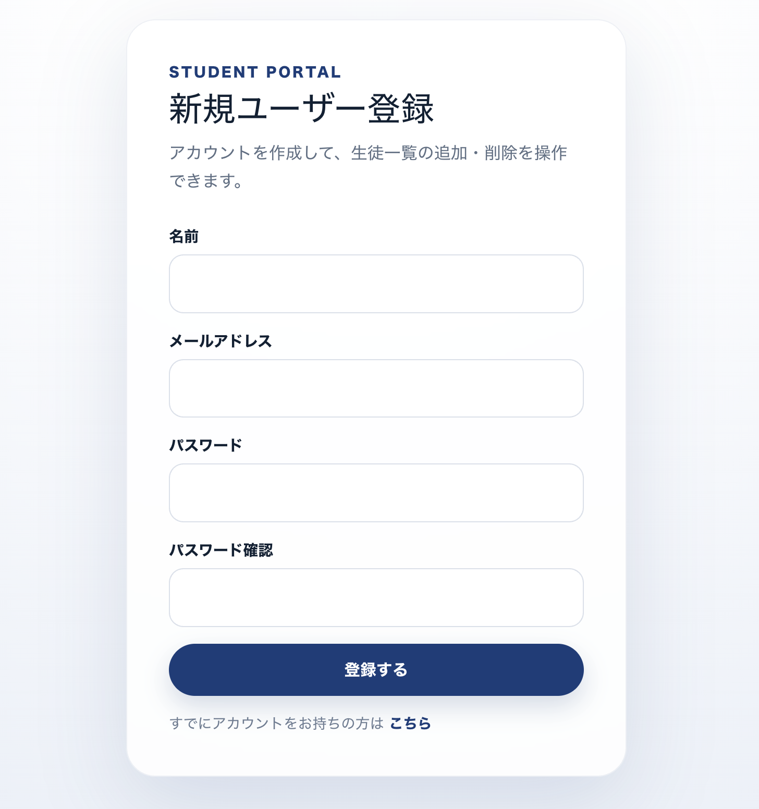
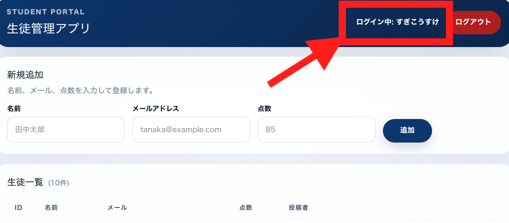
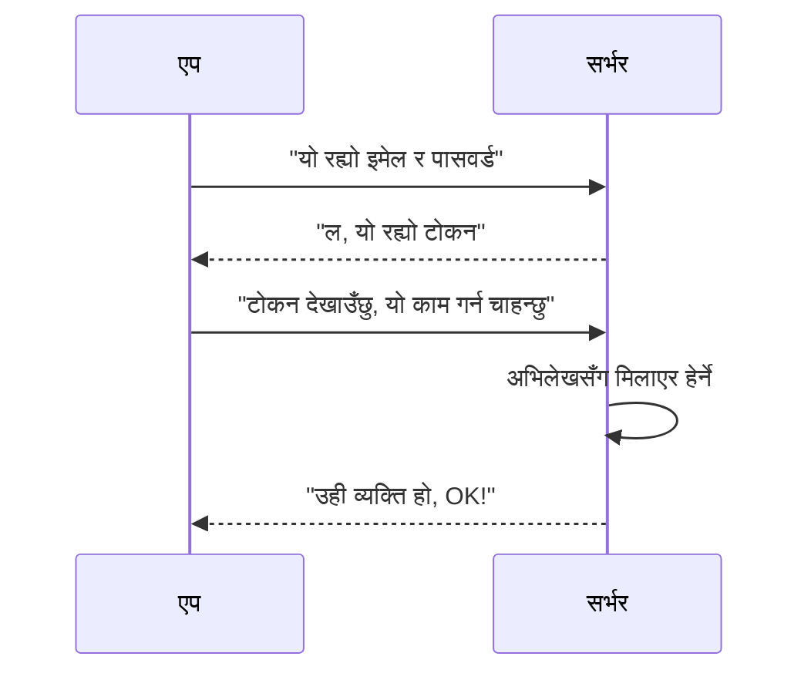
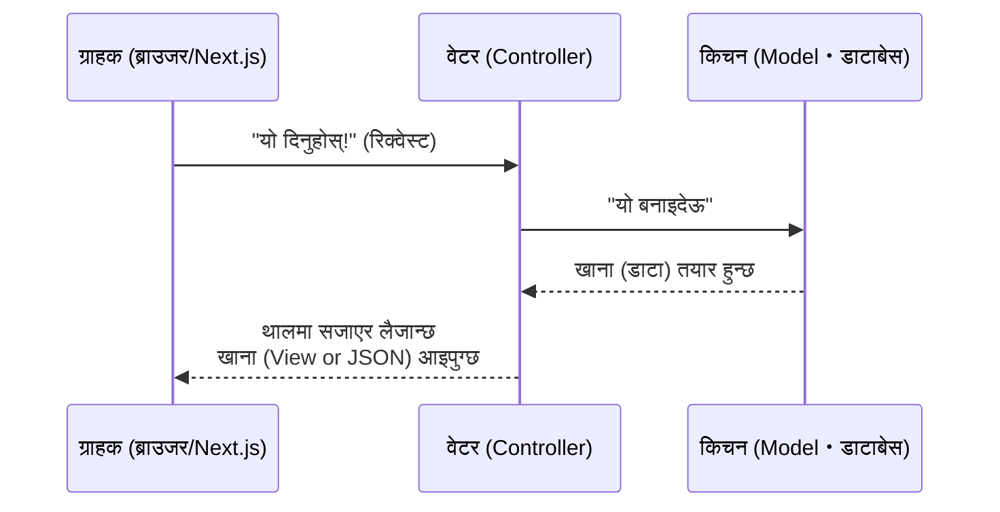

# कक्षा 23｜नयाँ प्रयोगकर्ता दर्ता सुविधा थप्ने र अहिलेसम्मको पुनरावलोकन

> 🇯🇵 मूल प्रति (जापानी भाषामा): [2026_07_09.md](<../../../2年生_システム開発実践/前期/2026_07_09/2026_07_09.md>) <!-- original-ja-link -->

---

# यहाँसम्मको काम पूरा गरिसकेका विद्यार्थीहरूले अब नयाँ प्रयोगकर्ता दर्ता स्क्रिन बनाऔँ

अहिले लगइन स्क्रिन मात्र छ, त्यसैले नयाँ विद्यार्थी थप्न चाहने मान्छे स्क्रिनभित्र छिर्न सक्दैन।

## के बनाउने

तलको तस्बिरजस्तै "नयाँ प्रयोगकर्ता दर्ता" स्क्रिन बनाउनेछौँ। नयाँ खाता बनाउन मिल्ने बनाएपछि, पहिलो पटक आउने मान्छेले पनि आफैँ खाता बनाएर लगइन गर्न सक्छ।



नयाँ दर्ता गरिएको प्रयोगकर्ताको खाताबाट लगइन गर्न सकियो भने OK!!!



## स्क्रिनमा चाहिने तत्वहरू

- **नाम** लेख्ने ठाउँ
- **इमेल ठेगाना** लेख्ने ठाउँ
- **पासवर्ड** लेख्ने ठाउँ
- **पासवर्ड पुष्टि** लेख्ने ठाउँ (टाइप गर्दा गल्ती हुन नदिन उही पासवर्ड फेरि एक पटक लेख्न लगाउने)
- **दर्ता गर्ने बटन**
- "पहिल्यै खाता भएकाहरू यहाँ क्लिक गर्नुहोस्" भन्ने लगइन स्क्रिनमा जाने लिंक

## बनाउने संकेत (अहिलेसम्म सिकेका कुरासँग जोडिएको छ)

- यो स्क्रिनले गर्न खोजेको काम CRUD को **Create (नयाँ प्रयोगकर्ता बनाउने)** अन्तर्गत पर्छ। Laravel तिर यो काम `store()` मा पर्छ
- Next.js को **फारम** मा प्रयोगकर्ताले लेखेको नाम, इमेल र पासवर्डलाई Laravel API तिर पठाउँछौँ (POST)
- Laravel तिरको **Controller** ले पाएको डाटालाई भ्यालिडेसन (पासवर्ड र पासवर्ड पुष्टि मिल्छ कि मिल्दैन, इमेल दोहोरिएको छ कि छैन आदि) गरेपछि, **Model** मार्फत डाटाबेसमा सेभ गर्छ
- दर्ता सफल भएपछि सिधै लगइन स्क्रिनमा पठाउने (वा लगत्तै लगइन गराएर **टोकन** जारी गर्ने), यस्तो क्रम बनाउँदा स्वाभाविक हुन्छ

---

# अहिलेसम्मको पुनरावलोकन (बोर्डमा लेखेर बुझाउँछु!)

## 1. टोकन कसरी काम गर्छ

एपको सर्भरले धेरै मान्छेबाट रिक्वेस्ट (अनुरोध) पाउँछ। त्यस बेला "के यो साँच्चै लगइन गरेको व्यक्ति आफैँको अनुरोध हो?" भनेर जाँच्नुपर्छ। यो जाँचका लागि प्रयोग हुने "गोप्य शब्दको कार्ड" जस्तो चिज नै **टोकन** हो।

### मनोरञ्जन पार्कको रिस्टब्यान्डको उदाहरणबाट बुझौँ

मनोरञ्जन पार्कमा छिर्दा टिकट देखाएपछि "रिस्टब्यान्ड" पाइन्छ, होइन र? त्यसपछि हरेक राइड चढ्दा टिकट फेरि देखाउनु पर्दैन, **रिस्टब्यान्ड मात्र देखाए पुग्छ**, अनि "यो मान्छे भित्र छिरिसकेको ग्राहक हो" भनेर थाहा हुन्छ।

टोकनले पनि ठ्याक्कै यही काम गर्छ।

```
   [टिकट काउन्टरमा प्रवेशका लागि अनुरोध]
          ↓
   कर्मचारी "ठिक छ, यो लिनुहोस् रिस्टब्यान्ड"
          ↓
   ★ रिस्टब्यान्ड हातमा लगाउने ★
          ↓
   त्यसपछि हरेक राइड चढ्दा
   रिस्टब्यान्ड मात्र देखाए पुग्छ!
```

### एपको संसारमा पनि उस्तै क्रम

1. **लगइन**: इमेल ठेगाना र पासवर्ड पठाएर "म हुँ" भनेर जानकारी दिने
2. **टोकन पाउने**: सर्भरले व्यक्तिको पहिचान पुष्टि गरेपछि गोप्य शब्दको कार्ड (टोकन) जारी गरिदिन्छ
3. **कार्ड राखिराख्ने**: पाएको टोकनलाई एपतिर सुरक्षित राख्ने
4. **कार्ड देखाउने**: केही काम गर्दा हरेक पटक त्यो टोकन पनि सँगै पठाउने
5. **सर्भरले जाँच्ने**: "यो टोकन पक्कै लगइन गरिसकेको व्यक्तिकै हो" भनेर मिलाएर OK दिने

यो क्रमलाई चित्रमा देखाउँदा यस्तो हुन्छ।



### सम्झिराख्नुपर्ने कुरा

- टोकन भनेको गोप्य शब्दजस्तै हो। **अरूलाई देखाएमा वा चोरी भएमा, अरू कसैले तपाईंको पहिचान प्रयोग गरेर तपाईं बनेर काम गर्न सक्छ**, त्यसैले होसियारीसाथ राख्नुहोस्
- "लगआउट गर्नु" = सर्भरको अभिलेखमा "यो टोकन अब अमान्य छ" भनेर दर्ज गर्नु
- हरेक पटक यो जाँच मान्छेले गर्नु गाह्रो हुने भएकाले, Laravel मा `auth:sanctum` भन्ने व्यवस्थाले आफैँ जाँचिदिन्छ

### टोकन डेभलपर टुल्समा हेर्न सकिन्छ

वास्तवमा, आफ्नो एपसँग अहिले कस्तो टोकन छ भन्ने कुरा **ब्राउजरको डेभलपर टुल्स (DevTools) खोलेर हेर्न सकिन्छ**।

- **Application ट्याब (Chrome को हकमा)** → `Local Storage` हेर्दा सेभ भएको टोकनको स्ट्रिङ देख्न सकिन्छ
- **Network ट्याब** → API मा रिक्वेस्ट पठाउँदाको कम्युनिकेसन हेर्दा, `Authorization: Bearer ○○○` भन्ने हेडरमा वास्तविक टोकन राखिएको देख्न सकिन्छ

"टोकन ठिकसँग पाइएको छ कि छैन", "रिक्वेस्टमा सही तरिकाले जोडिएको छ कि छैन" भन्ने थाहा नभएमा, पहिले डेभलपर टुल्समा हेर्ने बानी बसाल्नुभयो भने बगको कारण पत्ता लगाउन सजिलो हुन्छ।

### वास्तविक JavaScript कोड

तलको कोड **Laravel तिर होइन, Next.js तिर (फ्रन्टएन्ड) लेख्ने कोड** हो। वेटर (Controller) लाई अनुरोध गर्ने पक्ष, अर्थात् "ग्राहक" को कोड हो भनेर कल्पना गर्नुहोस्।

#### 1. लगइन गरेर टोकन पाउने र सेभ गर्ने

```javascript
async function login(email, password) {
  const response = await fetch('http://localhost:8000/api/login', {
    method: 'POST',
    headers: {
      'Content-Type': 'application/json',
    },
    body: JSON.stringify({ email, password }),
  });

  const data = await response.json();

  // सर्भरबाट आएको टोकनलाई ब्राउजरमा सेभ गरेर राख्ने
  localStorage.setItem('token', data.token);
}
```

#### 2. सेभ गरेको टोकन जोडेर API कल गर्ने

```javascript
async function fetchMyProfile() {
  // अघि सेभ गरेर राखेको टोकन निकाल्ने
  const token = localStorage.getItem('token');

  const response = await fetch('http://localhost:8000/api/user', {
    method: 'GET',
    headers: {
      // यहाँ "गोप्य शब्दको कार्ड" देखाएजस्तै गरी टोकन जोड्ने
      Authorization: `Bearer ${token}`,
    },
  });

  const data = await response.json();
  console.log(data);
}
```

#### 3. लगआउट गर्ने (टोकन अमान्य बनाउने)

```javascript
async function logout() {
  const token = localStorage.getItem('token');

  await fetch('http://localhost:8000/api/logout', {
    method: 'POST',
    headers: {
      Authorization: `Bearer ${token}`,
    },
  });

  // ब्राउजरतिर बाँकी रहेको टोकन पनि मेटाउने
  localStorage.removeItem('token');
}
```

`Authorization: Bearer ${token}` भन्ने भाग नै "रिस्टब्यान्ड देखाउने" काम हो। यस्तो गरी हेडर नजोडे सर्भरलाई "कसको रिक्वेस्ट हो थाहा भएन" भन्ने हुन्छ, त्यसैले 401 एरर (प्रमाणीकरण एरर) फर्किन्छ।

## 2. CRUD बारे

CRUD भनेको एपले डाटामाथि गर्ने **४ वटा आधारभूत काम** का पहिलो अक्षर जोडेर बनेको शब्द हो। कापीलाई सम्झेर हेर्दा बुझ्न सजिलो हुन्छ।

| पहिलो अक्षर | काम | कापीको उदाहरणमा |
|------|------|------------------|
| **C**reate (बनाउने) | नयाँ डाटा थप्ने | कापीमा नयाँ पाना लेख्ने |
| **R**ead (पढ्ने) | डाटा हेर्ने | लेखेको पाना फेरि पढ्ने |
| **U**pdate (अपडेट गर्ने) | डाटा परिवर्तन गर्ने | लेखेको कुरा मेटाएर फेरि लेख्ने |
| **D**elete (मेटाउने) | डाटा हटाउने | पाना च्यातेर फाल्ने |

```
      ┌─────────── कापी (डाटाबेस) ───────────┐
      │                                             │
 Create│ नयाँ पाना थप्ने →  [ पहिलो पाना ]        │
      │                                             │
  Read │ पढ्ने            →  "हो हो, यही हो"    │
      │                                             │
Update │ फेरि लेख्ने         →  [ पहिलो पाना (सच्याइएको) ]  │
      │                                             │
Delete │ च्यातेर फाल्ने     →  (पाना हराउँछ)      │
      └─────────────────────────────────────────────┘
```

### किन महत्त्वपूर्ण छ?

- सूचना बोर्ड, अनलाइन पसल, सोसल मिडिया, टास्क व्यवस्थापन एप... प्रायः सबै एप "डाटा बनाउने, हेर्ने, सच्याउने र मेटाउने" कै संयोजनले बनेका हुन्छन्
- Laravel मा `Route::apiResource` भन्ने सुविधाजनक फिचर छ, जसले यी ४ वटा (वास्तवमा ५ वटा) काम एकैचोटि तयार गरिदिन्छ

```php
Route::apiResource('users', UserController::class);
// यो एक लाइनले मात्र "बनाउने, हेर्ने, सच्याउने र मेटाउने" सबै बाटाहरू जोडिन्छन्
```

CRUD लाई ध्यानमा राख्दा "यो बटन केका लागि हो" भन्ने कुरा टिमका जोकोहीलाई पनि बुझाउन सजिलो हुन्छ।

## 3. Laravel को MVC मोडेल बारे

Laravel को एपलाई **रेस्टुरेन्ट** सँग तुलना गर्दा कल्पना गर्न सजिलो हुन्छ। जिम्मेवारी प्रस्ट बाँडिएको हुनाले धेरै मान्छे मिलेर काम गर्दा पनि अलमल हुँदैन।

### रेस्टुरेन्टका भूमिकाबाट बुझौँ

- **Controller (कन्ट्रोलर) = वेटर**: ग्राहक (रिक्वेस्ट) बाट अर्डर लिने, किचनलाई भन्ने, अनि तयार भएको खाना ग्राहकसम्म पुर्‍याउने व्यक्ति
- **Model (मोडेल) = किचन र फ्रिज**: सामग्री (डाटा) राख्ने र वास्तवमा खाना (डाटा निकाल्ने र सेभ गर्ने) बनाउने ठाउँ
- **View (भ्यू) = थालमा सजाइएको खाना**: ग्राहकको अगाडि आइपुग्ने अन्तिम रूप

अर्डरदेखि खाना आइपुग्दासम्मको क्रमलाई चित्रमा देखाउँदा यस्तो हुन्छ।



### API बनाउँदा के फरक पर्छ?

API बनाउनुअघि, वेटर (Controller) ले किचनबाट पाएको खानालाई **रेस्टुरेन्टभित्रै** सजाएर ग्राहकको अगाडि राख्थ्यो (Blade ले स्क्रिन बनाउने)।

API बनाएपछि, वेटर (Controller) ले **सजाउने काम गर्दैन, सामग्री र बनाउने तरिका (JSON डाटा) मात्र** ग्राहकलाई दिन्छ। अनि वास्तवमा रूप तयार गर्ने (थालमा सजाउने) काम Next.js तिरले गर्छ।

अर्थात् "अर्डर लिने र किचनसँग कुरा गर्ने" भन्ने वेटरको आधारभूत काम परिवर्तन हुँदैन, **अन्तिम सजावट (स्क्रिनको रूप बनाउने काम) मात्र Next.js तिर सरेको हो** भनेर कल्पना गर्दा बुझ्न सजिलो हुन्छ।

