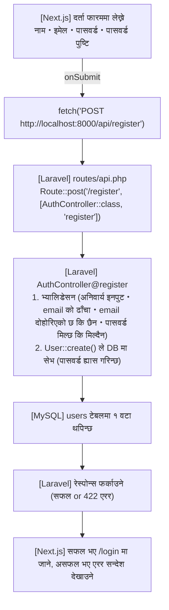

# नयाँ प्रयोगकर्ता दर्ता स्क्रिन बनाउने क्रम

> 🇯🇵 मूल प्रति (जापानी भाषामा): [2026_07_09_2.md](<../../../2年生_システム開発実践/前期/2026_07_09/2026_07_09_2.md>) <!-- original-ja-link -->

यो डकुमेन्ट कक्षा 23 को असाइनमेन्ट "नयाँ प्रयोगकर्ता दर्ता स्क्रिन बनाउने" आफैँ अभ्यास गर्दै पूरा गर्नका लागि चरणबद्ध मार्गदर्शन हो।  
`2026_07_09.md` मा दिइएको काम, अहिलेसम्मका कक्षा (कक्षा 17〜22) मा बनाएको `school-frontend` प्रोजेक्टमाथि लागू गर्दै जानेछौँ।

---

## 0. समग्र चित्र: केसँग के जोडिन्छ

दर्ता स्क्रिन "नयाँ रेकर्ड एउटा बनाउने" सुविधा भएकाले, यो CRUD को **Create** अन्तर्गत पर्छ।  
प्रक्रिया लगइन स्क्रिन (कक्षा 17) को जस्तै छ; अनुरोध पठाउने URL र भ्यालिडेसनका नियम मात्र फरक छन्।



`routes/api.php` मा वास्तवमा **कक्षा 08 कै बेला दर्ताका लागि रुट लेखिसकिएको छ।**

```php
// routes/api.php (पहिल्यै लेखिएको हुनुपर्छ)
Route::post('/login', [AuthController::class, 'login']);
Route::post('/register', [AuthController::class, 'register']);
```

तर `AuthController` भित्र `login` / `logout` / `me` मात्र बनाइएको छ, त्यसैले  
**`register()` मेथड अहिलेसम्म बनाइएको छैन।** आज हामी यही मेथड बनाएर सुरु गर्छौँ।

---

## 1. Laravel तिर: `register()` बनाउने

`app/Http/Controllers/Api/AuthController.php` खोलेर, `login()` मेथडको नजिकै थप्नुहोस्।

```php
// app/Http/Controllers/Api/AuthController.php
use App\Models\User;
use Illuminate\Support\Facades\Hash;

// POST /api/register
public function register(Request $request)
{
    // ① इनपुट जाँच
    $validated = $request->validate([
        'name'     => 'required|string|max:255',
        'email'    => 'required|email|unique:users,email',
        'password' => 'required|min:8|confirmed',
    ]);

    // ② प्रयोगकर्ता बनाउने (पासवर्ड अनिवार्य रूपमा ह्यास गर्ने)
    $user = User::create([
        'name'     => $validated['name'],
        'email'    => $validated['email'],
        'password' => Hash::make($validated['password']),
    ]);

    // ③ सिधै लगइन गराउन चाहेकाले टोकन पनि जारी गरेर फर्काउने
    $token = $user->createToken('api-token')->plainTextToken;

    return response()->json([
        'status' => 'ok',
        'token'  => $token,
        'user'   => $user,
    ], 201); // 201 = नयाँ बनाउन सफल
}
```

### भ्यालिडेसनका मुख्य बुँदा

| नियम | अर्थ |
|--------|------|
| `required` | केही नलेखेमा 422 एरर |
| `email` | इमेलको ढाँचा हो कि होइन जाँच्ने |
| `unique:users,email` | `users` टेबलमा उही इमेल छ कि छैन जाँच्ने (दोहोरो दर्ता रोक्न) |
| `min:8` | पासवर्ड ८ अक्षर वा बढी |
| `confirmed` | **"उही नाम + `_confirmation`" भएको फिल्डसँग मान मिल्छ कि मिल्दैन** भनेर आफैँ जाँच्ने विशेष नियम |

`confirmed` नियम प्रयोग गर्दा, फ्रन्टएन्डबाट पठाउने key को नाम अनिवार्य रूपमा यसरी राख्नुपर्छ।

```json
{
  "name": "田中太郎",
  "email": "tanaka@example.com",
  "password": "password123",
  "password_confirmation": "password123"
}
```

`password_confirmation` भन्ने नाममा एउटा अक्षर मात्र गल्ती भए पनि `confirmed` नियमले काम गर्दैन, र "मिलेको छ तर पनि एरर आउँछ" भन्ने बगको कारण बन्छ, त्यसैले ध्यान दिनुहोस्।

---

## 2. Next.js तिर: `/register` पेज बनाउने

`app/register/` फोल्डर बनाएर, `page.tsx` नयाँ बनाउनुहोस्।

```
app/register/page.tsx  ← नयाँ बनाउने
```

लगइन पेज (कक्षा 17) कै संरचनामा बनाउँछौँ। **फरक भनेको इनपुट गर्ने कुराहरू र पठाउने ठाउँ मात्र हो।**

```tsx
"use client";

import { useState } from "react";
import { useRouter } from "next/navigation";

export default function RegisterPage() {
  const router = useRouter();
  const [name, setName] = useState("");
  const [email, setEmail] = useState("");
  const [password, setPassword] = useState("");
  const [passwordConfirmation, setPasswordConfirmation] = useState("");
  const [error, setError] = useState("");
  const [loading, setLoading] = useState(false);

  async function handleSubmit(e) {
    e.preventDefault();
    setError("");
    setLoading(true);

    const res = await fetch("http://localhost:8000/api/register", {
      method: "POST",
      headers: {
        "Content-Type": "application/json",
        "Accept": "application/json",
      },
      // ★ key को नाम Laravel तिरको भ्यालिडेसनसँग मिलाउने
      body: JSON.stringify({
        name,
        email,
        password,
        password_confirmation: passwordConfirmation,
      }),
    });

    const data = await res.json();
    setLoading(false);

    if (res.ok) {
      // ★ सिधै लगइन अवस्थामा राख्ने (टोकन सेभ गरेर /students मा)
      localStorage.setItem("token", data.token);
      localStorage.setItem("userName", data.user?.name || "ユーザー");
      router.push("/students");
    } else if (data.errors) {
      // कक्षा 21 मा सिकेजस्तै, Laravel को भ्यालिडेसन एरर देखाउने
      const messages = Object.values(data.errors).flat().join(" / ");
      setError(messages);
    } else {
      setError(`エラーが発生しました（HTTP ${res.status}）`);
    }
  }

  return (
    <div style={{
      maxWidth: "400px", margin: "80px auto",
      background: "white", padding: "32px",
      borderRadius: "8px", boxShadow: "0 2px 8px rgba(0,0,0,0.1)"
    }}>
      <h2 style={{ marginBottom: "24px", textAlign: "center" }}>新規ユーザー登録</h2>

      <form onSubmit={handleSubmit}>
        <div style={{ marginBottom: "16px" }}>
          <label style={{ display: "block", marginBottom: "6px", fontWeight: "bold" }}>名前</label>
          <input
            type="text"
            value={name}
            onChange={(e) => setName(e.target.value)}
            style={{ width: "100%", padding: "10px", border: "1px solid #ccc", borderRadius: "6px", fontSize: "1em", boxSizing: "border-box" }}
          />
        </div>

        <div style={{ marginBottom: "16px" }}>
          <label style={{ display: "block", marginBottom: "6px", fontWeight: "bold" }}>メールアドレス</label>
          <input
            type="email"
            value={email}
            onChange={(e) => setEmail(e.target.value)}
            style={{ width: "100%", padding: "10px", border: "1px solid #ccc", borderRadius: "6px", fontSize: "1em", boxSizing: "border-box" }}
          />
        </div>

        <div style={{ marginBottom: "16px" }}>
          <label style={{ display: "block", marginBottom: "6px", fontWeight: "bold" }}>パスワード</label>
          <input
            type="password"
            value={password}
            onChange={(e) => setPassword(e.target.value)}
            style={{ width: "100%", padding: "10px", border: "1px solid #ccc", borderRadius: "6px", fontSize: "1em", boxSizing: "border-box" }}
          />
        </div>

        <div style={{ marginBottom: "16px" }}>
          <label style={{ display: "block", marginBottom: "6px", fontWeight: "bold" }}>パスワード確認</label>
          <input
            type="password"
            value={passwordConfirmation}
            onChange={(e) => setPasswordConfirmation(e.target.value)}
            style={{ width: "100%", padding: "10px", border: "1px solid #ccc", borderRadius: "6px", fontSize: "1em", boxSizing: "border-box" }}
          />
        </div>

        {error && (
          <p style={{ color: "#D32F2F", fontSize: "0.9em", marginBottom: "12px" }}>
            {error}
          </p>
        )}

        <button
          type="submit"
          disabled={loading}
          style={{ width: "100%", padding: "12px", background: loading ? "#aaa" : "#1976D2", color: "white", border: "none", borderRadius: "6px", fontSize: "1em", fontWeight: "bold", cursor: loading ? "not-allowed" : "pointer" }}
        >
          {loading ? "登録中..." : "登録する"}
        </button>

        <p style={{ textAlign: "center", marginTop: "16px", fontSize: "0.9em" }}>
          すでにアカウントをお持ちの方は{" "}
          <a href="/login" style={{ color: "#1976D2", fontWeight: "bold" }}>こちら</a>
        </p>
      </form>
    </div>
  );
}
```

### लगइन पेज (कक्षा 17) सँगको फरक

| | `/login` (कक्षा 17) | `/register` (यस पटक) |
|--|--|--|
| इनपुट गर्ने कुराहरू | इमेल・पासवर्ड | नाम・इमेल・पासवर्ड・पासवर्ड पुष्टि |
| पठाउने ठाउँ | `POST /api/login` | `POST /api/register` |
| सफल हुँदाको रेस्पोन्स | `{ token, user }` | `{ token, user }` (उही ढाँचा) |
| असफल हुँदा देखाउने कुरा | निश्चित सन्देश (401) | Laravel को भ्यालिडेसन सन्देश (422) |
| सफल भएपछि जाने ठाउँ | `/students` | `/students` (दर्तासँगै लगइन भएको मान्ने) |

---

## 3. लगइन स्क्रिन र दर्ता स्क्रिनलाई एकअर्कामा लिंक गर्ने

असाइनमेन्टको स्पेसिफिकेसन (`2026_07_09.md`) मा भनेजस्तै, दर्ता स्क्रिनमा 「すでにアカウントをお持ちの方はこちら」(पहिल्यै खाता भएकाहरू यहाँ) भन्ने लगइन स्क्रिनमा जाने लिंक चाहिन्छ (माथिको कोडको अन्तिम भागमा पहिल्यै थपिसकिएको छ)।

साथै, लगइन स्क्रिनतिर पनि दर्ता स्क्रिनमा जाने लिंक थपिदिनुभयो भने प्रयोगकर्ता नअलमलिई यताउता जान सक्छ।

```tsx
// app/login/page.tsx को <form> को सबैभन्दा तल थप्ने
<p style={{ textAlign: "center", marginTop: "16px", fontSize: "0.9em" }}>
  アカウントをお持ちでない方は{" "}
  <a href="/register" style={{ color: "#1976D2", fontWeight: "bold" }}>こちら</a>
</p>
```

---

## 4. दुवै सर्भर चलाएर काम गर्छ कि गर्दैन जाँच्ने

```bash
# टर्मिनल ① Laravel
cd (Laravel प्रोजेक्टको फोल्डर)
php artisan serve

# टर्मिनल ② Next.js
cd school-frontend
npm run dev
```

### जाँच गर्ने चेकलिस्ट

| जाँच्ने कुरा | गर्ने काम | अपेक्षित नतिजा |
|---------|------|------------|
| स्क्रिन देखिने | `http://localhost:3000/register` खोल्ने | नाम・इमेल・पासवर्ड・पासवर्ड पुष्टि लेख्ने ठाउँ देखिन्छ |
| सामान्य दर्ता | सबै सही लेखेर 「登録する」(दर्ता गर्ने) थिच्ने | `/students` मा पुगिन्छ र लगइन भएको अवस्था हुन्छ |
| इमेल दोहोरिएको | पहिल्यै दर्ता भएको इमेल ठेगानाले दर्ता गर्ने | "The email has already been taken." जस्ता एरर देखिन्छ |
| पासवर्ड नमिलेको | पासवर्ड र पासवर्ड पुष्टिमा फरक मान राख्ने | "The password confirmation does not match." देखिन्छ |
| केही नलेखेको | केही नलेखी पठाउने | हरेक फिल्डको "required" एरर देखिन्छ |
| स्क्रिन परिवर्तन (दर्ता→लगइन) | 「すでにアカウントをお持ちの方はこちら」(पहिल्यै खाता भएकाहरू यहाँ) थिच्ने | `/login` मा पुगिन्छ |
| स्क्रिन परिवर्तन (लगइन→दर्ता) | लगइन स्क्रिनको 「こちら」(यहाँ) थिच्ने | `/register` मा पुगिन्छ |
| लगइन जाँच | नयाँ दर्ता गरेको इमेल र पासवर्डले फेरि लगइन गर्ने | लगइन सफल हुन्छ |

---

## सारांश: यस पटक गरेको कामको समग्र सन्दर्भ

| अहिलेसम्म | यस पटक थपेको भाग |
|--|--|
| `routes/api.php` मा `/register` को बाटो पहिल्यै तयार थियो (कक्षा 08) | `AuthController` मा `register()` को भित्री भाग (भ्यालिडेसन + `User::create`) बनायौँ |
| `/login` पेज पहिल्यै थियो (कक्षा 17) | उही बनावटमा `/register` पेज नयाँ बनायौँ |
| 422 एरर देखाउने तरिका कक्षा 21 मा पहिल्यै सिकिसकेका थियौँ | उही तरिका प्रयोग गरेर दर्ता फारममा एरर देखाउने व्यवस्था गर्‍यौँ |

यस असाइनमेन्टको मुख्य बुँदा के हो भने, यसमा लगभग कुनै नयाँ अवधारणा छैन; **CRUD को Create・Controller/Model・भ्यालिडेसन・टोकन जारी गर्ने** जस्ता अघिल्ला कक्षाहरूमा सिकेका कुराहरू संयोजन गरेरै यो बनाउन सकिन्छ।
