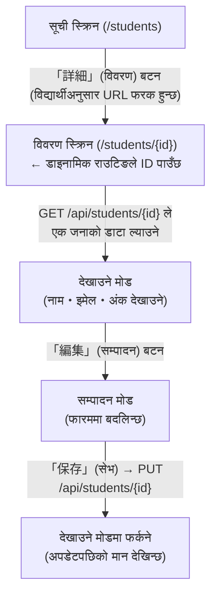
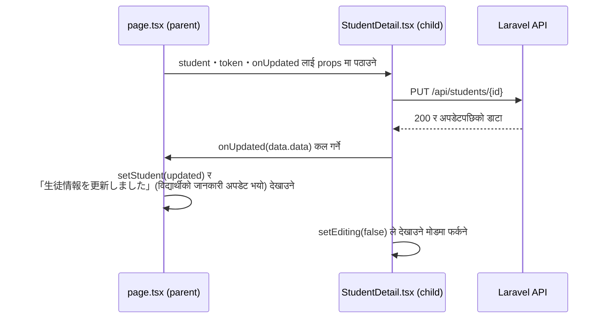

# कक्षा 24｜विवरण स्क्रिन बनाउने - कार्यान्वयन चरणहरू

> 🇯🇵 मूल प्रति (जापानी भाषामा): [2026_07_16_実装.md](<../../../2年生_システム開発実践/前期/2026_07_16/2026_07_16_実装.md>) <!-- original-ja-link -->

## आजको लक्ष्य

- सूची स्क्रिनको 「詳細」(विवरण) बटनबाट, त्यो एक जना विद्यार्थीको मात्र जानकारी देखाउने स्क्रिनमा जान सक्ने
- विवरण स्क्रिनको 「編集」(सम्पादन) बटनले त्यहीँ फारममा बदलेर अपडेट गर्न सक्ने
- Laravel तिर अपडेट गर्ने API endpoint (`PUT /api/students/{id}`) तयार गर्न सक्ने

> **भूमिका:** सूची स्क्रिन (`GET /api/students`) सबै विद्यार्थीको जानकारी एकैचोटि हेर्ने स्क्रिन हो भने, विवरण स्क्रिन ID बाट निर्दिष्ट गरिएको एक जना विद्यार्थीको जानकारी मात्र हेर्ने र सच्याउने स्क्रिन हो। यसमा CRUD का **Read (एउटा रेकर्ड हेर्ने)** र **Update (अपडेट गर्ने)** कार्यहरू एउटै स्क्रिनमा मोड बदलेर गर्न सकिन्छ।

---

## समग्र चित्र: के बनाउने



### किन यही क्रममा बनाउने

> 💡 **उदाहरण दिँदा… पसलको "व्यक्तिगत अर्डर कार्ड"**
>
> सूची स्क्रिनलाई "आजको बुकिङ सूची" मान्ने हो भने, विवरण स्क्रिन एक जना ग्राहकको मात्र "व्यक्तिगत अर्डर कार्ड" हो। कार्डलाई सिधै परिवर्तन (सम्पादन) गर्न, पहिले पसलतिर (Laravel) "यो कार्ड निकाल्ने" काउन्टर (`GET /api/students/{id}`) र "परिवर्तन स्वीकार गर्ने" काउन्टर (`PUT /api/students/{id}`) नभई काम सुरु नै हुँदैन।

ब्याकएन्डको अपडेट API नभए, फ्रन्टएन्डमा सम्पादन फारम बनाए पनि सेभ गर्ने ठाउँ हुँदैन र काम गर्छ कि गर्दैन जाँच्न सकिँदैन। त्यसैले **ब्याकएन्ड (API) → सूचीबाट जाने बाटो → विवरण स्क्रिन (देखाउने) → सम्पादन मोड** को क्रममा, सानो-सानो बनाउँदै हरेक पटक चलाएर हेर्दै अगाडि बढ्छौँ।

### फाइल संरचना (यस पटक प्रयोग वा परिवर्तन गरिने फाइलहरू)

| चिन्ह | अर्थ |
|---|---|
| 🆕 नयाँ | फाइल नयाँ बनाउने |
| ➕ थप्ने | भइरहेको फाइलमा कोड थप्ने |
| 👀 जाँच | परिवर्तन चाहिँदैन। पहिल्यै बनेको छ कि छैन जाँच्ने मात्र |

```
Laravel/
├── app/Http/Requests/UpdateStudentRequest.php      🆕 नयाँ
├── app/Http/Controllers/Api/StudentController.php  ➕ update() थप्ने
└── routes/api.php                                  👀 जाँच मात्र

school-frontend/
├── components/students/StudentList.tsx             ➕ विवरण लिंक थप्ने
├── components/students/StudentDetail.tsx           🆕 नयाँ (देखाउने⇔सम्पादन)
└── app/students/[id]/page.tsx                       🆕 नयाँ → पछिल्लो भागमा ➕ थप्ने (डाइनामिक राउटिङ)
```

---

## Step 1｜ब्याकएन्ड: अपडेट API थप्ने

सूची, विवरण ल्याउने र मेटाउने API पहिल्यै छन्, तर "१ वटालाई परिवर्तन गर्ने" काउन्टर अझै छैन। यसलाई सबैभन्दा पहिले बनाउँछौँ।


### 1-3. `routes/api.php` जाँच्ने

**👀 जाँच मात्र (प्रायः परिवर्तन चाहिँदैन)** — `Route::apiResource('students', StudentController::class)` मा सुरुकै अवस्थामा `update` पनि समावेश हुन्छ। `->only([...])` ले सीमित गरेको अवस्थामा **मात्र** `update` थप्नुहोस्।

```php
Route::middleware('auth:sanctum')->group(function () {
    Route::post('/logout', [AuthController::class, 'logout']);
    Route::get('/me', [AuthController::class, 'me']);
    Route::apiResource('students', StudentController::class);
    
    // only भएको छ कि छैन भन्ने मात्र जाँच्ने
    // Route::apiResource('students', StudentController::class)->only(['index', 'show']);
});
```

### 1-4. काम गर्छ कि गर्दैन जाँच्ने

```bash
cd Laravel && php artisan serve
```

लगइन गरेर टोकन पाएपछि, `curl` ले अपडेट API लाई सिधै कल गरेर हेरौँ।

⚠️ Windows (PowerShell) प्रयोग गर्नेहरूका लागि सावधानी
PowerShell मा त्यसै curl प्रयोग गर्दा एरर आउँछ। अनिवार्य रूपमा सुरुमा curl.exe लेख्नुहोस्, वा टर्मिनलमा cmd लेखेर "कमान्ड प्रम्प्ट" मा बदलेपछि मात्र चलाउनुहोस्। साथै, डाटाभित्रको डबल कोटेसन (\") लाई escape गर्नुपर्छ।
```bash
curl -X PUT http://localhost:8000/api/students/1 \
  -H "Authorization: Bearer <पाएको टोकन>" \
  -H "Content-Type: application/json" \
  -H "Accept: application/json" \
  -d '{"name":"テスト太郎","email":"test-taro@example.com","score":80}'
```

| जाँच्ने कुरा | गर्ने काम | अपेक्षित नतिजा |
|---|---|---|
| अपडेट सफल | माथिको curl चलाउने | 200 फर्किन्छ, र अपडेटपछिको नाम・इमेल・अंक JSON मा समावेश हुन्छ |
| भ्यालिडेसन | `score` मा `200` राखेर चलाउने | 422 फर्किन्छ |
| प्रमाणीकरण अनिवार्य | `Authorization` हेडर हटाएर चलाउने | 401 फर्किन्छ |
| अस्तित्वमा नभएको ID | `/api/students/9999` मा चलाउने | 404 फर्किन्छ |

---

## Step 2｜फ्रन्टएन्ड: सूचीबाट विवरणमा जाने बाटो

`school-frontend/components/students/StudentList.tsx` सम्पादन गर्नुहोस्।

### किन चाहिन्छ

सूचीको हरेक पङ्क्तिबाट "यो विद्यार्थीको मात्र URL" मा जान नसके, विवरण स्क्रिन बनाए पनि त्यहाँ पुग्ने उपाय हुँदैन। **विद्यार्थीको ID लाई त्यसै URL को एक भागमा राख्नु** नै मुख्य कुरा हो।

**➕ थप्ने (भइरहेको फाइलको सुरुमा)** — `import` थप्नुहोस्।

```tsx
// ▼ StudentList.tsx को सुरुमा थप्ने
"use client";

import Link from "next/link";
```

**➕ थप्ने (भइरहेको फाइल)** — `bodyCell` को तलतिर, विवरण लिंकको स्टाइल थप्नुहोस्।

```tsx
// स्टाइल constant (बारम्बार प्रयोग हुने style लाई एकै ठाउँमा राख्ने)
const thStyle = { padding: "10px 16px", textAlign: "left", fontWeight: "bold", fontSize: "0.9em" };
const tdStyle = { padding: "12px 16px", fontSize: "0.95em" };

// ▼ तलतिर थप्ने (विवरण लिंकको स्टाइल)
const detailLinkStyle = {
  display: "inline-flex",
  alignItems: "center",
  justifyContent: "center",
  minWidth: 104,
  padding: "0.85rem 1.25rem",
  borderRadius: 999,
  background: "#163D7A",
  color: "#fff",
  fontWeight: 700,
  fontSize: "0.95rem",
  letterSpacing: "0.01em",
  boxShadow: "0 10px 24px rgba(22, 61, 122, 0.18)",
};
```

**🔁 बदल्ने (भइरहेको फाइल)** — `StudentRow` को अन्तिम `<td>` (कार्य बटनहरूको सेल) लाई तलको कोडले बदल्नुहोस्।

```tsx
// StudentRow: टेबलको १ पङ्क्ति
function StudentRow({ student, onDelete }) {
  function handleDelete() {
    // पुष्टि गर्ने डायलग देखाएपछि मात्र मेटाउने
    if (window.confirm(`${student.name} を削除しますか？`)) {
      onDelete(student.id); // parent कम्पोनेन्टलाई "यो ID मेटाउनुहोस्" भनेर जानकारी दिने
    }
  }

  return (
    <tr style={{ borderBottom: "1px solid #eee" }}>
      <td style={tdStyle}>{student.id}</td>
      <td style={tdStyle}>{student.name}</td>
      <td style={tdStyle}>{student.email}</td>
      <td style={tdStyle}>{student.score}</td>
      <td style={tdStyle}>
      <div style={{ display: "flex", gap: "0.5rem", flexWrap: "wrap" }}>
        <Link href={`/students/${student.id}`} style={detailLinkStyle}>
          詳細
        </Link>
        <button
          onClick={handleDelete}
          style={{ background: "#D32F2F", color: "white", border: "none", borderRadius: "4px", padding: "4px 12px", cursor: "pointer", fontSize: "0.85em" }}
        >
          削除
        </button>
        </div >
      </td>
    </tr>
  );
}
```

### काम गर्छ कि गर्दैन जाँच्ने

```bash
cd school-frontend && npm run dev
```

| जाँच्ने कुरा | गर्ने काम | अपेक्षित नतिजा |
|---|---|---|
| बाटो देखिने | `/students` खोल्ने | हरेक पङ्क्तिमा 「詳細」(विवरण) बटन देखिन्छ |
| स्क्रिन परिवर्तन | 「詳細」(विवरण) बटन क्लिक गर्ने | `/students/{त्यो पङ्क्तिको ID}` मा पुगिन्छ (यस बेला 404 भए पनि OK। Step 3 मा बनाउँछौँ) |

---

## Step 3｜फ्रन्टएन्ड: विवरण स्क्रिन (देखाउने मोड)

**🆕 नयाँ फाइल** — `school-frontend/app/students/[id]/page.tsx` नयाँ बनाउनुहोस् (`[id]` नामको फोल्डर पनि नयाँ बनाउनुहोस्)।

### किन `[id]` भन्ने फोल्डर नाम राख्ने

Next.js मा फोल्डरको नाम `[id]` जस्तै वर्ग कोष्ठकमा राख्दा, URL को त्यो भाग (`/students/3` को `3`) लाई पेजभित्र प्राप्त गर्न सकिने **डाइनामिक राउटिङ** बन्छ।

```tsx
"use client";

import { useState, useEffect } from "react";
import { useRouter, useParams } from "next/navigation";
import Link from "next/link";


export default function StudentDetailPage() {
  const router = useRouter();
  const params = useParams(); // URL को {id} भाग प्राप्त गर्ने
  const [student, setStudent] = useState(null);
  const [userName, setUserName] = useState("");
  const [loading, setLoading] = useState(true);
  const [notFound, setNotFound] = useState(false);
  const [token, setToken] = useState(null); // ★ एररको कारण बनेको "token" को बाकस यहाँ थपियो!

  // ★ useEffect: पेज देखिँदा १ पटक मात्र चल्छ
  useEffect(() => {
    const savedToken = localStorage.getItem("token");

    // टोकन छैन भने लगइन पेजमा फर्काउने
    if (!savedToken) {
      router.push("/login");
      return;
    }

    setToken(savedToken); // ★ पाएको टोकनलाई state मा राम्ररी सेभ गर्ने
    setUserName(localStorage.getItem("userName") || "ユーザー");
    loadStudent(savedToken);
  }, []); // [] = पहिलो १ पटक मात्र चल्ने

  // कुनै एक विद्यार्थीको डाटा API बाट ल्याउने
  async function loadStudent(currentToken) {
    setLoading(true);
    setNotFound(false);
  
    try {
      // URL प्यारामिटरको params.id प्रयोग गरेर Laravel API मा सोध्ने
      const res = await fetch(`http://localhost:8000/api/students/${params.id}`, {
        headers: {
          "Accept": "application/json",
          "Authorization": `Bearer ${currentToken}`, // ★ टोकनलाई हेडरमा जोड्ने
        },
      });

      // 401 = टोकन अमान्य → लगइन पेजमा फर्काउने
      if (res.status === 401) {
        router.push("/login");
        return;
      }

      // 404 = विद्यार्थी भेटिएन
      if (res.status === 404) {
        setStudent(null);
        setNotFound(true);
        return;
      }

      const data = await res.json();
      setStudent(data.data); // Laravel API ले { data: {...} } को रूपमा फर्काउँछ
    } catch (error) {
      console.error("データの取得に失敗しました", error);
    } finally {
      setLoading(false);
    }
  }

  // लगआउट
  async function handleLogout() {
    const currentToken = localStorage.getItem("token");

    await fetch("http://localhost:8000/api/logout", {
      method: "POST",
      headers: {
        "Accept": "application/json",
        "Authorization": `Bearer ${currentToken}`,
      },
    });

    localStorage.removeItem("token");
    localStorage.removeItem("userName");
    router.push("/login");
  }

  // ★ टोकन तयार नहुन्जेल वा लोड नसकिउन्जेल पर्खने
  if (!token || loading) {
    return (
      <div style={{ textAlign: "center", padding: "80px", color: "#888" }}>
        生徒データを読み込んでいます...
      </div>
    );
  }

  return (
    <div style={{ background: "#f4f6f8", minHeight: "100vh" }}>

      {/* हेडर (सूची स्क्रिनसँग उस्तै साझा रूप) */}
      <header style={{
        background: "#1565C0", color: "white",
        padding: "16px 32px",
        display: "flex", alignItems: "center"
      }}>
        <h1 style={{ fontSize: "1.2em" }}>生徒管理アプリ（Next.js API版）</h1>
        <div style={{ marginLeft: "auto", display: "flex", alignItems: "center", gap: "12px" }}>
          <span style={{ fontSize: "0.9em" }}>● ログイン中：{userName}</span>
          <button
            onClick={handleLogout}
            style={{ background: "#D32F2F", color: "white", border: "none", borderRadius: "6px", padding: "6px 14px", cursor: "pointer" }}
          >
            ログアウト
          </button>
        </div>
      </header>

      {/* मुख्य सामग्री */}
      <main style={{ padding: "32px", maxWidth: "640px", margin: "0 auto", display: "grid", gap: "20px" }}>
        
        <Link href="/students" style={{ color: "#1565C0", fontWeight: "bold", textDecoration: "none" }}>
          ← 一覧に戻る
        </Link>


        {/* ★ विद्यार्थी नभेटिएको वा डाटा खाली हुँदाको देखावट */}
        {notFound || !student ? (
          <div style={{
            borderRadius: "8px",
            padding: "40px 24px",
            textAlign: "center",
            background: "white",
            border: "1px solid #ddd",
          }}>
            <p style={{ margin: 0, color: "#888" }}>生徒が見つかりません</p>
          </div>
        ) : (
          /* ★ अब token लाई सही तरिकाले child कम्पोनेन्टमा पठाउन सकिन्छ */
          <section style={{
              background: "white", border: "1px solid #ddd", borderRadius: "8px",
              padding: "24px", boxShadow: "0 4px 12px rgba(0,0,0,0.05)"
            }}>
              <h2 style={{ margin: "0 0 20px 0", fontSize: "1.4em", borderBottom: "2px solid #1565C0", paddingBottom: "8px" }}>
                {student.name}
              </h2>
              
              <dl style={{ display: "grid", gap: "16px", margin: 0 }}>
                <div>
                  <dt style={{ fontSize: "0.9em", color: "#666", marginBottom: "4px" }}>メールアドレス</dt>
                  <dd style={{ margin: 0, fontWeight: "bold", fontSize: "1.1em" }}>{student.email}</dd>
                </div>
                <div>
                  <dt style={{ fontSize: "0.9em", color: "#666", marginBottom: "4px" }}>点数</dt>
                  <dd style={{ margin: 0, fontWeight: "bold", fontSize: "1.1em" }}>{student.score} 点</dd>
                </div>
              </dl>
            </section>
        )}

      </main>

    </div>
  );
}
```

### काम गर्छ कि गर्दैन जाँच्ने

| जाँच्ने कुरा | गर्ने काम | अपेक्षित नतिजा |
|---|---|---|
| देखाउने | लगइनपछि, सूचीको 「詳細」(विवरण) बाट जाने | त्यो विद्यार्थीको नाम・इमेल・अंक मात्र देखिन्छ |
| अस्तित्वमा नभएको ID | `/students/99999` सिधै खोल्ने | 「生徒が見つかりません」(विद्यार्थी भेटिएन) देखिन्छ |
| प्रमाणीकरण नभएको | लगआउट अवस्थामा `/students/1` खोल्ने | `/login` मा रिडाइरेक्ट हुन्छ |

---

## Step 4｜फ्रन्टएन्ड: सम्पादन मोड थप्ने

देखाउने मात्र काम गर्ने विवरण स्क्रिनमा, 「編集」(सम्पादन) बटनले बदलिने फारम थप्छौँ। कक्षा 17〜21 मा बनाएको "फारमबाट इनपुट लिएर पठाउने" सोच त्यसै प्रयोग गर्न सकिन्छ।

### 4-1. `school-frontend/components/students/StudentDetail.tsx` नयाँ बनाउने

**🆕 नयाँ फाइल** — `editing` लाई `useState` मा राखेर, "अहिले देखाउने मोड हो कि सम्पादन मोड" बदल्छौँ।

```tsx
"use client";

import { useState } from "react";

// इनपुट फारमको साझा स्टाइल
const inputStyle = {
  width: "100%",
  borderRadius: "6px",
  border: "1px solid #ddd",
  padding: "10px 12px",
  fontSize: "1rem",
  outline: "none",
  background: "#fff",
  boxSizing: "border-box", // किनाराको रेखा बाहिर ननिस्कने गरी स्थिर राख्ने
};

export default function StudentDetail({ student, token, onUpdated }) {
  const [editing, setEditing] = useState(false); // false = देखाउने मोड, true = सम्पादन मोड
  const [name, setName] = useState(student.name);
  const [email, setEmail] = useState(student.email);
  const [score, setScore] = useState(String(student.score));
  const [error, setError] = useState("");
  const [saving, setSaving] = useState(false);

  function startEditing() {
    // हालको मानले फारम सुरु गरेर सम्पादन मोडमा जाने
    setName(student.name);
    setEmail(student.email);
    setScore(String(student.score));
    setError("");
    setEditing(true);
  }

  function cancelEditing() {
    setError("");
    setEditing(false); // लेखेको कुरा फालेर देखाउने मोडमा फर्कने
  }

  async function handleSubmit(e) {
    e.preventDefault();
    setError("");

    if (!name || !email || !score) {
      setError("すべての項目を入力してください");
      return;
    }

    const scoreNumber = Number(score);
    if (Number.isNaN(scoreNumber) || scoreNumber < 0 || scoreNumber > 100) {
      setError("点数は0〜100の数値を入力してください");
      return;
    }

    setSaving(true);

    try {
      const res = await fetch(`http://localhost:8000/api/students/${student.id}`, {
        method: "PUT",
        headers: {
          "Content-Type": "application/json",
          "Accept": "application/json",
          "Authorization": `Bearer ${token}`,
        },
        body: JSON.stringify({ name, email, score: scoreNumber }),
      });

      if (res.status === 401) {
        window.location.href = "/login";
        return;
      }

      if (res.ok) {
        const data = await res.json();
        onUpdated(data.data); // parent कम्पोनेन्ट (page.tsx) लाई पछिल्लो डाटा पठाएर अपडेट गर्ने
        setEditing(false);
        return;
      }

      if (res.status === 422) {
        const data = await res.json();
        const details = Object.values(data.errors ?? {}).flat().join(" / ");
        setError(details || "入力内容をご確認ください");
        return;
      }

      setError("更新に失敗しました");
    } catch (err) {
      setError("更新に失敗しました");
    } finally {
      setSaving(false);
    }
  }

  // 【1】देखाउने मोड (सम्पादन बटन नथिचेको बेला)
  if (!editing) {
    return (
      <section style={{
        background: "white", border: "1px solid #ddd", borderRadius: "8px",
        padding: "24px", boxShadow: "0 4px 12px rgba(0,0,0,0.05)"
      }}>
        <h2 style={{ margin: "0 0 20px 0", fontSize: "1.4em", borderBottom: "2px solid #1565C0", paddingBottom: "8px" }}>
          {student.name}
        </h2>
        
        <dl style={{ display: "grid", gap: "16px", margin: 0 }}>
          <div>
            <dt style={{ fontSize: "0.9em", color: "#666", marginBottom: "4px" }}>メールアドレス</dt>
            <dd style={{ margin: 0, fontWeight: "bold", fontSize: "1.1em" }}>{student.email}</dd>
          </div>
          <div>
            <dt style={{ fontSize: "0.9em", color: "#666", marginBottom: "4px" }}>点数</dt>
            <dd style={{ margin: 0, fontWeight: "bold", fontSize: "1.1em" }}>{student.score} 点</dd>
          </div>
        </dl>

        <div style={{ marginTop: "20px" }}>
          <button 
            onClick={startEditing}
            style={{
              background: "#1565C0", color: "white", border: "none", 
              borderRadius: "6px", padding: "8px 20px", cursor: "pointer", fontWeight: "bold"
            }}
          >
            編集する
          </button>
        </div>
      </section>
    );
  }

  // 【2】सम्पादन मोड (सम्पादन बटन थिचेको बेला)
  return (
    <section style={{
      background: "white", border: "1px solid #ddd", borderRadius: "8px",
      padding: "24px", boxShadow: "0 4px 12px rgba(0,0,0,0.05)"
    }}>
      <h2 style={{ margin: "0 0 20px 0", fontSize: "1.3rem", color: "#1565C0", fontWeight: "bold" }}>
        生徒情報を編集
      </h2>

      <form onSubmit={handleSubmit} style={{ display: "grid", gap: "16px" }}>
        <label style={{ display: "grid", gap: "6px" }}>
          <span style={{ fontSize: "0.9em", fontWeight: "bold", color: "#444" }}>名前</span>
          <input
            type="text"
            value={name}
            onChange={(event) => setName(event.target.value)}
            style={inputStyle}
          />
        </label>

        <label style={{ display: "grid", gap: "6px" }}>
          <span style={{ fontSize: "0.9em", fontWeight: "bold", color: "#444" }}>メールアドレス</span>
          <input
            type="email"
            value={email}
            onChange={(event) => setEmail(event.target.value)}
            style={inputStyle}
          />
        </label>

        <label style={{ display: "grid", gap: "6px" }}>
          <span style={{ fontSize: "0.9em", fontWeight: "bold", color: "#444" }}>点数</span>
          <input
            type="number"
            value={score}
            onChange={(event) => setScore(event.target.value)}
            min="0"
            max="100"
            style={inputStyle}
          />
        </label>

        <div style={{ display: "flex", gap: "12px", marginTop: "8px" }}>
          <button
            type="submit"
            disabled={saving}
            style={{
              background: saving ? "#aaa" : "#2E7D32", color: "white", border: "none",
              borderRadius: "6px", padding: "8px 20px", cursor: saving ? "default" : "pointer", fontWeight: "bold"
            }}
          >
            {saving ? "保存中..." : "保存"}
          </button>
          
          <button
            type="button"
            onClick={cancelEditing}
            disabled={saving}
            style={{
              background: "#757575", color: "white", border: "none",
              borderRadius: "6px", padding: "8px 20px", cursor: saving ? "default" : "pointer", fontWeight: "bold"
            }}
          >
            キャンセル
          </button>
        </div>
      </form>

      {/* एरर सन्देश देखाउने */}
      {error && (
        <p style={{
          margin: "16px 0 0 0", color: "#D32F2F", fontWeight: "bold",
          background: "#FFEBEE", borderRadius: "6px", padding: "10px 12px", fontSize: "0.9em"
        }}>
          ⚠ {error}
        </p>
      )}
    </section>
  );
}
```

### 4-2. app/students/[id]/page.tsx सम्पादन गरेर StudentDetail राख्ने

Step 3 मा बनाएको यो फाइलमा, तलका ४ ठाउँमा थप्ने वा बदल्ने काम गर्नुहोस्।

**➕ थप्ने (import)**

```tsx
import StudentDetail from "@/components/students/StudentDetail";
```

**➕ थप्ने (notFound को state को तल १ लाइन थप्ने)** — अपडेटपछिको सन्देश देखाउनका लागि state हो।

```tsx
  const [message, setMessage] = useState("");
```

**➕ थप्ने (loadStudent भित्र, setNotFound(false); को ठीक पछि १ लाइन थप्ने)**

```tsx
      setLoading(true);
      setNotFound(false);
      // यति मात्र थप्ने↓↓
      setMessage("");
```

**➕ थप्ने (`<Link href="/students" ...>` को ठीक पछि)** — सन्देश देखाउने ब्लक थप्नुहोस्।

```tsx
        {message ? (
          <div
            style={{
              borderRadius: 18,
              padding: "0.9rem 1rem",
              background: "rgba(255, 255, 255, 0.82)",
              border: "1px solid rgba(22, 61, 122, 0.08)",
              color: "#163D7A",
              fontWeight: 700,
            }}
          >
            {message}
          </div>
        ) : null}
```

**🔁 बदल्ने** — Step 3 मा बनाएको देखाउने मात्रको `<section>...</section>` लाई `StudentDetail` कल गर्ने कोडले बदल्नुहोस्।

```tsx
        {/* ★ विद्यार्थी नभेटिएको वा डाटा खाली हुँदाको देखावट */}
        {notFound || !student ? (
          <div style={{
            borderRadius: "8px",
            padding: "40px 24px",
            textAlign: "center",
            background: "white",
            border: "1px solid #ddd",
          }}>
            <p style={{ margin: 0, color: "#888" }}>生徒が見つかりません</p>
          </div>
        ) : (
          /* ★ अब token लाई सही तरिकाले child कम्पोनेन्टमा पठाउन सकिन्छ */
          <StudentDetail
            student={student}
            token={token}
            onUpdated={(updated) => {
              setStudent(updated);
              setMessage("生徒情報を更新しました");
            }}
          />
        )}
```

「保存」(सेभ) थिच्दा child कम्पोनेन्ट (`StudentDetail.tsx`), parent कम्पोनेन्ट (`page.tsx`) र Laravel बीच डाटा कसरी आदानप्रदान हुन्छ भन्ने कुरा तलको चित्रमा देखाइएको छ।



### काम गर्छ कि गर्दैन जाँच्ने

```bash
cd school-frontend && npm run dev
```

| जाँच्ने कुरा | गर्ने काम | अपेक्षित नतिजा |
|---|---|---|
| सम्पादन मोडमा बदल्ने | 「編集」(सम्पादन) बटन थिच्ने | हालको मान राखिएको अवस्थामा फारममा बदलिन्छ |
| सेभ | मान परिवर्तन गरेर 「保存」(सेभ) | देखाउने मोडमा फर्किन्छ, र अपडेटपछिको मान र 「生徒情報を更新しました」(विद्यार्थीको जानकारी अपडेट भयो) देखिन्छ |
| रद्द | मान परिवर्तन गरेर 「キャンセル」(रद्द) | परिवर्तन फालिन्छ, र पुरानै मानसहित देखाउने मोडमा फर्किन्छ |
| अंकको भ्यालिडेसन | अंकमा `200` राखेर सेभ गर्ने | एरर सन्देश देखिन्छ, र सम्पादन मोडमै रहन्छ |
| इमेल दोहोरिएको | अर्को विद्यार्थीले प्रयोग गरिरहेको इमेल राखेर सेभ गर्ने | ब्याकएन्डको 422 एरर सन्देश देखिन्छ |

---

## सारांश

| अवधारणा | यस पटक सम्बन्धित ठाउँ |
|---|---|
| Read (१ वटा मात्र हेर्ने) | `GET /api/students/{id}`, `app/students/[id]/page.tsx` |
| Update (अपडेट गर्ने) | `PUT /api/students/{id}`, `StudentDetail.tsx` को सेभ गर्ने प्रक्रिया |
| डाइनामिक राउटिङ | `app/students/[id]/page.tsx`, `useParams()` |
| देखाउने⇔सम्पादन बदल्ने | `StudentDetail.tsx` को `editing` state |

## पूरा भएको जाँचसूची (Definition of Done)

- [ ] `/students` को हरेक पङ्क्तिमा 「詳細」(विवरण) बटन छ, र क्लिक गर्दा `/students/{id}` मा पुगिन्छ
- [ ] `/students/{id}` मा नाम・इमेल・अंक देखिन्छ
- [ ] 「編集」(सम्पादन) बटन थिच्दा फारम खुल्छ र मान परिवर्तन गरेर सेभ गर्दा अद्यावधिक मान DB र स्क्रिन दुवैमा प्रतिबिम्बित हुन्छ
- [ ] भ्यालिडेसन एरर (अनिवार्य फिल्ड・अंकको दायरा・इमेल दोहोरिएको) स्क्रिनमा देखिन्छ
- [ ] अस्तित्वमा नभएको ID मा पहुँच गर्दा 「生徒が見つかりません」(विद्यार्थी भेटिएन) देखिन्छ
- [ ] प्रमाणीकरण नभएको पहुँच `/login` मा रिडाइरेक्ट हुन्छ

## सुरु गर्ने कमान्ड

```bash
# ब्याकएन्ड
cd Laravel && php artisan serve   # http://localhost:8000

# फ्रन्टएन्ड
cd school-frontend && npm run dev # http://localhost:3000
```

टेस्ट खाता: `test@example.com` / `password`
