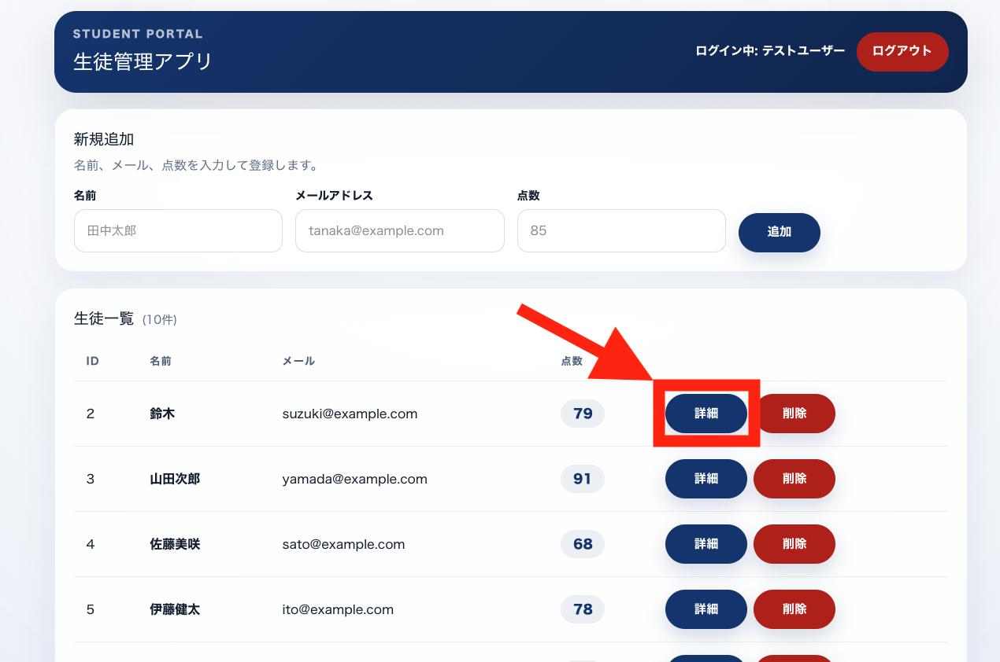
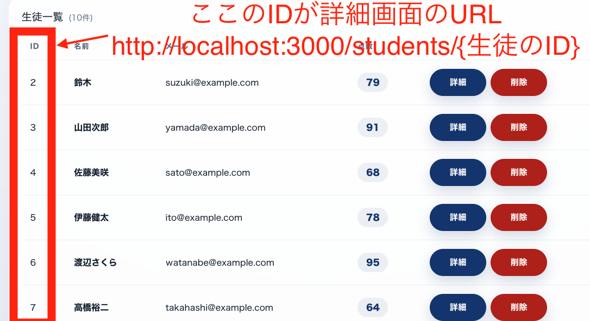
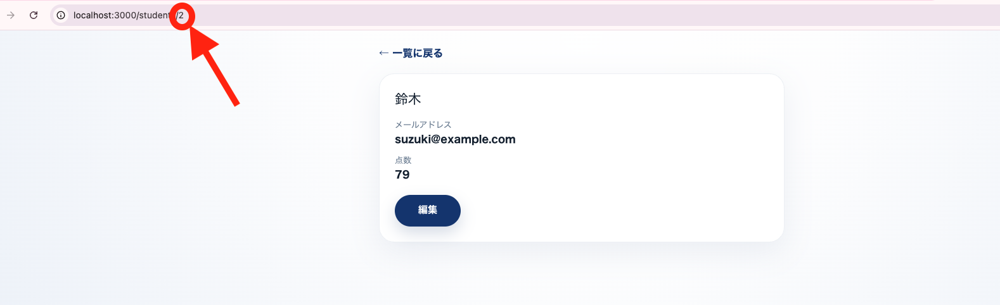
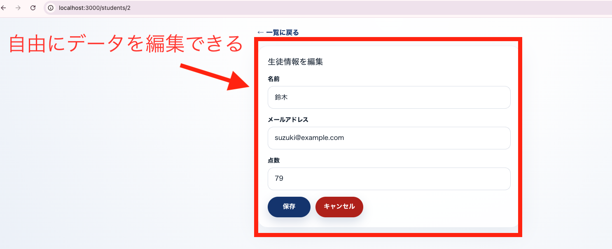
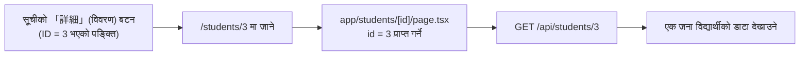

# कक्षा 24｜विवरण स्क्रिन बनाउने

> 🇯🇵 मूल प्रति (जापानी भाषामा): [2026_07_16_課題.md](<../../../2年生_システム開発実践/前期/2026_07_16/2026_07_16_課題.md>) <!-- original-ja-link -->

---

# यहाँसम्म पूरा गरेकाहरूले अब विवरण स्क्रिन बनाउनुहोस्

अहिलेको अवस्थामा सूची स्क्रिनमा नाम, इमेल र अंक एक नजरमै देखिन्छन्, तर प्रत्येक विद्यार्थीको जानकारी विस्तारमा हेर्ने वा त्यहीँबाट सम्पादन गर्ने स्क्रिन छैन। सूचीको 「詳細」(विवरण) बटन थिच्दा, त्यो विद्यार्थीको मात्र जानकारी देखाउने स्क्रिन बनाउनेछौँ।

## के बनाउने

सूची स्क्रिनको हरेक पङ्क्तिमा भएको 「詳細」(विवरण) बटन थिच्दा, त्यो विद्यार्थीको जानकारी मात्र देखिने स्क्रिनमा जाने बनाउँछौँ।

मुख्य कुरा के हो भने, **सूचीको कुन पङ्क्तिको 「詳細」(विवरण) थिचियो भन्ने अनुसार जाने ठाउँको URL फरक हुन्छ**। विद्यार्थीको ID नै URL को एक भाग बन्छ।

बटन थिच्दा, तलको तस्बिरजस्तै त्यो विद्यार्थीको नाम, इमेल ठेगाना र अंक मात्र देखिने स्क्रिनमा जान सकियो भने OK।

यसबाहेक, विवरण स्क्रिनबाट 「編集」(सम्पादन) बटन थिच्दा, त्यहीँ फारम देखिने र जानकारी परिवर्तन गर्न मिल्ने बनाउँछौँ (यो कक्षा 21 मा बनाएको अपडेट प्रक्रियाकै अवधारणा हो)।

## विवरण स्क्रिन भनेको के हो?

विवरण स्क्रिन CRUD को **Read (एउटा मात्र हेर्ने)** कार्यअन्तर्गत पर्छ। सूची स्क्रिन "सबैको जानकारी एकैचोटि हेर्ने" स्क्रिन हो भने, विवरण स्क्रिन "ID ले तोकेको एक जनाको मात्र जानकारी हेर्ने" स्क्रिन हो।

- सूची स्क्रिन: `GET /api/students` → सबैको डाटा फर्किन्छ
- विवरण स्क्रिन: `GET /api/students/{id}` → तोकेको ID भएको एक जना विद्यार्थीको मात्र डाटा फर्किन्छ

उदाहरणका लागि, ID 3 भएको विद्यार्थीको 「詳細」(विवरण) थिच्दा URL को ID कसरी हस्तान्तरण हुन्छ भन्ने चित्रमा देखाउँदा यस्तो हुन्छ।

यसबाहेक, विवरण स्क्रिनबाट सम्पादन गरेर सेभ गर्ने भाग CRUD को **Update (अपडेट गर्ने)** कार्यअन्तर्गत पर्छ। एउटै स्क्रिनमा जानकारी हेर्ने (Read) र अपडेट गर्ने (Update) मोडबीच स्विच गर्न मिल्ने बनाइन्छ।

## स्क्रिनमा चाहिने तत्वहरू

- विद्यार्थीको **नाम** देखाउने
- विद्यार्थीको **इमेल ठेगाना** देखाउने
- विद्यार्थीको **अंक** देखाउने
- "**सम्पादन**" बटन (थिच्दा फारममा बदलिन्छ)
- सम्पादन फारममा नाम, इमेल ठेगाना र अंक लेख्ने ठाउँ, अनि "**सेभ**" र "**रद्द**" बटन
- "**सूचीमा फर्कने**" लिंक

## कार्यान्वयनका लागि सुझाव (अहिलेसम्म सिकेका कुरासँग जोडिएका छन्)

- सूची स्क्रिनको 「詳細」(विवरण) बटन, हरेक विद्यार्थीका लागि `/students/{विद्यार्थीको ID}` भन्ने लिंक बन्ने गरी बनाउनुहोस् (`` <Link href={`/students/${student.id}`}> `` जस्तै, ID राखिएको URL बनाउने)
- Next.js मा URL को एक भाग (ID) प्राप्त गर्न सकिने **डाइनामिक राउटिङ** प्रयोग गर्छौँ। `app/students/[id]/page.tsx` जस्तो फोल्डर र फाइल संरचना बनाउँदा, URL को `{id}` भागको मान पेजभित्र प्राप्त गर्न सकिन्छ
- पेज देखिएपछि, प्राप्त गरेको ID प्रयोग गरेर `` fetch(`http://localhost:8000/api/students/${id}`) `` जस्तै गरी Laravel API मा रिक्वेस्ट पठाउनुहोस्, र त्यो एक जना विद्यार्थीको डाटा मात्र ल्याउनुहोस्
- Laravel तिर, `routes/api.php` को `Route::apiResource('students', StudentController::class)` ले गर्दा, वास्तवमा `show($id)` (१ वटा ल्याउने) र `update($id)` (अपडेट गर्ने) को रुट पनि पहिल्यै तयार छन्। `StudentController` मा यी २ वटा मेथड बनाइएका छन् कि छैनन् जाँच्नुहोस्
- 「編集」(सम्पादन) बटन थिच्दा देखिने सामग्री बदल्नका लागि, अहिले हेर्ने मोड हो कि सम्पादन मोड हो भन्ने अवस्था `useState` मा राख्नुभयो भने, कक्षा 17〜21 मा बनाएको फारमकै अवधारणा प्रयोग गर्न सकिन्छ
- सेभ बटन थिच्दा, `fetch` मा `PUT` (वा `PATCH`) प्रयोग गरेर `http://localhost:8000/api/students/{id}` मा पठाउनुहोस्। टोकनलाई `Authorization: Bearer ${token}` ले जोड्न नबिर्सनुहोस्
