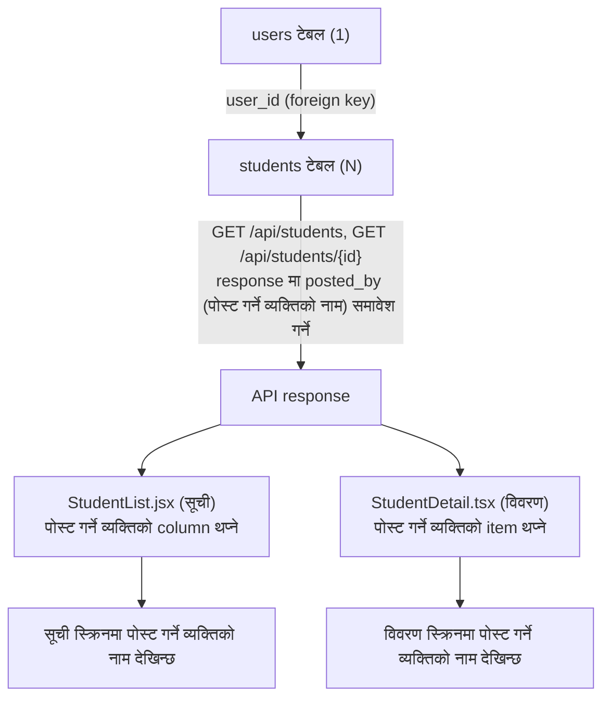
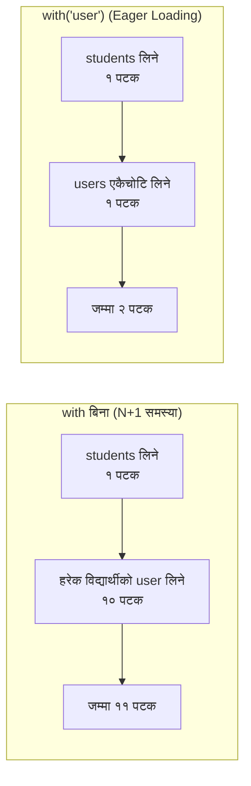

# कक्षा 25｜Users ⇔ Students बीच relation बनाएर, पोस्ट गर्ने व्यक्ति देखाउने - implementation का चरणहरू

> 🇯🇵 मूल प्रति (जापानी भाषामा): [2026_07_23_実装 .md](<../../../2年生_システム開発実践/前期/2026_07_23/2026_07_23_実装 .md>) <!-- original-ja-link -->

## आजको लक्ष्य

- `students` टेबलमा "यो डाटा कसले दर्ता गर्‍यो" भन्ने जनाउने `user_id` राख्ने
- `User` र `Student` लाई Eloquent को relation ले जोड्ने (एक जना user ले धेरै विद्यार्थी राख्न सक्छ)
- विद्यार्थी सूची र विवरण API को response मा "पोस्ट गर्ने व्यक्तिको नाम (`posted_by`)" समावेश गर्ने
- नयाँ विद्यार्थी दर्ता गर्दा, login भएको user सँग स्वचालित रूपमा जोडेर save गर्ने
- सूची स्क्रिन र विवरण स्क्रिन दुवैमा "पोस्ट गर्ने व्यक्ति" देखाउने

> **यस पाठको स्थान:** अहिलेसम्मको `students` टेबलमा "कसले दर्ता गर्‍यो" भन्ने जानकारी थिएन। `users` टेबलसँग foreign key relation थपेर, त्यो जानकारी API मार्फत frontend सम्म पुर्‍याई स्क्रिनमा देखाउने, यो पूरै प्रक्रिया बनाउँछौं।

---

## समग्र चित्र: के बनाउने



> 💡 **उदाहरण दिँदा… पुस्तकालयको किताब लिने कार्ड**
>
> `students` टेबलको हरेक record लाई "किताब" मान्ने हो भने, `user_id` चाहिँ "यो किताब कसले लग्यो (दर्ता गर्‍यो)" भनेर लेखिएको कार्ड हो। कार्ड नभए किताब हेरेर "यो कसको जिम्मामा छ" थाहा हुँदैन। पहिले किताब (`students`) मा कार्ड राख्ने ठाउँ (`user_id` column) बनाउँछौं, त्यसपछि "एक जना पाठकले धेरै किताब लिन सक्छ" भन्ने सम्बन्धलाई code (Eloquent) मा व्यक्त गर्छौं, र अन्तमा त्यो जानकारी स्क्रिनमा देखाउँछौं।

Eloquent मा यसलाई तल जस्तै मिलाइन्छ।

| class | method | अर्थ |
|---|---|---|
| `User` | `students()` | एक जना user सँग धेरै विद्यार्थी हुन्छन् (`hasMany`) |
| `Student` | `user()` | एउटा विद्यार्थी एक जना user को हुन्छ (`belongsTo`) |

### किन यही क्रममा बनाउने?

backend मा `user_id` र relation तयार गरेर API ले `posted_by` फर्काउन नसकेसम्म, frontend सँग देखाउने डाटा नै हुँदैन। त्यसैले **backend (migration → model → Controller/Seeder) → frontend (सूची → विवरण)** को क्रममा, सानो-सानो बनाउँदै र हरेक पटक चलाएर हेर्दै अगाडि बढ्छौं।

### फाइल संरचना (यसपटक काम गर्ने फाइलहरू)

| चिन्ह | अर्थ |
|---|---|
| 🆕 नयाँ | नयाँ फाइल बनाउने |
| ➕ थप्ने | पहिले नै भएको फाइलमा code थप्ने |
| 🔁 बदल्ने | पहिले नै भएको प्रक्रिया फेरि लेख्ने |
| 👀 जाँच्ने | परिवर्तन चाहिँदैन। पहिले नै बनेको छ कि छैन जाँच्ने मात्र |

```
Laravel/
├── database/migrations/xxxx_add_user_id_to_students_table.php  🆕 नयाँ (user_id column थप्ने)
├── app/Models/User.php                                     ➕ students() relation थप्ने
├── app/Models/Student.php                                  ➕ user() relation थप्ने
├── app/Http/Controllers/Api/StudentController.php          🔁 index(), store() सुधार्ने
├── app/Http/Resources/StudentResource.php                  ➕ posted_by थप्ने
└── database/seeders/StudentSeeder.php                       🔁 user मार्फत विद्यार्थी बनाउने

school-frontend/
├── components/students/StudentList.tsx     ➕ पोस्ट गर्ने व्यक्तिको column थप्ने (header, cell)
└── components/students/StudentDetail.tsx   ➕ पोस्ट गर्ने व्यक्तिको item थप्ने
```

---

## Step 1｜Backend: migration ले `user_id` थप्ने

**🆕 नयाँ फाइल** — पहिले नै भएको `create_students_table` migration लाई सिधै edit गर्दैनौं। एक पटक चलाइसकेको migration फेरि लेख्नु दुर्घटनाको कारण बन्छ, त्यसैले `user_id` column थप्नका लागि छुट्टै नयाँ migration बनाउँछौं।

```bash
cd Laravel
php artisan make:migration add_user_id_to_students_table --table=students
```

`Laravel/database/migrations/` मा, तल जस्तै नाम भएको फाइल बन्छ (सुरुमा चलाएको मिति र समय हुन्छ)।

```
2026_07_16_000001_add_user_id_to_students_table.php
```

बनेको फाइलभित्र तल जस्तै लेख्नुहोस्।

```php
<?php
// ▼ database/migrations/2026_07_16_000001_add_user_id_to_students_table.php

use Illuminate\Database\Migrations\Migration;
use Illuminate\Database\Schema\Blueprint;
use Illuminate\Support\Facades\Schema;

return new class extends Migration
{
    public function up(): void
    {
        // पहिले नै भएको students टेबलमा user_id column थप्ने
        Schema::table('students', function (Blueprint $table) {
            $table->foreignId('user_id') // users.id लाई reference गर्ने foreign key column बनाउने
                ->after('id')             // id column को ठीक पछाडि राख्ने (हेर्न सजिलो होस् भनेर)
                ->constrained()           // reference गर्ने ठाउँ (users टेबलको id) आफैं अनुमान गरेर foreign key constraint लगाउने
                ->cascadeOnDelete();      // user delete भएमा, त्यो user का विद्यार्थी डाटा पनि सँगै delete गर्ने
        });
    }

    public function down(): void
    {
        // migrate:rollback गर्दा, थपेको foreign key र column लाई पहिलेकै अवस्थामा फर्काउने
        Schema::table('students', function (Blueprint $table) {
            $table->dropForeign(['user_id']); // पहिले foreign key constraint हटाउने
            $table->dropColumn('user_id');    // column नै delete गर्ने
        });
    }
};
```

- `Schema::table('students', ...)` … पहिले नै भएको टेबलमा "column थप्ने" परिवर्तन भएकाले, `create` होइन `table` प्रयोग गर्ने
- `foreignId('user_id')` … `users.id` लाई reference गर्ने foreign key column बनाउने
- `->after('id')` … `id` को ठीक पछाडि `user_id` column राख्ने (हेर्न सजिलो होस् भनेर)
- `->constrained()` … reference गर्ने ठाउँ (`users` टेबलको `id`) आफैं अनुमान गरेर foreign key constraint लगाउने
- `->cascadeOnDelete()` … user delete भएमा, त्यो user सँग भएका विद्यार्थी डाटा पनि सँगै delete गर्ने
- `down()` … `migrate:rollback` गर्दा, थपेको foreign key र column लाई पहिलेकै अवस्थामा फर्काउन सकिने बनाउने

> ⚠️ पछि गएर `user_id` थप्दा, पहिले नै भएका डाटामा कुन user सँग जोड्ने भन्ने जानकारी हुँदैन। development को क्रममा हो भने, `php artisan migrate:fresh --seed` ले टेबल फेरि बनाएर, seeder मार्फत सुरुदेखि नै user सँग जोडिएको डाटा फेरि हाल्नु सजिलो हुन्छ (production जस्तै डाटा सुरक्षित राख्नुपर्ने अवस्थामा, पहिले `nullable()` सहित column थपेर backfill गर्ने, अनि त्यसपछिको migration मा `NOT NULL` constraint लगाउने गरी दुई चरणमा काम गर्नुपर्छ)।

---

## Step 2｜Backend: model मा relation परिभाषित गर्ने

### 2-1. `app/Models/User.php`

**➕ थप्ने** — `HasMany` को `use` statement र `students()` method थप्नुहोस्।

```php
use Illuminate\Database\Eloquent\Relations\HasMany; // ← relation को type (HasMany) प्रयोग गर्न सकिने बनाउने

// ...

// एक जना user सँग धेरै विद्यार्थी हुन्छन् भन्ने सम्बन्ध (one-to-many) जनाउने method
// यो परिभाषित गरेपछि $user->students ले "यो user ले दर्ता गरेका विद्यार्थीहरूको सूची" पाउन सकिन्छ
public function students(): HasMany
{
    // hasMany(Student::class) … "धेरै Student model हरू छन्" भन्ने अर्थ
    return $this->hasMany(Student::class);
}
```

### 2-2. `app/Models/Student.php`

**➕ थप्ने** — `BelongsTo` को `use` statement र `user()` method थप्नुहोस्।

```php
use Illuminate\Database\Eloquent\Relations\BelongsTo; // ← relation को type (BelongsTo) प्रयोग गर्न सकिने बनाउने

// ...

// एउटा विद्यार्थी एक जना user को हुन्छ भन्ने सम्बन्ध (many-to-one) जनाउने method
// यो परिभाषित गरेपछि $student->user ले "यो विद्यार्थी दर्ता गर्ने user" पाउन सकिन्छ
public function user(): BelongsTo
{
    // belongsTo(User::class) … "User model को हो" भन्ने अर्थ
    // ※ यो टेबलको user_id column हेरेर, मिल्ने users record खोज्न जान्छ
    return $this->belongsTo(User::class);
}
```

अब `$user->students` (धेरै विद्यार्थीको डाटा प्राप्त गर्ने) र `$student->user` (त्यो विद्यार्थीको डाटा दर्ता गर्ने user प्राप्त गर्ने) मार्फत दुवै दिशामा access गर्न सकिन्छ।

---

## Step 3｜Backend: Controller बाट पोस्ट गर्ने व्यक्तिको नाम फर्काउने

### 3-1. `index()` सुधार्ने

**🔁 बदल्ने** — `Student::all()` जस्तो साधारण तरिकाले लिनुको सट्टा, `with('user')` ले relation भएको डाटा पनि सँगै load (Eager Loading) गरेर, `StudentResource` मार्फत response मा बदल्छौं। `show()` ले पहिले नै `StudentResource` प्रयोग गरिरहेकाले, `index()` लाई पनि उस्तै बनाउँदा पोस्ट गर्ने व्यक्ति देखाउने तरिका एउटै ठाउँ (`StudentResource`) मा राख्न सकिन्छ।

```php
public function index()
{
    // विद्यार्थी डाटा लिँदा, पोस्ट गर्ने व्यक्ति (user) को जानकारी पनि सँगै load गरिराख्ने
    // → यसो नगरे, विद्यार्थीको संख्या जति नै पटक "पोस्ट गर्ने व्यक्तिको नाम लिने" SQL चल्छ (N+1 समस्या)
    $students = Student::with('user')->get();

    // पाएको विद्यार्थी डाटालाई response को रूप (StudentResource) मा बदलेर फर्काउने
    return StudentResource::collection($students);
}
```

> 💡 **N+1 समस्या भनेको के हो?**
>
> `with('user')` नलगाई `Student::all()` वा `Student::get()` लेख्दा, तल जस्तै SQL चल्छ।
>
> 1. `students` टेबलबाट सबै विद्यार्थी लिने SQL (१ पटक)
> 2. स्क्रिन वा response मा **हरेक विद्यार्थीका लागि** `$student->user->name` access गर्दा हरेक पटक, "यो विद्यार्थीको डाटा दर्ता गर्ने user ल्याउने" SQL (विद्यार्थीको संख्या बराबर = N पटक)
>
> अर्थात्, १० जना विद्यार्थी छन् भने "विद्यार्थी सूची लिने १ पटक" + "पोस्ट गर्ने व्यक्ति लिने १० पटक" = **जम्मा ११ पटक** SQL चल्छ। विद्यार्थी १०० जना, १००० जना हुँदै जाँदा, SQL चल्ने संख्या पनि त्यही अनुपातमा बढ्छ, र API झन्-झन् ढिलो हुन्छ। यही हो **N+1 समस्या** (१ पटकमा सकिनुपर्ने काममा, N वटा डाटाका लागि N पटक थप query चल्ने समस्या)।
>
> सुरुमै `with('user')` लगाइदिँदा, Laravel ले
>
> 1. `students` टेबल लिने SQL (१ पटक)
> 2. त्यहाँ आएका `user_id` हरू एकैपटक जम्मा गरेर, मिल्ने `users` एकैचोटि लिने SQL (१ पटक)
>
> गरी **जम्मा २ पटक** मा काम सकाइदिन्छ (यसलाई **Eager Loading** = पहिले नै एकैचोटि load गर्ने, भनिन्छ)। विद्यार्थी जति नै बढे पनि, SQL चल्ने संख्या सधैं २ पटक नै रहन्छ। "पछि एक-एक गरेर लिन जाने (N+1)" होइन, "सुरुमै एकैचोटि लिइराख्ने (Eager Loading)" भन्ने कुरा मुख्य हो।
>
> १० जना विद्यार्थी हुँदा SQL चल्ने संख्या तुलना गर्दा, यस्तो हुन्छ।



> ⚠️ return type `: JsonResponse` लेख्न मन लाग्ला, तर त्यसो गर्दा `use Illuminate\Http\JsonResponse;` import चाहिन्छ। अरू `store()`/`show()`/`update()`/`destroy()` मा पनि type लेखिएको छैन, त्यसैले मिलाउनका लागि type बिना नै राख्छौं।

### 3-2. `app/Http/Resources/StudentResource.php` मा `posted_by` थप्ने

**➕ थप्ने** — `index()` मात्र सुधार्दा response मा `posted_by` अझै देखिँदैन। वास्तवमा डाटालाई JSON मा बदल्ने काम `StudentResource` ले गर्छ, त्यसैले यहीँ थप्छौं। `show()` (विवरण API) ले पनि यही `StudentResource` प्रयोग गर्छ, त्यसैले एक पटकको परिवर्तन सूची र विवरण दुवैमा लागू हुन्छ।

```php
public function toArray($request): array
{
    // यो विद्यार्थीको डाटा दर्ता गर्ने user को नाम पहिले नै variable मा राख्ने
    $postedByName = $this->user->name;

    return [
        'id'         => $this->id,
        'name'       => $this->name,
        'email'      => $this->email,
        'score'      => $this->score,
        'evaluation' => $this->score >= 80 ? 'A' : 'B',
        'created_at' => $this->created_at->format('Y/m/d'),
        'posted_by'  => $postedByName, // ★ थपिएको: पोस्ट गर्ने व्यक्तिको नाम
    ];
}
```

### 3-3. `store()` सुधार्ने

**🔁 बदल्ने** — `Student::create()` होइन, login भएको user मार्फत बनाएर `user_id` आफैं set हुने बनाउँछौं। validation पहिलेकै जस्तो `$request->validate(...)` प्रयोग गर्छौं, र त्यसको नतिजा (`$validated`) लाई सिधै विद्यार्थी बनाउन दिन्छौं।

```php
public function store(Request $request)
{
    // Validation: पठाइएको डाटाको format जाँच्ने
    $validated = $request->validate([
        'name'  => 'required|max:100',          // अनिवार्य, १०० अक्षरभित्र
        'email' => 'required|email|unique:students', // अनिवार्य, email format, दोहोरिन नहुने
        'score' => 'required|integer|min:0|max:100', // अनिवार्य, पूर्णांक, ०-१००
    ]);

    // $request->user() … अहिले login भएको user (Sanctum ले authenticate गरिदिएको)
    // ->students()->create(...) … त्यो user को विद्यार्थीको रूपमा नयाँ बनाउने
    //   → Eloquent ले आफैं user_id मा login भएको user को ID हालिदिन्छ
    $student = $request->user()->students()->create($validated);

    // 201 Created (सफलतापूर्वक बन्यो) status code सहित फर्काउने
    return response()->json([
        'status' => 'ok',
        'data'   => $student,
    ], 201);
}
```

`$request->user()` भनेको Sanctum ले authenticate गरिसकेको user (= अहिले login भएको शिक्षक) हो। `->students()->create(...)` लेख्दा, Eloquent ले आफैं `user_id` मा त्यो user को ID भरिदिन्छ। `Student::create($request->all())` जस्तो "सबै parameter" पठाउनुको सट्टा, validation भइसकेको `$validated` मात्र पठाउने कुरामा पनि ध्यान दिनुहोस्।

---

## Step 4｜Backend: seeder लाई पनि user मार्फत बनाउने गरी बदल्ने

यो project मा `StudentSeeder.php` भन्ने फाइल छैन, `database/seeders/DatabaseSeeder.php` भित्रै सिधै `Student::factory(10)->create()` गरेर विद्यार्थी डाटा बनाइएको छ।

```php
// database/seeders/DatabaseSeeder.php (अहिलेको content)
public function run(): void
{
    \App\Models\Student::factory(10)->create(); // विद्यार्थी डाटा १० वटा बनाउने
}
```

यस्तै छोडे विद्यार्थी डाटामा `user_id` पर्दैन (जोड्ने user नै छैन), त्यसैले **① पहिले test user बनाउने → ② त्यो user मार्फत विद्यार्थी बनाउने** गरी दुई चरणमा फेरि लेख्छौं। नयाँ फाइल बनाउनु पर्दैन, `DatabaseSeeder.php` लाई सिधै सुधारे पुग्छ।

**🔁 बदल्ने**

```php
// database/seeders/DatabaseSeeder.php (सुधारपछि)
public function run(): void
{
    // ① login का लागि test user एक जना बनाउने
    // User::factory() … UserFactory मा परिभाषित dummy डाटाले बनाउने
    //   password चाहिँ UserFactory मै "password" लाई hash गरेको value भइसकेको छ,
    //   त्यसैले यहाँ name र email मात्र overwrite गरे test@example.com / password ले login गर्न सकिन्छ
    $user = \App\Models\User::factory()->create([
        'name'  => 'テストユーザー',
        'email' => 'test@example.com',
    ]);

    // ② विद्यार्थी डाटा बनाउँदा ->for($user) राखे,
    //   Student::user() relation (belongsTo) मार्फत, user_id मा आफैं $user->id पर्छ
    \App\Models\Student::factory(10)->for($user)->create();
}
```

`Student::factory(10)->for($user)` को `for()` भनेको "यो model ($user) सँग जोडेर बनाउने" भन्ने अर्थ भएको Factory को सुविधा हो। `Student` model मा `user()` (`belongsTo(User::class)`) पहिले नै परिभाषित भएकाले, Laravel ले आफैं `user_id` लाई `$user->id` मा set गरिदिन्छ। `$user->students()->create(...)` एक-एक गरेर बोलाउँदा आउने नतिजालाई नै, Factory ले एकैचोटि पूरा गरेको जस्तो सम्झनुहोस्।

### चलाएर जाँच्ने (backend)

```bash
cd Laravel
php artisan migrate:fresh --seed
php artisan serve
```

login गरेर token लिएपछि, सूची API call गरेर `posted_by` समावेश छ कि छैन जाँच्नुहोस्।

```bash
curl http://localhost:8000/api/students \
  -H "Authorization: Bearer <पाएको token>" \
  -H "Accept: application/json"
```

| जाँच्ने कुरा | गर्ने काम | अपेक्षित नतिजा |
|---|---|---|
| Relation | सूची API चलाउने | हरेक विद्यार्थीको JSON मा `posted_by` (दर्ता गर्ने user को नाम) हुन्छ |
| नयाँ दर्ता | `POST /api/students` ले विद्यार्थी थप्ने | DB को `students.user_id` मा login भएको user को ID पर्छ |
| Cascade delete | सम्बन्धित user लाई DB बाट delete गर्ने (development DB मा परीक्षण गर्ने) | त्यो user ले दर्ता गरेका विद्यार्थी डाटा पनि सँगै delete हुन्छन् |
| N+1 को उपाय | `index()` मा query log राखेर जाँच्ने | `students` लिने १ पटक + `users` लिने १ पटक जति मै सकिन्छ (विद्यार्थीको संख्या जति पटक चल्दैन) |

---

## Step 5｜Frontend: सूची स्क्रिनमा पोस्ट गर्ने व्यक्तिको column थप्ने

`school-frontend/components/StudentList.jsx` edit गर्नुहोस्। यो project TypeScript को type प्रयोग नगर्ने साधारण JSX (`.jsx`) मा लेखिएको छ, त्यसैले `type Student` जस्तो type परिभाषा कतै पनि छैन। backend ले `posted_by` फर्काइदिएपछि, frontend मा `student.posted_by` भनेर सिधै लेखे value निकाल्न सकिन्छ। type जाँच्ने वा सुधार्ने चरण चाहिँदैन।

**➕ थप्ने (table header)** — `点数` (अंक) column को पछाडि "投稿者" (पोस्ट गर्ने व्यक्ति) header थप्नुहोस्।

```jsx
<thead>
  <tr style={{ background: "#f5f5f5" }}>
    <th style={thStyle}>ID</th>
    <th style={thStyle}>名前</th>
    <th style={thStyle}>メール</th>
    <th style={thStyle}>点数</th>
    <th style={thStyle}>投稿者</th> {/* ★ थपिएको: यो विद्यार्थी दर्ता गर्ने user को नामको column */}
    <th style={thStyle}></th>
  </tr>
</thead>
```

**➕ थप्ने (`StudentRow` भित्र)** — अंकको cell पछाडि, पोस्ट गर्ने व्यक्तिको नाम देखाउने cell थप्नुहोस्।

```jsx
<td style={tdStyle}>{student.score}</td>
{/* ★ थपिएको: header मा बनाएको "投稿者" column सँग मिल्ने cell। भित्र पोस्ट गर्ने व्यक्तिको नामको string मात्र भए पुग्छ */}
<td style={tdStyle}>{student.posted_by}</td>
<td style={tdStyle}>
  <div style={{ display: "flex", gap: "0.5rem", flexWrap: "wrap" }}>
    {/* विवरण, delete button (पहिलेकै जस्तो) */}
  </div>
</td>
```

header र cell को column संख्या नबिग्रियोस् भनेर, दुवैलाई सँगै थप्नु मुख्य कुरा हो।

---

## Step 6｜Frontend: विवरण स्क्रिनमा पोस्ट गर्ने व्यक्तिको item थप्ने

`school-frontend/components/students/StudentDetail.tsx` edit गर्नुहोस्। यो फाइलको extension `.tsx` भए पनि, `props` मा type annotation लगाइएको छैन (`export default function StudentDetail({ student, token, onUpdated })` जस्तो लेखिएको छ), त्यसैले type जाँच्ने वा सुधार्ने चरण चाहिँदैन। backend ले `posted_by` फर्काइदिए, सिधै `student.posted_by` ले reference गर्न सकिन्छ।

**➕ थप्ने (देखाउने mode को `<dl>` भित्र)** — "点数" (अंक) item को पछाडि "投稿者" (पोस्ट गर्ने व्यक्ति) item थप्नुहोस्। पहिले नै भएका `<dt>`/`<dd>` कै style मिलाउनुहोस्।

```tsx
<dl style={{ display: "grid", gap: "16px", margin: 0 }}>
  <div>
    <dt style={{ fontSize: "0.9em", color: "#666", marginBottom: "4px" }}>メールアドレス</dt>
    <dd style={{ margin: 0, fontWeight: "bold", fontSize: "1.1em" }}>{student.email}</dd>
  </div>
  <div>
    <dt style={{ fontSize: "0.9em", color: "#666", marginBottom: "4px" }}>点数</dt>
    <dd style={{ margin: 0, fontWeight: "bold", fontSize: "1.1em" }}>{student.score} 点</dd>
  </div>
  <div>
    {/* ★ थपिएको: यो विद्यार्थी डाटा कसले दर्ता गर्‍यो भनेर देखाउने item (देखाउने मात्र, edit form मा थप्दैनौं) */}
    <dt style={{ fontSize: "0.9em", color: "#666", marginBottom: "4px" }}>投稿者</dt>
    <dd style={{ margin: 0, fontWeight: "bold", fontSize: "1.1em" }}>{student.posted_by}</dd>
  </div>
</dl>
```

edit mode (form) मा नाम, email र अंक मात्र edit गर्न मिल्ने व्यवस्था जस्ताको त्यस्तै राखे हुन्छ। "投稿者" (पोस्ट गर्ने व्यक्ति) ले डाटा कसले दर्ता गर्‍यो भनेर देखाउने मात्र भएकाले, यसलाई edit form मा थप्दैनौं।

### चलाएर जाँच्ने (frontend)

```bash
cd school-frontend && npm run dev
```

पहिले backend (`php artisan serve`) चलाउनुहोस्, र login गरेको अवस्थामा जाँच्नुहोस्।

| जाँच्ने कुरा | गर्ने काम | अपेक्षित नतिजा |
|---|---|---|
| सूची देखाइ | `/students` खोल्ने | हरेक row को "点数" (अंक) को दायाँतिर "投稿者" (पोस्ट गर्ने व्यक्ति) column छ, र दर्ता गर्ने user को नाम देखिन्छ |
| विवरण देखाइ | कुनै एक row को "詳細" (विवरण) खोल्ने | नाम, email र अंकका साथै "投稿者" (पोस्ट गर्ने व्यक्ति) पनि देखिन्छ |
| Type error नहुनु | `npx tsc --noEmit` चलाउने | error आउँदैन (`posted_by` पहिले नै भएको type मा समावेश भएकाले) |
| Layout नबिग्रनु | सूचीको header र cell को column संख्या तुलना गर्ने | header संख्या र cell संख्या मिलेको छ, टेबल बिग्रिएको छैन |

---

## सारांश

| अवधारणा | यसपटक काम गरेको ठाउँ |
|---|---|
| One-to-many relation | `students.user_id`, `User::students()`, `Student::user()` |
| Eager Loading (N+1 को उपाय) | `StudentController@index` को `Student::with('user')` |
| login भएको user सँग स्वचालित रूपमा जोड्ने | `StudentController@store` को `$request->user()->students()->create(...)` |
| API response मा पोस्ट गर्ने व्यक्तिको जानकारी थप्ने | `posted_by` field |
| Frontend मा देखाउने | `StudentList.tsx`／`StudentDetail.tsx` |

## पूरा भएको जाँचसूची (Definition of Done)

- [ ] `students` टेबलमा `user_id` column छ, र `users.id` मा foreign key constraint लगाइएको छ
- [ ] `User::students()` / `Student::user()` दुवै दिशाको relation परिभाषित छ
- [ ] `GET /api/students` को response मा `posted_by` (पोस्ट गर्ने व्यक्तिको नाम) समावेश छ
- [ ] `POST /api/students` ले विद्यार्थी बनाउँदा, login भएको user सँग आफैं जोडिन्छ
- [ ] seeder फेरि चलाउँदा पनि `posted_by` मा test user को नाम पर्छ
- [ ] `/students` को सूची टेबलमा "投稿者" (पोस्ट गर्ने व्यक्ति) column छ, र दर्ता गर्ने user को नाम देखिन्छ
- [ ] `/students/{id}` को विवरण स्क्रिनमा "投稿者" (पोस्ट गर्ने व्यक्ति) item छ, र दर्ता गर्ने user को नाम देखिन्छ
- [ ] edit form मा पोस्ट गर्ने व्यक्तिको field थपिएको छैन (देखाउने मात्र भएकाले)
- [ ] `npx tsc --noEmit` error बिना pass हुन्छ

## चलाउने command

```bash
# Backend
cd Laravel && php artisan serve   # http://localhost:8000

# Frontend
cd school-frontend && npm run dev # http://localhost:3000
```

Test account: `test@example.com` / `password`
