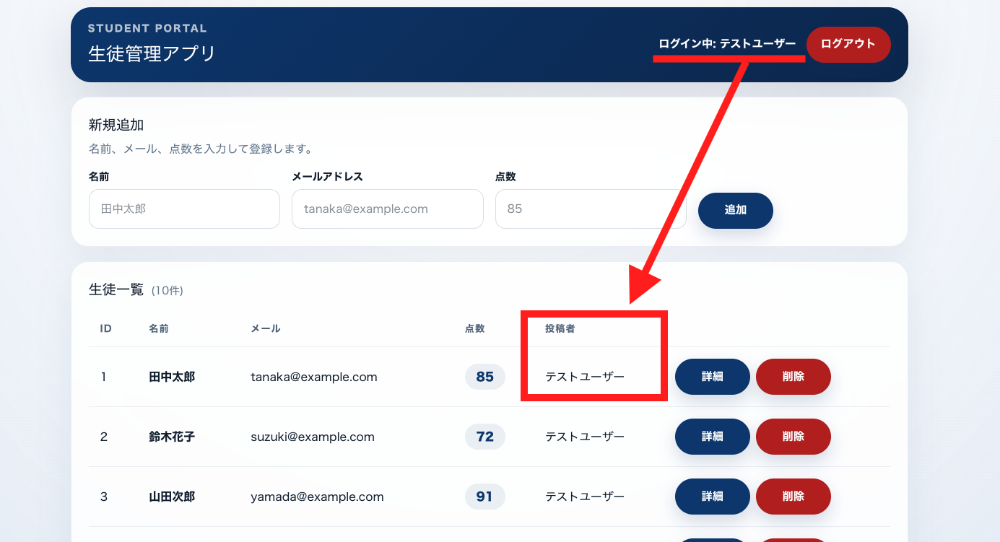
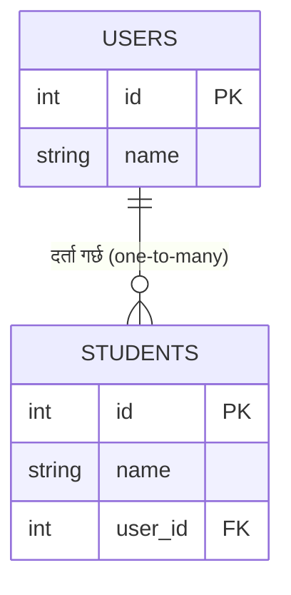

# कक्षा 25｜Users ⇔ Students बीच relation बनाउने

> 🇯🇵 मूल प्रति (जापानी भाषामा): [2026_07_23_課題.md](<../../../2年生_システム開発実践/前期/2026_07_23/2026_07_23_課題.md>) <!-- original-ja-link -->

---

# यहाँसम्म गरिसक्नुभयो भने, अब Users टेबल र Students टेबलबीच relation बनाऔं

[Relational database को बारेमा](./リレーショナルデータベース入門.md)

अहिलेको अवस्थामा, `students` टेबलमा "त्यो विद्यार्थीको डाटा कसले दर्ता गर्‍यो" भन्ने जानकारी छैन। सबैले एउटै सूची हेर्न सक्छन्, तर "यो डाटा मैले (हाल login भएको user ले) दर्ता गरेको हो" भनेर छुट्याउन सकिँदैन।

`users` टेबल र `students` टेबलबीच relation (सम्बन्ध) बनाएर, सूची र विवरण स्क्रिनमा "पोस्ट गर्ने व्यक्ति" को रूपमा दर्ता गर्ने user को नाम देखिने बनाउँछौं।

## के बनाउने

नयाँ विद्यार्थी दर्ता गर्दा, त्यो विद्यार्थी डाटा "अहिले login भएको user" सँग आफैं जोडिने बनाउँछौं। अनि सूची स्क्रिन र विवरण स्क्रिन दुवैमा, त्यो विद्यार्थी दर्ता गर्ने user को नाम (पोस्ट गर्ने व्यक्ति) देखाउँछौं।

मुख्य कुरा, **login भएको user को नाम (माथि दायाँ) र सूचीको "投稿者" (पोस्ट गर्ने व्यक्ति) column मा देखिने नाम मिल्नु** हो। यसपटकको test user प्रयोग गर्दा, जुनसुकै विद्यार्थीको row मा पनि "投稿者：テストユーザー" (पोस्ट गर्ने व्यक्ति: test user) देखिनुपर्छ (किनकि हालको seed डाटामा सबै विद्यार्थी एउटै user ले दर्ता गरेको मानिएको छ)।

## Relation भनेको के हो?

`users` टेबल र `students` टेबल अहिले पूरै छुट्टाछुट्टै टेबलको रूपमा छन्। यिनलाई "एक जना user ले धेरै विद्यार्थी दर्ता गर्न सक्छ" भन्ने सम्बन्धले जोड्नु नै यसपटकको relation हो।

- `users` टेबल: १ record = १ जना user (शिक्षक)
- `students` टेबल: १ record = १ जना विद्यार्थी

यी दुईलाई, `students` तर्फ "कुन user ले दर्ता गर्‍यो" जनाउने column (**foreign key**) राखेर जोड्छौं। यसले गर्दा,

- एक जना user सँग धेरै विद्यार्थी हुन सक्छन् (**one-to-many** सम्बन्ध)
- एउटा विद्यार्थी डाटा, अनिवार्य रूपमा एक जना user को हुन्छ

भन्ने सम्बन्ध database मा व्यक्त गर्न सकिन्छ। चित्रमा देखाउँदा यस्तो हुन्छ (`user_id` foreign key हो)।

Laravel मा, यही foreign key को आधारमा `User` model र `Student` model मा relation परिभाषित गरेर, "यो user ले दर्ता गरेका विद्यार्थीहरूको सूची" वा "यो विद्यार्थी दर्ता गर्ने user" सजिलै लिन सकिन्छ।

## स्क्रिनमा चाहिने कुराहरू

- विद्यार्थी सूची स्क्रिन (`/students`) को हरेक row मा, **पोस्ट गर्ने व्यक्ति** (दर्ता गर्ने user को नाम) देखाउने column
- विद्यार्थी विवरण स्क्रिन (`/students/{id}`) मा पनि, त्यसै गरी **पोस्ट गर्ने व्यक्ति** देखाउने item
- नयाँ विद्यार्थी दर्ता गर्दा, त्यो विद्यार्थी डाटा आफैं "अहिले login भएको user" सँग जोडिनु (अर्को user ले दर्ता गरेको भनिनु हुँदैन)

## Implementation का hint (अहिलेसम्म सिकेका कुरासँग जोडिएका छन्)

- Database तर्फ, `students` टेबलमा `users` टेबललाई reference गर्ने foreign key column (उदाहरण: `user_id`) थप्नुहोस्। पहिले नै चलिरहेको टेबलको migration सिधै फेरि लेख्नुको सट्टा, column थप्ने **नयाँ migration** बनाउनु सुरक्षित हुन्छ
- Foreign key थपेपछि, "reference गरिएको user delete भएमा के गर्ने" भन्ने पनि तय गर्नुपर्छ (delete सँगै विद्यार्थी डाटा पनि हटाउने, आदि)
- Laravel मा, `User` model मा "एक जना user सँग धेरै विद्यार्थी हुन सक्छन्" भन्ने relation (`hasMany`), र `Student` model मा "एउटा विद्यार्थी एक जना user को हुन्छ" भन्ने relation (`belongsTo`) परिभाषित गर्नुहोस्
- विद्यार्थी सूची फर्काउने API (`index()`) मा, विद्यार्थीको डाटासँगै दर्ता गर्ने user को जानकारी पनि प्राप्त गरेर, response मा पोस्ट गर्ने व्यक्तिको नाम समावेश गर्नुहोस्। प्रत्येक विद्यार्थीका लागि छुट्टाछुट्टै user को जानकारी लिँदा SQL query हरू अनावश्यक रूपमा बढ्छन् भन्ने कुरामा पनि ध्यान दिनुहोस् (`with()` प्रयोग गरी अग्रिम रूपमा डाटा लोड गर्नु उपयोगी हुन्छ)
- नयाँ विद्यार्थी दर्ता गर्ने API (`store()`) मा, `$request->user()` (अहिले login भएको user) मार्फत डाटा बनाएर, foreign key आफैं त्यो user को ID हुने बनाउनुहोस्
- Frontend तर्फ, API response को type (`type Student`) मा पोस्ट गर्ने व्यक्तिको नामको field थपेर, सूची टेबल र विवरण स्क्रिन दुवैमा देखाउने JSX थप्नुहोस्

## Implementation को क्रम

**1. DB तर्फ foreign key थप्ने**

`students` टेबलमा `user_id` column थप्ने। पहिले नै भएको migration फेरि नलेखी, नयाँ migration फाइल बनाएर थप्नु सुरक्षित हुन्छ (production मा चलिरहेको टेबल संरचना पछि बदल्दा अपनाइने मानक तरिका)।

**↓**

**2. Delete हुँदा के गर्ने तय गर्ने**

Foreign key लगाउँदा, reference गरिएको `users` हटेमा के गर्ने (`onDelete('cascade')` ले विद्यार्थी डाटा पनि सँगै हटाउने, आदि) भन्ने पनि सँगै set गर्नुपर्छ।

**↓**

**3. Model मा relation परिभाषित गर्ने**

- `User` model → `hasMany(Student::class)` (एक जना user सँग धेरै विद्यार्थी हुन सक्छन्)
- `Student` model → `belongsTo(User::class)` (एउटा विद्यार्थी एक जना user को हुन्छ)

**↓**

**4. सूची API सुधार्ने (`index()`)**

विद्यार्थी डाटा लिँदा, पोस्ट गर्ने व्यक्ति (user) को जानकारी पनि सँगै लिने। यहाँ एक-एक गरेर query पठाए N+1 समस्याले SQL अनावश्यक रूपमा बढ्छ, त्यसैले `with('user')` जस्तो Eager Loading प्रयोग गर्ने।

**↓**

**5. दर्ता API सुधार्ने (`store()`)**

नयाँ विद्यार्थी बनाउँदा, `$request->user()` बाट पाएको "अहिले login भएको user" मार्फत record बनाउने। यसो गर्दा `user_id` आफैं त्यो user को ID हुन्छ, र जसले पनि अरूको ID तोक्न सक्ने जस्ता गलत काम हुँदैनन्।

**↓**

**6. Frontend तर्फ सुधार्ने**

`type Student` को type परिभाषामा पोस्ट गर्ने व्यक्तिको नामको field थप्ने → सूची टेबलको row र विवरण स्क्रिनको JSX मा "投稿者：〇〇" (पोस्ट गर्ने व्यक्ति: 〇〇) देखाउने भाग थप्ने।
