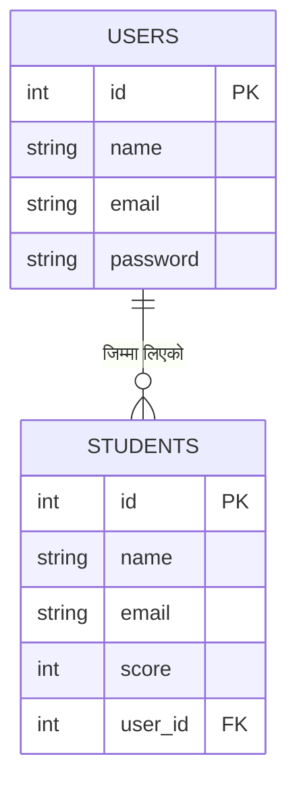

> 🇯🇵 मूल प्रति (जापानी भाषामा): [リレーショナルデータベース入門.md](<../../../2年生_システム開発実践/前期/2026_07_23/リレーショナルデータベース入門.md>) <!-- original-ja-link -->

## यो लेखबाट के थाहा हुन्छ

- टेबल, row र column
- Primary key
- Foreign key र टेबलहरूबीचको सम्बन्ध
- टेबल छुट्याउने कारण

## Database = व्यवस्थित गरिएका टेबलहरूको समूह

कागजमा छरिएर नोट लेख्नुको सट्टा, टेबलको रूपमा मिलाएर save गर्ने व्यवस्था नै "database" हो। RDB (relational database) को विशेषता भनेको, यस्ता टेबलहरू धेरै वटा जोडेर (= relation बनाएर) प्रयोग गर्न सकिनु हो।

## टेबल, row र column

यो app मा फरक-फरक काम गर्ने २ वटा टेबल छन्। हरेकलाई उदाहरण बनाएर, हरेक भागको नाम हेरौं।

### 🎓 students टेबल (विद्यार्थी डाटा)

| id | name | email | score |
|----|------|-------|-------|
| 1  | 田中太郎 | tanaka@example.com | 80 |
| 2  | 佐藤花子 | sato@example.com | 95 |

- **टेबल**: यो टेबल आफैं (काम अनुसार धेरै वटा बनाइन्छ)
- **Column**: `id` `name` `email` `score` जस्ता ठाडो दिशाका item
- **Row (record)**: एउटा रेकर्डको डाटा (यहाँ एक जना विद्यार्थीको जानकारी)

### 🔑 users टेबल (शिक्षक र administrator को login जानकारी)

| id | name | email | password |
|----|------|-------|----------|
| 1  | 小山先生 | koyama@example.com | $2y$10$abcdefGhIjKlmn...(ハッシュ化済み) |
| 2  | 田中先生 | tanaka-t@example.com | $2y$10$OpQrStUvWxYz...(ハッシュ化済み) |

- **टेबल**: `users` (login का लागि account जानकारी। students भन्दा फरक काम)
- **Column**: `id` `name` `email` `password`
- **Row (record)**: एउटा डाटा (यहाँ एक जना शिक्षक वा administrator को login जानकारी)

> 💡 `password` लाई टाइप गरिएको जस्ताको तस्तै string (plain text) का रूपमा नभई, hashing भनिने उल्टाउन नसकिने रूपान्तरण गरेपछि save गरिन्छ। कुनै कारणले database को सामग्री चुहिए पनि मूल password थाहा नहोस् भनेर यसो गरिन्छ।

## Primary key: डाटालाई अद्वितीय रूपमा छुट्याउने ID

`name` (नाम) ले मात्र खोज्दा, एउटै नाम भएका मानिसहरू भए कसलाई खोजिएको हो भनेर छुट्याउन सकिँदैन। त्यसैले, अरू कुनै row सँग कहिल्यै नदोहोरिने नम्बर (**primary key**) प्रयोग गरिन्छ। माथिको टेबलको `id` नै त्यही हो। "id = 1 भएको डाटा दिनुहोस्" भने, नतिजालाई 田中太郎 (Tanaka Taro) को एउटा रेकर्डमा सीमित गर्न सकिन्छ। Primary key लाई राष्ट्रिय परिचयपत्र नम्बर वा सदस्यता नम्बर जस्तै हो भनेर सम्झँदा बुझ्न सजिलो हुन्छ।

## Foreign key: टेबलहरूबीचको सम्बन्ध

धेरै टेबललाई ID ले जोड्न सकिनु नै RDB को मूल कुरा (= "relational" शब्द यहीँबाट आएको) हो।

यो app मा, login का लागि `users` टेबल (शिक्षक र administrator का account) र विद्यार्थी डाटाको `students` टेबल गरी २ वटा टेबल छन्। अहिलेसम्म यी दुई ID ले जोडिएका छैनन्, छुट्टाछुट्टै टेबल हुन्।

यदि "कुन शिक्षक (user) ले कुन विद्यार्थी (student) दर्ता गर्‍यो वा हेर्छ" भन्ने रेकर्ड राख्न मन लाग्यो भने, `students` टेबलमा `user_id` भन्ने column थपेर जोड्छौं।

`STUDENTS.user_id` (foreign key) ले `USERS.id` (primary key) लाई reference गर्ने व्यवस्था गरेमा, एक जना शिक्षक (user) ले धेरै विद्यार्थी (student) को जिम्मा लिन सक्ने सम्बन्ध (one-to-many) देखाउन सकिन्छ।

## किन टेबल छुट्याउने?

टेबल नछुट्याई एउटै टेबलमा राख्दा, एउटै जिम्मेवार शिक्षकको नाम र email address, उनले हेर्ने विद्यार्थीको संख्या जति नै पटक दोहोरिन्छ।

| student_id | student_name | staff_name | staff_email |
|-----------|-------|-------------|---------------|
| 101 | 田中花子 | 小山先生 | koyama@example.com |
| 103 | 田中次郎 | 小山先生 | koyama@example.com |

यसो हुँदा, 小山先生 (Koyama सर) ले email address बदल्दा सम्बन्धित सबै row खोजेर सच्याउनुपर्छ, र कुनै row छुट्ने सम्भावना हुन्छ। users टेबल र students टेबल छुट्याएर ID ले जोडेमा, Koyama सरको जानकारी एउटै ठाउँमा मात्र हुन्छ र सच्याउँदा पनि त्यही एक ठाउँमा सच्याए पुग्छ। यसरी "दोहोरिनबाट बच्न टेबल छुट्याउने" सोचलाई **normalization** भनिन्छ।

## सारांश

- Database भनेको, डाटा व्यवस्थित गरेर save गरिराख्ने व्यवस्था हो
- RDB ले डाटालाई "टेबल" को रूपमा व्यवस्थापन गर्छ, र टेबल "column (item)" र "row (एउटा रेकर्डको डाटा)" मिलेर बनेको हुन्छ
- Primary key भनेको, हरेक डाटालाई नदोहोरिने गरी छुट्याउने चिन्ह (ID) हो
- Foreign key भनेको, अर्को टेबलको primary key लाई reference गरेर टेबलहरूलाई जोड्ने व्यवस्था हो
- टेबल छुट्याएर जोड्दा, एउटै जानकारी दोहोरिनबाट रोकिन्छ, र डाटा व्यवस्थित गर्न सजिलो हुन्छ

यसपछि "SQL", "index", "transaction" जस्ता विषयहरू पनि आउँछन्, तर अहिलेका लागि यो आधारभूत अवधारणा बुझ्न सके पुग्छ।
