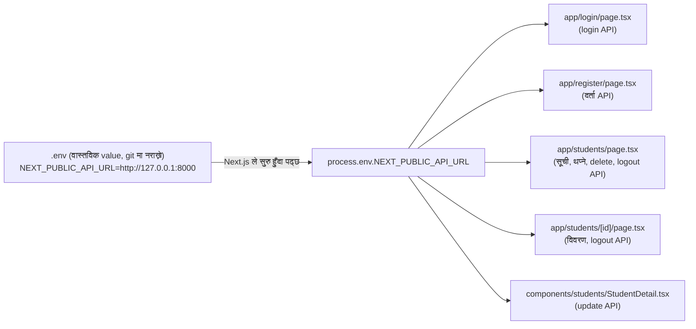
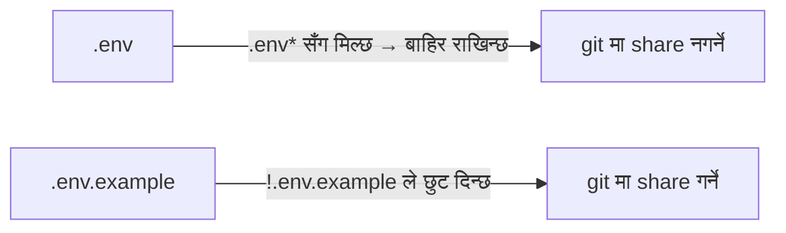

# कक्षा 26｜API को URL लाई environment variable (.env) मा छुट्याउने - implementation का चरणहरू

> 🇯🇵 मूल प्रति (जापानी भाषामा): [2026_07_30_実装.md](<../../../2年生_システム開発実践/前期/2026_07_30/2026_07_30_実装.md>) <!-- original-ja-link -->

## आजको लक्ष्य

- `school-frontend` का हरेक page मा सिधै लेखिएका `http://localhost:8000` / `http://127.0.0.1:8000` लाई एउटै ठाउँमा जम्मा गर्ने
- `.env` फाइल बनाएर, API को URL लाई environment variable `NEXT_PUBLIC_API_URL` को रूपमा व्यवस्थापन गर्ने
- `.env.example` (value नभएको template) लाई git मार्फत share गर्ने, र `.env` (वास्तविक value) लाई git को व्यवस्थापनबाट बाहिर राख्ने
- fetch प्रयोग गरिएका सबै ठाउँलाई `process.env.NEXT_PUBLIC_API_URL` मार्फत चल्ने गरी फेरि लेख्ने

> **यस पाठको स्थान:** अहिलेसम्म `fetch("http://127.0.0.1:8000/api/students")` जस्तै, API को URL हरेक फाइलमा सिधै लेखिएको थियो। यसरी लेख्दा, development environment र production environment मा URL फरक हुँदा धेरै ठाउँमा फाइल सुधार्नुपर्छ, र कतै सुधार्न बिर्सिँदा bug पनि आउँछ। यसपटक "बदलिन सक्ने value (URL वा API key आदि) लाई code भित्र नराखी, environment variable को रूपमा बाहिर निकाल्ने" भन्ने सोच सिक्छौं।

---

## समग्र चित्र: के बनाउने



> 💡 **उदाहरण दिँदा… ठेगाना एकै ठाउँमा राखिएको सम्पर्क डायरी**
>
> अहिलेसम्मको तरिका, साथीलाई चिठी पठाउँदा हरेक पटक "Tanaka को घर ◯◯ टोल 3-1" भनेर आफैं ठेगाना लेखेजस्तै थियो। यदि Tanaka घर सरे भने, लेखिसकेका सबै चिठी फेरि लेख्नुपर्छ। `.env` चाहिँ "सम्पर्क डायरी" जस्तै हो, जहाँ ठेगाना (API को URL) एउटै ठाउँमा मात्र लेखिन्छ, र चिठी (हरेक फाइलको fetch) बाट "सम्पर्क डायरीमा भएको Tanaka को ठेगाना" हेरिन्छ। घर सर्दा (URL बदलिँदा) पनि, सम्पर्क डायरी एक पटक सुधारे पुग्छ।

### किन `.env` र `.env.example` छुट्याउने?

यो app को `.env` मा गोप्य value छैन, तर सामान्यतया जोडिने DB को password वा API key जस्ता अरूले हेर्न नहुने value राखिन्छ। त्यसैले `.env` आफैंलाई `.gitignore` ले बाहिर राखिन्छ, र git मा share गरिँदैन। अर्कोतर्फ "कुन-कुन variable नाम चाहिन्छ" भन्ने कुरा team मा share गर्न चाहिन्छ, त्यसैले value खाली (वा dummy value) राखिएको `.env.example` मात्र commit गरिन्छ। project मा नयाँ सामेल भएको व्यक्तिले `.env.example` copy गरेर `.env` बनाउँछ, र आफ्नो environment अनुसार value हाल्छ।

### फाइल संरचना (यसपटक परिवर्तन गर्ने फाइलहरू)

| चिन्ह | अर्थ |
|---|---|
| 🆕 नयाँ | नयाँ फाइल बनाउने |
| ➕ थप्ने | पहिले नै भएको फाइलमा code थप्ने |
| 🔁 बदल्ने | पहिले नै भएको प्रक्रिया फेरि लेख्ने |

```
school-frontend/
├── .env                                       🆕 नयाँ (वास्तविक value, git मा नराख्ने)
├── .env.example                               🆕 नयाँ (template, git मा राख्ने)
├── .gitignore                                 ➕ .env.example लाई मात्र बाहिर राख्ने नियमबाट छुट दिने
├── app/login/page.tsx                         🔁 fetch को URL लाई environment variable ले बदल्ने
├── app/register/page.tsx                      🔁 fetch को URL लाई environment variable ले बदल्ने
├── app/students/page.tsx                      🔁 fetch को URL लाई environment variable ले बदल्ने (४ ठाउँ)
├── app/students/[id]/page.tsx                 🔁 fetch को URL लाई environment variable ले बदल्ने (२ ठाउँ)
└── components/students/StudentDetail.tsx      🔁 fetch को URL लाई environment variable ले बदल्ने
```

---

## Step 1｜`.env` बनाउने

**🆕 नयाँ फाइल** — `school-frontend` को ठीक मुनि `.env` बनाउनुहोस्।

```bash
# ▼ school-frontend/.env
NEXT_PUBLIC_API_URL=http://127.0.0.1:8000
```

- key नामको सुरुमा `NEXT_PUBLIC_` लगाउनु मुख्य कुरा हो। Next.js ले `NEXT_PUBLIC_` लगाइएका environment variable मात्र, browser तर्फ (client component) बाट पनि पढ्न सकिने गरी build मा राखिदिन्छ। यसपटक फेरि लेख्ने `fetch` सबै `"use client"` लगाइएका component भित्र भएकाले, यो prefix अनिवार्य छ।
- `NEXT_PUBLIC_` नलगाइएका environment variable (उदाहरण: DB को password आदि) server तर्फको code बाट मात्र पढ्न सकिन्छ। browser ले हेर्न नहुने value मा यो prefix नलगाउनुहोस्।

---

## Step 2｜`.env.example` बनाउने

**🆕 नयाँ फाइल** — team मा share गर्ने template को रूपमा, उस्तै content भएको फाइल बनाउनुहोस्। यसपटक गोप्य जानकारी नभएको URL भएकाले, उही value नै लेख्छौं।

```bash
# ▼ school-frontend/.env.example
NEXT_PUBLIC_API_URL=http://127.0.0.1:8000
```

> ⚠️ password वा API key जस्ता साँच्चै गोप्य value भएमा, `.env.example` मा वास्तविक value नलेखी, `DB_PASSWORD=` जस्तै खाली राख्ने वा `your-api-key-here` जस्तो dummy value राख्ने गर्नुहोस्।

---

## Step 3｜`.gitignore` मा `.env.example` लाई मात्र बाहिर राख्ने नियमबाट छुट दिने

`create-next-app` ले सुरुदेखि नै तयार पारेको `.gitignore` मा, तल जस्तै `.env*` भन्ने wildcard नियम छ।

```
# env files (can opt-in for committing if needed)
.env*
```

यो नियमले `.env` मात्र होइन, `.env.example` सहित "`.env` बाट सुरु हुने सबै फाइल" लाई बाहिर राख्छ। गोप्य जानकारी गल्तीले commit नहोस् भन्ने सुरक्षाको हिसाबले यो ठीक setting हो, तर यसो हुँदा share गर्नुपर्ने `.env.example` पनि git को व्यवस्थापनबाट बाहिर पर्छ। त्यसैले, `.env.example` लाई मात्र अपवादको रूपमा बाहिर नराख्ने setting एक लाइन थप्छौं।

**➕ थप्ने**

```
# env files (can opt-in for committing if needed)
.env*
!.env.example
```

सुरुमा `!` लगाउँदा "यो pattern लाई बाहिर नराख्ने (= git मा व्यवस्थापन गर्ने)" भन्ने अर्थ हुन्छ। `.env*` ले पहिले सबैलाई बाहिर राखेपछि `!.env.example` ले `.env.example` लाई मात्र फिर्ता ल्याउने, यो क्रम महत्त्वपूर्ण छ (उल्टो क्रममा राखे काम गर्दैन)।

यो setting पछि दुई फाइललाई यसरी ह्यान्डल गरिन्छ।



---

## Step 4｜fetch को URL लाई environment variable ले बदल्ने

यहाँसम्म `.env` तयार भयो, तर वास्तविक code ले अझै `http://127.0.0.1:8000` लाई सिधै हेरिरहेको छ। हरेक फाइलको fetch call लाई `process.env.NEXT_PUBLIC_API_URL` प्रयोग गर्ने template literal मा फेरि लेख्छौं।

### 4-1. `app/login/page.tsx`

**🔁 बदल्ने**

```tsx
// Before
const res = await fetch("http://127.0.0.1:8000/api/login", {

// After
const res = await fetch(`${process.env.NEXT_PUBLIC_API_URL}/api/login`, {
```

### 4-2. `app/register/page.tsx`

**🔁 बदल्ने**

```tsx
// Before
const res = await fetch("http://127.0.0.1:8000/api/register", {

// After
const res = await fetch(`${process.env.NEXT_PUBLIC_API_URL}/api/register`, {
```

### 4-3. `app/students/page.tsx` (४ ठाउँ)

**🔁 बदल्ने** — सूची लिने, विद्यार्थी थप्ने, विद्यार्थी delete गर्ने र logout गर्ने गरी ४ वटा fetch लाई छुट्टाछुट्टै फेरि लेख्नुहोस्।

```tsx
// सूची लिने (Before → After)
const res = await fetch("http://127.0.0.1:8000/api/students", {
const res = await fetch(`${process.env.NEXT_PUBLIC_API_URL}/api/students`, {

// विद्यार्थी थप्ने (Before → After)
const res = await fetch("http://127.0.0.1:8000/api/students", {
const res = await fetch(`${process.env.NEXT_PUBLIC_API_URL}/api/students`, {

// विद्यार्थी delete गर्ने (Before → After)
const res = await fetch(`http://127.0.0.1:8000/api/students/${id}`, {
const res = await fetch(`${process.env.NEXT_PUBLIC_API_URL}/api/students/${id}`, {

// Logout (Before → After)
await fetch("http://127.0.0.1:8000/api/logout", {
await fetch(`${process.env.NEXT_PUBLIC_API_URL}/api/logout`, {
```

### 4-4. `app/students/[id]/page.tsx` (२ ठाउँ)

**🔁 बदल्ने** — यस फाइलमा पहिलेदेखि नै `http://localhost:8000` प्रयोग गरिएको थियो (`127.0.0.1` को सट्टा `localhost` लेखिएको थियो)। लेखाइ एकनास नहुनु आफैंले "URL लाई एउटै ठाउँमा जम्मा गर्नु" किन आवश्यक छ भन्ने देखाउँछ।

```tsx
// विवरण लिने (Before → After)
const res = await fetch(`http://localhost:8000/api/students/${params.id}`, {
const res = await fetch(`${process.env.NEXT_PUBLIC_API_URL}/api/students/${params.id}`, {

// Logout (Before → After)
await fetch("http://localhost:8000/api/logout", {
await fetch(`${process.env.NEXT_PUBLIC_API_URL}/api/logout`, {
```

### 4-5. `components/students/StudentDetail.tsx`

**🔁 बदल्ने**

```tsx
// Before
const res = await fetch(`http://localhost:8000/api/students/${student.id}`, {

// After
const res = await fetch(`${process.env.NEXT_PUBLIC_API_URL}/api/students/${student.id}`, {
```

> 💡 मूल string `"http://..."` जस्तो double quote (साधारण string) मा भएका ठाउँलाई पनि, `${...}` राख्नका लागि backquote (\` \`) को template literal मा बदल्नुपर्छ। पहिले नै template literal भएका ठाउँ (`` `http://127.0.0.1:8000/api/students/${id}` `` आदि) मा backquote त्यसै राखेर, भित्रको string भाग मात्र बदल्नुहोस्।

---

## चलाएर जाँच्ने

```bash
# Backend
cd Laravel && php artisan serve   # http://localhost:8000

# Frontend
cd school-frontend && npm run dev # http://localhost:3000
```

> ⚠️ `.env` नयाँ बनाउँदा वा value बदल्दा, `npm run dev` एक पटक रोकेर फेरि सुरु गर्नुहोस्। Next.js ले environment variable build वा सुरु हुने बेलामा पढ्छ, त्यसैले server चलिरहेकै बेला `.env` बदले पनि त्यो परिवर्तन hot reload बाट लागू हुँदैन।

| जाँच्ने कुरा | गर्ने काम | अपेक्षित नतिजा |
|---|---|---|
| code भित्र सिधै लेखिएको URL बाँकी छ कि छैन | `grep -rn "localhost:8000\|127.0.0.1:8000" app components` चलाउने | केही पनि output आउँदैन (सबै `process.env` मार्फत बदलिएको छ) |
| Login | `/login` बाट login गर्ने | पहिले जस्तै login हुन्छ, र `/students` मा जान्छ |
| सूची, विवरण, थप्ने, delete | `/students` मा सबै काम क्रमशः गर्ने | सबै पहिले जस्तै चल्छ (URL को लेखाइ मात्र बदलिएको हो, व्यवहार बदलिँदैन) |
| Environment variable बदल्ने | `.env` को value लाई अस्थायी रूपमा अर्को port (उदाहरण: नभएको port) मा बदलेर फेरि सुरु गर्ने | API सँग connect हुन fail हुन्छ = `.env` को value साँच्चै प्रयोग भइरहेको छ भनेर पुष्टि हुन्छ (जाँचेपछि पहिलेकै value मा फर्काउने) |
| git मा कसरी देखिन्छ | `git status` चलाउने | `.env` देखिँदैन (बाहिर राखिएको छ), `.env.example` चाहिँ untracked फाइलको रूपमा देखिन्छ |

---

## सारांश

| अवधारणा | यसपटक काम गरेको ठाउँ |
|---|---|
| Environment variable मा छुट्याउने | `.env` को `NEXT_PUBLIC_API_URL` |
| Client तर्फ environment variable पढ्ने शर्त | `NEXT_PUBLIC_` prefix |
| गोप्य जानकारी git मा नराख्ने उपाय | `.gitignore` को `.env*` |
| Template मात्र team मा share गर्ने उपाय | `.env.example` ＋ `!.env.example` ले दिएको छुट |
| Environment variable लागू हुने समय | `.env` बदलेपछि development server फेरि सुरु गर्नुपर्छ |

## पूरा भएको जाँचसूची (Definition of Done)

- [ ] `school-frontend/.env` मा `NEXT_PUBLIC_API_URL=http://127.0.0.1:8000` set गरिएको छ
- [ ] `school-frontend/.env.example` बनाइएको छ, र उही variable नाम template को रूपमा लेखिएको छ
- [ ] `.gitignore` मा `!.env.example` थपिएको छ, र `.env.example` मात्र git मा व्यवस्थापन गर्न सकिन्छ
- [ ] `app/login/page.tsx` / `app/register/page.tsx` / `app/students/page.tsx` / `app/students/[id]/page.tsx` / `components/students/StudentDetail.tsx` का fetch सबै `process.env.NEXT_PUBLIC_API_URL` मार्फत चल्छन्
- [ ] `grep -rn "localhost:8000\|127.0.0.1:8000" app components` मा केही पनि भेटिँदैन
- [ ] `npm run dev` फेरि सुरु गरेको अवस्थामा, login देखि सूची, विवरण, थप्ने र delete सम्म पहिले जस्तै चल्छ
- [ ] `git status` मा `.env` देखिँदैन, र `.env.example` मात्र व्यवस्थापनमा परेको छ

## चलाउने command

```bash
# Backend
cd Laravel && php artisan serve   # http://localhost:8000

# Frontend
cd school-frontend && npm run dev # http://localhost:3000
```
