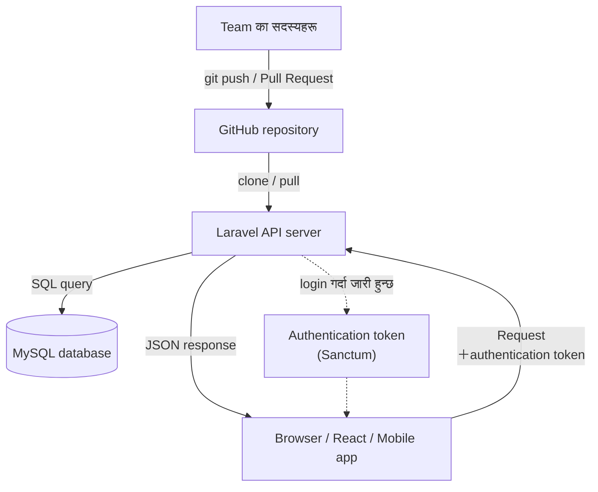
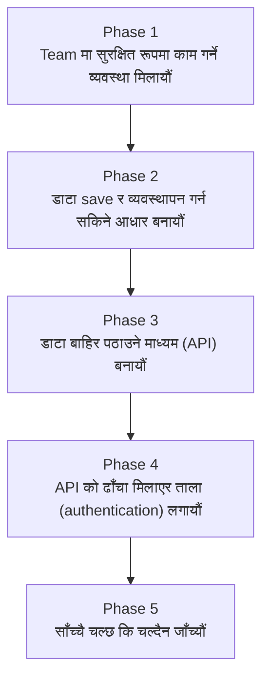

# डेभलपमेन्टको क्रम: शून्यबाट API बनाउँदासम्म

> 🇯🇵 मूल प्रति (जापानी भाषामा): [開発の流れ_まとめ.md](<../../2年生_システム開発実践/前期/開発の流れ_まとめ.md>) <!-- original-ja-link -->

---

## सुरुमा

यो सामग्रीमा "के गर्‍यौं" मात्र होइन, "**किन त्यही क्रममा गर्‍यौं**" भन्ने कुरा पनि व्याख्या गर्छौं।

---

## समग्र चित्र: के बनायौं

### पूरा भएको system को समग्र चित्र



### ५ वटा phase

| Phase | विषय | मुख्य शब्द | सम्बन्धित कक्षा |
|---------|--------|-----------|---------|
| 1 | Team development को तयारी | Branch, PR, Review | 04/30 |
| 2 | App को आधार बनाउने | Laravel, DB, Migration | 05/06 |
| 3 | डाटा आदानप्रदान गर्ने माध्यम बनाउने | REST API, JSON, Routing | 05/14 |
| 4 | ढाँचा र सुरक्षा व्यवस्थित गर्ने | Resource, Validation, Sanctum | 05/21 |
| 5 | चलिरहेको छ कि छैन जाँच्ने | curl, Browser test | 05/28 |

---

## Phase 1: Team development को तयारी

### के गर्‍यौं

Git को branch, merge, Pull Request (PR) र code review सिकेर,
app लाई team मिलेर GitHub मा राखी सबैले चलाउन सक्ने अवस्थामा पुर्‍यायौं।

### किन आवश्यक थियो

> 💡 **उदाहरण दिँदा… निर्माण स्थलमा नक्साको व्यवस्थापन**
>
> ठूलो भवन धेरै ठेकेदारले मिलेर बनाउँदा, सबैले "एउटै मूल नक्सा" मा
> सिधै लेखे भने अन्योल हुन्छ। त्यसैले हरेक ठेकेदारले "आफ्नै copy (branch)"
> मा लेख्छन्, र काम सकिएपछि एकैचोटि मिलान (review) गरेर मात्र मूल नक्सामा लागू गर्छन्।

Team development मा धेरै जनाले एउटै फाइल एकैसाथ edit गर्छन्।
Branch बनाएर "main code नबिगारी नयाँ feature विकास गर्न" सकिन्छ।
PR भनेको "यो code main मा राख्न मिल्छ?" भन्ने अनुरोध हो, र
review भनेको त्यो code सही छ कि छैन, पढ्न सजिलो छ कि छैन भनेर team ले जाँच्ने ठाउँ हो।

> ⚠️ **यो नभए…** कसैको code ले अर्काको code माथि overwrite गरेर मेटाइदिन्छ।
> "भर्खरसम्म चलिरहेको थियो, अहिले चल्दैन" भन्ने समस्या बारम्बार आउँछ।

### यो phase पछि गर्न सक्ने कुराहरू

- `git switch -c feature/xxxx` ले branch बनाएर काम गर्न सक्ने
- `git push origin feature/xxxx` ले team सँग share गर्न सक्ने
- GitHub मा PR बनाएर review को अनुरोध गर्न सक्ने
- Review को comment अनुसार code सुधार्न सक्ने

### विस्तृत चरणहरू

→ [`2026_04_30/2026_04_30.md`](2026_04_30/2026_04_30.md)

---

## Phase 2: App को आधार बनाउने

### के गर्‍यौं

Laravel project बनाएर, database (`school_api`) तयार पार्‍यौं,
`students` टेबल परिभाषित गरी बनायौं। Test डाटा १० वटा हालेर server सुरु गर्‍यौं।

### किन आवश्यक थियो

> 💡 **उदाहरण दिँदा… रेस्टुरेन्टको भान्सा बनाउने**
>
> ग्राहकलाई खाना (API को response) दिन,
> पहिले भान्सा (Laravel) र सामग्री राख्ने ठाउँ (database) चाहिन्छ।
> भान्साको नक्सा (migration) पहिले नै बनाइराखे,
> team को जो कोहीले पनि उस्तै environment फेरि बनाउन सक्छ।

Laravel भनेको "धेरै प्रयोग हुने सुविधाहरू (routing, DB operation, authentication आदि) सुरुदेखि नै भएको बाकस" हो।
Migration भनेको database को design document हो, र `php artisan migrate` चलाउने बित्तिकै
team का सबैले आफ्नो computer मा उस्तै टेबल संरचना बनाउन सक्छन्।
Seeder ले test डाटा आफैं बनाउँछ, र हातैले डाटा हाल्ने झन्झट हटाउँछ।

> ⚠️ **यो नभए…** API को code लेखे पनि डाटा save गर्ने ठाउँ नहुने भएकाले,
> हरेक request मा डाटा हराउँछ।

### यो phase पछि गर्न सक्ने कुराहरू

- `composer create-project laravel/laravel` ले project बनाउन सक्ने
- `.env` मा DB connection जानकारी set गर्न सक्ने
- `php artisan make:model Student -mf` ले model, migration र factory एकैचोटि बनाउन सक्ने
- `php artisan migrate` ले टेबल बनाउन सक्ने
- `php artisan db:seed` ले test डाटा हाल्न सक्ने
- `php artisan serve` ले local server सुरु गर्न सक्ने

### विस्तृत चरणहरू

→ [`2026_05_06/20260506.md`](2026_05_06/20260506.md)

---

## Phase 3: डाटा आदानप्रदान गर्ने माध्यम बनाउने

### के गर्‍यौं

REST API को अवधारणा (URL × HTTP method, JSON response, status code) सिकेर,
`StudentController` बनाई `GET /api/students` सहित ५ वटा endpoint implement गर्‍यौं।

### किन आवश्यक थियो

> 💡 **उदाहरण दिँदा… vending machine का button**
>
> Vending machine मा "कोला", "चिया", "पानी" जस्ता button हुन्छन्,
> थिच्दा सम्बन्धित सामान निस्कन्छ।
> API को endpoint पनि त्यस्तै हो,
> "`GET /api/students` (सबै दिनुहोस्)", "`DELETE /api/students/3` (३ नम्बर delete गर्नुहोस्)"
> जस्तै URL × HTTP method को संयोजनले के गर्ने भन्ने तय हुन्छ।

पहिलो वर्षमा बनाएको Blade app ले HTML page फर्काउँथ्यो।
API ले त्यसको सट्टा JSON डाटा मात्र फर्काउँछ।
JSON बनाउँदा, React, Vue, mobile app जस्ता
**फरक-फरक screen बाट एउटै डाटा फेरि-फेरि प्रयोग गर्न** सकिन्छ।

> ⚠️ **यो नभए…** frontend र server बीच कुराकानी हुन सक्दैन।
> React बाट API call गरे पनि "कहाँ पठाउने थाहा छैन" भन्ने अवस्था हुन्छ।

### यो phase पछि गर्न सक्ने कुराहरू

- REST API को URL design (resource नाम, HTTP method) बुझ्न सक्ने
- `php artisan make:controller Api/StudentController --api` ले API controller बनाउन सक्ने
- `routes/api.php` मा routing थप्न सक्ने
- `response()->json()` ले JSON response फर्काउन सक्ने
- HTTP status code (200, 201, 404, 422) को अर्थ थाहा पाउने

### विस्तृत चरणहरू

→ [`2026_05_14/20260514.md`](2026_05_14/20260514.md)

---

## Phase 4: ढाँचा र सुरक्षा व्यवस्थित गर्ने

### के गर्‍यौं

`StudentResource` प्रयोग गरेर response को ढाँचा एकनास बनायौं र validation मार्फत input डाटा जाँच्ने व्यवस्था थप्यौं।
Laravel Sanctum प्रयोग गरेर authentication सुविधा (login, token जारी गर्ने, logout) implement गर्‍यौं।

### किन आवश्यक थियो

> 💡 **उदाहरण दिँदा… पार्सलको ढुवानी लेबलको ढाँचा ＋ भवन प्रवेश पास**
>
> Courier मा "पठाउने व्यक्ति, प्राप्तकर्ता, सामानको नाम" तोकिएको ठाउँमा लेखिएको हुन्छ।
> फारम एकनास भएकाले, लिने पक्षले अलमल नगरी काम गर्न सक्छ।
> `StudentResource` भनेको response को format तय गर्ने "ढुवानी लेबलको ढाँचा" हो।
>
> Sanctum को token भनेको "भवन प्रवेश पास" हो।
> login गर्दा जारी गरिएको प्रवेश पास (token) भएका व्यक्ति मात्र
> भवन (API) भित्र पस्न सक्छन्।

Phase 3 मा API चल्ने भयो, तर अझै जो कोहीले पनि access गर्न सक्ने अवस्थामा थियो।
Authentication नभए अपरिचित व्यक्तिले पनि डाटा मनलाग्दी लिन र delete गर्न सक्छ।
त्यसैगरी API को response format एकनास नभए, frontend लाई डाटा चलाउन गाह्रो हुन्छ।

> ⚠️ **यो नभए…** internet मा जो कोहीले पनि डाटा फेरबदल गर्न वा delete गर्न सक्छ।
> password र email address जस्ता व्यक्तिगत जानकारी सबैले देख्ने खतरा पनि हुन्छ।

### यो phase पछि गर्न सक्ने कुराहरू

- `php artisan make:resource StudentResource` ले response मिलाउने class बनाउन सक्ने
- `$request->validate()` ले validation लेख्न सक्ने
- `composer require laravel/sanctum` ले authentication package install गर्न सक्ने
- `POST /api/login` ले token लिन सक्ने
- `auth:sanctum` middleware ले authentication चाहिने route लाई सुरक्षित गर्न सक्ने

### विस्तृत चरणहरू

→ [`2026_05_21/20260521.md`](2026_05_21/20260521.md)

---

## Phase 5: चलिरहेको छ कि छैन जाँच्ने

### के गर्‍यौं

`curl` command प्रयोग गरेर API मा request पठाई त्यसको काम जाँच्यौं,
अनि browser बाट चलाउन सकिने test screen (`/api-test`) बनाएर
login गर्ने, विद्यार्थी सूची लिने, विद्यार्थी थप्ने र delete गर्ने पूरै क्रम जाँच्यौं।

### किन आवश्यक थियो

> 💡 **उदाहरण दिँदा… बनिसकेको vending machine मा साँच्चै पैसा हालेर हेर्ने**
>
> Vending machine design गरेर बनाए पनि, साँच्चै पैसा हालेर button नथिचेसम्म
> "साँच्चै सामान निस्कन्छ कि निस्कँदैन" थाहा हुँदैन।
> API पनि त्यस्तै हो, code लेखेर मात्र सही चल्छ कि चल्दैन थाहा हुँदैन।
> साँच्चै request पठाएर, अपेक्षा गरे जस्तै JSON फर्किन्छ कि फर्किँदैन जाँच्नुपर्छ।

`curl` भनेको "terminal बाट HTTP request पठाउने command" हो।
Browser नखोली नै API चलेको छ कि छैन तुरुन्तै जाँच्न सकिन्छ।
Browser test screen भनेको curl ले गर्ने काम नै graphical रूपमा गर्न सकिने page हो,
र "React बाट हेर्दा यस्तो देखिन्छ" भन्ने कल्पना गर्न पनि मद्दत गर्छ।

> ⚠️ **यो नभए…** bug थाहा नपाई production environment मा पुग्छ।
> "development environment मा चलिरहेको थियो, production मा बिग्रियो" भन्ने समस्या रोक्न पनि चलाएर जाँच्नु अनिवार्य छ।

### यो phase पछि गर्न सक्ने कुराहरू

- `curl` ले GET, POST र DELETE request पठाउन सक्ने
- `Authorization: Bearer <token>` header ले authentication सहितको request पठाउन सक्ने
- Browser बाट API को login, सूची लिने, थप्ने र delete गर्ने काम चलाउन सक्ने
- HTTP status code र response को JSON पढेर "सही चलिरहेको छ कि छैन" निर्णय गर्न सक्ने

### विस्तृत चरणहरू

→ [`2026_05_28/20260528.md`](2026_05_28/20260528.md)

---

## सारांश: ५ वटा phase जोडिए

५ वटा phase फर्केर हेर्दा, हरेक phase अघिल्लो phase माथि थपिँदै गएको देखिन्छ।



अर्थात्, हरेक phase "अर्को phase का लागि आवश्यक थियो"।
क्रम बदलियो भने यो सम्भव हुँदैन।

### अर्को चरण

यो API अहिले नै **React जस्ता frontend बाट call गर्न सकिने अवस्थामा** छ।
```javascript
fetch('/api/students', { headers: { Authorization: 'Bearer ' + token } })
```
यति लेख्ने बित्तिकै, browser मा डाटा लिएर देखाउन सकिन्छ।

अब आउने पढाइमा "यो API प्रयोग गरेर screen बनाउने" frontend development तर्फ अगाडि बढ्छौं।
