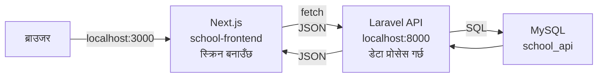
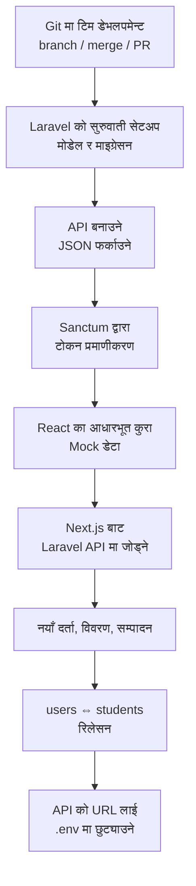
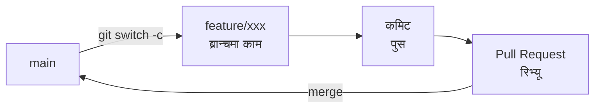
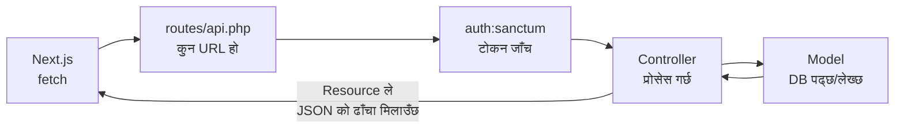
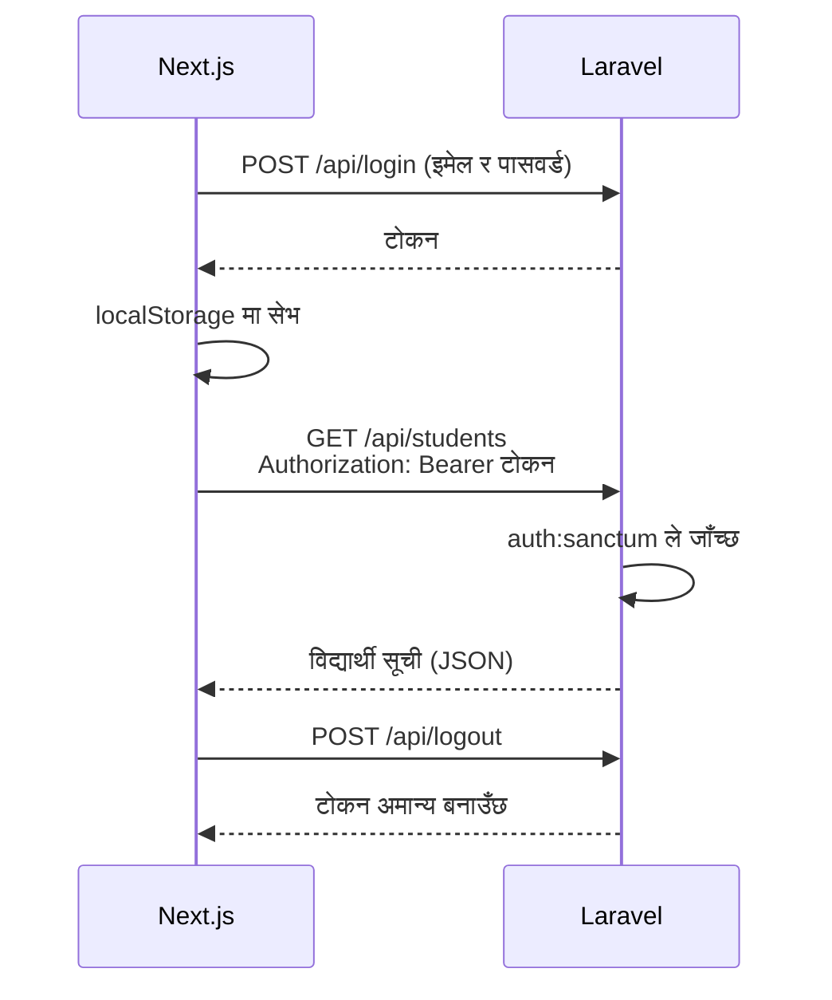
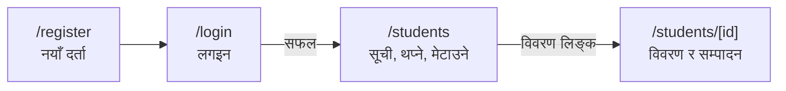
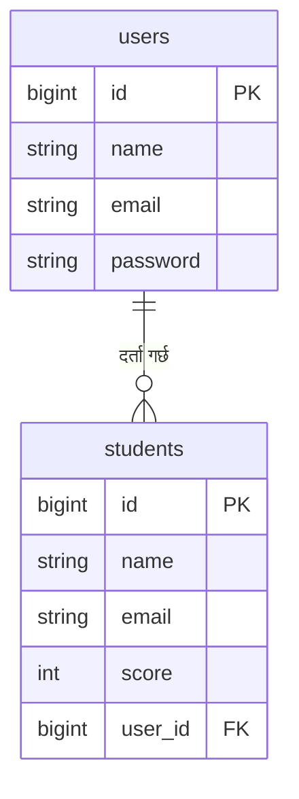
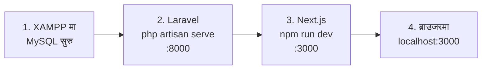

# पहिलो सेमेस्टरको पुनरावलोकन (दोहोर्‍याइ)

> 🇯🇵 मूल प्रति (जापानी भाषामा): [2026_10_02_資料1.md](<../../../2年生_システム開発実践/後期/2026_10_02/2026_10_02_資料1.md>) <!-- original-ja-link -->

दोस्रो सेमेस्टर सुरु गर्नुअघि, पहिलो सेमेस्टरमा बनाएको **विद्यार्थी व्यवस्थापन एप** को समग्र रूप एकपटक सम्झिऔँ।
पहिलो सेमेस्टरमा हामीले स्क्रिन (फ्रन्टएन्ड) र डेटा प्रोसेसिङ (ब्याकएन्ड) लाई **छुट्टाछुट्टै एप** का रूपमा बनायौँ र API मार्फत जोड्यौँ।



- **Next.js**: स्क्रिन बनाउने जिम्मेवारी। बटन थिचिँदा Laravel लाई अनुरोध (रिक्वेस्ट) पठाउँछ
- **Laravel**: अनुरोध लिने, डेटाबेस पढ्ने र त्यसमा लेख्ने, अनि नतिजा **JSON** मा फर्काउने जिम्मेवारी
- **MySQL**: डेटा भण्डारण गर्ने जिम्मेवारी

---

## 1. पहिलो सेमेस्टरको क्रम

पहिलो सेमेस्टरमा हामीले तलको क्रममा एपलाई बिस्तारै विकास गर्‍यौँ।



| कक्षा | विषयवस्तु | सामग्री |
|----|------|------|
| 4/30 | Git टिम डेभलपमेन्ट (branch, merge, Pull Request) | [सामग्री](../../前期/2026_04_30/2026_04_30.md) |
| 5/6 | Laravel प्रोजेक्टको सुरुवाती सेटअप | [सामग्री](../../前期/2026_05_06/20260506.md) |
| 5/14 | Blade एपलाई API मा बदल्ने | [सामग्री](../../前期/2026_05_14/20260514.md) |
| 5/21 | रिसोर्स कन्ट्रोलर र Sanctum द्वारा टोकन प्रमाणीकरण | [सामग्री](../../前期/2026_05_21/20260521.md) |
| 5/28 | ब्राउजरमा टोकन प्रमाणीकरण जाँच्ने | [सामग्री](../../前期/2026_05_28/20260528.md) |
| 6/11 | React का आधारभूत कुरा (कम्पोनेन्ट, JSX, props, useState) | [सामग्री](../../前期/2026_06_11/2026_06_11.md) |
| 7/2 | Next.js परिचय → Laravel API सँग जोड्ने | [सामग्री](../../前期/2026_07_02/2026_07_02.md) |
| 7/9 | नयाँ प्रयोगकर्ता दर्ता + टोकन, CRUD, MVC को दोहोर्‍याइ | [सामग्री](../../前期/2026_07_09/2026_07_09.md) |
| 7/16 | विवरण स्क्रिन र सम्पादन सुविधा | [सामग्री](../../前期/2026_07_16/2026_07_16_実装.md) |
| 7/23 | users ⇔ students को रिलेसन | [सामग्री](../../前期/2026_07_23/2026_07_23_実装%20.md) |
| 7/30 | API को URL लाई .env मा छुट्याउने | [सामग्री](../../前期/2026_07_30/2026_07_30_実装.md) |

---

## 2. Git मा टिम डेभलपमेन्ट

टिममा एउटै रिपोजिटरीमा काम गर्दा, हामीले **ब्रान्च** बनाएर काम गर्‍यौँ र **Pull Request (PR)** मार्फत रिभ्यू गरेपछि मात्र main मा मिलायौँ (GitHub Flow)।



- **main लाई सिधै नछुने**: जुनसुकै बेला पनि चल्ने अवस्थामा राख्ने
- दुई जनाले एउटै लाइन बदले भने **कन्फ्लिक्ट** हुन्छ → फाइल खोलेर हातैले मिलाएपछि कमिट गर्ने

---

## 3. Laravel API

### MVC (रेस्टुरेन्टको उदाहरण)

| भूमिका | फाइलको उदाहरण | रेस्टुरेन्टसँग तुलना गर्दा |
|------|------------|-----------|
| **Model** | `app/Models/Student.php` | भान्सा र फ्रिज (डेटा सम्हाल्छ) |
| **Controller** | `app/Http/Controllers/Api/StudentController.php` | वेटर (अर्डर लिएर ल्याउँछ) |
| **View** | → API बनाएपछि **Next.js मा सर्‍यो** | खाना सजाउने काम (देखावट) |

API बनाएपछि, Laravel ले स्क्रिन बनाउँदैन, **JSON (डेटा मात्र)** फर्काउँछ।

### रिक्वेस्ट जाने बाटो



### बनाएका API

`Route::apiResource('students', ...)` को एउटै लाइनले CRUD का ५ वटा रुट एकैपटक बनायो।

| CRUD | मेथड | URL | Controller | प्रमाणीकरण |
|------|---------|-----|-----------|:----:|
| — | POST | `/api/register` | `AuthController@register` | आवश्यक छैन |
| — | POST | `/api/login` | `AuthController@login` | आवश्यक छैन |
| — | POST | `/api/logout` | `AuthController@logout` | 🔒 |
| Read | GET | `/api/students` | `index` (सूची) | 🔒 |
| Create | POST | `/api/students` | `store` (थप्ने) | 🔒 |
| Read | GET | `/api/students/{id}` | `show` (विवरण) | 🔒 |
| Update | PUT | `/api/students/{id}` | `update` (अपडेट) | 🔒 |
| Delete | DELETE | `/api/students/{id}` | `destroy` (मेटाउने) | 🔒 |

🔒 भएका रुटहरू `auth:sanctum` भित्र छन्, त्यसैले **टोकन नभए 401 एरर** आउँछ।

---

## 4. टोकन प्रमाणीकरण

लगइन गर्दा Laravel ले **टोकन** (मनोरञ्जन पार्कको रिस्टब्यान्ड जस्तै) जारी गर्छ।
Next.js ले त्यसलाई सुरक्षित राख्छ र API बोलाउँदा हरेकपटक देखाउँछ।



काम नगरेमा, ब्राउजरको **डेभलपर टुल्स** मा जाँच्नुहोस्।

- `Application` ट्याब → `Local Storage`: टोकन सेभ भएको छ कि छैन
- `Network` ट्याब: रिक्वेस्टमा `Authorization: Bearer ...` लागेको छ कि छैन

---

## 5. Next.js का स्क्रिनहरू

`app/` भित्रका फोल्डरहरू नै सिधै **URL** बने।



| URL | फाइल | प्रयोग हुने API |
|-----|---------|--------|
| `/login` | `app/login/page.tsx` | `POST /api/login` |
| `/register` | `app/register/page.tsx` | `POST /api/register` |
| `/students` | `app/students/page.tsx` | सूची, थप्ने, मेटाउने, लगआउट |
| `/students/[id]` | `app/students/[id]/page.tsx` + `components/students/StudentDetail.tsx` | विवरण र अपडेट |

`[id]` जस्तै फोल्डरको नामलाई `[ ]` ले घेरेमा, `/students/1`, `/students/2` … जस्तै **URL को एक भागलाई भेरिएबलका रूपमा लिन सकिन्छ**।

React का आधारभूत कुरा पनि सम्झिऔँ।

| नाम | भूमिका |
|------|------|
| **कम्पोनेन्ट** | स्क्रिनका भागहरू (`LoginForm`, `StudentList` आदि) |
| **props** | प्यारेन्टबाट चाइल्ड कम्पोनेन्टमा डेटा पठाउँछ |
| **useState** | स्क्रिनमा बदलिने मानहरू (इनपुट, सूचीको डेटा आदि) राख्छ |
| **useEffect** | स्क्रिन देखिँदा जस्ता अवस्थामा API कल गरेर डेटा ल्याउँछ |

---

## 6. टेबल र रिलेसन

विद्यार्थीलाई "कसले दर्ता गर्‍यो" भन्ने थाहा पाउन, `students` मा `user_id` (फरेन की) थप्यौँ।



- एक जना प्रयोगकर्ताले धेरै विद्यार्थी दर्ता गर्न सक्छ (**एक-देखि-धेरै**)
- मोडेलमा `hasMany` / `belongsTo` लेखेमा, `$student->user->name` बाट दर्ता गर्ने व्यक्तिको नाम पाउन सकिन्छ

---

## 7. दुई वटा .env

Laravel र Next.js दुवैमा **छुट्टाछुट्टै `.env`** हुन्छ।

| फाइल | लेखिएको कुरा | उदाहरण |
|---------|--------------|----|
| Laravel को `.env` | डेटाबेस जडानको ठेगाना | `DB_DATABASE=school_api` |
| Next.js को `.env` | API को URL | `NEXT_PUBLIC_API_URL=http://127.0.0.1:8000` |

- `.env` लाई **Git मा नराख्ने** (पासवर्ड जस्ता कुरा हुन सक्ने भएकाले)
- बरु, मान खाली गरिएको `.env.example` सेयर गर्ने
- `.env` परिवर्तन गरेपछि **डेभलपमेन्ट सर्भर रिस्टार्ट** गर्ने

---

## 8. एप चलाउने क्रम

तीनै वटा नचलेसम्म एप चल्दैन। तलको क्रममा सुरु गर्नुहोस्।



टर्मिनल **दुई वटा** खोल्नुहोस्।

```bash
# टर्मिनल ① ब्याकएन्ड
cd Laravel
php artisan serve        # → http://localhost:8000

# टर्मिनल ② फ्रन्टएन्ड
cd school-frontend
npm run dev              # → http://localhost:3000
```

---

## जाँच क्विज

व्याख्या गर्न सक्नुहुन्छ कि सक्नुहुन्न, जाँचेर हेर्नुहोस्।

- [ ] Next.js र Laravel ले क्रमशः के-के जिम्मेवारी लिन्छन्?
- [ ] `GET /api/students` र `POST /api/students` मा के फरक छ?
- [ ] टोकन नलगाई `/api/students` बोलाउँदा के फर्किन्छ?
- [ ] `students` टेबलको `user_id` केका लागि छ?
- [ ] `.env` लाई Git मा किन नराख्ने? बरु के सेयर गर्ने?
- [ ] एप चलाउन के-के कुन क्रममा सुरु गर्ने?
