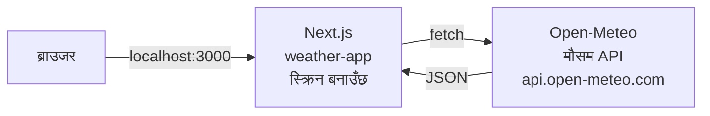
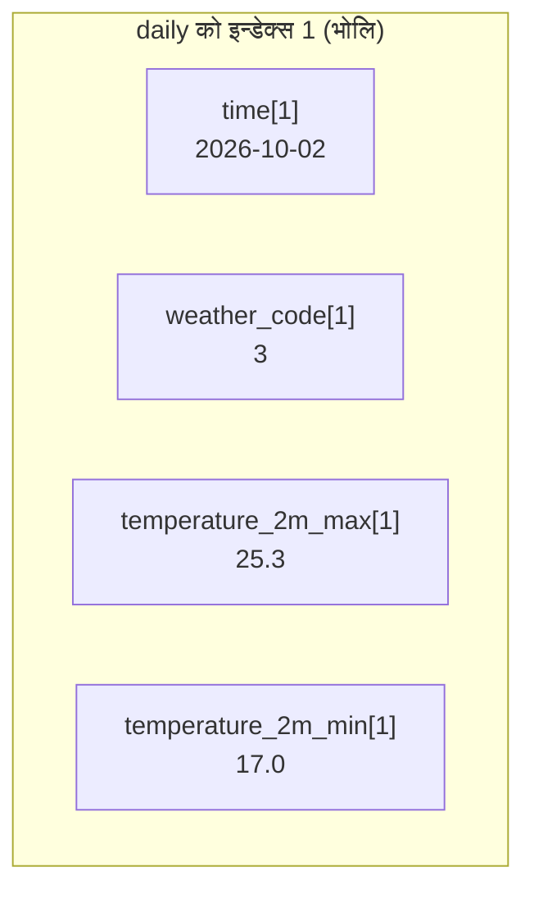
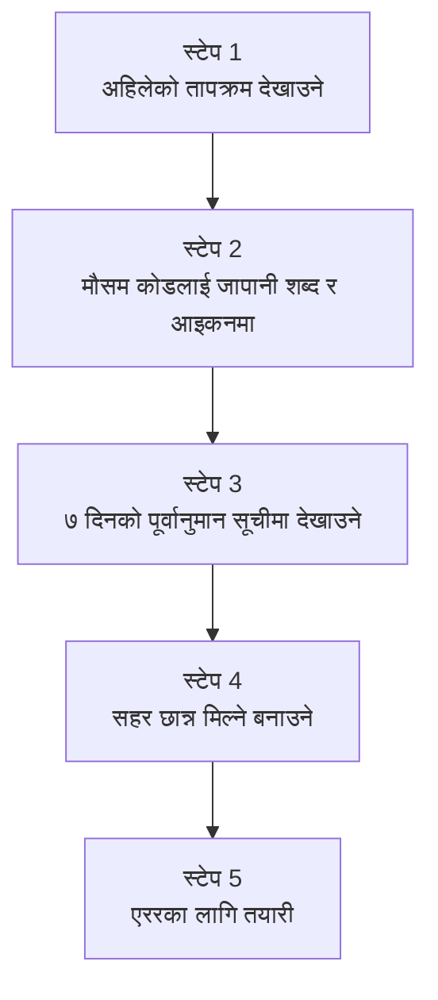
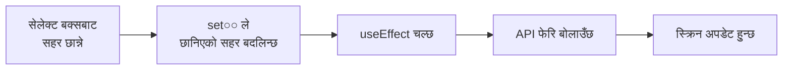

# थप चुनौती: मौसम API प्रयोग गरेर मौसम पूर्वानुमान एप बनाऔँ

> 🇯🇵 मूल प्रति (जापानी भाषामा): [2026_10_02_資料2.md](<../../../2年生_システム開発実践/後期/2026_10_02/2026_10_02_資料2.md>) <!-- original-ja-link -->

**विद्यार्थी व्यवस्थापन एप पूरा गरिसकेका साथीहरू** यो असाइनमेन्टमा अघि बढ्नुहोस्।
पहिलो सेमेस्टरमा हामीले "आफैँले बनाएको Laravel API" बाट JSON लिएर स्क्रिनमा देखायौँ।
यसपटक **इन्टरनेटमा सार्वजनिक रूपमा उपलब्ध मौसम API (Open-Meteo)** बाट JSON लिएर, **नयाँ Next.js प्रोजेक्ट** मा मौसम पूर्वानुमान एप बनाउँछौँ।



### पूरा भएपछिको रूप

```
┌─────────────────────────────────────────┐
│ 天気予報（東京）              [ 東京 ▼ ]  │  ← सहर छान्न सकिन्छ
├─────────────────────────────────────────┤
│        ☀️                                │
│      晴れ   28℃                          │  ← अहिलेको मौसम
│      風速 0.7 km/h                       │
├─────────────────────────────────────────┤
│ 10/1(木)  ☀️ 晴れ    29℃ / 18℃  ☔ 0%    │
│ 10/2(金)  ☁️ くもり  25℃ / 17℃  ☔ 20%   │  ← ७ दिनको पूर्वानुमान
│ 10/3(土)  🌧️ 雨      21℃ / 16℃  ☔ 80%   │
│   …                                     │
└─────────────────────────────────────────┘
```

### आजको लक्ष्य

- **Next.js प्रोजेक्ट सुरुदेखि बनाउन** सक्ने
- सार्वजनिक **बाहिरी API** बोलाएर JSON लाई स्क्रिनमा देखाउन सक्ने
- JSON भित्रबाट **चाहिएको मान निकाल्न** सक्ने
- छानिएको मान (सहर) बदलिँदा **API फेरि बोलाउन** सक्ने

> यो सामग्रीमा **उत्तरको कोड राखिएको छैन।**
> पहिलो सेमेस्टरको विद्यार्थी व्यवस्थापन एप (`school-frontend`) को कोडलाई सन्दर्भका रूपमा हेर्दै, आफैँ सोचेर लेखेर हेर्नुहोस्।

---

## 1. प्रयोग गर्ने API: Open-Meteo

[Open-Meteo](https://open-meteo.com/) निःशुल्क प्रयोग गर्न सकिने मौसम API हो।

- **दर्ता वा API की आवश्यक छैन** (URL खोल्ने बित्तिकै प्रयोग गर्न सकिन्छ)
- ठाउँलाई **अक्षांश (latitude) र देशान्तर (longitude)** ले तोकिन्छ
- **बढीमा १६ दिनसम्मको** पूर्वानुमान पाइन्छ (यसपटक ७ दिनको प्रयोग गर्छौँ)

विद्यार्थी व्यवस्थापन एपसँग तुलना गरौँ।

| | विद्यार्थी व्यवस्थापन एप | मौसम पूर्वानुमान एप |
|---|---|---|
| API कसले बनायो | आफैँ (Laravel) | Open-Meteo |
| URL | `http://localhost:8000/api/students` | `https://api.open-meteo.com/v1/forecast?...` |
| प्रमाणीकरण | टोकन चाहिन्छ (🔒) | **चाहिँदैन** |
| प्रयोग गर्ने मेथड | GET / POST / PUT / DELETE | GET मात्र (पढ्ने मात्र) |

> यो निःशुल्क रूपमा सार्वजनिक गरिएको API हो। **बटन लगातार थिचेर वा लूपमा धेरैपटक बोलाउने काम नगर्नुहोस्।**

---

## 2. पहिले ब्राउजरमा API हेरौँ

कोड लेख्नुअघि, **कस्तो JSON फर्किन्छ** भनेर जाँच्नु महत्त्वपूर्ण छ।
तलको URL ब्राउजरको एड्रेस बारमा टाँसेर खोलेर हेर्नुहोस् (टोकियोको मौसम हो)।

```
https://api.open-meteo.com/v1/forecast?latitude=35.68&longitude=139.77&current=temperature_2m,weather_code,wind_speed_10m&daily=weather_code,temperature_2m_max,temperature_2m_min,precipitation_probability_max&timezone=Asia%2FTokyo
```

> Chrome मा "Pretty print" मा टिक लगाउनुभयो भने JSON पढ्न सजिलो हुन्छ।

### URL कसरी पढ्ने

`?` पछिको भाग **क्वेरी प्यारामिटर** (API लाई दिने अर्डर) हो। `&` ले छुट्याएर लहरै राखिन्छ।

| प्यारामिटर | अर्थ |
|-----------|------|
| `latitude=35.68` | अक्षांश |
| `longitude=139.77` | देशान्तर |
| `current=temperature_2m,weather_code,wind_speed_10m` | **अहिलेको** तापक्रम, मौसम कोड र हावाको गति चाहियो |
| `daily=weather_code,temperature_2m_max,...` | **दिनैपिच्छेको** मौसम कोड, अधिकतम तापक्रम, न्यूनतम तापक्रम र वर्षाको सम्भावना चाहियो |
| `timezone=Asia%2FTokyo` | जापानको समयमा फर्काइदिनुहोस् (`%2F` भनेको `/` हो) |

> `current=` वा `daily=` पछिका कुरा घटाउँदा वा बढाउँदा फर्किने JSON पनि बदलिन्छ। प्रयास गरेर हेर्नुहोस्।
> कस्ता-कस्ता फिल्ड छन् भनेर [Open-Meteo को डकुमेन्टेसन](https://open-meteo.com/en/docs) मा खोज्न सकिन्छ।

### फर्किने JSON (केही भाग)

```json
{
  "current": {
    "time": "2026-10-01T17:00",
    "temperature_2m": 28.2,
    "weather_code": 0,
    "wind_speed_10m": 0.7
  },
  "daily": {
    "time": ["2026-10-01", "2026-10-02", "2026-10-03", ...],
    "weather_code": [0, 3, 61, ...],
    "temperature_2m_max": [29.1, 25.3, 21.0, ...],
    "temperature_2m_min": [18.2, 17.0, 16.4, ...],
    "precipitation_probability_max": [0, 20, 80, ...]
  }
}
```

### कहाँ के छ?

| देखाउन चाहेको कुरा | JSON को कुन ठाउँमा? |
|--------------|-------------|
| अहिलेको तापक्रम | `current.temperature_2m` |
| अहिलेको मौसम कोड | `current.weather_code` |
| अहिलेको हावाको गति | `current.wind_speed_10m` (km/h) |
| मिति (७ दिनको) | `daily.time` ← **एरे** |
| दिनैपिच्छेको मौसम कोड | `daily.weather_code` ← **एरे** |
| दिनैपिच्छेको अधिकतम र न्यूनतम तापक्रम | `daily.temperature_2m_max` र `daily.temperature_2m_min` ← **एरे** |
| दिनैपिच्छेको वर्षाको सम्भावना (%) | `daily.precipitation_probability_max` ← **एरे** |

यहाँ मुख्य कुरा छ।

- `current` मा **एउटा मात्र मान** हुन्छ
- `daily` मा **हरेक फिल्ड एरेका रूपमा** हुन्छ, र **एउटै नम्बर (इन्डेक्स) भएका डेटा एउटै दिनका** हुन्



### मौसम कोड (weather_code)

मौसम "सफा" जस्ता शब्दमा होइन, **अङ्क (WMO कोड)** मा फर्किन्छ।
स्क्रिनमा देखाउँदा, आफैँले जापानी भाषामा बदल्नुपर्छ।

| कोड | मौसम | आइकनको उदाहरण |
|-------|------|-----------|
| 0 | सफा (晴れ) | ☀️ |
| 1, 2 | सफा, कहिलेकाहीँ बादल (晴れ時々くもり) | 🌤️ |
| 3 | बादल (くもり) | ☁️ |
| 45, 48 | कुहिरो (霧) | 🌫️ |
| 51〜57 | सिमसिमे पानी (霧雨) | 🌦️ |
| 61〜67 | पानी (雨) | 🌧️ |
| 71〜77 | हिउँ (雪) | ❄️ |
| 80〜82 | छिटपुट पानी (にわか雨) | 🌦️ |
| 85, 86 | छिटपुट हिउँ (にわか雪) | 🌨️ |
| 95〜99 | चट्याङसहित पानी (雷雨) | ⛈️ |

---

## 3. Next.js प्रोजेक्ट बनाउने

विद्यार्थी व्यवस्थापन एप (`school-frontend`) भन्दा **फरक फोल्डरमा** बनाउनुहोस्।
`school-frontend` भित्र नबनाउन ध्यान दिनुहोस्।

```bash
npx create-next-app@latest weather-app
```

प्रश्नहरूको उत्तर पहिलो सेमेस्टरमा जस्तै दिनुहोस्।

```
Would you like to use TypeScript?             → Yes
Would you like to use ESLint?                 → Yes
Would you like to use Tailwind CSS?           → Yes
Would you like your code inside a src/ dir?   → No
Would you like to use App Router?             → Yes
Would you like to use Turbopack?              → No
Would you like to customize the import alias? → No
```

```bash
cd weather-app
npm run dev
```

http://localhost:3000 खोल्दा Next.js को नमुना स्क्रिन देखियो भने सफल भयो।

### बनाएपछि तुरुन्तै गर्ने काम

| फाइल | गर्ने काम | सन्दर्भ |
|---------|---------|------|
| `app/layout.tsx` | `lang="en"` लाई `lang="ja"` मा, `title` लाई "天気予報アプリ" (मौसम पूर्वानुमान एप) मा बदल्ने | `school-frontend/app/layout.tsx` |
| `app/globals.css` | `@import "tailwindcss";` बाहेक सबै मेटाउने, र `body` को पृष्ठभूमि रङ र अक्षरको रङ आफैँ तय गर्ने | — |
| `app/page.tsx` | नमुनाको सबै सामग्री मेटाएर, मौसम पूर्वानुमानको स्क्रिन लेख्दै जाने | — |

> **globals.css किन सच्याउने**
> सुरुको `globals.css` मा, कम्प्युटर डार्क मोडमा भए **अक्षर सेतो** हुने सेटिङ छ।
> सेतो कार्डमाथि अक्षर राख्दा देखिँदैन, त्यसैले रङ आफैँ तय गर्नुहोस्।

> यसपटक API की चाहिँदैन, त्यसैले `.env` बनाउनु पर्दैन।
> साथै, Laravel प्रयोग नगर्ने भएकाले XAMPP वा `php artisan serve` सुरु गर्नु पनि पर्दैन।

---

## 4. बनाउँदै जाने क्रम

एकैपटक सबै बनाउन नखोजी, **एक-एक स्टेप चलाएर जाँच्दै** अघि बढ्नुहोस्।



### स्टेप 1: अहिलेको तापक्रम देखाउने

**गर्ने काम**
- `app/page.tsx` मा, पेज देखिँदा API बोलाएर टोकियोको **अहिलेको तापक्रम, मौसम कोड र हावाको गति** देखाउने

**सङ्केत**
- पहिलो लाइनमा `"use client";` लेख्ने (`useState` र `useEffect` प्रयोग गर्ने भएकाले)
- विद्यार्थी व्यवस्थापन एपको `app/students/page.tsx` को **`useEffect` र `loadStudents`** को ढाँचा सिधै सन्दर्भ बन्छ
- यसपटक **टोकन (`Authorization` हेडर) चाहिँदैन**। URL लाई `fetch` गरे मात्र पुग्छ
- सुरुमा URL मा `current=` मात्र भए पुग्छ (`daily=` स्टेप 3 मा थप्ने)
- डेटा आइपुग्नुअघि खाली (`null`) हुन्छ, त्यसैले पहिले "読み込み中..." (लोड हुँदैछ...) देखाइराख्ने
- TypeScript मा `useState(null)` लेखे पछि `weather.current` मा एरर आउँछ → `useState<any>(null)` लेख्ने

**✅ जाँच**: तापक्रम, मौसम कोड (अङ्क) र हावाको गति देखियो

### स्टेप 2: मौसम कोडलाई जापानी शब्द र आइकनमा बदल्ने

**गर्ने काम**
- मौसम कोड लिएर "晴れ" (सफा) जस्ता जापानी शब्द र इमोजी आइकन फर्काउने **फङ्सन** बनाउने
- अहिलेको मौसमलाई सेतो कार्डभित्र **आइकन, मौसम, तापक्रम र हावाको गति** सहित देखाउने

**सङ्केत**
- फङ्सनलाई `export default function ...` को **बाहिर (माथि)** बनाउँदा राम्रो हुन्छ
- 2. को मौसम कोड तालिका हेर्दै, `if` ले सानो कोडबाट क्रमैसँग जाँच्दै जाने
- जापानी शब्द र आइकन दुवै फर्काउन चाहँदा, `{ label: "晴れ", icon: "☀️" }` जस्तो **अब्जेक्ट** फर्काउने
- तापक्रम `28.2` जस्तै दशमलवमा आउँछ → `Math.round()` ले राउन्ड गर्दा पढ्न सजिलो हुन्छ

**✅ जाँच**: आइकन र "晴れ" (सफा) जस्ता जापानी शब्द देखिए

### स्टेप 3: ७ दिनको पूर्वानुमान सूचीमा देखाउने

**गर्ने काम**
- URL मा `daily=...` थपेर, ७ दिनको पूर्वानुमान सूचीमा देखाउने
- एउटा लाइनमा "मिति, आइकन, मौसम, अधिकतम तापक्रम, न्यूनतम तापक्रम, वर्षाको सम्भावना" लहरै राख्ने

**सङ्केत**
- सूची देखाउन विद्यार्थी सूचीमा जस्तै `map` प्रयोग गर्ने। `key` मा नदोहोरिने मान (मिति) प्रयोग गर्ने
- `daily.time` लाई `map` ले घुमाउँदा, दोस्रो आर्गुमेन्टमा **नम्बर `i`** पाइन्छ → `(date, i) => ...`
- त्यही `i` प्रयोग गरेर, `daily.weather_code[i]` जस्तै **एउटै नम्बर** ले अरू एरेबाट निकाल्ने
- मिति `2026-10-02` लाई `10/2(金)` को रूपमा देखाउन चाहनेले, `new Date(date)` बनाएर `getMonth()` (**0 बाट सुरु** हुने भएकाले +1), `getDate()`, `getDay()` (0 भनेको आइतबार) प्रयोग गर्ने

**✅ जाँच**: ७ दिनको पूर्वानुमान लहरै देखियो

### स्टेप 4: सहर छान्न मिल्ने बनाउने

**गर्ने काम**
- सेलेक्ट बक्सबाट सहर छान्दा, त्यस सहरको मौसम र पूर्वानुमानमा बदलिने बनाउने

सहरको अक्षांश र देशान्तरका लागि तलको तालिका प्रयोग गर्नुहोस्।

| सहर | अक्षांश (latitude) | देशान्तर (longitude) |
|-----|---------------|----------------|
| 東京 (टोकियो) | 35.68 | 139.77 |
| 大阪 (ओसाका) | 34.69 | 135.50 |
| 札幌 (साप्पोरो) | 43.06 | 141.35 |
| 那覇 (नाहा) | 26.21 | 127.68 |

**सङ्केत**
- सहरहरूको सूचीलाई `{ name: "東京", latitude: 35.68, longitude: 139.77 }` जस्ता अब्जेक्टको **एरे** बनाएर राख्ने
- "छानिएको सहर" लाई `useState` मा राख्ने
- URL को `latitude=` र `longitude=` भागलाई छानिएको सहरको मानले बदल्ने (टेम्प्लेट स्ट्रिङ `` `...${ }...` `` उपयोगी हुन्छ)
- `useEffect` को डिपेन्डेन्सी एरे सम्झनुहोस्



| डिपेन्डेन्सी एरे कसरी लेख्ने | कहिले चल्छ? |
|----------------|----------------|
| `[]` | पेज देखिँदा **एकपटक मात्र** (विद्यार्थी सूचीमा प्रयोग गरेको) |
| `[city]` | सुरुको एकपटक + **city बदलिँदा हरेकपटक** |

**✅ जाँच**: सहर बदल्दा मौसम र पूर्वानुमान बदलियो (साप्पोरो र नाहाको तापक्रम तुलना गरेर हेर्नुहोस्)

### स्टेप 5: एररका लागि तयारी

**गर्ने काम**
- API असफल हुँदा स्क्रिन पूरै सेतो नहोस्, बरु **एरर सन्देश** देखियोस् भन्ने बनाउने

**सङ्केत**
- विद्यार्थी व्यवस्थापन एपमा पनि `res.ok` ले असफलता जाँचेका थियौँ
- इन्टरनेट नजोडिएको बेला `fetch` नै असफल हुन्छ → `try` / `catch` ले समात्ने
- सफल होस् वा असफल, "लोड हुँदैछ" लाई अन्त्य गर्ने → `finally`

**✅ जाँच**: URL को `latitude=` लाई जानाजान `latitude=999` बनाउँदा एरर सन्देश देखियो (जाँचेपछि पहिलेकै अवस्थामा फर्काउने)

---

## 5. काम नगरेमा

| लक्षण | जाँच्ने कुरा |
|------|-------------|
| `useState is not defined` | पहिलो लाइनमा `"use client";` र त्यसको तल `import { useState, useEffect } from "react";` छ कि छैन |
| `Cannot read properties of null` | डेटा आइपुग्नुअघि नै देखाउन खोजिरहेको छ → "लोड हुँदैछ" जाँचभन्दा **तल** प्रयोग गरेको छ कि छैन |
| `Cannot read properties of undefined` | JSON बाट निकाल्ने तरिका गलत छ / URL मा `daily=` थप्न बिर्सनुभयो कि → 2. को तालिकासँग दाँजेर हेर्ने |
| समय वा मिति ९ घण्टा फरक पर्छ | URL मा `timezone=Asia%2FTokyo` थपेको छ कि छैन |
| अक्षर देखिँदैन (सेतो) | `globals.css` को डार्क मोड सेटिङ मेटाउनुभयो कि छैन |
| मान अनौठो छ / देखिँदैन | डेभलपर टुल्सको `Network` ट्याबमा API को रेस्पोन्स (JSON) जाँच्ने |

---

## 6. थप चुनौती (पूरा गरिसकेकाहरूका लागि)

- [ ] **कम्पोनेन्टमा छुट्याउने**: "अहिलेको मौसम" र "पूर्वानुमान सूची" लाई `components/` भित्र छुट्टै फाइलमा राखेर, `props` मार्फत डेटा पठाउने
- [ ] **सहर थप्ने**: आफ्नो गृहनगर थप्ने (Google Maps मा ठाउँमा राइट-क्लिक गर्दा अक्षांश र देशान्तर देखिन्छ)
- [ ] **सहरको नामले खोज्ने**: इनपुट बक्समा सहरको नाम लेखेर खोज्न मिल्ने बनाउने ([Geocoding API](https://open-meteo.com/en/docs/geocoding-api) ले सहरको नाम → अक्षांश र देशान्तरमा बदल्न सकिन्छ। यसमा पनि की चाहिँदैन)
- [ ] **घण्टैपिच्छेको पूर्वानुमान**: URL मा `hourly=temperature_2m&forecast_days=1` थपेर, आजको घण्टैपिच्छेको तापक्रम देखाउने
- [ ] **हालको स्थानको मौसम**: `navigator.geolocation.getCurrentPosition()` ले आफ्नो अक्षांश र देशान्तर लिएर, त्यस ठाउँको मौसम देखाउने
- [ ] **देखावट बदल्ने**: मौसमअनुसार पृष्ठभूमि रङ बदल्ने (सफा भए सुन्तला, पानी परे निलो आदि) / Tailwind CSS मा लेखेर हेर्ने

> अझै समय बाँकी भएकाहरूले [सामग्री 3](./2026_10_02_資料3.md) मा **Gemini बाट आफ्नै मौसम आइकन बनाउने** र **Vercel मा निःशुल्क डिप्लोय गर्ने** चुनौती लिनुहोस्।

---

## जाँच क्विज

- [ ] विद्यार्थी व्यवस्थापन एपको API र Open-Meteo को API मा के फरक छ? (कसले बनायो, प्रमाणीकरण)
- [ ] URL को `?` पछिको `latitude=35.68&longitude=139.77` ले के जनाउँछ?
- [ ] `daily` भित्र एउटै दिनको डेटा कसरी पत्ता लगाउने?
- [ ] मौसम कोड `3` कुन मौसम हो? त्यसलाई स्क्रिनमा "くもり" (बादल) भनेर देखाउन के गर्ने?
- [ ] `useEffect(() => { ... }, [city])` कहिले चल्छ?
- [ ] `try` / `catch` / `finally` को `finally` कहिले चल्छ?
