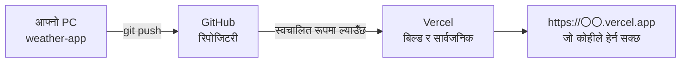

# थप चुनौती: मौसम पूर्वानुमान एपलाई अझ शक्तिशाली बनाऔँ

> 🇯🇵 मूल प्रति (जापानी भाषामा): [2026_10_02_資料3.md](<../../../2年生_システム開発実践/後期/2026_10_02/2026_10_02_資料3.md>) <!-- original-ja-link -->

[सामग्री 2](./2026_10_02_資料2.md) को मौसम पूर्वानुमान एप (`weather-app`) **पूरा गरिसकेका साथीहरू** यो सामग्रीमा अघि बढ्नुहोस्।

| | गर्ने काम |
|---|---|
| 1. | Gemini बाट आफ्नै मौसम आइकन बनाएर, इमोजीको सट्टा देखाउने |
| 2. | Vercel मा निःशुल्क डिप्लोय गरेर, स्मार्टफोनबाट पनि हेर्न मिल्ने बनाउने |

---

## 1. Gemini बाट आफ्नै मौसम आइकन बनाउने

Open-Meteo ले **आइकनको इमेज पठाउँदैन** (फर्किने भनेको मौसम कोडको अङ्क मात्र हो)।
त्यसैले, **Gemini बाट इमेज जेनेरेट** गरेर `public/` फोल्डरमा राखौँ, र मौसम कोडअनुसार देखाऔँ।


### 1-1. Gemini बाट इमेज बनाउने

[Gemini](https://gemini.google.com/) खोलेर, हरेक मौसमका लागि इमेज बनाउन लगाउनुहोस्।

| मौसम | फाइल नामको उदाहरण |
|-----|-------------|
| सफा | `sunny.png` |
| सफा, कहिलेकाहीँ बादल | `partly-cloudy.png` |
| बादल | `cloudy.png` |
| कुहिरो | `fog.png` |
| पानी (सिमसिमे पानी र छिटपुट पानी समेत) | `rainy.png` |
| हिउँ | `snowy.png` |
| चट्याङसहित पानी | `thunder.png` |

प्रम्प्ट (अनुरोधको वाक्य) को उदाहरण:

```
मौसम पूर्वानुमान एपमा प्रयोग गर्ने "सफा" मौसमको आइकन बनाइदिनुहोस्।
सरल र प्यारो चित्र बनाउनुहोस्। चित्र वर्गाकार होस्, पृष्ठभूमि सेतो होस् र कुनै अक्षर नराख्नुहोस्।
```

> **मुख्य कुरा**
> - पहिलो बनेपछि, "**उही शैलीमा** 'बादल' को आइकन पनि बनाइदिनुहोस्" भनेर थप अनुरोध गर्दा चित्रको शैली मिल्छ
> - बनेको इमेज डाउनलोड गरेर, माथिको तालिकाको नाममा बदल्नुहोस्
> - फाइलको नाम **हाफ-विड्थ अङ्ग्रेजी अक्षर र अङ्क** मा राख्नुहोस् (जापानी फाइल नाम नराख्ने)

### 1-2. public फोल्डरमा राख्ने

```
weather-app/
└── public/
    └── icons/          ← बनाउने
        ├── sunny.png
        ├── cloudy.png
        └── ...
```

`public/` मा राखेका फाइलहरू **`/` बाट सुरु हुने पाथ** प्रयोग गरेर देखाउन सकिन्छ।
उदाहरणका लागि `public/icons/sunny.png` लाई `` ले देखाउन सकिन्छ।

> ब्राउजरमा http://localhost:3000/icons/sunny.png खोलेर, इमेज देखिन्छ कि देखिँदैन पहिले नै जाँच्नुहोस्।

### 1-3. मौसम कोडअनुसार देखाउने

**गर्ने काम**
- सामग्री 2 को स्टेप 2 मा बनाएको फङ्सनलाई परिमार्जन गरेर, जापानी शब्द र इमोजीका साथै **इमेजको पाथ** (`/icons/sunny.png` आदि) पनि फर्काउने बनाउने
- अहिलेको मौसम र ७ दिनको पूर्वानुमानमा, इमोजीको सट्टा `` ले इमेज देखाउने

**सङ्केत**
- फर्काउने अब्जेक्टमा `image: "/icons/sunny.png"` जस्तो प्रपर्टी थप्ने
- इमेजको साइज `` को `width` वा `style` ले तय गर्ने (पूर्वानुमान सूचीमा अलि सानो)
- `alt` मा "晴れ" (सफा) जस्ता जापानी शब्द राख्दा, इमेज लोड नभएको बेला पनि मौसम थाहा हुन्छ

**✅ जाँच**: सहर बदल्दा, मौसमसँग मिल्ने आफ्नै आइकन देखियो

---

## 2. Vercel मा निःशुल्क डिप्लोय गर्ने

अहिलेको एप `localhost:3000` मा छ, त्यसैले **आफ्नै कम्प्युटरबाट मात्र हेर्न सकिन्छ।**
[Vercel](https://vercel.com/) (Next.js बनाउने कम्पनीको सेवा) प्रयोग गर्दा, निःशुल्क रूपमा इन्टरनेटमा सार्वजनिक गर्न सकिन्छ।
सार्वजनिक गरेपछि `https://weather-app-xxxx.vercel.app` जस्तो URL पाइन्छ, र **स्मार्टफोन वा साथीको कम्प्युटरबाट पनि हेर्न** सकिन्छ।



> **डिप्लोय** भनेको बनाएको एपलाई सर्भरमा राखेर, इन्टरनेटबाट प्रयोग गर्न मिल्ने बनाउनु हो।

### 2-1. आफ्नै कम्प्युटरमा बिल्ड हुन्छ कि जाँच्ने

Vercel मा पनि उही `npm run build` चलाइन्छ। पहिले आफ्नै कम्प्युटरमा एरर आउँछ कि आउँदैन जाँचौँ।

```bash
# npm run dev लाई Ctrl + C ले रोकेपछि
npm run build
```

- अन्त्यमा `✓ Compiled successfully` जस्तो सन्देश आएर, एररका कारण बिल्ड नरोकिए ठीक छ
- **रातो एरर** आएमा, सन्देशमा लेखिएको फाइल र लाइन सच्याएर फेरि `npm run build` चलाउने
- जाँचिसकेपछि, फेरि `npm run dev` बाट डेभलपमेन्ट जारी राख्न सकिन्छ

### 2-2. GitHub मा पुस गर्ने

`create-next-app` ले बनाएको प्रोजेक्ट **सुरुदेखि नै Git रिपोजिटरी** हुन्छ।

1. GitHub मा **नयाँ रिपोजिटरी** बनाउने (नाम `weather-app`, **README आदि नथप्ने**)
2. बनाएको रिपोजिटरीको पेजमा देखिने कमान्डलाई सन्दर्भ गर्दै, `git remote add origin ...` ले जोड्ने
3. `git add` → `git commit` → `git push` गरेर, अहिलेसम्मको कोड पुस गर्ने

> Git कसरी प्रयोग गर्ने भनेर पहिलो सेमेस्टरको 4/30 को सामग्री दोहोर्‍याउनुहोस्।
> `public/icons/` का इमेजहरू पनि सँगै पुस भए कि भएनन्, GitHub को स्क्रिनमा जाँच्नुहोस्।

### 2-3. Vercel मा सार्वजनिक गर्ने

1. https://vercel.com/ खोलेर **Sign Up** गर्ने → प्लानमा **Hobby (निःशुल्क)** छान्ने
2. **Continue with GitHub** बाट GitHub खाताले लगइन गर्ने
3. **Add New...** → **Project** छान्ने
4. सूचीबाट `weather-app` को **Import** थिच्ने (नदेखिएमा GitHub मा पहुँचको अनुमति दिने)
5. सेटिङ **जस्ताको तस्तै भए OK** (Next.js भए स्वचालित रूपमा पहिचान गर्छ) → **Deploy** थिच्ने
6. १–२ मिनेट पर्खेर, बधाईको स्क्रिन देखियो भने पूरा भयो! देखाइएको URL खोलेर हेर्नुहोस्

> यसपटक API की प्रयोग नगरेकाले, Vercel मा इन्भाइरनमेन्ट भेरिएबल सेट गर्नु पर्दैन।

### 2-4. सच्याएपछि पुस गरे पुग्छ, अपडेट आफैँ हुन्छ

एकपटक जोडिसकेपछि, **GitHub मा `git push` गर्दा हरेकपटक Vercel ले स्वचालित रूपमा फेरि डिप्लोय** गरिदिन्छ।


> **ध्यान दिनुहोस्**
> - सार्वजनिक गरेको URL **जो कोहीले हेर्न सक्छ**। नाम जस्ता व्यक्तिगत जानकारी स्क्रिनमा नराख्नुहोस्
> - Hobby प्लान **व्यक्तिगत र सिकाइका लागि** हो (पैसा कमाउने साइटका लागि प्रयोग गर्न मिल्दैन)
> - डिप्लोय असफल भएमा, Vercel को स्क्रिनको **Build Logs** मा एरर देखिन्छ। आफ्नै कम्प्युटरको `npm run build` मा पनि उही एरर आउँछ कि जाँच्नुहोस्

**✅ जाँच**: स्मार्टफोनमा Vercel को URL खोल्दा मौसम पूर्वानुमान देखियो
