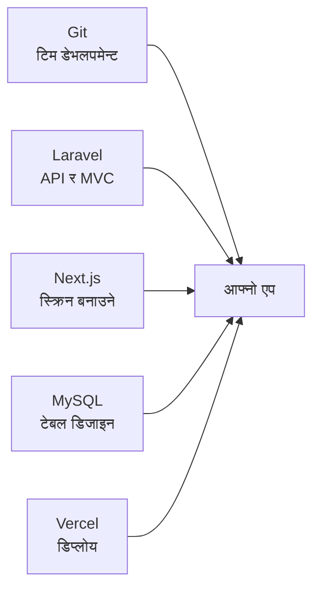
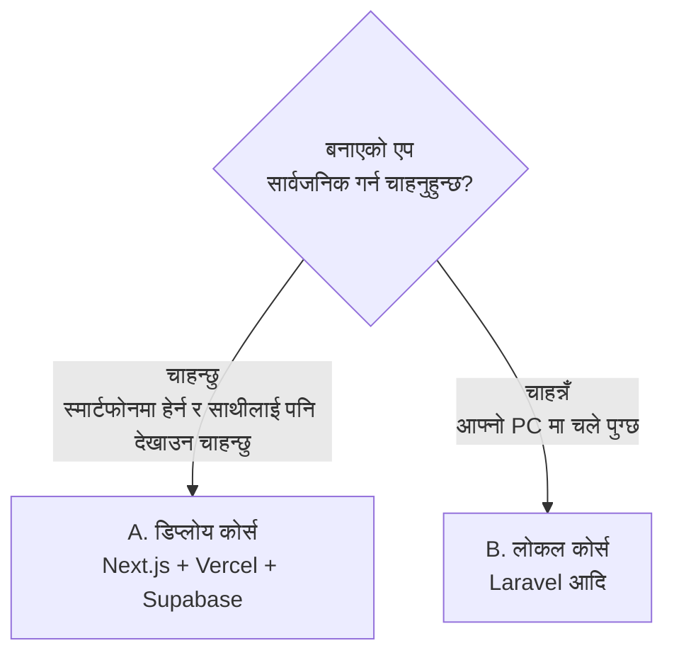
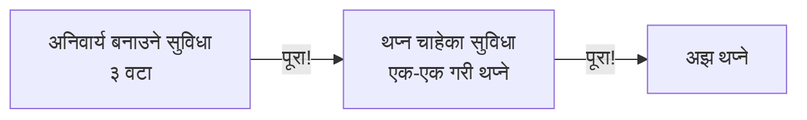
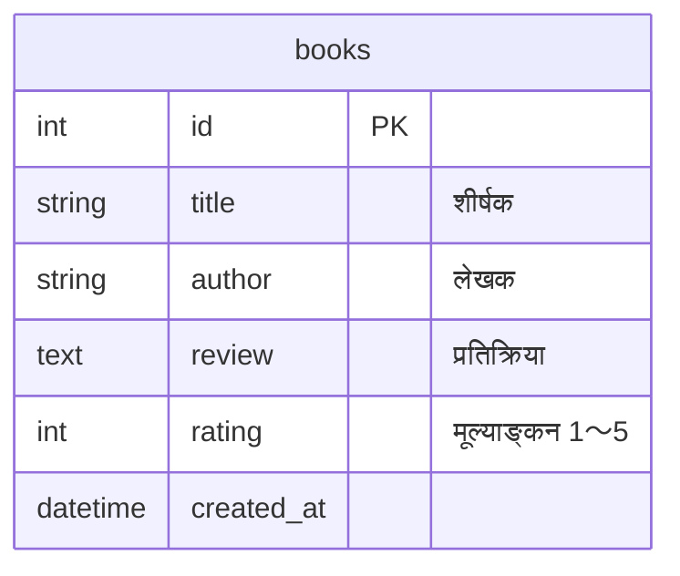
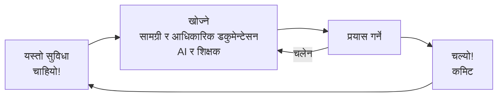
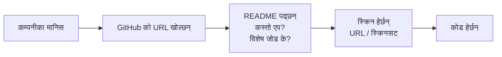
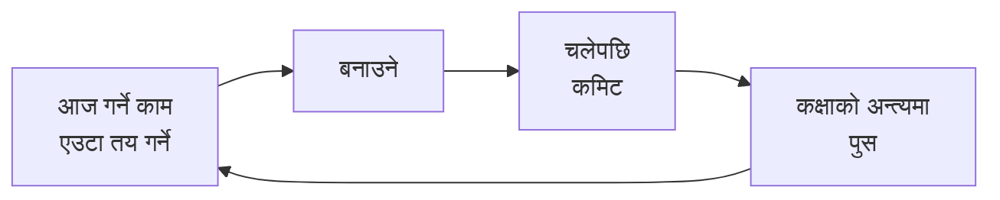

# स्वतन्त्र प्रोजेक्ट: आधारभूत कुरा सिकिसक्यौँ, अब यहाँदेखि आफूले बनाउन चाहेको कुरा बनाउँदै सिक्दै जाने

> 🇯🇵 मूल प्रति (जापानी भाषामा): [2026_10_09_資料1.md](<../../../2年生_システム開発実践/後期/2026_10_09/2026_10_09_資料1.md>) <!-- original-ja-link -->

## आजको लक्ष्य
- बनाउन चाहेको एप तय गर्न सक्ने
- पूरा भएको एपलाई जागिर खोज्दा **पोर्टफोलियोका रूपमा पेस गर्न सकिने** बनाउने लक्ष्य राख्ने
- आफूलाई मिल्ने कोर्स (डिप्लोय गर्ने / लोकलमा मात्र) छान्न सक्ने
- डेभलपमेन्ट सुरु गर्ने तयारी (रिपोजिटरी बनाउने, प्रोजेक्ट बनाउने) गर्न सक्ने
- "बनाउँदै सिक्ने" र "आफ्नो विशेष रुचि र जोडलाई महत्त्व दिने" यी दुई कुरामा ध्यान दिन सक्ने

---

## 1. स्वतन्त्र प्रोजेक्ट भनेको के हो

अहिलेसम्म सिकेका कुराहरू प्रयोग गरेर, **आफूलाई मन पर्ने कुरा** बनाउने हो।
विषय स्वतन्त्र छ। शोख, क्लब गतिविधि, पार्ट-टाइम जागिर वा वरपरका "भए सजिलो हुने" कुरालाई साकार बनाऔँ।

> 🎯 **लक्ष्य: जागिर खोज्दा कम्पनीमा पोर्टफोलियोका रूपमा पेस गर्न सकिने एप बनाउने**
> जुन कोर्स छाने पनि, पूरा भएको एपलाई **"आफैँले विकास गरेको कुरा" भनेर कम्पनीलाई देखाउन सकिने** बनाउँछौँ।
> कसरी पेस गर्ने भनेर [5. पोर्टफोलियोका रूपमा पेस गर्ने](#5-पोर्टफोलियोका-रूपमा-पेस-गर्ने) हेर्नुहोस्।



### किन आफूले बनाउन चाहेको कुरा बनाउने?

आधारभूत कुरा अहिलेसम्मका कक्षामा सिक्यौँ। अब यहाँदेखि त्यसको **प्रयोग** हो।
शिक्षकले तय गरेको असाइनमेन्ट होइन, **आफैँले बनाउन चाहेको कुरा तय गरेर बनाउने** कुराका तीन कारण छन्।

#### ① आफूले बनाउन चाहेको कुरा भए, उत्प्रेरणा टिकिरहन सजिलो हुन्छ

एप पूरा नहुँदासम्म एरर र "बुझिनँ" भन्ने कुरा धेरै आउँछन्।
**आफूलाई साँच्चै चाहिएको कुरा** हो भने, "पूरा गर्छु!" भन्ने भावनाले अन्त्यसम्म मेहनत गर्न सकिन्छ।

#### ② AI ले कोड लेख्न सक्ने जमाना भएकाले, "के बनाउने" भन्ने कुरा हेरिन्छ

आजकल AI लाई भनेपछि उसले कोड लेखिदिने जमाना छ।
त्यसैले, **"के बनाउने", "केलाई सजिलो बनाउन खोजिरहेको", "किन त्यो बनायो"** भन्ने कुरा महत्त्वपूर्ण हुन्छन्।
कोड लेख्न सक्नु मात्र होइन, **आफैँ समस्या पत्ता लगाएर त्यसको समाधान तयार गर्ने क्षमता** हेरिन्छ।

#### ③ पोर्टफोलियोका रूपमा कम्पनीमा पेस गर्न सकिन्छ

पूरा भएको एपलाई जागिर खोज्दा **पोर्टफोलियोका रूपमा कम्पनीमा पेस** गर्न सकिन्छ।
तर, सबैले उस्तै-उस्तै कुरा बनाए भने कम्पनीका मानिसहरूको मनमा छाप पर्दैन।
**आफूले आवेदन दिने कम्पनीका मानिसहरूले "ओहो!" भनेर आँखा ठूला पार्ने खालको, आफ्नै मौलिक प्रोडक्ट** बनाऔँ।

### विषयका उदाहरण

| विधा | उदाहरण |
|---------|-----|
| रेकर्ड राख्ने | पढेका किताबको रेकर्ड, व्यायामको रेकर्ड, घरखर्चको हिसाब, गेमको नतिजाको नोट |
| जम्मा गर्ने र देखाउने | आफूलाई मन पर्ने व्यक्ति वा पात्रको जानकारी सङ्ग्रह, सिफारिस गरिएका पसलको सूची, कृतिहरूको ग्यालेरी |
| काम लाग्ने | क्लबको हाजिरी तालिका, असाइनमेन्टको म्याद व्यवस्थापन, खानाको मेनु रुलेट |
| API प्रयोग गर्ने | मौसम + लुगाको सल्लाह, पोकेमन इन्साइक्लोपिडिया, फिल्म खोज |

---

## 2. कोर्स छान्ने

बनाएको एपलाई **इन्टरनेटमा सार्वजनिक गर्न चाहनुहुन्छ कि चाहनुहुन्न** भन्ने आधारमा कोर्स छान्नुहोस्।



| | A. डिप्लोय कोर्स | B. लोकल कोर्स |
|---|---|---|
| सामग्री | [सामग्री 2](./2026_10_09_資料2.md) | [सामग्री 3](./2026_10_09_資料3.md) |
| प्रयोग गर्ने कुरा | Next.js + **Vercel** + **Supabase** | Laravel + MySQL (+ Next.js) |
| हेर्न सकिने ठाउँ | इन्टरनेट (`https://〇〇.vercel.app`) | आफ्नो PC (`localhost`) |
| डेटाबेस | Supabase (इन्टरनेटमा भएको डेटाबेस) | MySQL (आफ्नो PC) |
| नयाँ सिक्ने कुरा | Supabase कसरी प्रयोग गर्ने | थोरै (पहिलो सेमेस्टरको प्रयोग) |
| कस्तालाई सिफारिस | नयाँ प्रविधिमा पनि चुनौती लिन चाहनेलाई | पहिलो सेमेस्टरको विषय राम्ररी पक्का गर्न चाहनेलाई |
| पोर्टफोलियो पेस | **URL** + GitHub | **GitHub** (README र स्क्रिनसट) |

> जुन छाने पनि मूल्याङ्कन फरक पर्दैन। **जुनसुकै कोर्समा पनि पोर्टफोलियोका रूपमा पेस गर्न सकिन्छ।**
> अलमल भएमा शिक्षकसँग सल्लाह गर्नुहोस्।

---

## 3. बनाउन सुरु गर्नुअघि

### पहिले सानो बनाउने

सुरुदेखि नै धेरै सुविधा थप्न खोज्दा, एप पूरा नहुँदै काम टुङ्गिन सक्छ।
**पहिले सानो रूपमा पूरा गरेर, पछि थप्दै जाने** नै तरिका हो।



### टेबलबारे सोच्ने

पहिलो सेमेस्टरमा सिकेको टेबल डिजाइन प्रयोग गरेर, चाहिने टेबल र कोलमहरूको सूची बनाउनुहोस्।



---

## 4. बनाउँदै सिक्ने

अब यहाँदेखि, शिक्षकले सबै चरण तयार गरिदिने होइन, **आफूले बनाउन चाहेको कुरा बनाउँदै सिक्दै जानेछौँ।**



- चाहिएको बेला, चाहिएको कुरा खोज्ने। **सबै बुझेपछि मात्र बनाउन सुरु गर्नु पर्दैन**
- एरर असफलता होइन, **अब के खोज्ने भन्ने सङ्केत** हो
- पहिलो सेमेस्टरका सामग्री र पूरा भएको संस्करणको कोड जुनसुकै बेला फेरि हेर्न सकिन्छ

### मुख्य कुरा: आफ्नो विशेष रुचि र जोडलाई महत्त्व दिने

स्वतन्त्र प्रोजेक्टमा सबैभन्दा महत्त्वपूर्ण कुरा **"यो कुरा चाहिँ यसरी नै गर्न चाहन्छु" भन्ने आफ्नो विशेष जोड** हो।

| विशेष जोडका उदाहरण |
|------------|
| आफूलाई मन पर्ने व्यक्ति वा पात्रसँग जोडिएको रङ प्रयोग गरेर स्क्रिन मिलाउन चाहन्छु |
| स्मार्टफोनमा एक हातले प्रयोग गर्न सजिलो बनाउन चाहन्छु |
| आफैँले साँच्चै दिनहुँ प्रयोग गर्ने एप बनाउन चाहन्छु |
| बटन थिच्दा देखिने एनिमेसन आकर्षक बनाउन चाहन्छु |

विशेष जोड भयो भने,

- "कसरी गर्न सकिन्छ?" भनेर **आफैँ खोज्न मन लाग्छ**
- पूरा भएपछि **अरूलाई देखाउन मन लाग्छ** (पोर्टफोलियो बन्छ)
- अन्तर्वार्तामा **"किन यो बनाएँ" भनेर आफ्नै शब्दमा बताउन सकिन्छ**

सुविधाको सङ्ख्याभन्दा, **आफ्नो विशेष जोड बुझिनु** लाई महत्त्व दिऔँ।

---

## 5. पोर्टफोलियोका रूपमा पेस गर्ने

**पोर्टफोलियो** भनेको "म यस्तो कुरा बनाउन सक्छु" भनेर कम्पनीलाई देखाउने कृति हो।
जागिर खोज्दा, आवेदन फारम (एन्ट्री सिट) पेस गर्ने वा अन्तर्वार्ता दिने बेला बनाएको एप पनि पेस गरिन्छ।

### कम्पनीका मानिसहरूले हेर्ने ठाउँ

कम्पनीका मानिसहरू व्यस्त हुन्छन्, त्यसैले **छोटो समयमा** हेर्छन्। "तुरुन्तै हेर्न सकिने" र "तुरुन्तै बुझिने" हुनु महत्त्वपूर्ण छ।



### कोर्सअनुसार पेस गर्ने तरिका

| | A. डिप्लोय कोर्स | B. लोकल कोर्स |
|---|---|---|
| पेस गर्ने कुरा | **सार्वजनिक URL** + GitHub को URL | GitHub को URL |
| कम्पनीका मानिसले स्क्रिन हेर्ने तरिका | URL खोले तुरुन्तै प्रयोग गर्न सकिन्छ | README का **स्क्रिनसट र भिडियो** मा हेर्छन् |

लोकल कोर्सको एप कम्पनीका मानिसको PC मा चलाउन सकिँदैन।
त्यसैले, **README मा स्क्रिनसट वा स्क्रिनको भिडियो (GIF) राखेर, एप चलिरहेको अवस्था बुझिने** बनाउनुहोस्।

### README मा लेख्ने कुरा

जुनसुकै कोर्समा पनि, GitHub को `README.md` एपको **अनुहार** बन्छ।

```markdown
# एपको नाम


## कस्तो एप?
पढेका किताब र तिनबारे आफ्ना विचार रेकर्ड गरेर, बुकसेल्फमा जस्तै फेरि हेर्न सकिने एप हो।

## विशेष जोड दिएका कुरा
- किताबका आवरणहरू लहरै राखेर, किताबको दराज जस्तै देखिने बनाएँ
- स्मार्टफोनमा पनि हेर्न सजिलो हुने लेआउट बनाएँ

## प्रयोग गरेका प्रविधि
- Next.js / Supabase / Vercel

## URL (डिप्लोय कोर्सका लागि मात्र)
https://〇〇.vercel.app
```

- **विशेष जोड दिएका कुरा** अन्तर्वार्तामा "किन यो बनाउनुभयो?" भनेर सोध्दाको उत्तर बन्छ
- डेभलपमेन्टकै बीचबाट थोरै-थोरै लेख्दै गए, अन्त्यमा हतार गर्नु पर्दैन

### पेस गर्नुअघिको जाँच

| जाँच | ✅ |
|---------|---|
| GitHub रिपोजिटरी **Public (सार्वजनिक)** भएको छ | |
| README मा एपको व्याख्या, विशेष जोड, प्रयोग गरेका प्रविधि र स्क्रिन छन् | |
| API की वा पासवर्ड GitHub मा राखिएको छैन | |
| (डिप्लोय कोर्स) सार्वजनिक URL खोल्दा राम्ररी चल्छ | |

> ⚠️ **Public बनाएपछि, संसारभरका जो कोहीले हेर्न सक्छ**
> वास्तविक नाम, ठेगाना, विद्यालयभित्रको जानकारी आदि छैन भनेर पेस गर्नुअघि जाँच्नुहोस्।

---

## 6. डेभलपमेन्ट कसरी अघि बढाउने

जुनसुकै कोर्समा पनि, हरेक कक्षा तलको क्रममा अघि बढ्छ।



- **GitHub मा रिपोजिटरी बनाउने**: आफ्नै खाताबाट, एपको नाममा रिपोजिटरी बनाउने
- **बारम्बार कमिट गर्ने**: "यहाँसम्म चल्यो" लागेपछि सेभ गर्ने
- **कक्षाको अन्त्यमा पुस गर्ने**: घरको PC वा अर्को PC बाट पनि बाँकी काम गर्न सकिन्छ
- **README पनि थोरै-थोरै लेख्ने**: पोर्टफोलियोका रूपमा पेस गर्दा, जस्ताको तस्तै प्रयोग गर्न सकिन्छ
- **समस्या परे १५ मिनेटको नियम**: १५ मिनेट खोज्दा पनि थाहा भएन भने, शिक्षक वा साथीलाई सोध्ने

> ⚠️ **API की वा पासवर्ड GitHub मा नराख्ने**
> `.env` वा `.env.local` मा लेखेर, पुस भएको छैन भनेर GitHub को स्क्रिनमा जाँच्नुहोस्।

---

## 7. आज गर्ने काम

| गर्ने काम | सकेपछि ✅ |
|---------|-----------|
| बनाउन चाहेको एप र कोर्स तय गर्ने | |
| टेबलबारे सोच्ने | |
| GitHub मा रिपोजिटरी बनाउने | |
| छानेको कोर्सको सामग्री ([सामग्री 2](./2026_10_09_資料2.md) / [सामग्री 3](./2026_10_09_資料3.md)) अनुसार तयारी गर्ने | |
| पहिलो पुस गर्ने | |
