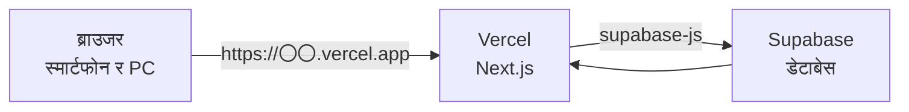
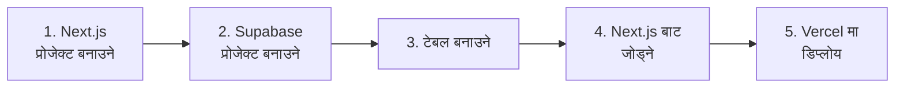
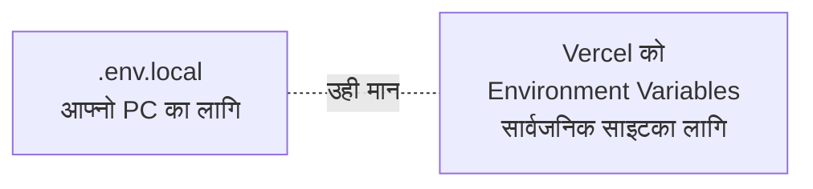

# स्वतन्त्र प्रोजेक्ट A. डिप्लोय कोर्स — Next.js + Vercel + Supabase

> 🇯🇵 मूल प्रति (जापानी भाषामा): [2026_10_09_資料2.md](<../../../2年生_システム開発実践/後期/2026_10_09/2026_10_09_資料2.md>) <!-- original-ja-link -->

बनाएको एपलाई **इन्टरनेटमा सार्वजनिक** गरेर, स्मार्टफोन वा साथीको PC बाट पनि प्रयोग गर्न मिल्ने बनाउने कोर्स हो।

> 💰 **सबै निःशुल्क बनाउन सकिन्छ**
> | सेवा | प्रयोग गर्ने प्लान |
> |---------|----------|
> | Next.js | निःशुल्क (ओपन सोर्स) |
> | Vercel | **Hobby** (निःशुल्क। व्यक्तिगत, गैर-व्यावसायिक प्रयोग) |
> | Supabase | **Free** (निःशुल्क) |
>
> क्रेडिट कार्ड दर्ता गर्नु पर्दैन। सशुल्क प्लानमा अपग्रेड गर्न सुझाव दिइए पनि नछान्नुहोस्।

[स्वतन्त्र प्रोजेक्ट: आफूलाई मन पर्ने कुरा विकास गरौँ मा फर्कनुहोस्](./2026_10_09_資料1.md)

---

## 1. संरचना

पहिलो सेमेस्टरमा, डेटा प्रोसेसिङ Laravel ले र डेटा भण्डारण MySQL ले गर्थे।
यो कोर्समा, ती दुईको सट्टा **Supabase** प्रयोग गर्छौँ।



| नाम | के हो? | पहिलो सेमेस्टरसँग तुलना गर्दा |
|------|-----------|------------|
| **Next.js** | स्क्रिन बनाउँछ (**ब्याकएन्ड API पनि बनाउन सकिन्छ**) | school-frontend (+ Laravel API) |
| **Vercel** | Next.js लाई इन्टरनेटमा सार्वजनिक गर्छ | (छैन) |
| **Supabase** | इन्टरनेटमा भएको डेटाबेस। API पनि स्वचालित रूपमा तयार गरिदिन्छ | Laravel API + MySQL |

### Next.js फुल-स्ट्याक फ्रेमवर्क हो

पहिलो सेमेस्टरमा "स्क्रिन Next.js मा, API Laravel मा" भनेर दुई वटा एपमा छुट्याएर बनायौँ।
तर Next.js **फुल-स्ट्याक फ्रेमवर्क** भएकाले, **स्क्रिन (फ्रन्टएन्ड) र API (ब्याकएन्ड) लाई एउटै प्रोजेक्टमा बनाउन सकिन्छ।**

```mermaid
graph LR
    subgraph पहिलो सेमेस्टर: दुई वटा एप
        F1[Next.js<br>स्क्रिन] -->|fetch| L[Laravel<br>API]
    end
    subgraph यो कोर्स: एउटा एप
        F2[Next.js<br>स्क्रिन] -->|fetch| A2[Next.js<br>API<br>app/api/...]
    end
```

`app/api/` भित्र `route.ts` बनाउँदा, त्यो API बन्छ (यसलाई **Route Handler** भनिन्छ)।

```ts
// app/api/hello/route.ts
export async function GET() {
  return Response.json({ message: "こんにちは" });
}
```

`npm run dev` ले सुरु गरेर http://localhost:3000/api/hello खोल्दा JSON फर्किन्छ।

| | पहिलो सेमेस्टर (Laravel) | Next.js |
|---|---|---|
| URL तय गर्ने | `routes/api.php` मा लेख्ने | `app/api/〇〇/route.ts` को **फोल्डरको स्थान** ले तय हुन्छ |
| प्रोसेस लेख्ने | कन्ट्रोलरको मेथड | `GET` / `POST` जस्ता फङ्सन |
| JSON फर्काउने | `return response()->json([...])` | `return Response.json({...})` |

**यस्तो बेला Next.js को API प्रयोग गर्ने**

- बाहिरी API (AI आदि) प्रयोग गर्दा, **API की ब्राउजरमा देखाउन नचाहेको बेला**
  (API भित्रको प्रोसेस सर्भरमा चल्ने भएकाले, `NEXT_PUBLIC_` नलागेको इन्भाइरनमेन्ट भेरिएबल सुरक्षित रूपमा प्रयोग गर्न सकिन्छ)
- डेटा सेभ गर्नुअघि सर्भरतर्फ जाँच गर्न चाहेको बेला

> सामान्य रूपमा डेटा थप्न वा निकाल्न, स्क्रिनबाट सिधै Supabase मा जडान गरे पुग्छ।
> "सर्भरतर्फ गर्न चाहेको काम" आएपछि Next.js को API बनाउनुहोस्।

## 2. तयारीको क्रम



### 2-1. Next.js प्रोजेक्ट बनाउने

मौसम पूर्वानुमान एपमा जस्तै `create-next-app` बाट बनाएर, GitHub मा पुस गरिराख्नुहोस्।
→ [मौसम पूर्वानुमान एपको सामग्री](../2026_10_02/2026_10_02_資料2.md)

### 2-2. Supabase प्रोजेक्ट बनाउने

1. https://supabase.com/ खोलेर, `Start your project` → **GitHub बाट लगइन**
2. `New project` थिचेर, तल जस्तै भर्ने

| वस्तु | भर्ने कुरा |
|------|------------|
| Project name | एपको नाम |
| Database Password | बलियो पासवर्ड (`Generate a password` प्रयोग गरे पनि हुन्छ। नोट गरेर राख्नुहोस्) |
| Region | **Northeast Asia (Tokyo)** |
| प्लान | **Free (निःशुल्क)** |

### 2-3. टेबल बनाउने

बायाँ मेनुको `Table Editor` → `Create a new table` बाट, योजना पानामा सोचेका टेबलहरू बनाउनुहोस्।
`Enable Row Level Security (RLS)` लाई **अन नै राख्नुहोस्** (तलको ध्यान दिनुपर्ने कुरा हेर्नुहोस्)।

### 2-4. Next.js बाट जोड्ने

Supabase को `Project Settings` → `API Keys` बाट **Project URL** र **Publishable key** (वा anon key) कपी गर्नुहोस्।
Next.js प्रोजेक्टमा, Supabase प्रयोग गर्ने प्याकेज इन्स्टल गर्नुहोस्।

```bash
npm install @supabase/supabase-js
```

प्रोजेक्टको मुख्य फोल्डरमा `.env.local` बनाएर, कपी गरेका मानहरू लेख्नुहोस्।

```bash
NEXT_PUBLIC_SUPABASE_URL=https://xxxxxxxx.supabase.co
NEXT_PUBLIC_SUPABASE_KEY=कपी गरेको Publishable key
```

`lib/supabase.ts` बनाएर, Supabase मा जोड्ने तयारी गर्नुहोस्।

```ts
import { createClient } from "@supabase/supabase-js";

export const supabase = createClient(
  process.env.NEXT_PUBLIC_SUPABASE_URL!,
  process.env.NEXT_PUBLIC_SUPABASE_KEY!
);
```

त्यसपछि, डेटा ल्याउने वा थप्ने काम गर्न सकिन्छ।

| गर्न चाहेको काम | Supabase | पहिलो सेमेस्टरको Laravel मा यस बराबर |
|------------|---------|----------------------|
| सबै ल्याउने | `supabase.from("books").select("*")` | `Book::all()` |
| थप्ने | `supabase.from("books").insert({ title: "..." })` | `Book::create([...])` |
| मेटाउने | `supabase.from("books").delete().eq("id", 1)` | `Book::find(1)->delete()` |

> ⚠️ **RLS (Row Level Security) मा ध्यान दिनुहोस्**
> RLS अन भएको टेबलमा **पोलिसी (कसले पढ्न/लेख्न पाउने भन्ने नियम)** नबनाए डेटा खाली फर्किन्छ।
> `Authentication` → `Policies` बाट, हरेक टेबलका लागि पोलिसी थप्नुहोस्।
> "डेटा आएन!" भएको बेला, पहिले यहीँ जाँच्नुहोस्। थाहा भएन भने शिक्षकलाई बोलाउनुहोस्।

> ⚠️ **`secret` की (service_role की) प्रयोग नगर्नुहोस्**
> `NEXT_PUBLIC_` लागेका मानहरू ब्राउजरबाट जो कोहीले हेर्न सक्छ।
> यहाँ **Publishable key (anon key) मात्र** राख्नुहोस्। `secret` की राखेमा, जो कोहीले डेटाबेस बदल्न सक्ने हुन्छ।

### 2-5. Vercel मा डिप्लोय गर्ने

मौसम पूर्वानुमान एपकै चरणअनुसार डिप्लोय गर्नुहोस्। → [Vercel मा डिप्लोय गर्ने](../2026_10_02/2026_10_02_資料3.md#2-vercel-मा-निःशुल्क-डिप्लोय-गर्ने)

तर, यसपटक **इन्भाइरनमेन्ट भेरिएबल सेट गर्नु आवश्यक** छ।
Vercel प्रोजेक्टको `Settings` → `Environment Variables` मा `.env.local` कै दुई वटा मान दर्ता गरेर, फेरि डिप्लोय गर्नुहोस्।



> `.env.local` GitHub मा पुस हुँदैन (`.gitignore` मा राखिएको छ)।
> त्यसैले, Vercel मा पनि छुट्टै दर्ता गर्नुपर्छ।

---

## 3. अब यहाँदेखि, बनाउँदै सिक्ने

तयारी पूरा भएपछि, **आफूले बनाउन चाहेको कुरा बनाउँदै** सिक्दै जानुहोस्।
"यो सुविधा बनाउन चाहन्छु → खोज्ने → प्रयास गर्ने → चल्यो!" दोहोर्‍याउँदै जाँदा, प्रयोग गर्न सकिने प्रविधि बढ्दै जान्छ।

अलमल हुँदा, **आफ्नो विशेष जोड** लाई फेरि सम्झनुहोस्। "यो कुरा चाहिँ यसरी नै बनाउन चाहन्छु" भन्ने सोचले अब के सिक्ने भनेर बाटो देखाउँछ।

पूरा भएपछि, **सार्वजनिक URL र GitHub को URL** पोर्टफोलियोका रूपमा पेस गर्न सकिन्छ।

> ⚠️ **Supabase केही समय प्रयोग नगरे अस्थायी रूपमा रोकिन्छ**
> निःशुल्क प्लानमा, **करिब एक हप्तासम्म कुनै एक्सेस नभए प्रोजेक्ट अस्थायी रूपमा रोकिन्छ**।
> रोकिएको बेला, सार्वजनिक URL खोले पनि डेटा देखिँदैन।
> Supabase को ड्यासबोर्डबाट फेरि सुरु गरे पहिलेकै अवस्थामा फर्किन्छ (डेटा मेटिँदैन)।
> **पेस गर्नुअघि वा अन्तर्वार्ताअघि, आफैँ सार्वजनिक URL खोलेर चल्छ कि जाँच्नुहोस्।**
→ [पोर्टफोलियोका रूपमा पेस गर्ने](./2026_10_09_資料1.md#5-पोर्टफोलियोका-रूपमा-पेस-गर्ने)

[सामग्री 1 को "बनाउँदै सिक्ने"](./2026_10_09_資料1.md#4-बनाउँदै-सिक्ने) पनि सँगै पढ्नुहोस्।
