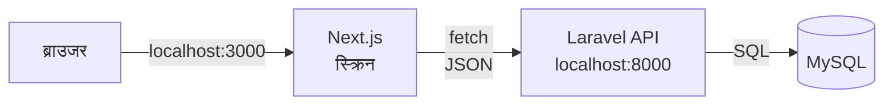
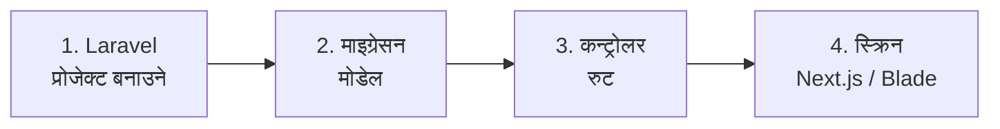

# स्वतन्त्र प्रोजेक्ट B. लोकल कोर्स — Laravel आदि

> 🇯🇵 मूल प्रति (जापानी भाषामा): [2026_10_09_資料3.md](<../../../2年生_システム開発実践/後期/2026_10_09/2026_10_09_資料3.md>) <!-- original-ja-link -->

आफ्नो PC (`localhost`) मा चलाउने कोर्स हो।

[स्वतन्त्र प्रोजेक्ट: आफूलाई मन पर्ने कुरा विकास गरौँ मा फर्कनुहोस्](./2026_10_09_資料1.md)

---

पहिलो सेमेस्टरको **विद्यार्थी व्यवस्थापन एप** मा प्रयोग गरेको प्रविधिकै संयोजन प्रयोग गरेर बनाउँछौँ। नयाँ सिक्नुपर्ने कुरा थोरै भएकाले **एपका सुविधा बनाउनमा ध्यान केन्द्रित** गर्न सकिन्छ।

---

## 1. बनाउने तरिका छान्ने

बनाउने तरिका दुई किसिमका छन्।

| बनाउने तरिका | विषयवस्तु | कस्तालाई सिफारिस |
|-------|------|---------|
| **Laravel API + Next.js** | पहिलो सेमेस्टरकै जस्तै। स्क्रिन Next.js मा, डेटा Laravel मा | पहिलो सेमेस्टरमा सिकेका कुरा दोहोर्‍याउँदै बनाउन चाहनेलाई |
| **Laravel मात्र (Blade)** | स्क्रिन पनि Laravel को Blade मा बनाउने | संरचना सरल राख्न चाहनेलाई |

---

## 2. तयारीको क्रम

पहिलो सेमेस्टरका सामग्री र पूरा भएको संस्करणको कोडलाई सन्दर्भका रूपमा हेर्नुहोस्।

- समग्र क्रम → [डेभलपमेन्टको क्रम: शून्यबाट API बनाउँदासम्म](../../前期/開発の流れ_まとめ.md)
- पहिलो सेमेस्टरको पुनरावलोकन → [पहिलो सेमेस्टरको पुनरावलोकन (दोहोर्‍याइ)](../2026_10_02/2026_10_02_資料1.md)
- पूरा भएको संस्करणको कोड → [portfolio](../../前期/portfolio/)

> **"Laravel आदि" को "आदि"**
> पहिलो सेमेस्टरमा प्रयोग गरेका प्रविधिभन्दा फरक प्रविधि (जस्तै Python) प्रयोग गरेर बनाउन चाहने विद्यार्थीले शिक्षकसँग सल्लाह गर्नुहोस्।

---

## 3. अब यहाँदेखि, बनाउँदै सिक्ने

तयारी पूरा भएपछि, **आफूले बनाउन चाहेको कुरा बनाउँदै** सिक्दै जानुहोस्।
"यो सुविधा बनाउन चाहन्छु → जानकारी खोज्ने → प्रयास गर्ने → चल्यो!" भन्ने प्रक्रिया दोहोर्‍याउँदै जाँदा, आफूले प्रयोग गर्न सक्ने प्रविधिहरू बढ्दै जान्छन्।

अलमल पर्दा, **आफूले विशेष महत्त्व दिएको कुरा** सम्झनुहोस्। "यो कुरा चाहिँ यसरी नै बनाउन चाहन्छु" भन्ने सोचले अब के सिक्ने भन्ने बाटो देखाउँछ।

पूरा भएपछि, **GitHub को URL** पोर्टफोलियोका रूपमा पेस गर्न सकिन्छ। README मा **स्क्रिनसट वा स्क्रिनको भिडियो** राखेर, एप चलिरहेको अवस्था बुझिने बनाउनुहोस्।
→ [पोर्टफोलियोका रूपमा पेस गर्ने](./2026_10_09_資料1.md#5-पोर्टफोलियोका-रूपमा-पेस-गर्ने)

[सामग्री 1 को "बनाउँदै सिक्ने"](./2026_10_09_資料1.md#4-बनाउँदै-सिक्ने) पनि सँगै पढ्नुहोस्।
