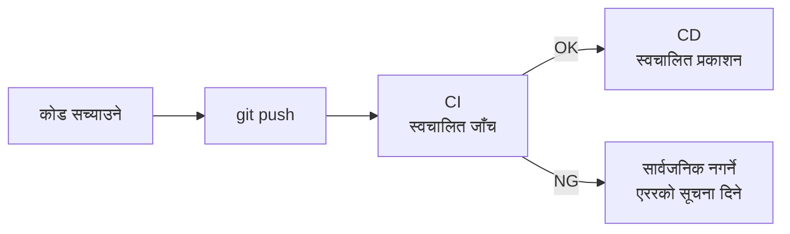
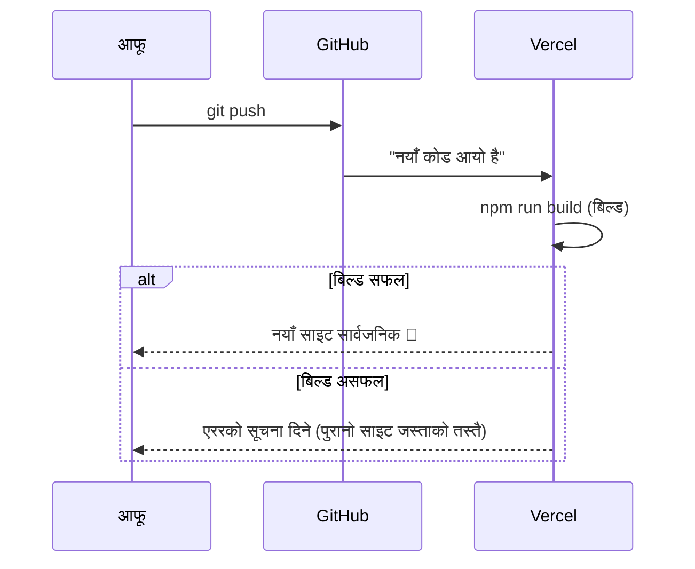
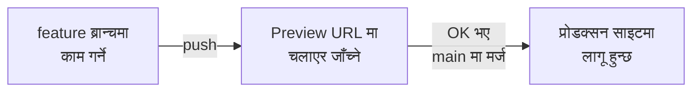
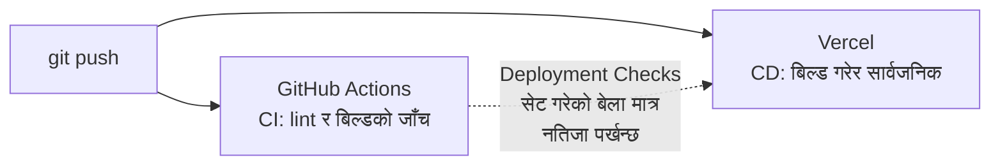

# CI/CD को बारेमा

> 🇯🇵 मूल प्रति (जापानी भाषामा): [CICDについて.md](<../../../2年生_システム開発実践/後期/2026_10_09/CICDについて.md>) <!-- original-ja-link -->

डिप्लोय कोर्समा, GitHub मा पुस गर्ने बित्तिकै Vercel को साइट अपडेट भयो।
वास्तवमा यही **CI/CD (सीआई/सीडी)** को कार्यप्रणाली हो।
यहाँ, CI/CD भनेको के हो भनेर हेर्दै जान्छौँ।

[स्वतन्त्र प्रोजेक्ट A. डिप्लोय कोर्समा फर्कनुहोस्](./2026_10_09_資料2.md)

---

## 1. CI/CD भनेको के हो

**CI/CD** भनेको "कोड लेखिसकेपछिका कामलाई **स्वचालित** बनाउने" प्रणाली हो।

| नाम | पूरा नाम | अर्थ | एक शब्दमा |
|------|----------|------|-----------|
| **CI** | Continuous Integration (निरन्तर इन्टिग्रेसन) | पुस गर्दा हरेकपटक **स्वचालित रूपमा जाँच** गर्छ | स्वचालित जाँच |
| **CD** | Continuous Delivery / Deployment (निरन्तर डेलिभरी / डिप्लोयमेन्ट) | जाँच पास भएपछि **स्वचालित रूपमा सार्वजनिक** गर्छ | स्वचालित प्रकाशन |

> 💡 **उदाहरण दिँदा "रिपोर्ट बुझाउने" जस्तै**
> - **CI** = बुझाउनुअघि, हिज्जेको गल्ती र पृष्ठ सङ्ख्याको जाँच **स्वचालित रूपमा गरिदिने** सुविधा
> - **CD** = जाँच पास भएपछि, **स्वचालित रूपमा शिक्षकलाई बुझाइदिने** सुविधा
>
> मानिसले हातैले गर्दा "जाँच्न बिर्सियो", "बुझाउन बिर्सियो" भन्ने हुन्छ। स्वचालित बनाए हरेकपटक उही तरिकाले गर्न सकिन्छ।

> 📝 **CD का दुई अर्थ**
> CD का **निरन्तर डेलिभरी** (जुनसुकै बेला सार्वजनिक गर्न सकिने अवस्थामा राख्ने, सार्वजनिक गर्ने बटन भने मानिसले थिच्ने) र **निरन्तर डिप्लोयमेन्ट** (सार्वजनिक गर्नेसम्म सबै स्वचालित) गरी दुई अर्थ छन्।
> यो सामग्रीको Vercel जस्तै, पुस गरेपछि स्वचालित रूपमा सार्वजनिक हुने चाहिँ **निरन्तर डिप्लोयमेन्ट** हो।

---

## 2. CI/CD नभए के हुन्छ?

CI/CD नभए, कोड सच्याउँदा हरेकपटक **हातैले** काम गर्नुपर्छ।


- जाँच्न बिर्सेर **एरर भएको कोड सार्वजनिक** गरिन्छ
- अपलोड गर्दा **गलत फाइल छानिन्छ**
- हरेकपटक उही काम गर्नुपर्ने भएकाले **समय लाग्छ**

CI/CD भए यस्तो हुन्छ।



**आफूले गर्ने काम `git push` मात्र** हो।

---

## 3. Vercel ले CD गरिदिइरहेको छ

Vercel र GitHub जोडेपछि, **पुस गर्दा हरेकपटक स्वचालित रूपमा डिप्लोय** हुन्छ। यही **CD** हो।



> 📝 **बिल्ड असफल भए पनि साइट बिग्रिँदैन**
> बिल्ड असफल भएको बेला, **पुरानो संस्करणको साइट जस्ताको तस्तै** देखिन्छ।
> Vercel को `Deployments` स्क्रिनमा असफल हुनुको कारण (एरर सन्देश) जाँच्नुहोस्।

### ब्रान्चअनुसार "परीक्षण URL" बन्छ

Vercel मा, ब्रान्चअनुसार सार्वजनिक हुने तरिका फरक हुन्छ।

| पुस गरेको ब्रान्च | के हुन्छ? | URL |
|------------------|-----------|-----|
| `main` | **प्रोडक्सन साइट** नयाँ हुन्छ | `https://〇〇.vercel.app` |
| त्यसबाहेक (`feature/login` आदि) | **परीक्षणका लागि साइट (Preview)** बन्छ | `https://〇〇-git-feature-login-〇〇.vercel.app` आदि |



नयाँ सुविधाका लागि **ब्रान्च बनाएर Preview URL मा जाँचेपछि मात्र main मा मर्ज** गरे, प्रोडक्सन साइट बिग्रिनबाट जोगाउन सकिन्छ।
यो पहिलो सेमेस्टरको टिम डेभलपमेन्टमा सिकेको **ब्रान्च → पुल रिक्वेस्ट → मर्ज** को क्रमजस्तै हो।

---

## 4. CI गरेर हेरौँ (GitHub Actions)

Vercel ले गरिदिने मुख्य काम CD हो।
**CI (स्वचालित जाँच)** लाई **GitHub Actions** भन्ने GitHub को सुविधाबाट थप्न सकिन्छ (पब्लिक रिपोजिटरी भए निःशुल्क। प्राइभेट रिपोजिटरीमा पनि हरेक महिना तोकिएको समयसम्म निःशुल्क)।

### 4-1. सेटिङ फाइल बनाउने

प्रोजेक्टमा `.github/workflows/ci.yml` बनाउनुहोस्।

```yaml
# .github/workflows/ci.yml
name: CI

# कहिले चलाउने: push र पुल रिक्वेस्टको बेला
on:
  push:
  pull_request:

jobs:
  check:
    runs-on: ubuntu-latest   # GitHub ले तयार गरिदिएको PC मा चल्छ
    steps:
      - uses: actions/checkout@v6      # कोड ल्याउँछ
      - uses: actions/setup-node@v6    # Node.js इन्स्टल गर्छ
        with:
          node-version: 24
      - run: npm ci                    # प्याकेज इन्स्टल गर्छ
      - run: npm run lint              # कोड लेख्ने तरिका जाँच्छ
      - run: npm run build             # बिल्ड हुन्छ कि जाँच्छ
```

> ⚠️ **`npm run lint` नचलेको बेला**
> `create-next-app` मा **Linter मा None छानेको** प्रोजेक्टमा `lint` स्क्रिप्ट हुँदैन। त्यस्तो अवस्थामा `npm run lint` को लाइन मेटाउनुहोस्।
> साथै, Next.js 16 देखि `next lint` कमान्ड हटाइएको छ। पुरानो प्रोजेक्टमा `"lint": "next lint"` छ भने, `"lint": "eslint"` मा बदल्नुहोस्।
> `package.json` को `"scripts"` हेरेर, `lint` छ कि छैन जाँच्नुहोस्।

| लाइन | अर्थ |
|----|------|
| `on:` | **कहिले** चलाउने |
| `runs-on:` | **कहाँ** चलाउने (GitHub ले उपलब्ध गराएको PC प्रयोग गर्ने) |
| `steps:` | **के** गर्ने (माथिबाट क्रमैसँग चलाउने) |

### 4-2. नतिजा हेर्ने

फाइल पुस गरेपछि, GitHub रिपोजिटरीको **`Actions`** ट्याबमा नतिजा हेर्न सकिन्छ।

| देखिने कुरा | अर्थ |
|------|------|
| ✅ हरियो चेक | सबै जाँच पास भए |
| ❌ रातो क्रस | कतै असफल भयो → क्लिक गर्दा एरर हेर्न सकिन्छ |

पुल रिक्वेस्टको स्क्रिनमा पनि नतिजा देखिने भएकाले, **मर्ज गर्नुअघि नै समस्या थाहा पाउन सकिन्छ**।

> ⚠️ **GitHub Actions असफल भए पनि Vercel ले डिप्लोय गर्छ**
> GitHub Actions (CI) र Vercel (CD) **आ-आफ्नै छुट्टाछुट्टै** चल्छन्।
> त्यसैले, केही सेटिङ नगरे, CI ❌ भए पनि Vercel को बिल्ड सफल भयो भने **प्रोडक्सन साइट नयाँ हुन्छ**।
> "CI ✅ भएको बेला मात्र प्रोडक्सनमा पठाउने" बनाउन चाहेमा, Vercel को **Deployment Checks** भन्ने सुविधा प्रयोग गर्नुहोस्।
> प्रोजेक्टको `Settings` भित्रको `Build and Deployment` मा रहेको Deployment Checks मा `Add Checks` थिचेर, GitHub Actions को जाँच छान्नुहोस् (विस्तृत जानकारी [Vercel को डकुमेन्टेसन](https://vercel.com/docs/deployment-checks) मा)।

CI र CD को सम्बन्धलाई चित्रमा देखाउँदा यस्तो हुन्छ।



> 💡 **README मा ब्याज टाँसे पोर्टफोलियोमा प्रभाव पार्न सकिन्छ**
> `Actions` ट्याबको workflow खोलेर, `Filter workflow runs` को छेउको `⋮` → `Create status badge` → `Copy status badge Markdown` बाट ब्याजको कोड बनाउन सकिन्छ।
> README मा टाँस्दा "CI/CD प्रयोग गरेर डेभलप गरिरहेको छु" भन्ने कुरा एकै नजरमा थाहा हुन्छ।

---

## 5. CI/CD का राम्रा पक्ष

- **गल्ती छिट्टै थाहा पाउन सकिन्छ**: पुस गर्ने बित्तिकै जाँच हुन्छ
- **सार्वजनिक गर्न सजिलो**: `git push` मात्रले प्रोडक्सनमा लागू हुन्छ
- **हरेकपटक उही प्रक्रिया अपनाउन सकिन्छ**: हातैले गर्दा हुने गल्ती हट्छ
- **टिम डेभलपमेन्टमा बलियो**: जसको कोड भए पनि उही नियमले जाँचिन्छ

वास्तविक डेभलपमेन्ट क्षेत्रमा, CI/CD **लगभग अनिवार्य रूपमा** प्रयोग हुन्छ।
स्वतन्त्र प्रोजेक्टमा यसको प्रयोग गरेमा, जागिर खोज्ने क्रममा पनि बताउन सकिने अनुभव हुन्छ।

---

## 6. सारांश

- **CI** = पुस गरेपछि **स्वचालित जाँच**, **CD** = जाँच पास भएपछि **स्वचालित प्रकाशन**
- Vercel ले स्वचालित रूपमा जाँच्ने कुरा **बिल्ड सफल हुन्छ कि हुँदैन** मात्र हो। GitHub Actions को नतिजाअनुसार सार्वजनिक गर्न रोक्न चाहेमा **Deployment Checks** सेट गर्ने
- Vercel ले GitHub सँग जोडिएर, **पुस गर्दा हरेकपटक स्वचालित रूपमा डिप्लोय (CD)** गरिदिन्छ
- `main` बाहेकका ब्रान्चलाई **Preview URL** मा जाँच्न सकिन्छ
- **GitHub Actions** प्रयोग गर्दा, lint र बिल्डको **स्वचालित जाँच (CI)** थप्न सकिन्छ
- आफूले गर्ने काम **`git push` मात्र**

[स्वतन्त्र प्रोजेक्ट A. डिप्लोय कोर्समा फर्कनुहोस्](./2026_10_09_資料2.md)
