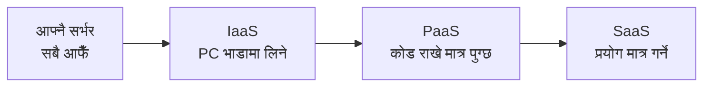
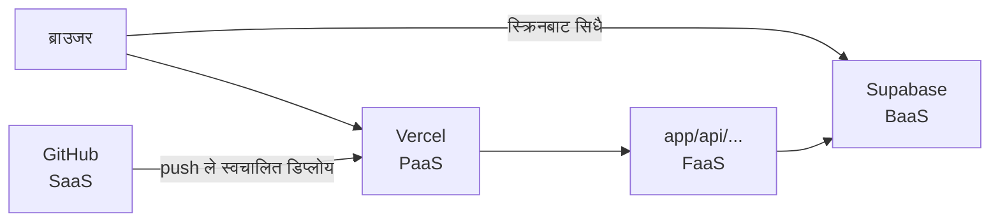

# IaaS・PaaS・SaaS・BaaS को बारेमा

> 🇯🇵 मूल प्रति (जापानी भाषामा): [IaaS_PaaS_SaaS_BaaSについて.md](<../../../2年生_システム開発実践/後期/2026_10_09/IaaS_PaaS_SaaS_BaaSについて.md>) <!-- original-ja-link -->

क्लाउड सेवाबारे खोज्दा, **IaaS (आयास)**, **PaaS (पास)**, **SaaS (सास)**, **BaaS (बास)** जस्ता शब्द धेरै देखिन्छन्।
यी सबै "〇〇 as a Service (〇〇 लाई सेवाका रूपमा प्रयोग गर्ने)" का छोटो रूप हुन्, र **कहाँसम्मको काम सेवालाई जिम्मा दिने** भन्ने फरकलाई जनाउँछन्।

[स्वतन्त्र प्रोजेक्ट A. डिप्लोय कोर्समा फर्कनुहोस्](./2026_10_09_資料2.md)

---

## 1. छोटकरीमा

| नाम | पूरा नाम | भाडामा लिने कुरा | छोटकरीमा |
|------|----------|-----------|-----------|
| **IaaS** | Infrastructure as a Service | **सर्भर (PC) नै** | खाली PC भाडामा लिने |
| **PaaS** | Platform as a Service | **एप चलाउने ठाउँ** | कोड राखे चल्छ |
| **BaaS** | Backend as a Service | **ब्याकएन्डका सुविधा** | डेटाबेस र लगइन सुरुदेखि नै हुन्छ |
| **FaaS** | Function as a Service | **फङ्सन चलाउने ठाउँ** | फङ्सन मात्र लेखे चल्छ |
| **SaaS** | Software as a Service | **पूरा भइसकेको एप** | जस्ताको तस्तै प्रयोग मात्र गर्ने |

तलतिर जाँदा जाँदा, **आफूले गर्नुपर्ने काम घट्दै** जान्छ।

---

## 2. पिज्जाको उदाहरणमा भन्दा

| | आफूले गर्ने काम | पिज्जामा भन्दा |
|---|---|---|
| **आफ्नै सर्भर** | सबै | पिठोबाट पिज्जाको आटा बनाउने, ओभन पनि आफैँ किन्ने |
| **IaaS** | OS र सफ्टवेयरको तयारी, एप | भान्सा र ओभन भाडामा लिएर, सामग्रीबाट आफैँ बनाउने |
| **PaaS** | एप (कोड) मात्र | आटा र ओभन तयार छन्। टपिङ मात्र आफैँ राख्ने |
| **SaaS** | केही नगर्ने (प्रयोग मात्र गर्ने) | होम डेलिभरी पिज्जा अर्डर गरेर खाने मात्र |

→ दायाँतिर जाँदा जाँदा **सजिलो**। बायाँतिर जाँदा जाँदा **स्वतन्त्र रूपमा कस्टमाइज गर्न सकिने**।

---

## 3. कसले के व्यवस्थापन गर्छ?

एप चलाउन, विभिन्न "तह" चाहिन्छन्।
**🟦 = आफैँ व्यवस्थापन गर्ने**, **⬜ = सेवाले व्यवस्थापन गरिदिने** हो।

| तह | आफ्नै सर्भर | IaaS | PaaS | SaaS |
|----|:---:|:---:|:---:|:---:|
| एप (आफ्नो कोड) | 🟦 | 🟦 | 🟦 | ⬜ |
| डेटा | 🟦 | 🟦 | 🟦 | ⬜ |
| PHP, Node.js जस्ता रनटाइम वातावरण | 🟦 | 🟦 | ⬜ | ⬜ |
| OS (Linux आदि) | 🟦 | 🟦 | ⬜ | ⬜ |
| सर्भर (PC को हार्डवेयर) | 🟦 | ⬜ | ⬜ | ⬜ |
| नेटवर्क, भवन र बिजुली | 🟦 | ⬜ | ⬜ | ⬜ |

---

## 4. हरेकको विस्तृत जानकारी

### 4-1. IaaS (आयास) — खाली PC भाडामा लिने

इन्टरनेटको अर्को छेउमा रहेको **एउटा PC भाडामा लिने** जस्तो कल्पना गर्नुहोस्।
OS हाल्ने, PHP र MySQL जस्ता सफ्टवेयर इन्स्टल गर्ने काम **आफैँ** गर्नुपर्छ।

- **उदाहरण**: AWS को EC2, Google Cloud को Compute Engine, Sakura Cloud
- **राम्रो पक्ष**: जे पनि स्वतन्त्र रूपमा गर्न सकिन्छ
- **गाह्रो पक्ष**: सेटिङ र सुरक्षाका उपाय सबै आफैँ गर्नुपर्छ

> पहिलो सेमेस्टरको Laravel लाई IaaS मा सार्वजनिक गर्ने हो भने, "Linux हाल्ने → PHP र MySQL हाल्ने → कोड राख्ने → २४ घण्टा चलाइराख्ने" सबै आफैँ गर्नुपर्छ।

### 4-2. PaaS (पास) — कोड राखे चल्छ

**एप चलाउने वातावरण सुरुदेखि नै तयार भएको** सेवा हो।
आफूले **कोड मात्र तयार गरे** पुग्छ, सार्वजनिक गर्नेसम्मको काम सेवाले सम्हालिदिन्छ।

- **उदाहरण**: **Vercel**, Render, Heroku, Google App Engine
  (Heroku ले 2026 मा नयाँ सुविधाको विकास रोक्ने घोषणा गरेको छ। PaaS को पुरानो प्रतिनिधि उदाहरणका रूपमा भने यसको नाम धेरै आउँछ)
- **राम्रो पक्ष**: सर्भरको सेटिङ चाहिँदैन। `git push` मात्रले सार्वजनिक गर्न सकिन्छ
- **गाह्रो पक्ष**: सेवाले समर्थन गर्ने भाषा र प्रयोग गर्ने तरिकामा बाँधिनुपर्छ

> 🎯 **डिप्लोय कोर्समा प्रयोग गर्ने Vercel PaaS हो।**
> Next.js को कोड GitHub मा पुस गरेर मात्र पनि इन्टरनेटमा सार्वजनिक गर्न सकियो।

### 4-3. BaaS (बास) — ब्याकएन्ड सुरुदेखि नै हुन्छ

**डेटाबेस, लगइन सुविधा र फाइल भण्डारण जस्ता ब्याकएन्डका सुविधाहरू एकै ठाउँमा उपलब्ध गराउने** सेवा हो।
ब्याकएन्डको कोड (पहिलो सेमेस्टरमा प्रयोग गरेको Laravel API जस्तै) **आफैँ नलेखे पनि** एप बनाउन सकिन्छ।

- **उदाहरण**: **Supabase**, Firebase
- **राम्रो पक्ष**: फ्रन्टएन्ड (स्क्रिन) बनाउनमा ध्यान केन्द्रित गर्न सकिन्छ
- **गाह्रो पक्ष**: जटिल प्रोसेसका लागि छुट्टै API बनाउनुपर्छ

| गर्न चाहेको काम | पहिलो सेमेस्टर (आफैँ बनाउने) | Supabase (BaaS) |
|------------|-----------------|-----------------|
| डेटा सेभ गर्ने | Laravel API + MySQL | सुरुदेखि नै छ |
| लगइन सुविधा | आफैँ बनाउने | सुरुदेखि नै छ (Authentication) |
| इमेज सेभ गर्ने | आफैँ बनाउने | सुरुदेखि नै छ (Storage) |

> 🎯 **डिप्लोय कोर्समा प्रयोग गर्ने Supabase BaaS हो।**

### 4-4. FaaS (फास) — फङ्सन मात्र लेखे चल्छ

**एउटा फङ्सन लेखे, बोलाइएको बेला मात्र चलाइदिने** सेवा हो।
यो "सर्भरलेस" को केन्द्रमा रहेको अवधारणा हो। → [सर्भरलेसको बारेमा](./サーバレスについて.md)

- **उदाहरण**: **Vercel Functions** (Next.js को `app/api/〇〇/route.ts`), AWS Lambda, Cloudflare Workers
- **राम्रो पक्ष**: प्रयोग गरेजति मात्र पैसा लाग्छ। एक्सेस बढे पनि स्वचालित रूपमा सम्हाल्छ
- **गाह्रो पक्ष**: लामो प्रोसेसमा कमजोर। फङ्सनभित्र डेटा राखिराख्न सकिँदैन

### 4-5. SaaS (सास) — पूरा भइसकेको एप प्रयोग गर्ने

**बनिसकेको एपलाई इन्टरनेटमार्फत जस्ताको तस्तै प्रयोग गर्ने** सेवा हो।
तपाईंहरूले दिनहुँ प्रयोग गर्ने धेरैजसो कुरा SaaS हुन्।

- **उदाहरण**: Gmail, Google Docs, **GitHub**, Slack, Zoom, Notion
- **राम्रो पक्ष**: इन्स्टल र व्यवस्थापन चाहिँदैन। तुरुन्तै प्रयोग गर्न सकिन्छ
- **गाह्रो पक्ष**: भित्री कुरा आफैँ बदल्न सकिँदैन

> स्वतन्त्र प्रोजेक्टमा बनाएको एप सार्वजनिक गरेर सबैलाई प्रयोग गर्न दिनुभयो भने, त्यो पनि **SaaS** हो।

---

## 5. डिप्लोय कोर्सको संरचनामा लागू गर्दा

| प्रयोग गरिरहेको कुरा | प्रकार |
|--------------|------|
| GitHub | SaaS (कोड व्यवस्थापन गर्ने पूरा भइसकेको सेवा) |
| Vercel | PaaS (Next.js चलाउने ठाउँ) |
| Next.js को API (`app/api/`) | FaaS (Vercel मा कल गरिएको बेला मात्र चल्ने फङ्सन) |
| Supabase | BaaS (डेटाबेस, लगइन जस्ता ब्याकएन्ड सुविधाहरू) |

> 📝 **ठ्याक्कै छुट्याउन नसकिने अवस्था पनि हुन्छ**
> "Vercel PaaS हो, र FaaS पनि उपलब्ध गराउँछ" भनेजस्तै, एउटै सेवाका धेरै रूप हुन सक्छन्।
> नाम घोक्नुभन्दा, **"कहाँसम्मको काम सेवालाई जिम्मा दिइरहेको छ"** भन्ने आधारमा सोच्न सक्ने बनौँ।

---

## 6. सारांश

- "〇〇 as a Service" भनेको **कहाँसम्मको काम सेवालाई जिम्मा दिने** भन्ने फरक हो
- **IaaS**: PC भाडामा लिने (स्वतन्त्र तर गाह्रो)
- **PaaS**: कोड राखे चल्छ (Vercel)
- **BaaS**: ब्याकएन्डका सुविधा सुरुदेखि नै हुन्छन् (Supabase)
- **FaaS**: फङ्सन मात्र लेखे चल्छ (Vercel मा चल्ने Next.js को API)
- **SaaS**: पूरा भइसकेको एप प्रयोग मात्र गर्ने (Gmail, GitHub)
- जति धेरै जिम्मा दियो उति **सजिलो**, जति धेरै आफैँ गर्‍यो उति **स्वतन्त्र**

[स्वतन्त्र प्रोजेक्ट A. डिप्लोय कोर्समा फर्कनुहोस्](./2026_10_09_資料2.md)
