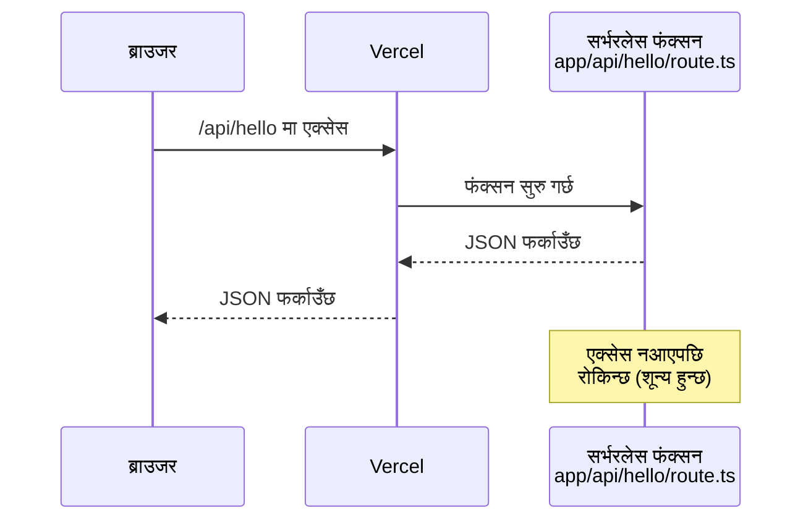
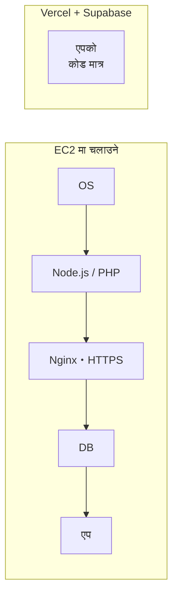

# सर्भरलेसको बारेमा

> 🇯🇵 मूल प्रति (जापानी भाषामा): [サーバレスについて.md](<../../../2年生_システム開発実践/後期/2026_10_09/サーバレスについて.md>) <!-- original-ja-link -->

डिप्लोय कोर्समा प्रयोग गर्ने **Vercel** मा, Next.js को API "**सर्भरलेस**" भनिने व्यवस्थामा चल्छ।
यहाँ हामी अघिल्लो सेमेस्टरको Laravel सँग तुलना गर्दै सर्भरलेस भनेको के हो भनेर हेर्नेछौं।

[स्वतन्त्र प्रोजेक्ट A. डिप्लोय कोर्समा फर्कनुहोस्](./2026_10_09_資料2.md)

---

## 1. सर्भरलेस भनेको के हो

**सर्भरलेस (Serverless)** को अर्थ "सर्भर नै छैन" भन्ने होइन।
सर्भर त **पक्कै हुन्छ**। तर, **सर्भर तयार गर्ने र व्यवस्थापन गर्ने काम आफैंले गर्नु नपर्ने** व्यवस्थालाई सर्भरलेस भनिन्छ।

> 💡 **उदाहरण दिँदा "ट्याक्सी" जस्तै**
> - **आफैं सर्भर तयार गर्नु** = गाडी किन्नु। पार्किङ, गाडी जाँच, पेट्रोल, बिग्रिँदा मर्मत सबै आफैंले गर्नुपर्छ
> - **सर्भरलेस** = ट्याक्सी चढ्नु। कहाँ जाने भनेर भने पुग्छ, गाडीको व्यवस्थापन चालक (कम्पनी) ले गरिदिन्छ
>
> दुवैमा "गाडी" त प्रयोग भइरहेकै छ। फरक भनेको **व्यवस्थापन कसले गर्छ** भन्ने हो।

---

## 2. अघिल्लो सेमेस्टरको तरिकासँग तुलना गरौं

अघिल्लो सेमेस्टरमा, आफ्नै PC मा `php artisan serve` चलाएर Laravel को सर्भर सुरु गर्थ्यौं।
यदि यसलाई इन्टरनेटमा सार्वजनिक गर्ने हो भने, **निरन्तर चलिरहने सर्भर** आफैंले तयार गर्नुपर्छ।

```mermaid
graph TB
    subgraph आफैं सर्भर तयार गर्ने
        S1[सर्भर भाडामा लिने] --> S2[OS・PHP・MySQL<br>इन्स्टल गर्ने] --> S3[एप राख्ने] --> S4[२४ घण्टा<br>चलाइरहने]
        S4 --> S5[अपडेट र<br>बिग्रिएमा मर्मत पनि आफैं]
    end
```

```mermaid
graph TB
    subgraph सर्भरलेस
        L1[कोड<br>GitHub मा push गर्ने] --> L2[Vercel ले<br>आफैं सार्वजनिक गर्छ]
        L2 --> L3[API, एक्सेस आएपछि<br>त्यतिबेला मात्र चल्छ]
    end
```

| | आफैं सर्भर तयार गर्ने | सर्भरलेस (Vercel आदि) |
|---|---|---|
| सर्भरको तयारी | आफैं गर्ने (OS र सफ्टवेयर इन्स्टल गर्ने) | **चाहिँदैन** |
| चलिरहने समय | **२४ घण्टा निरन्तर** | **एक्सेस आएको बेला मात्र** |
| एक्सेस अचानक बढ्दा | आफैं सर्भर थप्ने | **आफैं बढ्छ** |
| अपडेट र सुरक्षा उपाय | आफैं गर्ने | सेवाले गरिदिन्छ |
| पैसा | प्रयोग नगर्दा पनि लाग्छ | **प्रयोग गरेजति मात्र** (थोरै भए निःशुल्क) |

---

## 3. "एक्सेस आएको बेला मात्र चल्छ" भनेको के हो

सर्भरलेसको सबैभन्दा ठूलो विशेषता भनेको **बोलाइएको बेला मात्र चल्नु** हो।

सामग्री 2 मा बनाएको Next.js को API (`app/api/〇〇/route.ts`) लाई Vercel मा डिप्लोय गरेपछि, त्यो **सर्भरलेस फंक्सन (Vercel Functions)** को रूपमा चल्छ।



```ts
// app/api/hello/route.ts
export async function GET() {
  return Response.json({ message: "こんにちは" });
}
```

आफैंले लेख्ने भनेको **यो फंक्सन मात्र** हो।
"सर्भर सुरु गर्ने", "पोर्ट नम्बर तय गर्ने" जस्ता काम Vercel ले गरिदिन्छ।

---

## 4. Supabase सर्भरलेस हो?

Supabase मा पनि **सर्भर व्यवस्थापन गर्नु पर्दैन** भन्ने कुरा उस्तै हो। अघिल्लो सेमेस्टरमा MySQL आफ्नै PC (XAMPP वा Homebrew) मा चलाउँथ्यौं, तर
Supabase मा **डाटाबेसको तयारी र API बनाउने काम Supabase ले गरिदिन्छ**।

| गर्ने काम | अघिल्लो सेमेस्टर (Laravel + MySQL) | Supabase |
|---------|------------------------|----------|
| डाटाबेस चलाउने | XAMPP आदिमा आफैं सुरु गर्ने | Supabase ले चलाइदिन्छ |
| टेबल बनाउने | माइग्रेसन लेख्ने | Table Editor मा बनाउन सकिन्छ |
| डाटा राख्ने र निकाल्ने API | कन्ट्रोलर र रुट आफैं लेख्ने | **आफैं तयार हुन्छ** |

तर, Supabase को डाटाबेस **बोलाइएको बेला मात्र चल्ने होइन**।
प्रत्येक प्रोजेक्टका लागि डाटाबेसको सर्भर तयार गरिन्छ, र त्यो **निरन्तर चलिरहन्छ** (निःशुल्क प्लानमा करिब १ हप्ता प्रयोग नगरे अस्थायी रूपमा रोकिनुको कारण यही हो)।

| | Vercel को API (सर्भरलेस फंक्सन) | Supabase को डाटाबेस |
|---|---|---|
| सर्भरको व्यवस्थापन | गर्नु पर्दैन | गर्नु पर्दैन |
| चलिरहने समय | **बोलाइएको बेला मात्र** | **निरन्तर चलिरहन्छ** |
| प्रकार | सर्भरलेस (FaaS) | **BaaS** (ब्याकएन्डको काम जिम्मा दिन सकिने सेवा) |

> ⚠️ **निःशुल्क प्लानमा स्वचालित ब्याकअप हुँदैन**
> Supabase ले हरेक दिन आफैं ब्याकअप लिइदिने सुविधा सशुल्क प्लानमा मात्र हुन्छ।
> निःशुल्क प्लानमा, हराए समस्या हुने डाटा आफैं बाहिर निकालेर (export गरेर) राख्नुहोस्।

> 📝 **"सर्भरलेस" शब्द कसरी प्रयोग हुन्छ**
> "सर्भर व्यवस्थापन गर्नु नपर्ने" भन्ने फराकिलो अर्थमा, Supabase जस्ता सेवालाई पनि कहिलेकाहीँ "सर्भरलेस" भनिन्छ।
> तर यो सामग्रीमा भनिएको "बोलाइएको बेला मात्र चल्ने" सर्भरलेसभन्दा अलि फरक भएकाले, Supabase लाई **BaaS** को रूपमा सम्झनुहोस्।
> → [IaaS・PaaS・SaaS・BaaS को बारेमा](./IaaS_PaaS_SaaS_BaaSについて.md)

---

## 5. राम्रा पक्ष र ध्यान दिनुपर्ने कुरा

### राम्रा पक्ष 👍

- **तुरुन्तै सार्वजनिक गर्न सकिन्छ**: GitHub मा push गरे पुग्छ, डिप्लोय हुन्छ
- **खर्च कम लाग्छ**: प्रयोग गरेजति मात्र। विद्यार्थीको व्यक्तिगत एपका लागि निःशुल्क प्लान नै पर्याप्त हुन्छ
- **एक्सेस बढे पनि समस्या हुँदैन**: प्रोसेस गर्न सक्ने मात्रा आफैं बढ्छ
- **एप बनाउनमा ध्यान दिन सकिन्छ**: सर्भर व्यवस्थापनको चिन्ता गर्नु पर्दैन

### ध्यान दिनुपर्ने कुरा ⚠️

| ध्यान दिनुपर्ने कुरा | यसको मतलब के हो? |
|---------------|--------------|
| **पहिलो एक्सेस अलि ढिलो हुन सक्छ** | केही समय प्रयोग नभएमा फंक्सन रोकिएको हुन्छ, त्यसैले सुरु हुन समय लाग्छ (यसलाई **कोल्ड स्टार्ट** भनिन्छ)। अहिलेको Vercel मा यो समय निकै छोटो बनाउन प्रयास गरिएको छ |
| **लामो प्रोसेस राम्रोसँग गर्न सक्दैन** | एक पटकको प्रोसेसमा समयको सीमा हुन्छ (Vercel को निःशुल्क प्लानमा **बढीमा ५ मिनेट**)। भारी प्रोसेसका लागि उपयुक्त हुँदैन |
| **फंक्सनभित्र डाटा सेभ गर्न सकिँदैन** | फंक्सन कहिले रोकिन्छ थाहा नहुने भएकाले, भेरिएबल वा फाइलमा सेभ गरे पनि **अर्को पटक बाँकी रहन्छ भन्ने छैन** → **डाटा Supabase मा सेभ गर्नुहोस्** |
| **निःशुल्क प्लानमा सीमा हुन्छ** | धेरै प्रयोग गरे रोकिन सक्छ। सशुल्क प्लान नरोज्नुहोस् |

> 📝 **"डाटा फंक्सनभित्र बाँकी रहँदैन" भन्ने कुरा धेरै महत्त्वपूर्ण छ**
> Laravel को बेलामा जस्तै, **डाटा डाटाबेसमा सेभ गर्नु** आधारभूत नियम हो।
> सर्भरलेस फंक्सनभित्रको भेरिएबल, अर्को एक्सेसको बेलासम्म **मेटिइसकेको हुन सक्छ** भनेर सोच्नुहोस्।
> अर्कोतिर, Vercel मा एउटै फंक्सनले एकै समयमा धेरै अनुरोधहरू प्रोसेस गर्न सक्ने भएकाले, **अर्को व्यक्तिको अनुरोधसँग पनि भेरिएबल साझा हुन सक्छ**। प्रत्येक प्रयोगकर्ताको डाटा फंक्सनबाहिरको भेरिएबलमा नराख्नुहोस्।

---

## 6. यदि सर्भरलेस प्रयोग नगरेको भए? (EC2 मा चलाउने अवस्था)

सर्भरलेस कति उपयोगी छ भन्ने कुरा **आफैं सर्भर तयार गर्ने तरिकासँग** तुलना गर्दा राम्रोसँग बुझिन्छ।
यहाँ AWS को **EC2** (इन्टरनेटको अर्को छेउमा रहेको एउटा PC भाडामा लिने सेवा) मा चलाउने अवस्था हेरौं।

EC2 मा त **खाली PC (Linux)** भाडामा लिने मात्र हो। Node.js पनि PHP पनि इन्स्टल गरिएको हुँदैन।
→ थप जानकारीका लागि [IaaS・PaaS・SaaS・BaaS को बारेमा](./IaaS_PaaS_SaaS_BaaSについて.md) को IaaS भाग हेर्नुहोस्।

### 6-1. Next.js लाई EC2 मा चलाउने हो भने

| गर्ने काम | विवरण | Vercel मा भए |
|---|---|---|
| 1. EC2 बनाउने | OS (Ubuntu आदि) छानेर सुरु गर्ने | चाहिँदैन |
| 2. Node.js इन्स्टल गर्ने | `nvm` आदिबाट Node.js इन्स्टल गर्ने | चाहिँदैन |
| 3. कोड ल्याउने | `git clone` गर्ने | GitHub जोडे मात्र पुग्छ |
| 4. इन्भाइरोनमेन्ट भेरिएबल राख्ने | `.env.local` आदि आफैं बनाउने | स्क्रिनमा दर्ता गर्ने |
| 5. बिल्ड गरेर सुरु गर्ने | `npm ci` → `npm run build` → `npm run start` | स्वचालित |
| 6. निरन्तर चलाइरहने | टर्मिनल बन्द गरे पनि नरोकियोस् भनेर **PM2** जस्ता टुल प्रयोग गर्ने | स्वचालित |
| 7. पोर्ट खोल्ने | EC2 को **सेक्युरिटी ग्रुप** मा 80 र 443 नम्बर खोल्ने | चाहिँदैन |
| 8. Nginx राख्ने | Next.js 3000 नम्बरमा चल्ने भएकाले, **Nginx** ले 80 र 443 नम्बरबाट फरवार्ड गर्ने | चाहिँदैन |
| 9. HTTPS बनाउने | **Let's Encrypt** आदिबाट सर्टिफिकेट लिने र नवीकरण पनि गरिरहने | स्वचालित |
| 10. अपडेट गर्दा | हरेक पटक लगइन गरेर `git pull` → बिल्ड → रिस्टार्ट | `git push` मात्र |
| 11. व्यवस्थापन गरिरहने | OS अपडेट, सुरक्षा उपाय, सर्भर डाउन हुँदा समस्या समाधान गर्ने | चाहिँदैन |

### 6-2. Laravel लाई EC2 मा चलाउने हो भने

Laravel को हकमा, इन्स्टल गर्नुपर्ने कुरा अझ बढ्छन्।

| गर्ने काम | विवरण | अघिल्लो सेमेस्टरमा (आफ्नै PC) |
|---|---|---|
| 1. EC2 बनाउने | OS (Ubuntu आदि) छानेर सुरु गर्ने | आफ्नै PC |
| 2. PHP इन्स्टल गर्ने | PHP र Laravel ले प्रयोग गर्ने एक्सटेन्सनहरू (`mbstring`・`xml`・`curl`, MySQL सँग जोड्न `pdo_mysql` आदि) | XAMPP वा Homebrew |
| 3. Composer इन्स्टल गर्ने | PHP का प्याकेजहरू व्यवस्थापन गर्ने टुल | इन्स्टल गरेका थियौं |
| 4. वेब सर्भर इन्स्टल गर्ने | **Nginx + PHP-FPM** (PHP चलाउने व्यवस्था) इन्स्टल गरेर, `public/` फोल्डर सार्वजनिक गर्ने सेटिङ गर्ने | `php artisan serve` |
| 5. MySQL तयार गर्ने | EC2 मा आफैं इन्स्टल गर्ने, वा AWS को **RDS** (डाटाबेस सेवा) प्रयोग गर्ने | XAMPP वा Homebrew |
| 6. कोड ल्याउने | `git clone` → `composer install --no-dev` | उस्तै |
| 7. `.env` बनाउने | `APP_ENV=production`・`APP_DEBUG=false`・DB को कनेक्सन ठेगाना आदि लेखेर, `php artisan key:generate` | उस्तै (प्रोडक्सनको मान राख्ने) |
| 8. टेबल बनाउने | `php artisan migrate --force` | `php artisan migrate` |
| 9. अनुमति (permission) सेट गर्ने | `storage/` र `bootstrap/cache/` मा वेब सर्भरले लेख्न सक्ने बनाउने | ध्यान दिनु परेको थिएन |
| 10. पोर्ट खोल्ने र HTTPS | 80 र 443 नम्बर खोलेर, Let's Encrypt बाट सर्टिफिकेट लिने | चाहिएको थिएन |
| 11. अपडेट गर्दा | `git pull` → `composer install` → `migrate` → क्यास फेरि बनाउने (`php artisan optimize`) | — |
| 12. व्यवस्थापन गरिरहने | OS र PHP अपडेट, सुरक्षा उपाय, समस्या आउँदा समाधान | — |

> ⚠️ **प्रोडक्सनमा ध्यान दिनुपर्ने कुरा**
> - **`php artisan serve` प्रोडक्सनमा प्रयोग गरिँदैन।** यो विकासका लागि बनाइएको सरल सर्भर हो, धेरै एक्सेस सम्हाल्ने गरी बनाइएको छैन। यसको सट्टा Nginx + PHP-FPM प्रयोग गरिन्छ (त्यसैले Next.js मा जस्तो PM2 सामान्यतया चाहिँदैन)।
> - **`APP_DEBUG=true` राखेर सार्वजनिक गर्नु हुँदैन।** एरर स्क्रिनमा पासवर्ड जस्ता महत्त्वपूर्ण जानकारी देखिन सक्छ।

### 6-3. तुलना गर्दा



अघिल्लो सेमेस्टरको विद्यार्थी व्यवस्थापन एप (Next.js + Laravel API + MySQL) लाई EC2 मा सार्वजनिक गर्न खोज्दा, **6-1 र 6-2 दुवै** चाहिन्छ।
डिप्लोय कोर्समा **Vercel + Supabase** प्रयोग गर्नुको कारण, यस्ता तयारी र व्यवस्थापनको काम जिम्मा दिएर **एप बनाउनमा ध्यान दिनु** हो।

> 💡 **EC2 मा चलाउनुको पनि महत्त्व छ**
> सबै आफैं गर्नु गाह्रो भए पनि, त्यसो गर्दा **सर्भर कसरी चल्छ भन्ने राम्रोसँग बुझिन्छ**, र जे पनि आफ्नो इच्छाअनुसार सेटिङ गर्न सकिन्छ।
> वास्तविक कम्पनीहरूमा पनि EC2 जस्ता सर्भर धेरै प्रयोग हुन्छन्। रुचि हुनेहरूले स्वतन्त्र प्रोजेक्टपछि प्रयास गरेर हेर्नुहोस्।

---

## 7. सारांश

- सर्भरलेस भनेको "सर्भर छैन" होइन, **सर्भर व्यवस्थापन गर्नु नपर्ने** व्यवस्था हो
- **एक्सेस आएको बेला मात्र** चल्छ, र **प्रयोग गरेजति मात्र** पैसा लाग्छ
- Vercel मा डिप्लोय गरेको Next.js को API **सर्भरलेस फंक्सन** को रूपमा चल्छ
- Supabase लाई पनि सर्भरको व्यवस्थापन जिम्मा दिन सकिन्छ, तर डाटाबेस **निरन्तर चलिरहन्छ**। सर्भरलेसभन्दा पनि **BaaS** भन्नु उपयुक्त हुन्छ
- डाटा फंक्सनभित्र होइन, **डाटाबेसमा सेभ** गर्ने
- EC2 जस्तो सर्भरमा चलाउँदा, Node.js・PHP・Nginx・HTTPS・डाटाबेस आदि **सबै आफैं तयार र व्यवस्थापन** गर्नुपर्छ

[स्वतन्त्र प्रोजेक्ट A. डिप्लोय कोर्समा फर्कनुहोस्](./2026_10_09_資料2.md)
