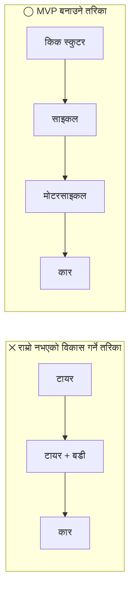
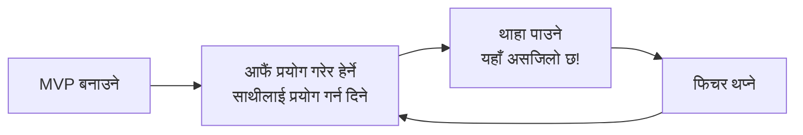
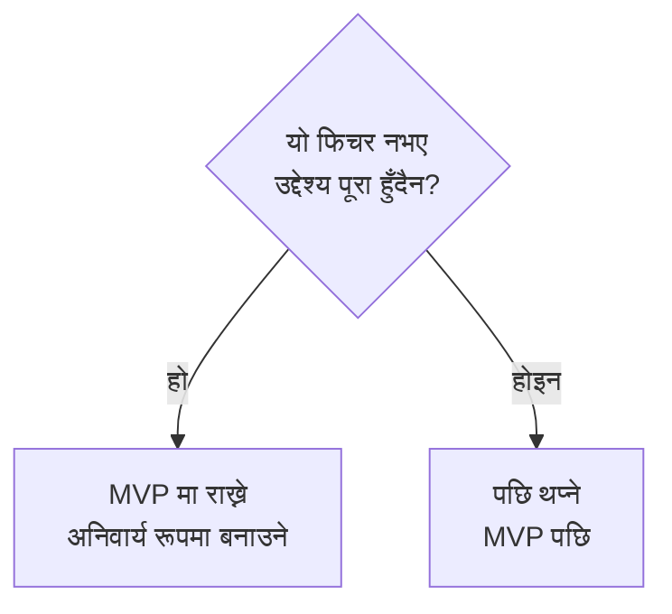
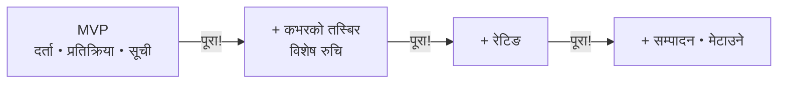
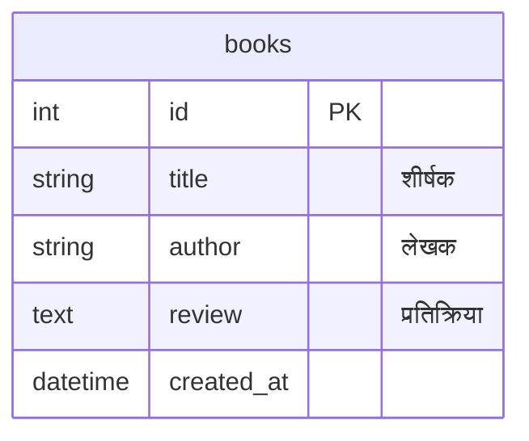

# MVP: पहिले "न्यूनतम रूपमा प्रयोग गर्न सकिने कुरा" पूरा गरौं

> 🇯🇵 मूल प्रति (जापानी भाषामा): [2026_10_16_資料1.md](<../../../2年生_システム開発実践/後期/2026_10_16/2026_10_16_資料1.md>) <!-- original-ja-link -->

## 1. MVP भनेको के हो

अघिल्लो पटक, [पहिले सानो बनाउने](../2026_10_09/2026_10_09_資料1.md#पहिले-सानो-बनाउने) भन्ने कुरा गरेका थियौं।
यो "सानो रूपमा बनाएको कुरा" को एउटा नाम छ। त्यो हो **MVP**।

| छोटो नगर्दाको रूप | अर्थ |
|-------|------|
| **M**inimum | न्यूनतम |
| **V**iable | प्रयोग गर्न सकिने, काम चल्ने |
| **P**roduct | उत्पादन, एप |

अर्थात् MVP भनेको **"यति भए प्रयोग गर्न सकिन्छ" भन्ने न्यूनतम एप** हो।
वास्तविक कम्पनीहरूमा पनि, नयाँ सेवा बनाउँदा पहिले MVP बनाएर सार्वजनिक गरिन्छ, अनि प्रयोगकर्ताको प्रतिक्रिया हेर्दै त्यसलाई विकास गर्दै लगिन्छ।

> 💡 **उदाहरण दिँदा "करी-भात" जस्तै**
> करीको MVP भनेको "भात + करी सस" हो। यति भए मात्र पनि **करीको रूपमा राम्रोसँग खान सकिन्छ**।
> टोन्कात्सु, चिज, अचार चाहिँ पछि टपिङको रूपमा थपे हुन्छ।
> उल्टो, टपिङ मात्र धेरै भएर **करी सस नै छैन** भने, करीको रूपमा खान सकिँदैन।

---

## 2. MVP बारे सामान्य गलतफहमी

MVP भनेको "आधा बनाएको कुरा" होइन। **सानो भए पनि, राम्रोसँग प्रयोग गर्न सकिनु** महत्त्वपूर्ण हो।



| | ✕ राम्रो नभएको विकास गर्ने तरिका | ◯ MVP बनाउने तरिका |
|---|---|---|
| पहिलो पटक | टायर मात्र → **यात्रा गर्न सकिँदैन** | किक स्कुटर → **यात्रा गर्न सकिन्छ!** |
| दोस्रो पटक | टायर + बडी → **अझै यात्रा गर्न सकिँदैन** | साइकल → **अझ छिटो यात्रा गर्न सकिन्छ** |
| बीचमै समय सकियो भने | **केही पनि प्रयोग गर्न सकिँदैन** | **प्रयोग गर्न सकिने कुरा हातमा रहन्छ** |

- ✕ तरिकामा, अन्तिमसम्म बनाएर पूरा नगरे **एक पटक पनि प्रयोग गर्न सकिँदैन**
- ◯ तरिकामा, जुनसुकै चरणमा सकिए पनि **"यात्रा गर्ने" भन्ने उद्देश्य पूरा हुन्छ**

एपमा पनि यस्तै हो। "लगइन स्क्रिन मात्र एकदम राम्रो", "डिजाइन मात्र एकदम राम्रो" तर **मुख्य फिचर नै चल्दैन** भने त्यो ✕ को ढाँचा हो।

---

## 3. किन MVP बाट बनाउने?

### ① काम पूरा नभई अन्त्य हुने अवस्थाबाट बच्न सकिन्छ

स्वतन्त्र प्रोजेक्टमा सबैभन्दा धेरै हुने गल्ती भनेको **धेरै फिचर थपेर, प्रोजेक्ट पूरा गर्न नसक्नु** हो।
पहिले नै MVP बनाएको छ भने, **जुनसुकै चरणमा समय सकिए पनि "चल्ने एप" हातमा रहन्छ**।

### ② छिटो प्रयोग गरेर हेर्दा, साँच्चै के चाहिन्छ भन्ने थाहा हुन्छ

बनाउनुअघि "भए राम्रो हुन्थ्यो" भनेर सोचेका कुरा, वास्तवमा प्रयोग गरेर हेर्दा **नचाहिने रहेछन्** भन्ने अक्सर थाहा हुन्छ।
अर्कोतर्फ, प्रयोग गरेर हेरेपछि मात्र "यो नभए असजिलो हुने रहेछ!" भनेर थाहा हुने फिचर पनि हुन्छन्।



### ③ पोर्टफोलियोको रूपमा, पहिले "देखाउन सकिने" अवस्थामा पुग्छ

जागिर खोज्दा पेस गर्ने बेला, **अधूरो एप** देखाउन गाह्रो हुन्छ।
MVP तयार भएमा, जुनसुकै बेला **"चल्ने कुरा" को रूपमा पेस गर्न सकिने अवस्था** हुन्छ।
आफ्नो विशेष रुचिका कुरा, त्यसमाथि **बिस्तारै थप्दै गए** पुग्छ।

---

## 4. MVP कसरी तय गर्ने

### चरण 1: एपको उद्देश्य एक वाक्यमा लेख्ने

पहिले, **"कसले", "के गर्नका लागि" प्रयोग गर्ने एप हो** भनेर एक वाक्यमा लेख्नुहोस्।

```
〇〇 जस्ता मानिसले, △△ गर्नका लागि प्रयोग गर्ने एप
```

| एप | उद्देश्य (एक वाक्य) |
|-------|-----------|
| पढाइ रेकर्ड | किताब मन पराउने मानिसले, **पढेको किताब र प्रतिक्रिया रेकर्ड गरेर फेरि हेर्न** प्रयोग गर्ने एप |
| जिम/व्यायाम रेकर्ड | व्यायाम गर्ने मानिसले, **दैनिक व्यायामको सूची र प्रत्येक व्यायाम कति पटक गरियो भन्ने रेकर्ड गर्न** प्रयोग गर्ने एप |
| क्लबको हाजिरी तालिका | क्लबको म्यानेजरले, **अभ्यासमा को उपस्थित र को अनुपस्थित थिए भन्ने विवरण संकलन गर्न** प्रयोग गर्ने एप |

> यो वाक्यको **बोल्ड भाग** नै एपको "करी सस" हो। यो बनेन भने, एपको रूपमा काम चल्दैन।

### चरण 2: बनाउन चाहेका सबै फिचर लेख्ने

मनमा आएका फिचरहरू, संकोच नगरी **सबै** लेख्नुहोस्। यहाँ अझै बनाउन सकिन्छ कि सकिँदैन भनेर सोच्नु पर्दैन।

**पढाइ रेकर्ड एपको उदाहरण**

- किताब दर्ता गर्ने (शीर्षक, लेखक)
- प्रतिक्रिया लेख्ने
- रेटिङ (१ देखि ५ तारा) दिने
- दर्ता गरेका किताबहरू सूचीमा हेर्ने
- किताब सम्पादन गर्ने वा मेटाउने
- कभरको तस्बिर देखाउने
- किताब खोज्ने
- विधा (genre) अनुसार छुट्याउने
- लगइन फिचर
- साथीसँग किताब सेयर गर्ने
- पढेका किताबको संख्या ग्राफमा देखाउने

### चरण 3: "नभए उद्देश्य पूरा हुँदैन?" भनेर छुट्याउने

लेखेका फिचरहरू एक-एक गरी हेरेर, **"यो नभए, उद्देश्य (चरण 1 को एक वाक्य) पूरा हुँदैन?"** भनेर आफैंलाई सोध्नुहोस्।



**पढाइ रेकर्ड एपको उदाहरण** (उद्देश्य: पढेको किताब र प्रतिक्रिया रेकर्ड गरेर फेरि हेर्ने)

| फिचर | नभए उद्देश्य पूरा हुँदैन? | वर्गीकरण |
|------|-------------------|------|
| किताब दर्ता गर्ने (शीर्षक, लेखक) | हो (रेकर्ड गर्न सकिँदैन) | **MVP** |
| प्रतिक्रिया लेख्ने | हो (प्रतिक्रिया रेकर्ड गर्न सकिँदैन) | **MVP** |
| दर्ता गरेका किताबहरू सूचीमा हेर्ने | हो (फेरि हेर्न सकिँदैन) | **MVP** |
| रेटिङ (१ देखि ५ तारा) दिने | होइन (प्रतिक्रिया भए रेकर्ड गर्न सकिन्छ) | पछि |
| किताब सम्पादन गर्ने वा मेटाउने | होइन (नभए पनि रेकर्ड गर्न र फेरि हेर्न सकिन्छ) | पछि |
| कभरको तस्बिर देखाउने | होइन | पछि |
| किताब खोज्ने | होइन (किताब थोरै हुँदासम्म सूची नै पर्याप्त) | पछि |
| विधा (genre) अनुसार छुट्याउने | होइन | पछि |
| लगइन फिचर | होइन (आफू मात्र प्रयोग गर्ने भए चाहिँदैन) | पछि |
| साथीसँग किताब सेयर गर्ने | होइन | पछि |
| पढेका किताबको संख्या ग्राफमा देखाउने | होइन | पछि |

> 💡 **MVP मा करिब ३ वटा फिचर राख्नु एउटा सामान्य मापदण्ड हो**। ५ वटा वा सोभन्दा बढी भएमा, "साँच्चै, यो नभए उद्देश्य पूरा हुँदैन?" भनेर फेरि एक पटक सोध्नुहोस्।

> ⚠️ **लगइन फिचर प्रायः MVP मा राखिँदैन**
> लगइन बनाउन गाह्रो हुन्छ र समय पनि लाग्छ, तर प्रायः यो **एपको मुख्य उद्देश्य हुँदैन**।
> पहिले लगइनबिना चल्ने एप बनाउनुहोस्, र आवश्यक परेपछि मात्र थप्नुहोस्।

### चरण 4: "पछि थप्ने" फिचरहरूको क्रम तय गर्ने

"पछि थप्ने" फिचरहरूलाई **बनाउन चाहेको क्रम** दिनुहोस्।
यहाँ महत्त्व दिनुपर्ने कुरा, अघिल्लो पटक भनिएको **आफ्नो विशेष रुचि** हो।

| क्रम | फिचर | कारण |
|-----|------|------|
| 1 | कभरको तस्बिर देखाउने | **किताबको र्‍याक जस्तो देखाउन चाहन्छु** (सबैभन्दा ठूलो रुचि) |
| 2 | रेटिङ (१ देखि ५ तारा) दिने | सिफारिस गर्ने किताब एकै नजरमा थाहा हुन्छ |
| 3 | किताब सम्पादन गर्ने वा मेटाउने | गल्ती भएमा सच्याउन चाहन्छु |
| 4 | विधा (genre) अनुसार छुट्याउने | किताब बढ्दै गएपछि चाहिन्छ |
| … | … | … |



विशेष रुचिको फिचर **MVP लगत्तै** बनाउनु राम्रो हुन्छ।
MVP मात्र भए अरूको जस्तै एप बन्ने सम्भावना हुन्छ, तर आफ्नो विशेष रुचि थपिएपछि **"आफ्नै एप"** बन्छ।

---

## 5. MVP को टेबल सोच्ने

टेबल पनि **MVP लाई चाहिने कोलम मात्र** बाट सुरु गर्नुहोस्। कोलम पछि माइग्रेसन (Supabase भए व्यवस्थापन स्क्रिन) बाट थप्न सकिन्छ।



रेटिङ (`rating`) वा कभरको तस्बिर (`image_url`) चाहिँ, त्यो फिचर बनाउने बेलामा थपे पुग्छ।

