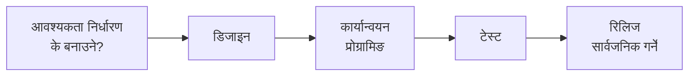
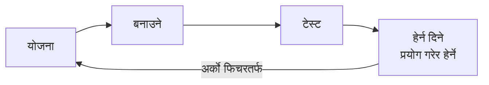
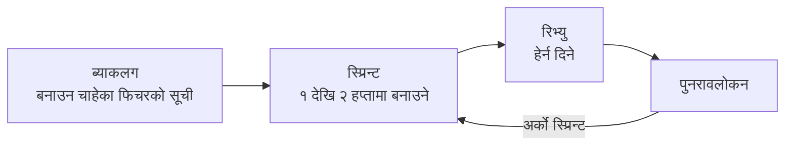

# एजाइल डेभलपमेन्टको बारेमा

> 🇯🇵 मूल प्रति (जापानी भाषामा): [アジャイル開発について.md](<../../../2年生_システム開発実践/後期/2026_10_23/アジャイル開発について.md>) <!-- original-ja-link -->

अघिल्लो पटक, सुरुमा सानो तर पूरा हुने गरी बनाइने **MVP** को बारेमा सिक्यौं।
"सानो बनाउने, प्रयोग गरेर हेर्ने, अनि बिस्तारै विकास गर्दै जाने" भन्ने बनाउने तरिकाको एउटा नाम छ। त्यो हो **एजाइल डेभलपमेन्ट**।
यहाँ, धेरै पहिलेदेखि चलिआएको **वाटरफल डेभलपमेन्ट** सँग तुलना गर्दै हेर्नेछौं।

[स्वतन्त्र प्रोजेक्टमा फर्कनुहोस्](../2026_10_09/2026_10_09_資料1.md)

---

## 1. छोटकरीमा भन्नुपर्दा

| नाम | अंग्रेजी नाम (अर्थ) | काम गर्ने तरिका | छोटकरीमा |
|------|-------|-------|-----------|
| **वाटरफल डेभलपमेन्ट** | Waterfall (झरना) | सबै कुरा तय गरेपछि, क्रमैसँग एकै पटकमा बनाउने | योजनाअनुसार बनाउने |
| **एजाइल डेभलपमेन्ट** | Agile (फुर्तिलो) | सानो बनाएर, बारम्बार सुधार गर्ने | बनाउँदै विकास गर्ने |

---

## 2. वाटरफल डेभलपमेन्ट

**झरनाको पानी माथिबाट तल बगेझैं**, कामका चरणहरू एक-एक गरी क्रमैसँग अघि बढाइन्छ।
अघिल्लो चरण नसकिउन्जेल, अर्को चरणमा जाइँदैन। सामान्यतया, **पछाडि नफर्कने** भन्ने मान्यतामा चल्छ।

| राम्रा पक्ष 👍 | ध्यान दिनुपर्ने कुरा ⚠️ |
|------------|-----------------|
| सुरुमै सबै तय गर्ने भएकाले, **समय-तालिका र खर्च अनुमान गर्न सजिलो** | बीचमा "होइन, यसरी गर्न चाहन्छु" भन्न **गाह्रो हुन्छ** |
| चरण अनुसार जिम्मेवारी बाँड्न सजिलो | प्रयोगकर्ताले चल्ने उत्पादन **अन्तिममा मात्र** हेर्न पाउँछन् |
| बैंक, सरकारी कार्यालय जस्ता **गल्ती गर्न नमिल्ने** प्रणालीका लागि उपयुक्त | अन्तिममा "सोचेजस्तो रहेनछ" भयो भने, **फेरि बनाउन धेरै गाह्रो** |

---

## 3. एजाइल डेभलपमेन्ट

**हरेक सानो फिचरका लागि "योजना → बनाउने → जाँच्ने" चक्र दोहोर्याएर**, एपलाई बिस्तारै विकास गर्दै लगिन्छ।
एक पटकको दोहोर्याइ, **करिब १ देखि ४ हप्ता** को छोटो अवधि हो।

| राम्रा पक्ष 👍 | ध्यान दिनुपर्ने कुरा ⚠️ |
|------------|-----------------|
| **सुरुकै चरणमा चल्ने उत्पादन** हेर्न सकिन्छ | अन्तिममा कहाँसम्म बनाउन सकिन्छ भन्ने **सुरुमा अनुमान गर्न गाह्रो हुन्छ** |
| प्रयोगकर्ताको राय **तुरुन्तै अर्को पटक समेट्न** सकिन्छ | "अहिलेलाई बनाइहालौं" भन्ने सोचले काम गर्दा **डिजाइन अस्तव्यस्त** हुन सक्छ |
| बीचमा दिशा परिवर्तन गर्न सजिलो | टिममा **बारम्बार छलफल** गर्नुपर्छ |

> 💡 **MVP भनेको एजाइल डेभलपमेन्टको "पहिलो दोहोराइ" हो**
> MVP बनाउने, प्रयोग गरेर हेर्ने, अनि आफ्नो विशेष रुचिका फिचर एक-एक गरी थप्दै जाने——
> स्वतन्त्र प्रोजेक्टको यो तरिका, ठ्याक्कै एजाइल डेभलपमेन्ट नै हो।

---

## 4. तुलना गरौं

**"खाना पकाउने"** उदाहरणबाट हेरौं।

| | वाटरफल | एजाइल |
|---|---|---|
| काम गर्ने तरिका | पूरा भोजको मेनु **सबै तय गरेर**, सुरुको परिकारदेखि मिठाईसम्म क्रमैसँग पकाएर, **अन्तिममा सबै एकैचोटि पस्किने** | पहिले एउटा परिकार बनाएर **स्वाद चखाउने**, प्रतिक्रिया सुनेर अर्को परिकार तय गर्ने |
| बीचमा परिवर्तन | "होइन, माछाको सट्टा मासु चाहियो" भने गाह्रो हुन्छ | अर्को परिकारमा परिवर्तन गरे पुग्छ |
| उपयुक्त अवस्था | बिहेको भोज (मेनु सुरुदेखि नै तय हुन्छ) | परिवारको खाना (त्यस दिनको मुड अनुसार फरक हुन्छ) |

कुन सही हो भन्ने हुँदैन। **बनाउने कुरा अनुसार छानेर प्रयोग गरिन्छ।**

---

## 5. स्क्रम — एजाइल डेभलपमेन्टको एउटा तरिका

एजाइल डेभलपमेन्टका तरिकाहरूमध्ये, सबैभन्दा प्रख्यात **स्क्रम** हो। रग्बीमा टिमका खेलाडीहरूले काँध जोडेर बनाउने "स्क्रम" बाट यसको नाम आएको हो।

| शब्द | अर्थ | स्वतन्त्र प्रोजेक्टमा यसको उदाहरण |
|-----|------|---------------|
| **स्प्रिन्ट** | एक पटकको दोहोर्याइको अवधि (१ देखि ४ हप्ता) | १ देखि २ कक्षाजति |
| **प्रोडक्ट ब्याकलग** | बनाउन चाहेका फिचरहरूलाई **महत्त्वको क्रम** मा मिलाएको सूची | MVP को सामग्रीमा बनाएको "पछि थप्ने फिचर (बनाउने क्रम)" |
| **डेली स्क्रम** | हरेक दिन करिब १५ मिनेटको छोटो बैठक | कक्षाको सुरुमा "आज गर्ने काम" तय गर्ने |
| **स्प्रिन्ट रिभ्यु** | बनेको कुरा देखाएर, राय लिने | साथी वा शिक्षकलाई प्रयोग गर्न दिने |
| **पुनरावलोकन (रेट्रोस्पेक्टिभ)** | काम गर्ने तरिकाको पुनरावलोकन गरेर, अर्को पटक उपयोग गर्ने | कक्षाको अन्त्यमा "राम्रो भएका कुरा र समस्या भएका कुरा" सोच्ने |

> 💡 **GitHub मा ब्याकलग बनाउन सकिन्छ**
> GitHub को **Issues** मा "बनाउन चाहेका फिचर" एक-एक गरी दर्ता गरेर, **Projects** मा "गर्नुपर्ने・काम भइरहेको・सकिएको" मा मिलाए, वास्तविक कार्यस्थलमा जस्तै ब्याकलग व्यवस्थापन गर्न सकिन्छ।

---

## 6. कार्यस्थलमा कुन बढी प्रयोग हुन्छ?

आजकलका वेब सेवा र मोबाइल एपको विकासमा, **एजाइल डेभलपमेन्ट** धेरै प्रयोग हुन्छ।
किनभने प्रयोगकर्ताको प्रतिक्रिया हेर्दै, लगभग हरेक हप्ता वा हरेक दिन अपडेट गरिन्छ।

अर्कोतर्फ, बैंकको प्रणाली वा कारखानाका मेसिन चलाउने प्रणाली जस्ता ठाउँमा, अहिले पनि **वाटरफल डेभलपमेन्ट** प्रयोग हुन्छ।
साथै, ठूलो रूपरेखा वाटरफलबाट तय गरेर, साना भागहरू एजाइलबाट अघि बढाउने **मिश्रित तरिका** पनि छ।

> 💡 **अन्तर्वार्तामा भन्न सकिन्छ**
> "स्वतन्त्र प्रोजेक्टमा, पहिले MVP बनाएर, प्रयोग गरेर हेर्दै फिचर थप्दै जाने **एजाइल तरिका** अपनाएँ" भन्न सकियो भने, तपाईंले विकासको प्रक्रिया बुझ्नुभएको छ भन्ने कुरा देखिन्छ।

---

## 7. सारांश

- **वाटरफल डेभलपमेन्ट** = सबै तय गरेपछि, क्रमैसँग एकै पटकमा बनाउने (पछाडि नफर्कने)
- **एजाइल डेभलपमेन्ट** = सानो बनाएर, प्रयोग गरेर हेर्दै, बारम्बार सुधार गर्ने
- **स्क्रम** एजाइल डेभलपमेन्टको एउटा तरिका हो। **स्प्रिन्ट** (छोटो अवधि) बारम्बार दोहोर्याइन्छ
- **MVP → फिचर थप्दै जाने** स्वतन्त्र प्रोजेक्टको तरिका, एजाइल डेभलपमेन्ट नै हो
- कुन सही हो भन्ने होइन, **बनाउने कुरा अनुसार छानेर प्रयोग गर्ने**

[स्वतन्त्र प्रोजेक्टमा फर्कनुहोस्](../2026_10_09/2026_10_09_資料1.md)
