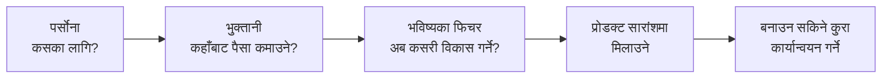
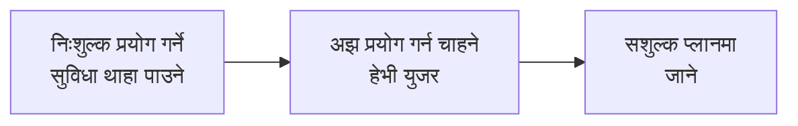
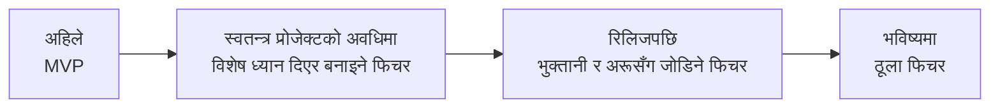
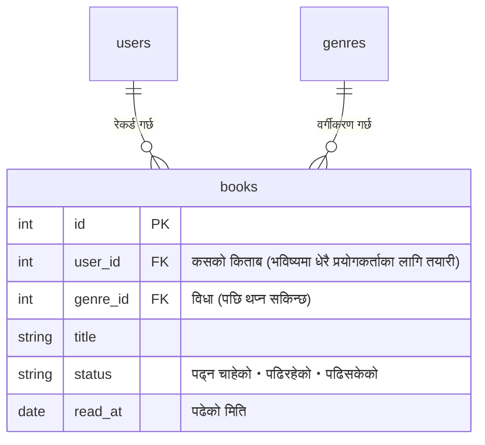
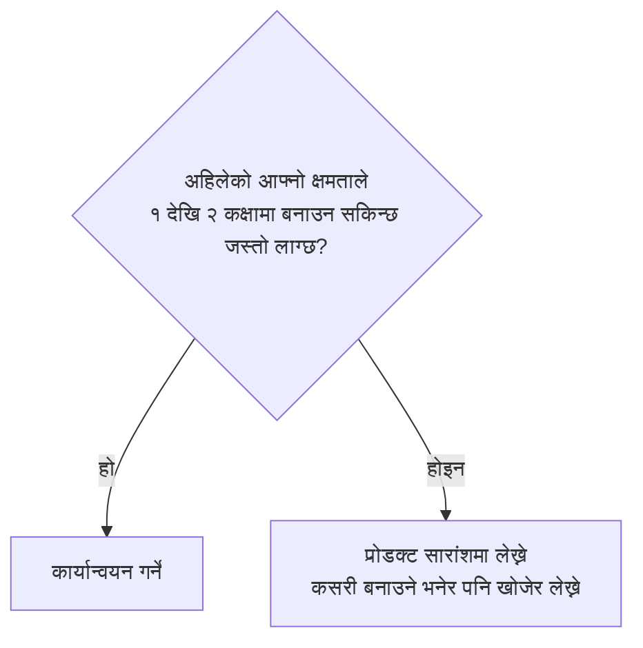

# स्वतन्त्र प्रोजेक्टको भविष्यको रूप पनि सोचेर बनाउने

> 🇯🇵 मूल प्रति (जापानी भाषामा): [自由制作の将来像も考えて作る.md](<../../../2年生_システム開発実践/後期/2026_10_23/自由制作の将来像も考えて作る.md>) <!-- original-ja-link -->

स्वतन्त्र प्रोजेक्टको एपलाई "कक्षाको गृहकार्य" होइन, **साँच्चै रिलिज गर्ने सेवा** हो भनेर सोचेर हेरौं।
**कसले प्रयोग गर्छ (पर्सोना)**, **कहाँबाट पैसा कमाउने (भुक्तानी)**, **अब उप्रान्त कस्ता फिचर थप्दै जाने** भनेर सोचेर, त्यसलाई **प्रोडक्ट सारांश** डकुमेन्टमा मिलाएर लेख्नेछौं।

[स्वतन्त्र प्रोजेक्टमा फर्कनुहोस्](../2026_10_09/2026_10_09_資料1.md)

---

## 1. किन भविष्यको रूप सोच्ने?



- **कुन फिचर बनाउने भनेर अलमलिनु पर्दैन**: "यो मानिस (पर्सोना) लाई यो चाहिन्छ?" भनेर निर्णय गर्न सकिन्छ
- **अन्तर्वार्तामा भन्न सकिन्छ**: "कसको, कस्तो समस्या समाधान गर्ने एप हो, र कसरी चलाइराख्ने सेवा हो" सम्म भन्न सकियो भने, **सोचेर बनाउने मानिस** हो भन्ने देखिन्छ
- **वास्तविक कम्पनी जस्तै**: कम्पनीमा एप बनाउँदा, बनाउनुअघि अनिवार्य रूपमा **योजना** सोचिन्छ

> 💡 सबै कार्यान्वयन गर्नु पर्दैन। **सोचेका कुरा प्रोडक्ट सारांशमा लेखेर राख्नु** मात्र पनि पोर्टफोलियोको रूपमा मूल्यवान् हुन्छ।

---

## 2. पर्सोना तय गर्ने

### पर्सोना भनेको के हो

**पर्सोना** भनेको एप प्रयोग गर्ने मानिसलाई **एउटा निश्चित व्यक्ति** को रूपमा विस्तृत रूपमा तय गरेको कुरा हो।
"२० देखि २९ वर्षका मानिस" जस्तो मोटामोटी विभाजन होइन, **साँच्चै भेटिने जस्तो एक जना व्यक्ति** कल्पना गर्नुहोस्।

| ✕ मोटामोटी | ◯ पर्सोना |
|----------|----------|
| किताब मन पराउने मानिस | तानाका साकुरा (२१ वर्ष, विश्वविद्यालयको तेस्रो वर्ष)। कलेज जाँदा रेलमा महिनामा ३-४ वटा किताब पढ्छिन्। पढेको किताबको विषयवस्तु छिट्टै बिर्सिन्छिन्, र साथीले सिफारिस सोध्दा जवाफ दिन नसक्नु उनको समस्या हो |

> 💡 **किन एक जनामा सीमित गर्ने?**
> "सबैका लागि" बनाउँदा, कसैका लागि पनि **अलि प्रयोग गर्न असजिलो** एप बन्ने सम्भावना हुन्छ।
> एक जनामा सीमित गर्दा, "साकुराले त रेलमा **एउटा हातले** रेकर्ड गर्न चाहन्छिन् होला" जस्तै, **ठोस रूपमा सोच्न सकिन्छ**।

### पर्सोनामा तय गर्ने कुराहरू

| विषय | उदाहरण (पढाइ रेकर्ड एप) |
|-----|-----------------|
| नाम, उमेर, पेसा | तानाका साकुरा, २१ वर्ष, विश्वविद्यालयको तेस्रो वर्ष |
| दैनिक जीवन | कलेज जाँदा रेलमा हरेक दिन ३० मिनेट पढ्छिन्। स्मार्टफोन सधैं साथमा हुन्छ |
| IT को अनुभव | SNS धेरै प्रयोग गर्छिन्। जटिल सेटिङ मिलाउन गाह्रो मान्छिन् |
| समस्या | पढेको किताबको विषयवस्तु छिट्टै बिर्सिन्छिन्। सिफारिस सोध्दा जवाफ दिन सक्दिनन् |
| लक्ष्य (के गर्न सक्ने हुन चाहन्छिन्?) | पढेको किताब र प्रतिक्रिया, पछि तुरुन्तै फेरि हेर्न सक्ने बनाउन चाहन्छिन् |
| एप प्रयोग गर्ने अवस्था | रेलमा पढिसकेलगत्तै, **स्मार्टफोनबाट** रेकर्ड गर्ने |

> ⚠️ **आफ्नो लागि सुविधाजनक मानिस नबनाउनुहोस्**
> "हरेक दिन एप खोल्ने, र सबै फिचर प्रयोग गरिदिने मानिस" लगभग हुँदैनन्।
> **व्यस्त, अल्छी, छिट्टै दिक्क हुने** जस्ता, वास्तविक मानिसको बारेमा सोच्नुहोस्।

---

## 3. कहाँ पैसा तिराउने भनेर सोच्ने

### पैसा कमाउने तरिका (आम्दानी मोडेल)

| मोडेल | व्यवस्था | उदाहरण |
|-------|------|-----|
| **विज्ञापन** | एप निःशुल्क हुन्छ। स्क्रिनमा विज्ञापन राखेर, विज्ञापनदाताबाट पैसा लिने | YouTube (निःशुल्क प्लान), समाचार एप |
| **एक पटक किन्ने** | सुरुमा एक पटक मात्र पैसा तिर्ने | सशुल्क मोबाइल गेम, सफ्टवेयर |
| **सब्सक्रिप्सन** | हरेक महिना वा हरेक वर्ष पैसा तिर्ने | Netflix, Spotify |
| **फ्रिमियम** | आधारभूत रूपमा **निःशुल्क**। अझ सुविधाजनक फिचर प्रयोग गर्न चाहनेले मात्र **पैसा तिर्ने** | Spotify, Notion, LINE स्टिकर |

व्यक्तिगत रूपमा बनाउने वेब एप हो भने, **फ्रिमियम** सबैभन्दा सोच्न सजिलो हुन्छ।

### "निःशुल्क" र "सशुल्क" बीचको रेखा कोर्ने

फ्रिमियममा सबैभन्दा महत्त्वपूर्ण कुरा, **कहाँसम्म निःशुल्क र कहाँदेखि सशुल्क बनाउने** हो।



| सोच्ने तरिका | व्याख्या |
|-------|------|
| **एपको "उद्देश्य" निःशुल्क राख्ने** | MVP को फिचर (सबैभन्दा महत्त्वपूर्ण फिचर) सशुल्क भयो भने, कसैले प्रयोग गर्न सुरु नै गर्दैन |
| **जति धेरै प्रयोग गर्छ, उति पैसा तिर्ने** | "〇 वटासम्म निःशुल्क" जस्तै, **मात्रा** बाट रेखा कोर्ने |
| **भए सुविधाजनक, तर नभए पनि समस्या नहुने कुरा** सशुल्क बनाउने | हेर्न सजिलो ग्राफ, डाटा export, डिजाइन परिवर्तन आदि |
| **पर्सोनाले पैसा तिर्ने कारण** सोच्ने | "साकुराले कुन कुराका लागि महिनाको ३०० येन तिर्लिन्?" |

**पढाइ रेकर्ड एपको उदाहरण**

| | निःशुल्क प्लान | सशुल्क प्लान (महिनाको ३०० येन) |
|---|---|---|
| किताब दर्ता | **५० वटासम्म** | असीमित |
| प्रतिक्रिया लेख्ने | ◯ | ◯ |
| सूचीमा फेरि हेर्ने | ◯ | ◯ |
| पढेका किताबको संख्याको ग्राफ | ✕ | ◯ |
| किताबको दराजको डिजाइन परिवर्तन | १ प्रकार | १० प्रकार |
| विज्ञापन | हुन्छ | **हुँदैन** |

> 💡 **"साकुरा" को हिसाबले सोच्दा**
> विद्यार्थी भएकाले, धेरै पैसा तिर्न सक्दिनन्। तर, एक वर्ष निरन्तर प्रयोग गरेर **५० वटा नाघ्ने** बेलासम्म, रेकर्ड धेरै जम्मा भएर एप छोड्नै नसक्ने भइसकेको हुन्छ।
> त्यही बेला "असीमित + ग्राफ" महिनाको ३०० येनमा दिइयो भने, उनले तिर्न पनि सक्छिन् होला।

---

## 4. भविष्यका फिचर सोच्ने

### फिचरहरूलाई समय अनुसार छुट्याउने

[MVP](../2026_10_16/2026_10_16_資料1.md) मा "पछि थप्ने फिचर" लेखेका थियौं। तिनलाई **समय** अनुसार छुट्याएर मिलाउनुहोस्।
यो "कहिले, के बनाउने" भन्ने योजनालाई **रोडम्याप** भनिन्छ।



| समय | फिचरको उदाहरण (पढाइ रेकर्ड एप) |
|-----|-----------------------|
| **अहिले (MVP)** | किताब दर्ता, प्रतिक्रिया, सूची |
| **स्वतन्त्र प्रोजेक्टको अवधिमा** | कभरको तस्बिर, रेटिङ (तारा), खोज |
| **रिलिजपछि** | लगइन, सशुल्क प्लान, पढेका किताबको संख्याको ग्राफ |
| **भविष्यमा** | साथीसँग किताबको दराज सेयर गर्ने, बारकोड पढेर किताब दर्ता गर्ने, AI ले किताब सिफारिस गर्ने |

### आइडिया निकाल्ने तरिका

- **पर्सोनाको एक दिन** कल्पना गरेर, "यहाँ पनि प्रयोग गर्न सकिए सुविधाजनक हुन्थ्यो" भन्ने अवस्था खोज्ने
- **मिल्दोजुल्दो एप** ३ वटा प्रयोग गरेर, "राम्रा पक्ष" र "असजिला पक्ष" लेख्ने
- **डाटा जम्मा भएपछि** के गर्न सकिन्छ भनेर सोच्ने (ग्राफ, र्‍याङ्किङ, सिफारिस)
- **अरू मानिससँग जोडिएपछि** के गर्न सकिन्छ भनेर सोच्ने (सेयर, कमेन्ट, र्‍याङ्किङ)

---

## 5. राम्रो डिजाइनले भविष्यको बारेमा पनि सोच्छ

### नभनिएका फिचरहरू "अनुमान" गर्ने

कामका लागि एप बनाउँदा, ग्राहकले "यस्तो एप बनाइदिनुहोस्" भनेर अनुरोध गर्छन्।
तर, ग्राहकले **आवश्यक सबै कुरा भनिदिँदैनन्**। प्रयोग गर्न थालेपछि "यो पनि चाहियो" भनेर आउने धेरै हुन्छ।

**राम्रो डिजाइन** भनेको भनिएका कुरा मात्र बनाउनु होइन,
**"भनिएको त छैन, तर सायद यस्तो फिचर थपिदिनुहोस् भनेर भन्लान्" भनेर अनुमान गरेर डिजाइन गर्नु** हो।

> 💡 **उदाहरण दिँदा "घर बनाउने" जस्तै**
> दम्पती दुई जनाको घर बनाउँदा, "भविष्यमा बच्चा जन्मेपछि कोठा चाहियो भन्लान्" भनेर सोचेर,
> **पछि भित्ता थपेर दुई कोठामा छुट्याउन सकिने** ठूलो कोठा बनाइराख्ने——यही भविष्य सोचेको डिजाइन हो।
> अहिल्यै बच्चाको कोठा बनाउने होइन, तर **पछि थप्न सजिलो** बनाइराखिन्छ।

### अनुमान गरेको उदाहरण (पढाइ रेकर्ड एप)

| अहिले अनुरोध गरिएको कुरा | भन्न सक्ने कुरा (अनुमान) | अहिल्यै गरिराख्ने डिजाइन |
|------------------|--------------------|-------------------|
| आफूले पढेको किताब रेकर्ड गर्न चाहन्छु | "परिवार र साथीले पनि प्रयोग गर्न चाहन्छन्" | `books` टेबलमा, कसको किताब हो भनेर देखाउने `user_id` राख्न सकिने रूपमा बनाइराख्ने |
| "पढेँ" भनेर रेकर्ड गर्न चाहन्छु | "**पढ्न चाहेको किताब** र **पढिरहेको किताब** पनि छुट्याउन चाहन्छु" | "पढेँ/पढिनँ" को दुई विकल्प (`true` / `false`) होइन, **स्थिति (`status`)** को कोलम बनाइराख्ने |
| विधा (genre) राख्न चाहन्छु | "विधा आफैं थप्न र नाम परिवर्तन गर्न चाहन्छु" | विधाको नाम सिधै टेक्स्टका रूपमा लेख्ने होइन, **`genres` टेबलमा छुट्याएर** जोड्ने |
| प्रतिक्रिया लेख्न चाहन्छु | "पछि प्रतिक्रिया **फेरि लेख्न चाहन्छु**", "कहिले पढेँ थाहा पाउन चाहन्छु" | `created_at`・`updated_at` राखेर, **पढेको मिति (`read_at`)** को कोलम पनि सोचिराख्ने |



> ⚠️ **अनुमान गरेका फिचर "सबै बनाउने" होइन**
> भविष्य सोच्ने भनेको **डिजाइन (टेबलको संरचना र कोड छुट्याउने तरिका)** हो। फिचर आफैं चाहिँ [MVP](../2026_10_16/2026_10_16_資料1.md) मा भनेझैं, सानो बनाएर बिस्तारै थप्दै जाने हो।
> "भन्न सक्ने कुरा" सबै बनाउन थाल्यो भने, कहिल्यै पूरा हुँदैन।
> **अहिले नबनाउने। तर, पछि थप्दा फेरि बनाउनु नपर्ने रूपमा राखिराख्ने** ——यही मुख्य कुरा हो।

### अनुमान गर्दाका सुझावहरू

- **एक जना → धेरै जना**: अहिले एक जनाले मात्र प्रयोग गर्ने कुरामा पनि, "अरूले पनि प्रयोग गर्न चाहन्छन्" भन्लान्?
- **दुई विकल्प → तीन वा बढी**: "हो/होइन" बाट बनाएको कुरामा, "अर्को एउटा विकल्प चाहियो" भन्लान्?
- **तय भएको मान → आफैं परिवर्तन गर्न चाहने**: प्रोग्राममा लेखेका विकल्पहरू, "प्रयोगकर्ताले थप्न र परिवर्तन गर्न चाहन्छन्" भन्लान्?
- **अहिलेको मात्र → रेकर्ड राख्न चाहने**: "कहिले परिवर्तन भयो", "पहिले कस्तो थियो" थाहा पाउन चाहन्छु भन्लान्?
- **पर्सोना** को हिसाबले सोच्ने: "साकुराले आधा वर्ष प्रयोग गरेपछि, अर्को के चाहन्छिन् होला?"

> 💡 **अन्तर्वार्तामा भन्न सकिन्छ**
> "अहिले लगइन फिचर छैन, तर भविष्यमा अरूले पनि प्रयोग गर्न सकून् भनेर `user_id` राख्न सकिने टेबल डिजाइन बनाएँ" भन्न सकियो भने,
> **अगाडि सोचेर डिजाइन गर्न सक्ने मानिस** हो भन्ने देखिन्छ। अनुमान गरेका कुरा, प्रोडक्ट सारांशको रोडम्यापमा पनि लेखिराख्नुहोस्।

---

## 6. कार्यान्वयन गर्ने कि, प्रोडक्ट सारांशमा लेख्ने

मनमा आएका सबै फिचर बनाउनु पर्दैन।
**गाह्रो छैन भने कार्यान्वयन गर्ने**, **गाह्रो जस्तो लाग्छ भने प्रोडक्ट सारांशमा लेख्ने**, भनेर छुट्याउनुहोस्।



| निर्णयको आधार | उदाहरण |
|-----------|-----|
| **कार्यान्वयन गर्ने** (अहिलेको ज्ञानको प्रयोगबाट गर्न सकिने) | एउटा कोलम थप्ने (रेटिङ, विधा), खोज, क्रम मिलाउने, "〇 वटासम्म" को सीमा जाँच, सशुल्क प्लानको **स्क्रिन मात्र** (शुल्क तालिकाको पेज) |
| **प्रोडक्ट सारांशमा लेख्ने** (नयाँ प्रविधि, वा पैसा र व्यक्तिगत जानकारीसँग सम्बन्धित) | वास्तविक भुक्तानी (क्रेडिट कार्ड), बारकोड पढ्ने, AI को सिफारिस, मोबाइल एप बनाउने, धेरै मानिसले एकै समयमा प्रयोग गर्ने व्यवस्था |

> 💡 **"प्रोडक्ट सारांशमा लेख्नु" पनि राम्रो उपलब्धि हो**
> "भुक्तानी **Stripe** भन्ने सेवा प्रयोग गरे कार्यान्वयन गर्न सकिन्छ जस्तो छ" जस्तै, **कसरी बनाउने भनेर खोजेर लेखिराख्यो** भने,
> "अहिले बनाउन सकिँदैन, तर बनाउने तरिका थाहा छ" भनेर अन्तर्वार्तामा भन्न सकिन्छ।

> ⚠️ **वास्तविक भुक्तानी कार्यान्वयन नगर्नुहोस्**
> क्रेडिट कार्डको भुक्तानीमा गल्ती भयो भने **साँच्चै पैसा सर्छ**। स्वतन्त्र प्रोजेक्टमा **प्रोडक्ट सारांशमा लेख्ने** सम्म मात्र गर्नुहोस्।
> भुक्तानीको व्यवस्था परीक्षण गर्न चाहनुहुन्छ भने, **डाटाबेसको कोलम (`is_premium` आदि) बाट प्रयोगकर्ताको सशुल्क प्लानको स्थिति परिवर्तन गर्ने** सम्म मात्र गर्नुहोस्।

---

## 7. प्रोडक्ट सारांश बनाउने

सोचेका कुराहरू, **प्रोडक्ट सारांश** डकुमेन्टमा मिलाएर लेख्नुहोस्।
प्रोडक्ट सारांश भनेको "**कस्तो प्रोडक्ट हो, कसका लागि हो, र अब कसरी विकास गर्दै जाने**" भन्ने कुरा, पहिलो पटक हेर्ने मानिसले पनि बुझ्ने गरी मिलाएर लेखेको कुरा हो।
रिपोजिटरीभित्र `docs/プロダクト概要.md` बनाएर लेखिराख्यो भने, GitHub मा त्यत्तिकै देखाउन सकिन्छ। README बाट लिंक गरिराख्नुहोस्।

### प्रोडक्ट सारांशको टेम्प्लेट

```markdown
# 〇〇 (एपको नाम) प्रोडक्ट सारांश

## 1. छोटकरीमा भन्नुपर्दा
〇〇 जस्ता मानिसले, △△ गर्नका लागि प्रयोग गर्ने एप

## 2. पर्सोना
- नाम, उमेर, पेसा:
- दैनिक जीवन:
- IT को अनुभव:
- समस्या:
- लक्ष्य (के हुन चाहन्छ?):
- एप प्रयोग गर्ने अवस्था:

## 3. मिल्दोजुल्दो एपसँगको फरक
| एप | राम्रा पक्ष | असजिला पक्ष |
|-------|----------|-----------|
|       |          |           |

यो एपको आफ्नै विशेषता:

## 4. आम्दानी मोडेल (कहाँ पैसा तिराउने)
- मोडेल: (फ्रिमियम / विज्ञापन / सब्सक्रिप्सन / एक पटक किन्ने)
- सशुल्क प्लानको मूल्य:

| | निःशुल्क प्लान | सशुल्क प्लान |
|---|---|---|
|   |   |   |

पर्सोनाले पैसा तिर्ने कारण:

## 5. रोडम्याप (भविष्यका फिचर)
| समय | फिचर | स्थिति |
|-----|------|-----|
| अहिले (MVP) |  | ✅ कार्यान्वयन भइसकेको |
| स्वतन्त्र प्रोजेक्टको अवधिमा |  | 🚧 बनाउँदै |
| रिलिजपछि |  | 📝 अझै नबनाएको |
| भविष्यमा |  | 📝 अझै नबनाएको |

## 6. अझै नबनाएका फिचर बनाउने तरिकाको नोट
- 〇〇 फिचर: △△ भन्ने सेवा वा प्रविधि प्रयोग गरे बनाउन सकिन्छ जस्तो छ
```

### लेख्दा ध्यान दिनुपर्ने कुरा

- **पर्सोना → भुक्तानी → रोडम्याप** सबै **आपसमा जोडिएको** होस् (पर्सोनाले चाहेको फिचर, सशुल्क प्लान वा रोडम्यापमा समावेश होस्)
- स्थितिको कोलम (✅ 🚧 📝) बाट, **कहाँसम्म कार्यान्वयन भयो** भन्ने एकै नजरमा थाहा हुने बनाउनुहोस्
- एक पटक लेखेर सकिँदैन, बनाउँदै **बारम्बार फेरि लेख्नुहोस्** ([एजाइल डेभलपमेन्ट](./アジャイル開発について.md) जस्तै सोचाइ)

---

## 8. सारांश

- स्वतन्त्र प्रोजेक्टको एपलाई **साँच्चै रिलिज गर्ने सेवा** हो भनेर सोच्ने
- **पर्सोना** = प्रयोगकर्तालाई **एउटा निश्चित व्यक्ति** को रूपमा तय गर्ने
- भुक्तानीका लागि **फ्रिमियम** सोच्न सजिलो। **उद्देश्यको फिचर निःशुल्क**, **धेरै प्रयोग गर्ने मानिस र भए सुविधाजनक हुने फिचर सशुल्क**
- भविष्यका फिचरहरू **समय अनुसार छुट्याएर** रोडम्याप बनाउने
- **राम्रो डिजाइन** ले ग्राहकले नभनेका फिचर पनि **अनुमान** गरेर, **पछि थप्न सजिलो रूप** मा राखिराख्छ (बनाउने चाहिँ बिस्तारै)
- **गाह्रो छैन भने कार्यान्वयन गर्ने**, **गाह्रो भए प्रोडक्ट सारांशमा लेख्ने** (बनाउने तरिका पनि खोजेर लेख्ने)
- वास्तविक भुक्तानी कार्यान्वयन नगर्ने। प्रयोगकर्ताको सशुल्क प्लानको स्थिति **डाटाबेसको कोलमबाट परिवर्तन गर्ने** सम्म मात्र
- प्रोडक्ट सारांश `docs/プロダクト概要.md` मा लेखेर, README बाट लिंक गर्ने

[स्वतन्त्र प्रोजेक्टमा फर्कनुहोस्](../2026_10_09/2026_10_09_資料1.md)
