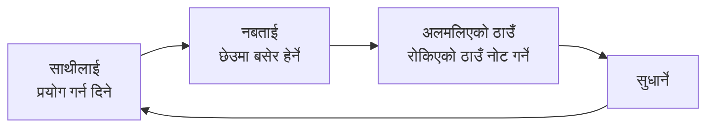

# UI・UX को बारेमा

> 🇯🇵 मूल प्रति (जापानी भाषामा): [UI_UXについて.md](<../../../2年生_システム開発実践/後期/2026_10_30/UI_UXについて.md>) <!-- original-ja-link -->

एपको बारेमा कुरा गर्दा, **UI (यु-आई)** र **UX (यु-एक्स)** भन्ने शब्द धेरै आउँछन्।
दुवै "प्रयोगकर्ता" सँग सम्बन्धित शब्द हुन्, तर तिनको अर्थ अलि फरक छ।

[स्वतन्त्र प्रोजेक्टमा फर्कनुहोस्](../2026_10_09/2026_10_09_資料1.md)

---

## 1. छोटकरीमा भन्नुपर्दा

| नाम | पूरा नाम | अर्थ | छोटकरीमा |
|------|----------|------|-----------|
| **UI** | User Interface (युजर इन्टरफेस) | प्रयोगकर्ताले **हेर्ने र छुने भाग** (स्क्रिन, बटन, अक्षर, रङ) | देखावट र सञ्चालन |
| **UX** | User Experience (युजर एक्सपेरियन्स) | प्रयोगकर्ताले **प्रयोग गर्दा महसुस गर्ने कुरा** (सुविधाजनक, रमाइलो, बुझ्न सजिलो) | प्रयोग गर्दाको अनुभव |

> 💡 **उदाहरण दिँदा "रेस्टुरेन्ट" जस्तै**
> - **UI** = मेनु कार्ड, प्लेट, टेबल, पसलको भित्री सजावट
> - **UX** = "तुरुन्तै बस्न पाएँ", "अर्डर गर्न सजिलो भयो", "मिठो थियो", "फेरि आउन मन लाग्यो" भनेर महसुस गर्ने **सम्पूर्ण अनुभव**
>
> मेनु कार्ड आकर्षक (UI राम्रो) भए पनि, खाना आउन एक घण्टा लाग्यो भने, अनुभव (UX) राम्रो हुँदैन।

---

## 2. UI र UX को सम्बन्ध

UI, UX को **एउटा भाग** हो।
राम्रो UX बनाउन राम्रो UI चाहिन्छ, तर **UI मात्र राम्रो भएर UX राम्रो हुँदैन**।

```mermaid
graph TB
    subgraph UX प्रयोग गर्दाको अनुभव
        UI[UI<br>स्क्रिन・बटन・रङ]
        A[चल्ने गति]
        B[बुझ्न सजिलो]
        C[एरर आउँदा पनि ढुक्क महसुस हुने]
    end
```

| उदाहरण | UI | UX |
|----|----|----|
| बटन आकर्षक छ, तर थिच्दा केही प्रतिक्रिया आउँदैन | ◯ | ✕ |
| देखावट साधारण छ, तर चाहिएको जानकारीसम्म तुरुन्तै पुग्न सकिन्छ | △ | ◯ |
| इनपुट गरेको डाटा, एररका कारण सबै मेटियो | — | ✕✕ |

---

## 3. राम्रो UI का मुख्य कुरा

### ① एकरूपता राख्ने (consistency)

एउटै अर्थका कुराहरूको **देखावट र स्थान एउटै** राख्नुहोस्।

| ✕ राम्रो होइन | ◯ राम्रो |
|----------|-------|
| पेजअनुसार "सेभ" बटनको रङ वा स्थान फरक हुन्छ | सेभ बटन, जुनसुकै पेजमा पनि **एउटै रङ र एउटै ठाउँ** मा |
| "दर्ता", "थप्ने", "बनाउने" जस्ता एउटै अर्थका फरक-फरक शब्द प्रयोग गरिएका छन् | शब्दलाई **एउटैमा मिलाउने** |

### ② थिच्न मिल्ने कुरा थिच्न मिल्छ भनेर बुझिने बनाउने

बटन र लिंकलाई **एकै नजरमा थिच्न मिल्छ भनेर बुझिने** देखावट दिनुहोस्।
माउस माथि ल्याउँदा रङ परिवर्तन भयो (`hover`) भने, अझ बुझ्न सजिलो हुन्छ।

### ③ महत्त्वपूर्ण कुरालाई प्रमुख देखाउने

सबैभन्दा धेरै थिचियोस् भन्ने बटन ("सेभ" आदि) लाई **गाढा रङ**, अरू ("रद्द गर्ने" आदि) लाई **हल्का रङ** दिनुहोस्।
सबै प्रमुख देखियो भने, **कुनै पनि प्रमुख देखिँदैन**।

### ④ पढ्न सजिलो बनाउने

- अक्षर र पृष्ठभूमिको रङको फरक (**कन्ट्रास्ट**) राम्रोसँग राख्ने (हल्का खैरो अक्षर पढ्न गाह्रो हुन्छ)
- अक्षर धेरै सानो नबनाउने
- पर्याप्त खाली ठाउँ राख्ने र सामग्री धेरै खाँदेर नराख्ने

---

## 4. राम्रो UX का मुख्य कुरा

### ① प्रतिक्रिया दिने (फिडब्याक)

बटन थिचेपछि, **के भयो भनेर जानकारी दिनुहोस्**। प्रतिक्रिया आएन भने, प्रयोगकर्ता "थिचियो कि थिचिएन?" भनेर चिन्तित हुन्छन्, र धेरै पटक थिच्छन्।

| अवस्था | फिडब्याकको उदाहरण |
|-----|----------------|
| सेभ हुँदै गर्दा | "सेभ हुँदैछ…" देखाउने, बटन थिच्न नमिल्ने बनाउने |
| सेभ भयो | "सेभ भयो" देखाउने |
| एरर | **के गलत भयो, र के गर्नुपर्छ** भनेर देखाउने |

### ② एररलाई मैत्रीपूर्ण बनाउने

| ✕ राम्रो होइन | ◯ राम्रो |
|----------|-------|
| `Error 422` | "शीर्षक लेख्नुहोस्" |
| एरर आएपछि, इनपुट गरेको सबै कुरा मेटिन्छ | इनपुट गरेको कुरा **त्यत्तिकै राखेर**, एरर भएको ठाउँ रातो बनाउने |

### ③ फिर्ता गर्न नसकिने कामको पुष्टि गर्ने

**मेटाउने** जस्तो पहिलेको अवस्थामा फर्काउन नसकिने कामका लागि, "साँच्चै मेटाउने हो?" भनेर पुष्टि गर्नुहोस्।

### ④ थोरै चरणमा सकिने बनाउने

धेरै प्रयोग हुने फिचरहरू **थोरै क्लिक** मै प्रयोग गर्न सकिने बनाउनुहोस्।
"रेकर्ड गर्दा हरेक पटक ३ वटा पेजमा जानुपर्ने" एप बिस्तारै प्रयोग हुन छोड्छ।

---

## 5. आफ्नो एपमा जाँच्ने तरिका

सबैभन्दा राम्रो तरिका भनेको **अरू मानिसलाई प्रयोग गर्न दिनु** हो।



- एप बनाउने व्यक्तिलाई आफैंले प्रयोग गर्ने तरिका थाहा हुने भएकाले, **बुझ्न गाह्रो हुने ठाउँ याद नहुन सक्छ**
- प्रयोग गरिरहेको मानिस **रोकिएको र अलमलिएको ठाउँ** नै सुधार्नुपर्ने ठाउँ हो
- बोलेर बुझाउन मन लाग्यो भने, त्यो **स्क्रिनबाटै कुरा बुझाउन सकिएको छैन** भन्ने संकेत हो

---

## 6. सारांश

- **UI** = स्क्रिन, बटन, रङ जस्ता **हेर्ने र छुने भाग**
- **UX** = प्रयोग गर्दा **महसुस गर्ने कुरा र सम्पूर्ण अनुभव**
- UI, UX को एउटा भाग हो। **देखावट मात्र राम्रो भएर राम्रो अनुभव हुँदैन**
- राम्रो UI: **एकरूपता राख्ने, थिच्न मिल्छ भनेर बुझिने बनाउने, महत्त्वपूर्ण कुरा प्रस्ट देखाउने, पढ्न सजिलो बनाउने**
- राम्रो UX: **प्रतिक्रिया दिने, एररलाई बुझ्न सजिलो बनाउने, फिर्ता गर्न नसकिने कामको पुष्टि गर्ने, थोरै चरण राख्ने**
- सबैभन्दा राम्रो जाँच्ने तरिका, **अरू मानिसलाई प्रयोग गर्न दिनु** हो

[स्वतन्त्र प्रोजेक्टमा फर्कनुहोस्](../2026_10_09/2026_10_09_資料1.md)
