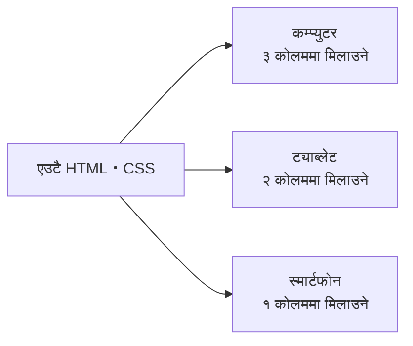
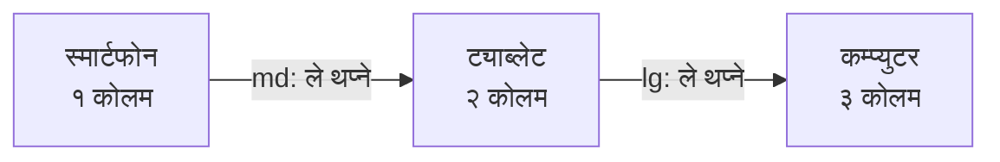
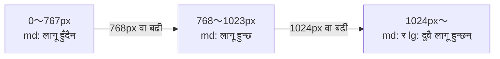
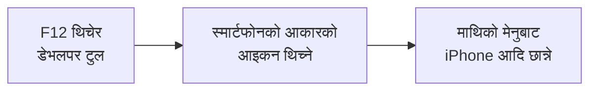

# रेस्पोन्सिभ डिजाइनको बारेमा

> 🇯🇵 मूल प्रति (जापानी भाषामा): [レスポンシブデザインについて.md](<../../../2年生_システム開発実践/後期/2026_11_06/レスポンシブデザインについて.md>) <!-- original-ja-link -->

वेबसाइट कम्प्युटर, ट्याब्लेट, स्मार्टफोन जस्ता **विभिन्न आकारका स्क्रिन** मा हेरिन्छ।
एउटै पेजलाई **जुनसुकै स्क्रिनमा पनि हेर्न सजिलो हुने गरी देखाउने** तरिकालाई **रेस्पोन्सिभ डिजाइन** भनिन्छ।

[स्वतन्त्र प्रोजेक्टमा फर्कनुहोस्](../2026_10_09/2026_10_09_資料1.md)

---

## 1. रेस्पोन्सिभ डिजाइन भनेको के हो

**Responsive (रेस्पोन्सिभ)** को अर्थ "प्रतिक्रिया दिने" हो।
स्क्रिनको **चौडाइ** अनुसार प्रतिक्रिया दिएर, लेआउट आफैं बदलिन्छ।



> 💡 **पहिले "स्मार्टफोनको लागि छुट्टै साइट" बनाइन्थ्यो**
> पहिले, कम्प्युटरको लागि पेज र स्मार्टफोनको लागि पेज (`m.〇〇.com` आदि) **छुट्टाछुट्टै** बनाइने गरिन्थ्यो।
> यसो गर्दा, सुधार्दा हरेक पटक **दुवै सुधार्नुपर्थ्यो**। रेस्पोन्सिभ डिजाइन भए, **एउटा मात्र सुधारे पुग्छ**।

---

## 2. किन महत्त्वपूर्ण छ?

- अहिले, वेबसाइट **स्मार्टफोनमा हेर्ने मानिस धेरै छन्**
- कम्पनीका मानिसले पनि पोर्टफोलियोको URL **स्मार्टफोनमा खोल्न** सक्छन्
- स्मार्टफोनमा हेर्दा अक्षर धेरै सानो भयो वा छेउतिर बाहिर निस्कियो भने, **त्यति मात्रैले पनि प्रभाव नराम्रो पर्छ**

---

## 3. काम गर्ने तरिका ① viewport (भ्युपोर्ट)

स्मार्टफोनको ब्राउजरले, केही नतोकिएमा, **कम्प्युटरको पेजलाई सानो बनाएर** देखाउँछ (अक्षर एकदम सानो हुन्छ)।
यसलाई रोक्ने भनेको HTML को `<head>` मा लेख्ने **viewport** को सेटिङ हो।

```html
<meta name="viewport" content="width=device-width, initial-scale=1">
```

| भाग | अर्थ |
|-----|------|
| `width=device-width` | पेजको चौडाइलाई, **त्यो डिभाइसको स्क्रिनको चौडाइ** मा मिलाउने |
| `initial-scale=1` | सुरुमा **ठूलो वा सानो नगरी** (१:१ स्केलमा) देखाउने |

> 📝 **Next.js ले आफैं राखिदिन्छ**
> Next.js (App Router) मा, यो viewport को सेटिङ **सुरुदेखि नै आफैं** राखिएको हुन्छ।
> Laravel को Blade बाट बनाउँदा, लेआउट फाइलमा आफैं लेख्नुहोस् (`laravel new` बाट बनाएको पेजमा सुरुदेखि नै राखिएको हुन्छ)।

---

## 4. काम गर्ने तरिका ② मिडिया क्वेरी

**मिडिया क्वेरी** भनेको "स्क्रिनको चौडाइ 〇〇px वा बढी भएको बेला मात्र यो CSS प्रयोग गर्ने" भनेर तोक्ने तरिका हो।

```css
/* सामान्य अवस्थामा (स्मार्टफोन) १ कोलम */
.cards {
  display: grid;
  grid-template-columns: 1fr;
}

/* स्क्रिनको चौडाइ 768px वा बढी भए २ कोलम */
@media (min-width: 768px) {
  .cards {
    grid-template-columns: 1fr 1fr;
  }
}

/* 1024px वा बढी भए ३ कोलम */
@media (min-width: 1024px) {
  .cards {
    grid-template-columns: 1fr 1fr 1fr;
  }
}
```

यसरी लेआउट बदल्ने **चौडाइको सीमा** लाई **ब्रेकपोइन्ट** भनिन्छ।

---

## 5. Tailwind CSS मा लेख्दा

Tailwind CSS मा क्लासको नामअगाडि `md:` वा `lg:` राखेर मात्र पनि मिडिया क्वेरीकै जस्तो काम गर्न सकिन्छ।

```html
<div class="grid grid-cols-1 md:grid-cols-2 lg:grid-cols-3 gap-4">
  <div>カード1</div>
  <div>カード2</div>
  <div>カード3</div>
</div>
```

| लेख्ने तरिका | कहिले लागू हुन्छ? |
|-------|------------|
| `grid-cols-1` | **सधैं** (स्मार्टफोन) |
| `sm:` | चौडाइ **640px वा बढी** हुँदा |
| `md:grid-cols-2` | चौडाइ **768px वा बढी** हुँदा (ट्याब्लेट जति) |
| `lg:grid-cols-3` | चौडाइ **1024px वा बढी** हुँदा (कम्प्युटर जति) |

---

## 6. मोबाइल फर्स्ट

माथिका दुवै उदाहरणमा, **स्मार्टफोनको देखावट पहिले लेखेर**, स्क्रिन ठूलो हुँदाको परिवर्तन **पछि थपिएको** छ।
यो सोचाइलाई **मोबाइल फर्स्ट** भनिन्छ।



- सानो स्क्रिनमा देखाउन सकिने कुरा थोरै हुने भएकाले, **साँच्चै चाहिने कुरा मात्र** सोच्नुपर्ने हुन्छ
- सानो स्क्रिनमा मिलाएको कुरालाई ठूलो स्क्रिनमा फैलाउनु **सजिलो** हुन्छ

> ⚠️ **Tailwind को `md:` को अर्थ "md वा बढी" हो**
> `md:hidden` भनेको "ट्याब्लेटमा **मात्र** लुकाउने" होइन, "768px **वा बढी** भए लुकाउने" हो।
> स्मार्टफोनको देखावट, `md:` आदि नराखेको **सामान्य क्लास** मा लेख्नुहोस्।

स्क्रिनको चौडाइ र लागू हुने क्लासको सम्बन्ध यस्तो छ।



---

## 7. स्मार्टफोनमा देखावट जाँच्ने

स्मार्टफोन नभए पनि, **ब्राउजरको डेभलपर टुल** बाट जाँच्न सकिन्छ।



| धेरै देखिने समस्या | सुधार्ने तरिका |
|-----------|------|
| छेउतिर स्क्रोल हुन्छ (बाहिर निस्किएको छ) | चौडाइ `px` मा स्थिर राखिएको एलिमेन्ट छ कि खोज्ने। तस्बिरमा `max-width: 100%` |
| बटन सानो भएर थिच्न गाह्रो | औंलाले थिच्न सजिलो आकार (**करिब 44px**) बनाउने |
| तालिका (टेबल) छेउतिर बाहिर निस्कन्छ | तालिकालाई छेउतिर स्क्रोल गर्न सकिने बाकसभित्र राख्ने, वा स्मार्टफोनमा कार्डको रूपमा बदल्ने |
| अक्षर धेरै सानो | मुख्य पाठका लागि **करिब 16px** लाई आधार मान्ने |

> 💡 डिप्लोय कोर्सका विद्यार्थीहरू, Vercel को URL **आफ्नै स्मार्टफोनमा खोलेर** जाँचेर हेर्नुहोस्।

---

## 8. सारांश

- **रेस्पोन्सिभ डिजाइन** = एउटै पेजलाई **स्क्रिनको चौडाइ अनुसार** हेर्न सजिलो हुने गरी बदल्ने तरिका
- **viewport** को सेटिङले स्मार्टफोनमा पनि **१:१ स्केलमा** देखाइन्छ (Next.js मा स्वचालित)
- **मिडिया क्वेरी** बाट, "〇〇px वा बढी भए यो CSS" भनेर तोकिन्छ। सीमालाई **ब्रेकपोइन्ट** भनिन्छ
- Tailwind CSS मा `md:` `lg:` राखे मात्र पुग्छ
- **मोबाइल फर्स्ट**: स्मार्टफोनको देखावट पहिले बनाएर, ठूलो स्क्रिनको परिवर्तन थप्ने
- जाँच्ने काम **डेभलपर टुल** र **आफ्नै स्मार्टफोन** बाट गर्ने

[स्वतन्त्र प्रोजेक्टमा फर्कनुहोस्](../2026_10_09/2026_10_09_資料1.md)
