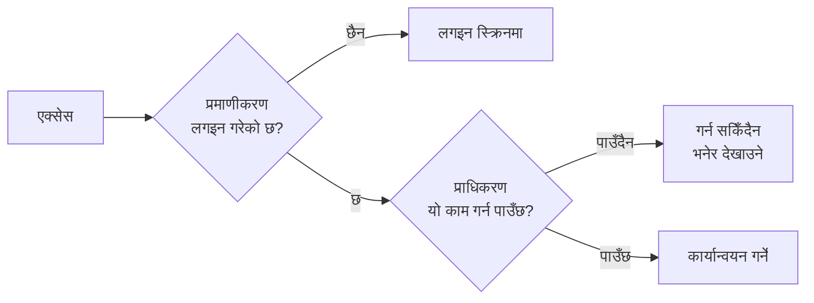
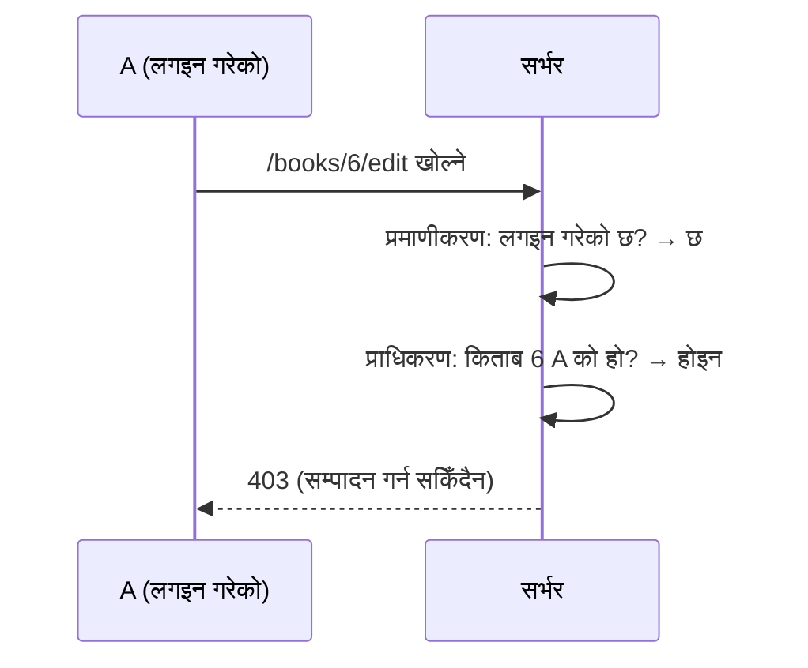
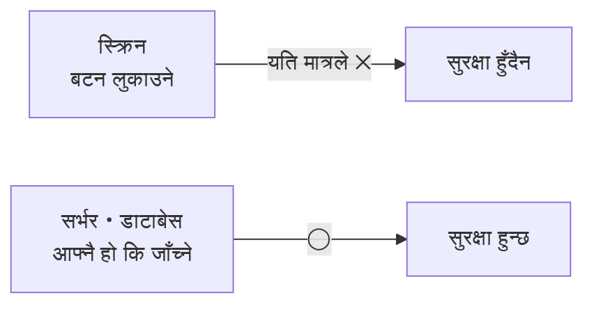

# प्रमाणीकरण (Authentication) र प्राधिकरण (Authorization) को बारेमा

> 🇯🇵 मूल प्रति (जापानी भाषामा): [認証と認可について.md](<../../../2年生_システム開発実践/後期/2026_11_13/認証と認可について.md>) <!-- original-ja-link -->

लगइन फिचर बनाउँदा, **प्रमाणीकरण (認証)** र **प्राधिकरण (認可)** भन्ने दुई शब्द आउँछन्।
जापानीमा यी दुई शब्दमा कान्जीको एउटा अक्षर मात्र फरक छ, तर यिनले गर्ने काम फरक-फरक हो।

[स्वतन्त्र प्रोजेक्टमा फर्कनुहोस्](../2026_10_09/2026_10_09_資料1.md)

---

## 1. छोटकरीमा भन्नुपर्दा

| नाम | अंग्रेजी | जाँच्ने कुरा | छोटकरीमा |
|------|-----|-----------|-----------|
| **प्रमाणीकरण** | Authentication (अथेन्टिकेसन), छोटकरीमा **AuthN** | **तपाईं को हुनुहुन्छ?** | पहिचान पुष्टि |
| **प्राधिकरण** | Authorization (अथोराइजेसन), छोटकरीमा **AuthZ** | **तपाईंले के गर्न पाउनुहुन्छ?** | अनुमतिको जाँच |

> 💡 **उदाहरण दिँदा "कन्सर्ट" जस्तै**
> - **प्रमाणीकरण** = प्रवेशद्वारमा **टिकट र परिचयपत्र** देखाएर, आफ्नो पहिचान पुष्टि गराउने
> - **प्राधिकरण** = टिकटको प्रकार अनुसार, **जान पाइने ठाउँ तय हुन्छ** (सामान्य सिटका मानिस, सम्बन्धित व्यक्तिहरूका लागि छुट्याइएको क्षेत्रमा जान पाउँदैनन्)
>
> आफू नै हो भन्ने थाहा भए पनि (प्रमाणीकरण OK), जताततै जान पाइन्छ भन्ने होइन (प्राधिकरण छुट्टै कुरा हो)।

---

## 2. क्रम "प्रमाणीकरण → प्राधिकरण" हो

**को हो भन्ने थाहा नभई, के गर्न पाउने भन्ने पनि तय गर्न सकिँदैन।** त्यसैले, सधैं प्रमाणीकरण पहिले हुन्छ।



---

## 3. आफ्नो एपमा लागू गरेर हेरौं

**पढाइ रेकर्ड एप** को उदाहरणबाट सोचौं।

| अवस्था | प्रमाणीकरण कि प्राधिकरण? | जाँच्ने कुरा |
|-----|-----------|-----------|
| इमेल ठेगाना र पासवर्डबाट लगइन गर्ने | **प्रमाणीकरण** | साँच्चै यही व्यक्ति हो? |
| लगइन नगरेको मानिसले "किताब दर्ता गर्ने" पेज खोल्ने | **प्रमाणीकरण** | लगइन गरेको छ? → छैन भने लगइन स्क्रिनमा |
| A ले **B को** प्रतिक्रिया सम्पादन गर्न खोज्ने | **प्राधिकरण** | यो किताब आफैंले दर्ता गरेको हो? → होइन भने गर्न सकिँदैन |
| एडमिनले मात्र अरूको पोस्ट मेटाउन सक्ने | **प्राधिकरण** | यो व्यक्ति एडमिन हो? |

> ⚠️ **धेरै हुने गल्ती: प्रमाणीकरण मात्र गरेर, प्राधिकरण बिर्सनु**
> "लगइन गरेको मानिसले मात्र सम्पादन पेज खोल्न सक्ने" मात्र भयो भने, लगइन गरेको **जो कोहीले पनि**, URL को नम्बर बदले मात्र **अरूको डाटा** सम्पादन गर्न सक्ने हुन्छ।
>
> ```
> /books/5/edit   ← आफ्नो किताब
> /books/6/edit   ← नम्बर बदल्दा… अरूको किताब?
> ```
>
> सम्पादन र मेटाउने बेला, **"यो डाटा लगइन गरेको व्यक्तिकै हो?"** भनेर अनिवार्य रूपमा जाँच्नुहोस्।

प्राधिकरणको जाँच भएमा, लगइन गरेको मानिस भए पनि अरूको डाटामा पहुँचलाई यसरी रोक्न सकिन्छ।



---

## 4. HTTP को स्टाटस कोड

एरर आउँदा फर्काउने स्टाटस कोड पनि, प्रमाणीकरण र प्राधिकरण अनुसार छुट्टिएको हुन्छ।

| कोड | नाम | अर्थ |
|-------|-----|------|
| **401** | Unauthorized | **प्रमाणीकरण** भएको छैन (लगइन गरेको छैन, को हो थाहा छैन) |
| **403** | Forbidden | प्रमाणीकरण त भएको छ, तर **प्राधिकरण** भएको छैन (त्यो काम निषेधित छ) |

> 📝 401 को नाम "Unauthorized (प्राधिकरण नभएको)" भए पनि, यसको अर्थ **प्रमाणीकरण नभएको** हो। नाम भ्रमपूर्ण भएकाले, अर्थबाट सम्झनुहोस्।

---

## 5. हरेक प्रविधिमा कसरी गर्ने?

### Laravel को हकमा

| | प्रयोग गर्ने कुरा | उदाहरण |
|---|---|---|
| प्रमाणीकरण | `Auth`, मिडलवेयर `auth` | लगइन नगरेको मानिसलाई लगइन स्क्रिनमा पठाउने |
| प्राधिकरण | **Policy** (पोलिसी), `Gate` (गेट) | "किताब सम्पादन गर्न पाउने व्यक्ति त्यसलाई दर्ता गर्ने व्यक्ति मात्र हो" भन्ने नियम लेख्ने |

```php
// routes/web.php: लगइन गरेको मानिस मात्र (प्रमाणीकरण)
Route::middleware('auth')->group(function () {
    Route::get('/books/{book}/edit', [BookController::class, 'edit']);
});
```

```php
// BookController: आफ्नै किताब हो कि होइन (प्राधिकरण)
public function edit(Book $book)
{
    if ($book->user_id !== Auth::id()) {
        abort(403); // आफ्नो किताब होइन भने 403
    }

    return view('books.edit', compact('book'));
}
```

### Supabase को हकमा

| | प्रयोग गर्ने कुरा | उदाहरण |
|---|---|---|
| प्रमाणीकरण | **Supabase Auth** | इमेल र पासवर्ड, वा Google खाताबाट लगइन |
| प्राधिकरण | **RLS (Row Level Security / रो लेभल सेक्युरिटी)** | "`user_id` आफ्नै भएका रो मात्र हेर्न र परिवर्तन गर्न पाइने" भन्ने नियम डाटाबेसमा लेख्ने |

> ⚠️ **Supabase मा RLS धेरै महत्त्वपूर्ण छ**
> Supabase मा, ब्राउजरबाट **सिधै डाटाबेसमा एक्सेस** गरिन्छ।
> RLS सेट नगरे, **जो कोहीले पनि सबै डाटा हेर्न वा मेटाउन सक्ने** अवस्था हुन सक्छ।
> Supabase को व्यवस्थापन स्क्रिनमा, हरेक टेबलमा RLS **सक्रिय (Enabled)** छ कि छैन जाँच्नुहोस्।

---

## 6. स्क्रिनमा लुकाउने मात्रले प्राधिकरण हुँदैन

"अरूको किताबमा सम्पादन बटन नदेखाउने"——यो **UI को उपाय** हो, **प्राधिकरण होइन**।
किनभने बटन नभए पनि, URL सिधै टाइप गरेर वा API सिधै बोलाएर काम गर्न सकिन्छ।



**प्राधिकरणको जाँच, सधैं सर्भरतर्फ (Laravel को कन्ट्रोलर, Supabase को RLS आदि) मा गर्नुहोस्।**

---

## 7. सारांश

- **प्रमाणीकरण** = **तपाईं को हुनुहुन्छ?** (पहिचान पुष्टि, लगइन)
- **प्राधिकरण** = **तपाईंले के गर्न पाउनुहुन्छ?** (अनुमतिको जाँच)
- क्रम **प्रमाणीकरण → प्राधिकरण** हो
- लगइन गरेको छैन → **401**, लगइन गरेको छ तर निषेधित → **403**
- Laravel मा **auth मिडलवेयर + Policy**, Supabase मा **Supabase Auth + RLS**
- बटन लुकाउने मात्रले सुरक्षा हुँदैन। **सर्भरतर्फ अनिवार्य रूपमा जाँच्नुहोस्**

[स्वतन्त्र प्रोजेक्टमा फर्कनुहोस्](../2026_10_09/2026_10_09_資料1.md)
