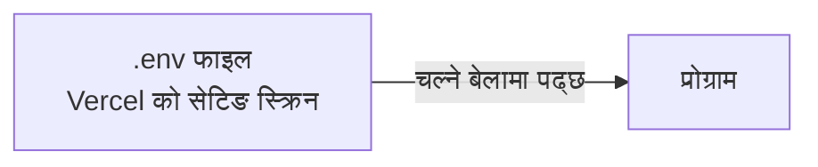
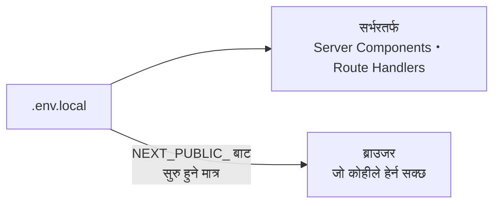
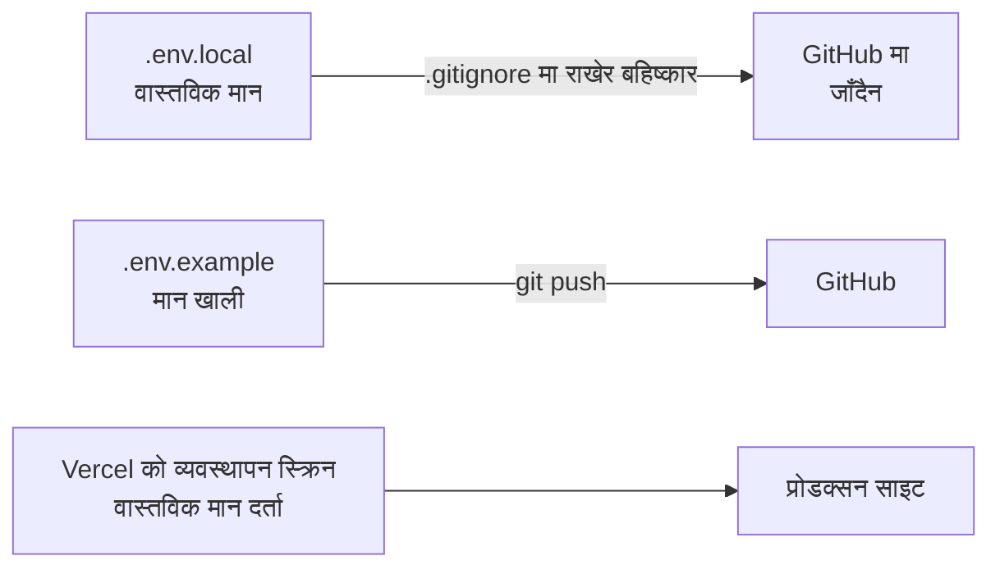

# इन्भाइरोनमेन्ट भेरिएबलको बारेमा

> 🇯🇵 मूल प्रति (जापानी भाषामा): [環境変数について.md](<../../../2年生_システム開発実践/後期/2026_11_27/環境変数について.md>) <!-- original-ja-link -->

स्वतन्त्र प्रोजेक्टका सामग्रीमा, धेरै पटक "**API की र पासवर्ड GitHub मा नराख्नुहोस्**", "`.env` मा लेख्नुहोस्" भनेर लेखिएको छ।
यो `.env` मा लेखिने कुरा नै **इन्भाइरोनमेन्ट भेरिएबल (environment variable)** हो।
यहाँ, इन्भाइरोनमेन्ट भेरिएबल भनेको के हो र किन प्रयोग गरिन्छ भनेर हेर्नेछौं।

[स्वतन्त्र प्रोजेक्टमा फर्कनुहोस्](../2026_10_09/2026_10_09_資料1.md)

---

## 1. इन्भाइरोनमेन्ट भेरिएबल भनेको के हो

**इन्भाइरोनमेन्ट भेरिएबल** भनेको प्रोग्रामको **बाहिर** राखिने सेटिङको मान हो।
प्रोग्रामले चल्ने बेलामा त्यो मान **पढेर** प्रयोग गर्छ।



| इन्भाइरोनमेन्ट भेरिएबलमा राख्ने कुरा | उदाहरण |
|------------------|-----|
| **गोप्य मान** | API की, डाटाबेसको पासवर्ड |
| **ठाउँ अनुसार फरक हुने मान** | डाटाबेसको ठाउँ (आफ्नो PC हो कि प्रोडक्सन सर्भर), API को URL |

> 💡 **उदाहरणका लागि, "घरको साँचो" जस्तै**
> घरको **नक्सा** (प्रोग्राम) अरूलाई देखाए पनि समस्या हुँदैन।
> तर, **साँचो** (पासवर्ड) नक्सामा टाँसेर राख्दैनौं, **छुट्टै राख्छौं** नि।
> इन्भाइरोनमेन्ट भेरिएबल, प्रोग्रामभन्दा छुट्टै राखिने **साँचो** जस्तै हो।

---

## 2. किन इन्भाइरोनमेन्ट भेरिएबल प्रयोग गर्ने?

### ① गोप्य मान GitHub मा नराख्नका लागि

API की प्रोग्राममा **सिधै लेखेर** GitHub मा सार्वजनिक गर्दा, **संसारभरका जो कोहीले पनि हेर्न सक्छन्**।

```js
// ✕ खतरनाक: कोडमा सिधै लेखिएको छ
const apiKey = "sk-abc123xyz...";
```

```js
// ◯ सुरक्षित: इन्भाइरोनमेन्ट भेरिएबलबाट पढ्ने
const apiKey = process.env.WEATHER_API_KEY;
```

> ⚠️ **GitHub मा राखिएको की तुरुन्तै दुरुपयोग हुन्छ**
> सार्वजनिक रिपोजिटरीमा राखिएका की आफैं खोजिरहने प्रोग्रामहरू छन्।
> गल्तीले push गर्नुभयो भने, **commit मेटाउने मात्रले पुग्दैन** (हिस्ट्रीमा बाँकी रहन्छ)।
> तुरुन्तै सेवाको व्यवस्थापन स्क्रिनमा गएर **की निष्क्रिय गरेर, नयाँ की बनाउनुहोस्**।

### ② ठाउँ अनुसार मान बदल्नका लागि

एउटै प्रोग्राम भए पनि, **आफ्नो PC** र **प्रोडक्सन (Vercel आदि)** मा जोडिने ठाउँ फरक हुन्छ।

| | आफ्नो PC (डेभलपमेन्ट इन्भाइरोनमेन्ट) | प्रोडक्सन इन्भाइरोनमेन्ट |
|---|---|---|
| डाटाबेस | आफ्नो PC को MySQL | इन्टरनेटमा भएको डाटाबेस |
| API को URL | `http://localhost:8000` | `https://〇〇.com` |

प्रोग्राम **नबदली**, इन्भाइरोनमेन्ट भेरिएबल मात्र बदलेर जोडिने ठाउँ बदल्न सकिन्छ।
"**इन्भाइरोनमेन्ट (वातावरण)** अनुसार बदलिने **भेरिएबल**" भएकाले, यसको नाम **इन्भाइरोनमेन्ट भेरिएबल** हो।

---

## 3. `.env` फाइल

डेभलपमेन्टको बेला, `.env` नामको फाइलमा इन्भाइरोनमेन्ट भेरिएबल लेखिन्छ।

### Laravel को हकमा (`.env`)

```
APP_NAME=BookApp
DB_HOST=127.0.0.1
DB_DATABASE=laravel
DB_USERNAME=laravel
DB_PASSWORD=password
```

```php
// पढ्ने बेलामा (config फाइलभित्र)
'database' => env('DB_DATABASE'),
```

### Next.js को हकमा (`.env.local`)

```
WEATHER_API_KEY=abc123xyz
NEXT_PUBLIC_SUPABASE_URL=https://〇〇.supabase.co
```

```js
// पढ्ने बेलामा
const apiKey = process.env.WEATHER_API_KEY;
```

> ⚠️ **Next.js को `NEXT_PUBLIC_` मा ध्यान दिनुहोस्**
> नाम `NEXT_PUBLIC_` बाट सुरु हुने इन्भाइरोनमेन्ट भेरिएबल, **ब्राउजरमा पठाइन्छ, र जो कोहीले हेर्न सक्छ**।
> **गोप्य मान (API की आदि) मा `NEXT_PUBLIC_` नराख्नुहोस्**।
> `NEXT_PUBLIC_` नभएका इन्भाइरोनमेन्ट भेरिएबलहरू सर्भरतर्फ मात्र (Server Components वा Route Handlers मा) प्रयोग गर्न सकिन्छन्।

मान कहाँसम्म पुग्छ भनेर चित्रमा देखाउँदा यस्तो हुन्छ।



> 📝 Supabase को **URL र सार्वजनिक की (publishable key / anon key)** ब्राउजरमा प्रयोग गर्ने उद्देश्यले बनाइएका हुन्, त्यसैले `NEXT_PUBLIC_` राखे पनि समस्या हुँदैन।
> तर, डाटा सुरक्षित राख्न **RLS** अनिवार्य रूपमा सेट गर्नुहोस् (→ [प्रमाणीकरण (Authentication) र प्राधिकरण (Authorization) को बारेमा](../2026_11_13/認証と認可について.md))।
> अर्कोतर्फ, **secret key / service_role key** ले जे पनि गर्न सक्ने भएकाले, यसमा कहिल्यै पनि `NEXT_PUBLIC_` राख्नु हुँदैन।

---

## 4. `.env` लाई GitHub मा नराख्ने व्यवस्था

`.env` GitHub मा नजानुको कारण, यो **`.gitignore`** मा लेखिएको हुनु हो।

```
# .gitignore
.env
.env*.local
```

`.gitignore` मा लेखिएका फाइलहरू **Git ले बेवास्ता गर्छ**, त्यसैले commit हुँदैनन्।
Laravel वा `create-next-app` बाट बनाएको प्रोजेक्टमा, यो **सुरुदेखि नै लेखिएको** हुन्छ।

### `.env.example` तयार गर्ने

`.env` GitHub मा नजाने भएकाले, अरूले हेर्दा **कस्ता इन्भाइरोनमेन्ट भेरिएबल चाहिन्छन्** भन्ने थाहा हुँदैन।
त्यसैले, **मान खाली राखेको नमुना** `.env.example` बनाएर GitHub मा राखिन्छ।

```
# .env.example (GitHub मा राख्ने)
WEATHER_API_KEY=
NEXT_PUBLIC_SUPABASE_URL=
```

> 💡 Laravel मा सुरुदेखि नै `.env.example` हुन्छ। पोर्टफोलियोको रूपमा देखाउँदा पनि, `.env.example` भएमा **व्यवस्थित तरिकाले बनाएको** भन्ने प्रभाव पर्छ।

---

## 5. प्रोडक्सन (Vercel) मा व्यवस्थापन स्क्रिनबाट सेट गर्ने

`.env.local` GitHub मा नजाने भएकाले, **Vercel सम्म पुग्दैन**।
प्रोडक्सनको इन्भाइरोनमेन्ट भेरिएबल, Vercel को व्यवस्थापन स्क्रिनमा सेट गरिन्छ।

आफ्नो PC, GitHub र Vercel मा के-के राखिन्छ भनेर मिलाउँदा यस्तो हुन्छ।



सेटिङ गर्ने चरणहरू यस्ता छन्।


> ⚠️ **इन्भाइरोनमेन्ट भेरिएबल थपे वा परिवर्तन गरेपछि, फेरि एक पटक डिप्लोय गर्नुहोस्**
> इन्भाइरोनमेन्ट भेरिएबल **डिप्लोय गर्ने बेलामा** पढिन्छ। सेटिङ मात्र गरेर अहिले चलिरहेको साइटमा परिवर्तन लागू हुँदैन।

---

## 6. सारांश

- **इन्भाइरोनमेन्ट भेरिएबल** = प्रोग्रामको **बाहिर** राखिने सेटिङको मान
- प्रयोग गर्ने कारण, **गोप्य मान सुरक्षित राख्न** र **इन्भाइरोनमेन्ट अनुसार मान बदल्न**
- डेभलपमेन्टको बेला **`.env`** (Next.js मा `.env.local`) मा लेख्ने। **`.gitignore`** ले गर्दा GitHub मा जाँदैन
- चाहिने इन्भाइरोनमेन्ट भेरिएबलको नमुनाको रूपमा **`.env.example`** GitHub मा राख्ने
- Next.js को **`NEXT_PUBLIC_`** ब्राउजरमा सबैले देख्छन्। गोप्य मानमा नराख्ने
- प्रोडक्सन (Vercel) मा **व्यवस्थापन स्क्रिनबाट सेट** गरेर, **फेरि एक पटक डिप्लोय**
- की push भइहाल्यो भने, **तुरुन्तै निष्क्रिय गरेर नयाँ बनाउने**

[स्वतन्त्र प्रोजेक्टमा फर्कनुहोस्](../2026_10_09/2026_10_09_資料1.md)
