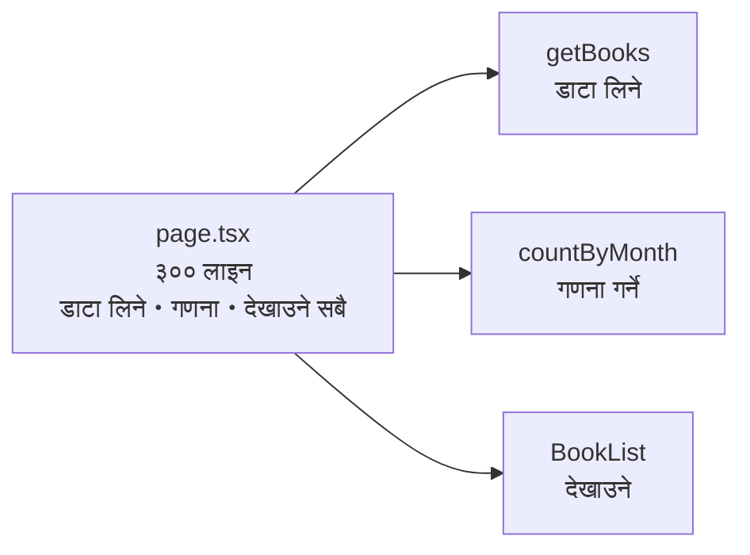

# रिफ्याक्टरिङको बारेमा

> 🇯🇵 मूल प्रति (जापानी भाषामा): [リファクタリングについて.md](<../../../2年生_システム開発実践/後期/2026_12_04/リファクタリングについて.md>) <!-- original-ja-link -->

फिचरहरू थप्दै जाँदा, कोड लामो हुँदै जान्छ, र **कहाँ के लेखिएको छ थाहा नहुने** हुन्छ।
त्यस्तो बेला गरिने काम हो **रिफ्याक्टरिङ**।

[स्वतन्त्र प्रोजेक्टमा फर्कनुहोस्](../2026_10_09/2026_10_09_資料1.md)

---

## 1. रिफ्याक्टरिङ भनेको के हो

**रिफ्याक्टरिङ** भनेको **एपको काम गर्ने तरिका नबदली**, कोडको **भित्री भागलाई पढ्न र सुधार्न सजिलो हुने गरी मिलाउनु** हो।

| | काम गर्ने तरिका (प्रयोगकर्ताले देख्ने कुरा) | कोडको भित्री भाग |
|---|---|---|
| फिचर थप्ने | **बदलिन्छ** | बदलिन्छ |
| बग सुधार्ने | **बदलिन्छ** (सही हुन्छ) | बदलिन्छ |
| **रिफ्याक्टरिङ** | **बदलिँदैन** | बदलिन्छ (सफा हुन्छ) |

> 💡 **उदाहरण दिँदा "कोठा मिलाउने" जस्तै**
> कोठा मिलाए पनि, आफूसँग भएका सामान (गर्न सकिने कुरा) बदलिँदैनन्।
> तर, कहाँ के छ भन्ने थाहा हुने भएकाले, **अर्को पटक केही खोज्दा वा नयाँ सामान राख्दा सजिलो** हुन्छ।

---

## 2. किन रिफ्याक्टरिङ गर्ने?


- कोड अस्तव्यस्त भयो भने, **अर्को फिचर थप्न समय लाग्छ**
- एउटै कोड धेरै ठाउँमा भयो भने, **एक ठाउँमा सुधार्न बिर्सेर** बग बन्छ
- छ महिनापछि, आफूले अहिले लेखेको कोड **प्रायः याद हुँदैन**
- पोर्टफोलियोमा, कम्पनीका मानिसले **कोड पनि हेर्छन्**। पढ्न सजिलो कोडको राम्रो मूल्यांकन हुन्छ

---

## 3. यस्तो कोड रिफ्याक्टरिङको संकेत हो

अस्तव्यस्त कोडमा, प्रायः देखिने ढाँचाहरू हुन्छन्। यसलाई **कोडबाट गन्ध आउनु (कोड स्मेल)** भनिन्छ।

| संकेत | उदाहरण |
|-------|-----|
| **एउटै कोड धेरै ठाउँमा छ** | एउटै हेडर, सबै पेजमा कपी गरेर लेखिएको छ |
| **एउटा फंक्सन वा फाइल धेरै लामो छ** | `page.tsx` ३०० लाइनको छ |
| **नाम बुझ्न गाह्रो छ** | `data`, `tmp`, `a`, `flg` |
| **के जनाउँछ भन्ने नबुझिने संख्या** | `if (status === 2)` (2 भनेको के?) |
| **प्रयोग नभएको कोड** | कमेन्ट आउट गरेर त्यत्तिकै छोडिएको पुरानो कोड |

---

## 4. धेरै गरिने रिफ्याक्टरिङ

### ① नाम बुझ्न सजिलो बनाउने

```js
// ✕ के राखिएको छ थाहा हुँदैन
const d = await getData();
const l = d.filter((x) => x.r >= 4);
```

```js
// ◯ नाम हेरे थाहा हुन्छ
const books = await getBooks();
const favoriteBooks = books.filter((book) => book.rating >= 4);
```

यो सबैभन्दा सजिलो, र सबैभन्दा प्रभावकारी रिफ्याक्टरिङ हो।

### ② एउटै कोडलाई एकै ठाउँमा मिलाउने

अघिल्लो सेमेस्टर वा पहिलो वर्षमा सिकेको **पुनः प्रयोग गर्न मिल्ने भाग (कम्पोनेन्ट・`@include`)** बनाउनु पनि रिफ्याक्टरिङ हो।

```jsx
// ✕ एउटै देखावटको कार्ड, धेरै पेजमा लेखिएको छ
<div className="rounded border p-4">
  <h2 className="font-bold">{book.title}</h2>
  <p>{book.author}</p>
</div>
```

```jsx
// ◯ BookCard भन्ने कम्पोनेन्ट बनाएर, जहाँ पनि प्रयोग गर्ने
<BookCard book={book} />
```

यसो गरिराख्यो भने, कार्डको देखावट बदल्न चाहँदा **एक ठाउँमा मात्र सुधारे पुग्छ**।
एउटै कुरा नदोहोर्याउने भन्ने सोचाइलाई **DRY (ड्राई)** (Don't Repeat Yourself) भनिन्छ।

### ③ अर्थ नखुल्ने नम्बरलाई नाम दिने

```js
// ✕ 2 ले के जनाउँछ थाहा हुँदैन
if (book.status === 2) { ... }
```

```js
// ◯ नाम दिने
const STATUS_FINISHED = 2; // पढिसकेको
if (book.status === STATUS_FINISHED) { ... }
```

### ④ लामो फंक्सन वा फाइल छुट्याउने

एउटा फंक्सनले **धेरै किसिमका काम गरिरहेको** छ भने, काम अनुसार छुट्याउनुहोस्।



---

## 5. रिफ्याक्टरिङका नियमहरू

### नियम ① पहिले commit गरिराख्ने

रिफ्याक्टरिङअघि, **चलिरहेको अवस्थालाई commit** गरिराख्नुहोस्।
बिगारिहाल्नुभयो भने पनि, तुरुन्तै **पहिलेको अवस्थामा फर्काउन सकिन्छ**।

### नियम ② फिचर थप्दाकै बेला नगर्ने

"फिचर थप्दै मिलाउने काम पनि गर्ने" हो भने, चल्न छोड्दा **कुन कारणले भयो थाहा नहुने** हुन्छ।


### नियम ③ अलिअलि गर्दै गर्ने

एकै पटकमा सबै सुधार्न नखोजी, **एउटा सुधारेपछि जाँच्ने**, यसरी दोहोर्याउनुहोस्।

### नियम ④ सकिएपछि, काम गर्ने तरिका बदलिएको छैन भनेर जाँच्ने

रिफ्याक्टरिङमा **काम गर्ने तरिका नबदल्नु** नियम हो।
सुधारेपछि, **पहिले जस्तै चल्छ कि चल्दैन** अनिवार्य रूपमा जाँच्नुहोस्।
यो जाँच स्वचालित रूपमा गर्ने उपाय भनेको अर्को पटक सिक्ने **टेस्ट** हो।

---

## 6. AI लाई रिफ्याक्टरिङमा सहयोग गर्न लगाउने

AI लाई "यो कोड पढ्न सजिलो हुने गरी रिफ्याक्टर गरिदेऊ" भनेर अनुरोध गर्दा, मिलाइएको कोड दिन्छ।
तर, तलका कुरामा ध्यान दिनुहोस्।

- **काम गर्ने तरिका बदलिएको छ कि छैन**, आफैं जाँच्ने (AI ले पनि गल्ती गर्न सक्छ)
- **किन त्यसरी सुधारियो** भन्ने बुझेपछि मात्र प्रयोग गर्ने। व्याख्या गर्न नसकिने कोडबारे अन्तर्वार्तामा सोधिए समस्या हुन्छ
- एकै पटक धेरै अनुरोध नगरी, **एक-एक फाइल, एक-एक फंक्सन** गरेर अनुरोध गर्ने

---

## 7. सारांश

- **रिफ्याक्टरिङ** = **काम गर्ने तरिका नबदली**, कोडलाई पढ्न र सुधार्न सजिलो हुने गरी मिलाउनु
- संकेतहरू: **एउटै कोड धेरै ठाउँमा, धेरै लामो, नाम बुझ्न गाह्रो, अर्थ नखुल्ने नम्बर**
- धेरै गरिने कुरा: **नाम बदल्ने, कम्पोनेन्टमा मिलाउने (DRY), नम्बरलाई नाम दिने, छुट्याउने**
- **पहिले commit**, **फिचर थप्दाकै बेला नगर्ने**, **अलिअलि गर्दै गर्ने**, **काम गर्ने तरिका उस्तै छ कि जाँच्ने**
- AI प्रयोग गर्दा पनि, **बुझेपछि मात्र** प्रयोग गर्ने

[स्वतन्त्र प्रोजेक्टमा फर्कनुहोस्](../2026_10_09/2026_10_09_資料1.md)
