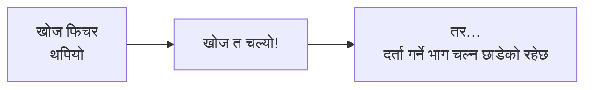
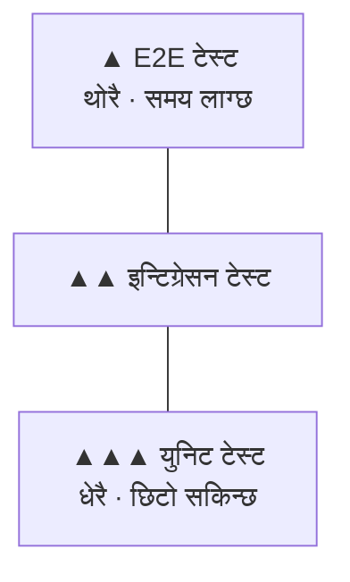

# टेस्टिङको बारेमा

> 🇯🇵 मूल प्रति (जापानी भाषामा): [テストについて.md](<../../../2年生_システム開発実践/後期/2026_12_11/テストについて.md>) <!-- original-ja-link -->

एप बनाइसकेपछि, त्यो **राम्रोसँग चल्छ कि चल्दैन** भनेर जाँच्छौँ। यसैलाई **टेस्ट (परीक्षण)** भनिन्छ।
यहाँ हामी टेस्टका प्रकारहरू र टेस्टलाई **स्वचालित (automatic)** रूपमा गर्ने तरिका हेर्नेछौँ।

[स्वतन्त्र प्रोजेक्टमा फर्कनुहोस्](../2026_10_09/2026_10_09_資料1.md)

---

## 1. टेस्ट भनेको के हो?

**टेस्ट** भनेको प्रोग्राम **हामीले सोचेजस्तै चल्छ कि चल्दैन** भनेर जाँच्नु हो।

तपाईंहरूले पनि कोड लेखिसकेपछि **ब्राउजरमा स्क्रिन खोलेर, बटन थिचेर** जाँच्नुहुन्छ, होइन?
यो पनि राम्रै टेस्ट हो। मानिसले हातैले गर्ने भएकाले यसलाई **म्यानुअल टेस्ट** भनिन्छ।

| | म्यानुअल टेस्ट | स्वचालित टेस्ट |
|---|---|---|
| तरिका | मानिसले स्क्रिन चलाएर जाँच्छ | **टेस्टका लागि बनाइएको प्रोग्रामले** जाँच्छ |
| समय | जाँच्नुपर्ने कुरा जति बढ्छ, त्यति **धेरै समय लाग्छ** | सयौँ टेस्ट भए पनि **केही सेकेन्डदेखि केही मिनेट** |
| जाँच्न बिर्सनु | हुन सक्छ | **हुँदैन** (हरेक पटक उही कुरा गर्छ) |

---

## 2. स्वचालित टेस्ट किन महत्त्वपूर्ण छ?

नयाँ फिचर थप्दा वा [रिफ्याक्टरिङ](../2026_12_04/リファクタリングについて.md) गर्दा, **पहिले चलिरहेको भाग बिग्रन** सक्छ।
यसलाई **रिग्रेसन (degrade / regression)** भनिन्छ।



फिचर थपिँदै जाँदा, हरेक पटक **सबै फिचर हातैले फेरि जाँच्नु** निकै गाह्रो हुन्छ।
स्वचालित टेस्ट भए, एउटै कमान्डले **सबै कुरा एकैपटक फेरि जाँच्न सकिन्छ**।

> 💡 **उदाहरणका लागि "परीक्षाको उत्तर मिलाउनु"**
> "यो प्रश्नको उत्तर 〇〇 हो" भनेर **उत्तर (अपेक्षित नतिजा)** पहिल्यै तय गरेर राख्यौँ भने,
> त्यसपछि **उत्तरसँग मिल्छ कि मिल्दैन** भनेर यान्त्रिक रूपमा जाँचे मात्र पुग्छ।

---

## 3. टेस्टका प्रकारहरू

टेस्टलाई **कति ठूलो भाग जाँच्ने** भन्ने आधारमा छुट्याइन्छ।

| प्रकार | जाँच्ने कुरा | उदाहरण |
|-----|-----------|-----|
| **युनिट टेस्ट** (Unit Test) | **एउटा फंक्सन वा एउटा भाग** सही चल्छ कि चल्दैन | "रेटिङको औसत निकाल्ने फंक्सन"मा `[4, 5, 3]` दिँदा `4` आउँछ कि आउँदैन |
| **इन्टिग्रेसन टेस्ट** (Integration Test) | **केही भागहरू जोड्दा** सही चल्छ कि चल्दैन | "किताब दर्ता गर्ने API" कल गर्दा डेटाबेसमा सेभ हुन्छ कि हुँदैन |
| **E2E टेस्ट** (End to End) | **प्रयोगकर्ताले चलाएजस्तै** सुरुदेखि अन्त्यसम्म चल्छ कि चल्दैन | ब्राउजरलाई स्वचालित रूपमा चलाएर, लगइन → किताब दर्ता → सूचीमा देखिन्छ कि देखिँदैन |



सानो टेस्ट (युनिट टेस्ट) **छिटो चल्ने र लेख्न सजिलो हुने** भएकाले यस्ता टेस्ट धेरै लेखिन्छन्।
ठूलो टेस्ट (E2E टेस्ट) मा **समय लाग्छ**, त्यसैले महत्त्वपूर्ण प्रक्रियाहरूमा मात्र सीमित गरिन्छ।
यही आकारका कारण यसलाई **टेस्ट पिरामिड** भनिन्छ।

---

## 4. टेस्ट कसरी लेखिन्छ, हेरौँ

### युनिट टेस्ट (JavaScript · Vitest को उदाहरण)

```js
// average.js: रेटिङको औसत निकाल्ने फंक्सन
export function average(ratings) {
  if (ratings.length === 0) return 0;
  const total = ratings.reduce((sum, r) => sum + r, 0);
  return total / ratings.length;
}
```

```js
// average.test.js: टेस्ट
import { expect, test } from "vitest";
import { average } from "./average";

test("平均を計算できる", () => {
  expect(average([4, 5, 3])).toBe(4);
});

test("1つもないときは 0", () => {
  expect(average([])).toBe(0);
});
```

| भाग | अर्थ |
|-----|------|
| `test("〇〇", ...)` | टेस्टको नाम र जाँच्ने कुरा |
| `expect(A).toBe(B)` | **A चाहिँ B हुनुपर्छ** (अपेक्षित नतिजा) |

### इन्टिग्रेसन टेस्ट (Laravel को उदाहरण)

Laravel मा सुरुदेखि नै टेस्ट गर्ने व्यवस्था हुन्छ।

```php
// tests/Feature/BookTest.php
public function test_本を登録できる(): void
{
    $response = $this->post('/books', [
        'title' => 'こころ',
        'author' => '夏目漱石',
    ]);

    $response->assertRedirect('/books');                      // सूचीमा फर्कन्छ
    $this->assertDatabaseHas('books', ['title' => 'こころ']); // DB मा सेभ भएको छ
}
```

```powershell
php artisan test
```

> 📝 Laravel मा टेस्ट लेख्ने तरिका **PHPUnit** र **Pest** गरी दुई किसिमका छन्। माथिको उदाहरण PHPUnit को तरिका हो। प्रोजेक्ट बनाउँदा कुन छान्नुभयो भन्ने अनुसार लेख्ने तरिका फरक हुन्छ, त्यसैले `tests` फोल्डरभित्रका उदाहरण हेर्नुहोस्।

---

## 5. टेस्टको नतिजा

टेस्ट चलाएपछि नतिजा देखिन्छ।

| देखिने कुरा | अर्थ |
|-----|------|
| ✅ PASS (हरियो) | अपेक्षाअनुसार भयो |
| ❌ FAIL (रातो) | अपेक्षाभन्दा फरक भयो → कुन टेस्टमा, के फरक भयो भन्ने देखाइन्छ |

> 💡 **CI मा टेस्टलाई स्वचालित रूपमा चलाउने**
> [CI/CD को बारेमा](../2026_10_09/CICDについて.md) मा सिकेको **GitHub Actions** मा टेस्टको कमान्ड राख्यौँ भने,
> **हरेक पटक push गर्दा टेस्ट स्वचालित रूपमा चल्छ**। कोड बिग्रिएको तुरुन्तै थाहा पाउन सकिन्छ।

---

## 6. के-के टेस्ट गर्ने?

सबै कुरा टेस्ट गर्नुपर्दैन। पहिले तलका जस्ता ठाउँबाट सुरु गरौँ।

- **सबैभन्दा महत्त्वपूर्ण फिचर** (MVP का फिचरहरू)
- **हिसाब गर्ने ठाउँ** (जम्मा रकम, औसत, मितिको हिसाब आदि)
- **गल्ती हुन सजिलो ठाउँ** (डेटा 0 वटा हुँदा, इनपुट खाली हुँदा, इनपुट धेरै लामो हुँदा)
- **पहिले एक पटक बग आएको ठाउँ** (उही बग फेरि नआओस् भनेर)

> 💡 **पोर्टफोलियोमा आफ्नो विशेषता देखाउन सकिन्छ**
> पोर्टफोलियोका लागि बनाएका प्रोजेक्टमा टेस्टसमेत लेख्ने विद्यार्थी धेरै हुँदैनन्।
> महत्त्वपूर्ण फिचरमा केही टेस्ट मात्र भए पनि, "**गुणस्तरलाई ध्यान दिएर बनाउन सक्ने मान्छे**" भन्ने सन्देश जान्छ।

---

## 7. सारांश

- **टेस्ट** = प्रोग्राम **सोचेजस्तै चल्छ कि चल्दैन** भनेर जाँच्नु
- **म्यानुअल टेस्ट** मा मानिसले जाँच्छ, **स्वचालित टेस्ट** मा प्रोग्रामले जाँच्छ
- स्वचालित टेस्ट भए, फिचर थप्दा वा रिफ्याक्टरिङ गर्दा **केही बिग्रेको छ कि छैन (रिग्रेसन)** भनेर तुरुन्तै जाँच्न सकिन्छ
- प्रकारहरू: **युनिट टेस्ट, इन्टिग्रेसन टेस्ट, E2E टेस्ट**। साना टेस्ट धेरै लेख्ने (**टेस्ट पिरामिड**)
- `expect(A).toBe(B)` जस्तै गरी **अपेक्षित नतिजासँग** तुलना गर्ने
- **GitHub Actions** सँग जोड्दा, हरेक पटक push गर्दा टेस्ट स्वचालित रूपमा चल्छ

[स्वतन्त्र प्रोजेक्टमा फर्कनुहोस्](../2026_10_09/2026_10_09_資料1.md)
