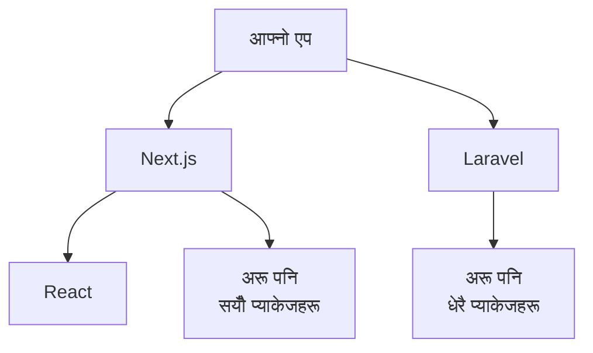
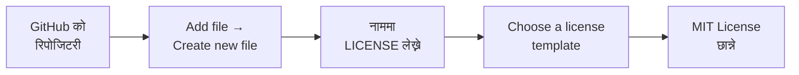

# OSS र लाइसेन्सको बारेमा

> 🇯🇵 मूल प्रति (जापानी भाषामा): [OSSとライセンスについて.md](<../../../2年生_システム開発実践/後期/2026_12_18/OSSとライセンスについて.md>) <!-- original-ja-link -->

स्वतन्त्र प्रोजेक्टमा प्रयोग गरिरहेका Laravel, Next.js, React, Tailwind CSS सबै **निःशुल्क** प्रयोग गर्न सकिन्छ।
किनभने यी सबै **OSS (ओपन सोर्स सफ्टवेयर)** हुन्।
यहाँ हामी OSS र त्यसलाई प्रयोग गर्दा पालना गर्नुपर्ने **लाइसेन्स** बारे हेर्नेछौँ।

[स्वतन्त्र प्रोजेक्टमा फर्कनुहोस्](../2026_10_09/2026_10_09_資料1.md)

---

## 1. OSS भनेको के हो?

**OSS (Open Source Software / ओपन सोर्स सफ्टवेयर)** भनेको **सोर्स कोड (प्रोग्रामको भित्री कोड) सार्वजनिक गरिएको** र
तोकिएका नियम पालना गरेमा **जो कोहीले पनि स्वतन्त्र रूपमा प्रयोग गर्न, परिमार्जन गर्न र बाँड्न सक्ने** सफ्टवेयर हो।

| | OSS | OSS नभएको सफ्टवेयर |
|---|---|---|
| सोर्स कोड | **सार्वजनिक गरिएको हुन्छ** | सार्वजनिक गरिएको हुँदैन (कम्पनीभित्र मात्र) |
| परिमार्जन | नियम पालना गरे गर्न सकिन्छ | गर्न सकिँदैन |
| उदाहरण | Laravel, Next.js, React, MySQL, Linux, VS Code को आधार बनेको कोड | Windows, Microsoft Office, Photoshop |

> 💡 **उदाहरणका लागि "रेसिपी सार्वजनिक गर्नु"**
> खानाको रेसिपी इन्टरनेटमा राखेर, "स्वतन्त्र रूपमा बनाउनुहोस्। आफ्नै तरिकाले फेरबदल गरे पनि हुन्छ। तर **मूल रेसिपी बनाउनेको नाम लेख्नुहोस्**" भन्नु——
> यही OSS को सोच हो। यो "तर 〇〇" भन्ने भाग नै **लाइसेन्स** हो।

---

## 2. हाम्रो वरिपरिका OSS

स्वतन्त्र प्रोजेक्टको एप पनि वास्तवमा **धेरै OSS मिलेर बनेको** हुन्छ।

`npm install` वा `composer install` ले इन्स्टल गर्ने कुराहरू (`node_modules` र `vendor` भित्रका सामग्री) प्रायः सबै OSS हुन्।
संसारभरका मानिसले बनाएका OSS का कारण, **सबै कुरा शून्यबाट नबनाईकनै** हामी एप बनाउन सकिरहेका छौँ।

---

## 3. लाइसेन्स भनेको के हो?

**लाइसेन्स** भनेको "यो सफ्टवेयर **कसरी प्रयोग गर्न पाइन्छ**" भनेर तय गरिएको **नियम** हो।
OSS स्वतन्त्र रूपमा प्रयोग गर्न सकिन्छ, तर **जे गरे पनि हुन्छ भन्ने होइन**। लाइसेन्समा लेखिएका नियम पालना गर्नुपर्छ।

### प्रायः देखिने लाइसेन्सहरू

| लाइसेन्स | खुलापन | नियम (छोटकरीमा) | प्रयोग गर्ने उदाहरण |
|----------|------|-----------------|-----------|
| **MIT** | धेरै खुला | **कपिराइट र लाइसेन्सको पाठ राखे**, जुनसुकै काममा प्रयोग गरे पनि हुन्छ (पैसा लिने एपमा पनि हुन्छ) | Laravel, Next.js, React, Tailwind CSS |
| **Apache 2.0** | खुला | लगभग MIT जस्तै। **परिवर्तन गरेको कुरा लेख्नुपर्ने** जस्ता नियम अलि बढी छन् | TypeScript, Kubernetes |
| **GPL** | अलि कडा | GPL को कोड प्रयोग गरेर बनाएको सफ्टवेयर **वितरण गर्ने** हो भने, **आफ्नो कोड पनि GPL अन्तर्गत सार्वजनिक** गर्नुपर्छ | Linux, WordPress |

> 📝 **GPL जस्ता लाइसेन्सलाई "कपिलेफ्ट (copyleft)" भनिन्छ**
> "स्वतन्त्र रूपमा प्रयोग गर्न पाइन्छ, तर त्यसको प्रयोग गरेर बनाएको कुरालाई पनि **त्यसैगरी स्वतन्त्र** राख्नुहोस्" भन्ने सोच हो।
> कम्पनीमा एप बनाउँदा, प्रयोग गरिएका OSS को लाइसेन्स **अनिवार्य रूपमा जाँचिन्छ**।

---

## 4. आफ्नो एपमा लाइसेन्स राख्ने

GitHub मा सार्वजनिक गरेको आफ्नो रिपोजिटरीमा पनि लाइसेन्स राख्न सकिन्छ।

> ⚠️ **लाइसेन्स नराखे, अरूले स्वतन्त्र रूपमा प्रयोग गर्न पाउँदैनन्**
> सार्वजनिक रिपोजिटरी भए पनि लाइसेन्स छैन भने, **अरूलाई कोड प्रयोग गर्ने वा परिमार्जन गर्ने अनुमति दिइएको छैन** भन्ने बुझिन्छ।
> अरूले "स्वतन्त्र रूपमा प्रयोग गरून्" भन्ने चाहनुहुन्छ भने MIT लाइसेन्स राख्ने र "हेरून् मात्र (प्रयोग नगरून्)" भन्ने चाहनुहुन्छ भने लाइसेन्स नराख्ने भनेर सोचौँ।

---

## 5. कोडबाहेक अरू कुरामा पनि "अधिकार" हुन्छ

एपमा राख्ने **इमेज, चित्र, आइकन, फन्ट, संगीत** मा पनि बनाउने व्यक्तिको **कपिराइट (प्रतिलिपि अधिकार)** हुन्छ।

| ✕ गर्न नहुने | ◯ यसो गर्ने |
|----------------|----------|
| इन्टरनेटमा खोजेर भेटिएको इमेज जस्ताको तस्तै प्रयोग गर्ने | **निःशुल्क सामग्री** (प्रयोगका सर्तहरू जाँचेर), वा आफैँले बनाएको इमेज वा खिचेको फोटो प्रयोग गर्ने |
| एनिमे वा गेमका क्यारेक्टरका इमेज एपमा राखेर सार्वजनिक गर्ने | सार्वजनिक गर्ने एपमा प्रयोग नगर्ने। प्रयोग गर्ने भए **आधिकारिक दिशानिर्देश (guideline)** जाँच्ने |
| निःशुल्क सामग्रीका प्रयोगका सर्तहरू नपढी प्रयोग गर्ने | "क्रेडिट (बनाउनेको नाम) देखाउनुपर्छ" जस्ता नियम पालना गर्ने |

> 💡 **आइकन र फन्टका लागि OSS का सामग्री उपयोगी हुन्छन्**
> आइकनका लागि **Heroicons, Lucide**, फन्टका लागि **Google Fonts** जस्ता निःशुल्क रूपमा सार्वजनिक गरिएका सामग्री छन्।
> लाइसेन्स जाँचेर प्रयोग गरौँ।

> ⚠️ **पोर्टफोलियोमा विशेष ध्यान दिनुहोस्**
> पोर्टफोलियो **कम्पनीका मानिसलाई देखाउने कुरा** हो। त्यसमा अधिकारको उल्लङ्घन गरेर प्रयोग गरिएको इमेज छ भने, त्यति मात्रैले पनि **छाप निकै नराम्रो** पर्छ।

---

## 6. OSS लाई "गुन फर्काउने"

OSS लाई संसारभरका मानिसहरूले **स्वयंसेवाको रूपमा वा आफ्नो कामको रूपमा** बनाइरहेका छन्। प्रयोग मात्र नगरी, गुन फर्काउने तरिकाहरू पनि छन्।

| गुन फर्काउने तरिका | विवरण |
|-----------|------|
| ⭐ **स्टार** | GitHub मा, आफूले प्रयोग गरिरहेको OSS को रिपोजिटरीमा स्टार दिने (सबैभन्दा सजिलो) |
| 🐛 **Issue** | बग भेटे, Issue मार्फत रिपोर्ट गर्ने |
| 📝 **डकुमेन्टेसन सुधार** | व्याख्याका गल्ती वा टाइपिङ गल्तीलाई पुल रिक्वेस्टमार्फत सुधार्ने |
| 🔧 **कोड सुधार** | बग सुधार्ने पुल रिक्वेस्ट पठाउने |

OSS मा पुल रिक्वेस्ट पठाएर त्यो मर्ज भएको अनुभव जागिर खोज्दा पनि **आफ्नो क्षमता देखाउने बलियो आधार** बन्छ।

---

## 7. सारांश

- **OSS** = सोर्स कोड सार्वजनिक गरिएको, नियम पालना गरे **जो कोहीले प्रयोग र परिमार्जन गर्न सक्ने** सफ्टवेयर
- Laravel, Next.js, React पनि OSS हुन्। आफ्नो एप **धेरै OSS मिलेर बनेको** हुन्छ
- **लाइसेन्स** = कसरी प्रयोग गर्न पाइन्छ भन्ने नियम। **MIT** (धेरै खुला), **GPL** (आफ्नो कोड पनि सार्वजनिक गर्नुपर्ने हुन सक्छ) आदि
- आफ्नो रिपोजिटरीमा पनि **LICENSE** फाइलमार्फत लाइसेन्स राख्न सकिन्छ
- इमेज, आइकन, फन्ट, संगीतमा पनि **कपिराइट** हुन्छ। पोर्टफोलियोमा विशेष ध्यान दिनुहोस्
- प्रयोग मात्र नगरी, **स्टार, Issue, पुल रिक्वेस्ट** मार्फत गुन फर्काउन सकिन्छ

[स्वतन्त्र प्रोजेक्टमा फर्कनुहोस्](../2026_10_09/2026_10_09_資料1.md)
