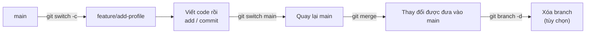
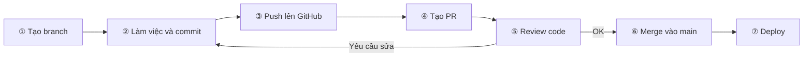
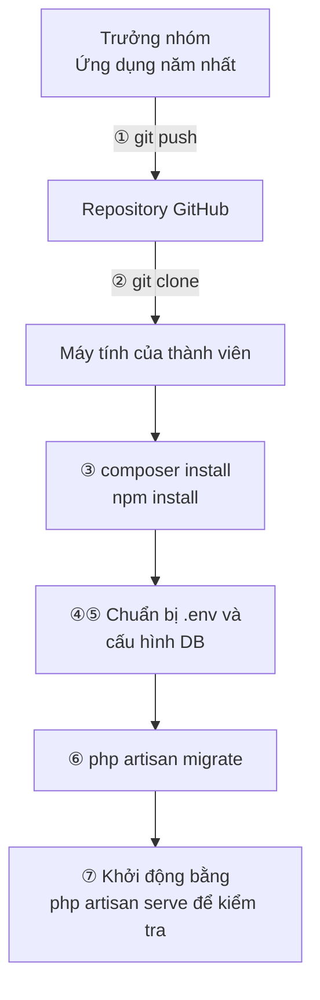

# Chuẩn bị cho phát triển nhóm với Git

> 🇯🇵 Bản gốc (tiếng Nhật): [2026_04_30.md](<../../../2年生_システム開発実践/前期/2026_04_30/2026_04_30.md>) <!-- original-ja-link -->

---

## Ôn tập Git + branch / merge

### Mục tiêu hôm nay
- Ôn lại commit/push đã học ở năm nhất
- Hiểu khái niệm branch và sử dụng được
- Biết cách merge

---

### Branch là gì

**Branch = "nhánh rẽ" của công việc. Có thể phát triển chức năng mới mà không làm hỏng code chính**

```
main (branch production)
  │
  ├── feature/login    ← Đang phát triển chức năng đăng nhập
  ├── feature/search   ← Đang phát triển chức năng tìm kiếm
  └── bugfix/404-error ← Đang sửa lỗi
```

```bash
# Kiểm tra branch hiện tại
git branch
# → * main (* là branch hiện tại)

# Tạo branch mới và chuyển sang đó
git checkout -b feature/add-profile
# hoặc (Git 2.23 trở lên)
git switch -c feature/add-profile

# Hiển thị danh sách branch
git branch -a   # -a để hiển thị cả branch remote

# Quay lại main
git switch main

# Xóa branch
git branch -d feature/add-profile
```

---

### merge — Gộp các branch

merge là việc đưa những thay đổi đã làm trên branch làm việc vào main ở bước cuối cùng.



```bash
# ① Làm việc trên branch feature/add-profile rồi commit
git switch feature/add-profile
# ... viết code ...
git add .
git commit -m "プロフィール画面を追加"

# ② Quay lại branch main
git switch main

# ③ Đưa thay đổi của feature/add-profile vào main
git merge feature/add-profile

# ④ Sau khi merge thì xóa branch (tùy chọn)
git branch -d feature/add-profile
```

---

### Giải quyết conflict (xung đột)

```bash
# Khi 2 người cùng sửa một dòng, lúc merge sẽ xảy ra conflict
# Khi mở file bị conflict ra...

<<<<<<< HEAD
  echo "Aさんが書いたコード";
=======
  echo "Bさんが書いたコード";
>>>>>>> feature/b-work

# ↑ Sửa phần này bằng tay thành code đúng
# Sửa xong thì:
git add .
git commit -m "コンフリクトを解消"
```

---

## Tiết 02: GitHub Flow — PR và code review

### GitHub Flow là gì

Đây là bộ quy ước (quy tắc) để phát triển theo nhóm.

```
① Tạo branch làm việc từ main
      git switch -c feature/xxxx

② Làm việc và commit trên branch
      git add .
      git commit -m "nội dung commit"

③ Push lên GitHub
      git push origin feature/xxxx

④ Tạo Pull Request (PR)
      → Gửi yêu cầu trên GitHub: "Tôi muốn đưa code này vào main"

⑤ Thành viên trong nhóm review code
      → Viết bình luận, yêu cầu sửa, v.v.

⑥ Nếu không có vấn đề gì thì merge vào main
⑦ Deploy (đưa lên môi trường chính thức)
```

Vẽ thành sơ đồ thì sẽ có luồng như sau. Nếu được yêu cầu sửa khi review, hãy quay lại bước ② để sửa rồi push lại.



### Cách viết Pull Request

```markdown
## Nội dung thay đổi
- Thêm màn hình hồ sơ
- Hiển thị được tên và ảnh đại diện của người dùng

## Những điểm cần kiểm tra
- Khi truy cập `/profile` có hiển thị đúng không
- Khi chưa đăng nhập có bị chuyển hướng đến `/login` không

## Ảnh chụp màn hình
(Đính kèm ảnh)
```

### Những điểm cần chú ý khi review code

- Có bug hay lỗi logic không
- Có vấn đề bảo mật không (XSS, SQL Injection, v.v.)
- Code có dễ đọc không
- Đã viết test chưa (ở năm hai thì không bắt buộc)

---

## Tiết 03: Chạy ứng dụng năm nhất theo nhóm

### Các bước

Đây là quy trình để tất cả thành viên chạy ứng dụng mà trưởng nhóm đã đưa lên GitHub trên máy tính của mình.



```bash
# ① Trưởng nhóm push ứng dụng năm nhất lên GitHub
git init
git remote add origin https://github.com/tên-nhóm/app.git
git add .
git commit -m "initial commit"
git push -u origin main

# ② Các thành viên trong nhóm clone về
git clone https://github.com/tên-nhóm/app.git
cd app

# ③ Cài đặt các thư viện phụ thuộc
composer install
npm install

# ④ Cấu hình môi trường
cp .env.example .env
php artisan key:generate

# ⑤ Cấu hình DB (chỉnh sửa .env)
# DB_DATABASE=app_db
# DB_USERNAME=root
# DB_PASSWORD=

# ⑥ Migration
php artisan migrate

# ⑦ Khởi động để kiểm tra
php artisan serve
```

---

## Tổng kết

| Lệnh | Ý nghĩa |
|---------|------|
| `git switch -c tên-branch` | Tạo branch và chuyển sang đó |
| `git switch main` | Quay lại main |
| `git merge tên-branch` | Gộp branch vào branch hiện tại |
| `git push origin tên-branch` | Push branch lên remote |
| Pull Request (PR) | Gửi yêu cầu merge code trên GitHub |
| Code review | Bình luận, góp ý cho PR |
