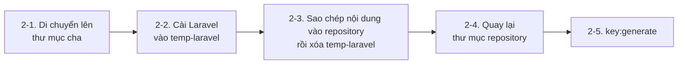
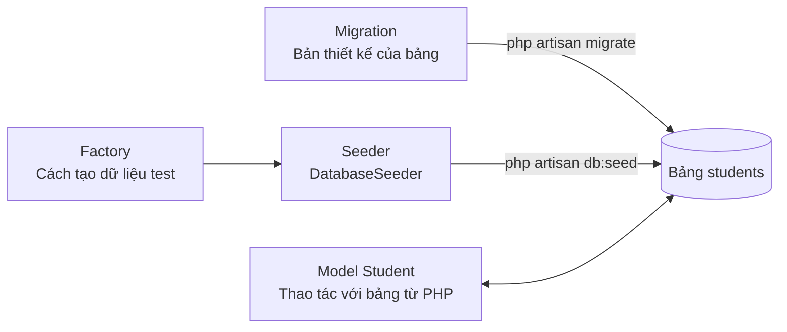

> 🇯🇵 Bản gốc (tiếng Nhật): [20260506.md](<../../../2年生_システム開発実践/前期/2026_05_06/20260506.md>) <!-- original-ja-link -->

## Khởi tạo project Laravel

> **Mục đích:** Tạo từ đầu project Laravel dùng trong môn học này để sẵn sàng bắt đầu phát triển API.

---

### Mở đầu: Kiểm tra xem đã cài đủ những thứ cần thiết chưa

Trước khi bắt đầu, ta kiểm tra xem các phần mềm cần thiết đã được cài đặt chưa.  
Hãy mở Terminal và chạy **từng dòng một** các lệnh dưới đây.

---

#### Kiểm tra PHP

```bash
php --version
```

**Trường hợp OK:**
```
PHP 8.2.x (cli) ...  ← Hiển thị phiên bản là OK
```

**Trường hợp NG (hiển thị `command not found` hoặc `'php' は認識されていません` (không được nhận diện)):**

Máy chưa cài PHP. Nếu cài XAMPP thì có thể dùng cả PHP lẫn MySQL cùng lúc.

**Với Windows:**
1. Truy cập `https://www.apachefriends.org/`
2. Tải "XAMPP for Windows" về và cài đặt
3. Sau khi cài xong, thêm `C:\xampp\php` vào **biến môi trường PATH**  
   (Tìm "環境変数" (biến môi trường) trong menu Start → "システム環境変数の編集" (Chỉnh sửa biến môi trường hệ thống) → "環境変数" (Biến môi trường) → chọn "Path" rồi bấm "編集" (Chỉnh sửa) → bấm "新規" (Mới) để thêm `C:\xampp\php`)
4. **Đóng Terminal rồi mở lại**, sau đó chạy lại `php --version`

**Với Mac:**
1. Chạy lệnh sau trong Terminal (nếu đã có Homebrew)
   ```bash
   brew install php
   ```
2. Nếu chưa cài Homebrew thì trước tiên hãy chạy lệnh sau
   ```bash
   /bin/bash -c "$(curl -fsSL https://raw.githubusercontent.com/Homebrew/install/HEAD/install.sh)"
   ```

---

#### Kiểm tra Composer

```bash
composer --version
```

**Trường hợp OK:**
```
Composer version 2.x.x ...  ← Hiển thị phiên bản là OK
```

**Trường hợp NG (hiển thị `command not found` hoặc `'composer' は認識されていません` (không được nhận diện)):**

Máy chưa cài Composer. Hãy cài đặt theo các bước sau.

**Với Windows:**
1. Truy cập `https://getcomposer.org/download/`
2. Tải "Composer-Setup.exe" về và chạy
3. Trong lúc cài, nếu được hỏi vị trí của PHP thì chỉ định `C:\xampp\php\php.exe`
4. Sau khi cài xong, **đóng Terminal rồi mở lại**, sau đó chạy `composer --version`

**Với Mac:**
```bash
brew install composer
```

---

#### Kiểm tra MySQL

```bash
mysql --version
```

**Trường hợp OK:**
```
mysql  Ver 8.0.x ...  ← Hiển thị phiên bản là OK
```

Nếu đã hiển thị phiên bản, tiếp theo ta kiểm tra xem **server** MySQL đã được khởi động chưa.

> **Lưu ý (Mac):** Dù `mysql --version` có hiển thị, vẫn có trường hợp server chưa được cài.  
> `mysql-client` (chỉ là công cụ kết nối) và `mysql` (bản thân server) là hai thứ khác nhau.  
> Hãy nhớ kiểm tra theo các bước dưới đây xem server có đang chạy không.

**Với Mac:**
```bash
brew services list | grep mysql
```

| Hiển thị | Ý nghĩa |
|------|------|
| `mysql  started` | Server đang chạy. Có thể chuyển sang bước tiếp theo |
| `mysql  stopped` | Server đang dừng. Xem các bước "Khởi động" bên dưới |
| Không có dòng mysql | Server chưa được cài. Xem các bước "Cài đặt" bên dưới |

**Với Windows (XAMPP):**  
Mở XAMPP Control Panel và bấm nút "Start" bên cạnh MySQL.  
Nếu hiển thị "Running" là đã khởi động.

**Khi server MySQL đang stopped (khởi động):**

```bash
# Với Mac
brew services start mysql
```

Với XAMPP thì bấm nút "Start" trên Control Panel.

**Khi server MySQL chưa được cài (Mac):**

```bash
brew install mysql
brew services start mysql
```

> **Về mật khẩu khi kết nối**  
> Khi chạy `mysql -u root -p` sẽ được hỏi mật khẩu.  
> Nếu mới cài bằng Homebrew thì **không có mật khẩu**, cứ thế bấm Enter.  
> Với XAMPP, thiết lập ban đầu cũng là **không có mật khẩu**.  
> Nếu em nhớ là đã tự đặt mật khẩu thì hãy nhập mật khẩu đó.

---

**Trường hợp NG (hiển thị `command not found` hoặc `'mysql' は認識されていません` (không được nhận diện)):**

Máy chưa cài MySQL.

**Windows (khi dùng XAMPP):**
1. Nếu đã cài XAMPP, thêm `C:\xampp\mysql\bin` vào biến môi trường PATH  
   (Làm giống các bước thêm PHP, lần này thêm `C:\xampp\mysql\bin`)
2. **Đóng Terminal rồi mở lại**, sau đó chạy `mysql --version`

**Với Mac:**
```bash
brew install mysql
brew services start mysql
```

---

> **Nếu vẫn chưa giải quyết được, hãy gọi thầy/cô.**  
> Nếu phiên bản quá cũ (như PHP 7.x) thì cũng hãy hỏi thầy/cô nhé.  
> Phiên bản khuyến nghị là **PHP 8.1 trở lên, Composer 2.x, MySQL 8.x**.

---

### Step 1｜Di chuyển vào bên trong repository đã clone

Chắc hẳn các em đã có repository clone từ GitHub.  
Hãy mở Terminal và di chuyển vào bên trong thư mục đó.

**Với Windows (PowerShell hoặc Command Prompt):**
```bash
cd C:\Users\（tên-người-dùng-của-em）\Documents\（tên-repository）
```

**Với Mac:**
```bash
cd ~/Documents/（tên-repository）
```

Kiểm tra xem đã di chuyển được chưa:
```bash
pwd
```
```
/Users/（tên-người-dùng-của-em）/Documents/（tên-repository）  ← Đang ở trong repository là OK
```

Cũng hãy kiểm tra xem thư mục có được nhận diện là Git repository không:
```bash
git status
```
```
On branch main
nothing to commit, working tree clean  ← Hiển thị như thế này là OK
```

> **Khi `git status` báo lỗi** (như `not a git repository`)  
> Em chưa di chuyển vào bên trong repository. Hãy kiểm tra lại tên thư mục và `cd` lại một lần nữa.

---

### Step 2｜Cài đặt Laravel

Trong thư mục đã clone có thư mục `.git` được `git clone` tự động tạo ra.  
`composer create-project laravel/laravel .` chỉ chạy được khi thư mục hoàn toàn trống, nên sẽ bị lỗi.

```
Project directory "..." is not empty.  ← Sẽ gặp lỗi này
```

> **`.git` là thư mục ẩn nên không nhìn thấy được trong Finder hay Explorer.**  
> Có thể kiểm tra bằng cách chạy `ls -a` trong Terminal.

Vì vậy, ta sẽ làm theo cách **tạo tạm ở một thư mục khác rồi chuyển nội dung sang**.



#### 2-1. Di chuyển lên thư mục cha

```bash
cd ..
```

Kiểm tra:
```bash
pwd
```
```
/Users/（tên-người-dùng-của-em）/Documents  ← Đang ở thư mục cha của repository là OK
```

#### 2-2. Cài Laravel vào thư mục tạm

```bash
composer create-project laravel/laravel temp-laravel
```

> Lệnh này mất khoảng **2–5 phút**. Màn hình sẽ chạy rất nhiều chữ, hãy kiên nhẫn chờ.  
> Cuối cùng hiển thị `Application ready!` là thành công.

#### 2-3. Chuyển nội dung thư mục tạm sang thư mục repository

**Với Mac:**
```bash
cp -r temp-laravel/. （tên-repository）/
rm -rf temp-laravel
```

**Với Windows (PowerShell):**
```powershell
Copy-Item -Path temp-laravel\* -Destination （tên-repository）\ -Recurse -Force
Copy-Item -Path temp-laravel\.* -Destination （tên-repository）\ -Recurse -Force -ErrorAction SilentlyContinue
Remove-Item -Recurse -Force temp-laravel
```

> Hãy thay phần **（tên-repository）** bằng tên thư mục repository của em.

#### 2-4. Quay lại thư mục repository

```bash
cd （tên-repository）
```

Kiểm tra xem đã di chuyển đúng chưa:
```bash
pwd
```
```
/Users/（tên-người-dùng-của-em）/Documents/（tên-repository）  ← Đang ở trong repository là OK
```

Nếu các thư mục như `app/` hay `routes/` đã được tạo ra là thành công:
```bash
ls
```
```
README.md  app  artisan  bootstrap  composer.json  config  database  ...
```

#### 2-5. Tạo application key

Laravel cần **application key** (khóa bí mật) cho session và mã hóa.  
Nhất định phải chạy lệnh này.

```bash
php artisan key:generate
```

```
   INFO  Application key set successfully.
```

> Khi chạy lệnh này, giá trị sẽ được tự động điền vào `APP_KEY=` trong file `.env`.  
> Nếu quên, màn hình lỗi `MissingAppKeyException` sẽ hiện ra.

**Khi gặp lỗi: `No APP_KEY variable was found in the .env file`**

File `.env` không có dòng `APP_KEY=`.  
Hãy mở `.env` bằng VSCode và thêm 1 dòng sau vào cuối file.

```dotenv
APP_KEY=
```

Lưu lại rồi chạy lại một lần nữa:

```bash
php artisan key:generate
```

Nếu sau `APP_KEY=` tự động có một chuỗi dài là thành công.

**Cấu trúc thư mục tại thời điểm này (chỉ những phần chính):**

```
（tên-repository）/          ← Thư mục đã clone (= Git repository)
├── app/
│   ├── Http/
│   │   └── Controllers/   ← Nơi đặt controller
│   └── Models/            ← Nơi đặt model
├── database/
│   ├── migrations/        ← Nơi đặt định nghĩa bảng
│   ├── factories/         ← Thiết lập tạo dữ liệu test
│   └── seeders/           ← Thiết lập nạp dữ liệu test
├── routes/
│   ├── api.php            ← Định tuyến cho API (chủ yếu dùng trong bài này)
│   └── web.php            ← Routing cho Blade (đã dùng ở năm nhất)
└── .env                   ← File cấu hình chứa thông tin kết nối DB, v.v.
```

---

### Step 3｜Chuẩn bị database

#### phpMyAdmin là gì?

**phpMyAdmin** là công cụ quản lý giúp thao tác với database MySQL ngay trên trình duyệt.  
Không cần gõ lệnh, chỉ cần thao tác trên màn hình là có thể tạo, kiểm tra, xóa database.

| Môi trường             | Cách mở phpMyAdmin                                                        |
| -------------- | ---------------------------------------------------------------------- |
| Windows (XAMPP) | Bấm nút "Admin" trên XAMPP Control Panel → `http://localhost/phpmyadmin` sẽ mở ra trên trình duyệt |
| Mac (XAMPP)     | Bấm nút "Admin" trên XAMPP Control Panel → `http://localhost/phpmyadmin` sẽ mở ra trên trình duyệt |
| Mac (Homebrew)  | Cần cài phpMyAdmin riêng (dùng cách làm trên Terminal ở phần sau sẽ đơn giản hơn)                             |

---

#### 3-1. Tạo database

**Với Windows (XAMPP + phpMyAdmin):**

1. Trên XAMPP Control Panel, bấm "Start" cho MySQL
2. Mở `http://localhost/phpmyadmin` trên trình duyệt
3. Bấm "**新規作成**" (Tạo mới) ở menu bên trái
4. Nhập các thông tin sau rồi bấm nút "**作成**" (Tạo)

   - **Tên database:** `school_api`
   - **Collation:** `utf8mb4_unicode_ci`

**Với Mac (Homebrew):**

Ta sẽ làm theo cách tạo từ Terminal, không cần thiết lập phpMyAdmin.  
Hãy chắc chắn MySQL đang chạy rồi mới thực hiện.

```bash
mysql -u root
```
```sql
CREATE DATABASE school_api CHARACTER SET utf8mb4 COLLATE utf8mb4_unicode_ci;
EXIT;
```

> Nếu đã đặt mật khẩu, hãy gõ `mysql -u root -p` rồi nhập mật khẩu.

#### 3-2. Cấu hình file `.env`

Mở project bằng VSCode, rồi mở file `.env` nằm ngay ở thư mục gốc.

```
（tên-repository）/
└── .env   ← Mở file này
```

> **⚠️ Lưu ý: Không được xóa hết nội dung file rồi viết lại.**  
> Trong `.env` đã có sẵn nhiều thiết lập như `APP_KEY`.  
> **Chỉ tìm 5 dòng liên quan đến DB và sửa giá trị. Đừng động vào các dòng khác.**

Kéo xuống trong file sẽ thấy các dòng như dưới đây.  
Chỉ sửa phần bên phải dấu `=` của 5 dòng này:

```dotenv
DB_CONNECTION=mysql
DB_HOST=127.0.0.1
DB_PORT=3306
DB_DATABASE=school_api    ← Đổi thành tên DB vừa tạo
DB_USERNAME=root           ← Tên người dùng MySQL (thường là root)
DB_PASSWORD=               ← Nếu chưa đặt mật khẩu thì để trống
```

Sửa xong thì lưu bằng **Ctrl+S** (Mac là **Cmd+S**).

> **`.env` là file cấu hình có ghi mật khẩu.**  
> File này được thiết lập để không tự động đưa vào Git, và các em đừng cho người khác xem nhé.

---

### Step 4｜Tạo model, migration và factory

Trong môn học này, ta sẽ tạo API quản lý **học sinh (Student)**.  
Chỉ với 1 lệnh dưới đây là có thể tạo hàng loạt các file cần thiết.

```bash
php artisan make:model Student -mf
```

| Tùy chọn | Ý nghĩa                  | File được tạo ra                                             |
| ----- | ------------------- | ---------------------------------------------------- |
| (không có)  | Tạo model              | `app/Models/Student.php`                             |
| `-m`  | Tạo thêm migration (định nghĩa bảng) | `database/migrations/xxxx_create_students_table.php` |
| `-f`  | Tạo thêm factory (tạo dữ liệu test)  | `database/factories/StudentFactory.php`              |

3 file được tạo ra và seeder sẽ dùng ở phần sau liên kết với nhau như sau.



Sau khi chạy, nếu hiển thị như dưới đây là thành công:

```
   INFO  Model [app/Models/Student.php] created successfully.
   INFO  Factory [database/factories/StudentFactory.php] created successfully.
   INFO  Migration [database/migrations/2024_xx_xx_create_students_table.php] created successfully.
```

---

### Step 5｜Chỉnh sửa model (thiết lập `$fillable`)

Mở file `app/Models/Student.php` vừa được tạo bằng VSCode.

```
school-api/
└── app/
    └── Models/
        └── Student.php   ← Mở file này
```

Khi mở file sẽ thấy nội dung như dưới đây. Hãy thêm `$fillable`:

```php
<?php
namespace App\Models;

use Illuminate\Database\Eloquent\Factories\HasFactory;
use Illuminate\Database\Eloquent\Model;

class Student extends Model
{
    use HasFactory;

    // ↓ Thêm 1 dòng này
    protected $fillable = ['name', 'email', 'score'];
}
```

> **`$fillable` là gì?**  
> Đây là một chức năng bảo mật của Laravel. Chỉ những tên cột được ghi vào đây mới có thể thay đổi bằng `create()` hay `update()`.  
> Nếu không thiết lập, sau này khi lưu dữ liệu từ API sẽ bị lỗi.

---

### Step 6｜Chỉnh sửa file migration

Mở thư mục `database/migrations/` bằng VSCode sẽ thấy các file bắt đầu bằng ngày tháng.

```
school-api/
└── database/
    └── migrations/
        ├── 0001_01_01_000000_create_users_table.php    ← Laravel chuẩn bị sẵn từ đầu
        ├── 0001_01_01_000001_create_cache_table.php    ← Laravel chuẩn bị sẵn từ đầu
        ├── 0001_01_01_000002_create_jobs_table.php     ← Laravel chuẩn bị sẵn từ đầu
        └── 2024_xx_xx_xxxxxx_create_students_table.php ← ← File được tạo ở Step 4 (sửa file này)
```

**Mở file `create_students_table.php` ở dưới cùng**, rồi sửa nội dung bên trong phương thức `up()`:

```php
public function up(): void
{
    Schema::create('students', function (Blueprint $table) {
        $table->id();                              // ID (tự động đánh số tăng dần)
        $table->string('name', 100);              // Họ tên
        $table->string('email')->unique();         // Địa chỉ email (không được trùng)
        $table->integer('score')->default(0);     // Điểm (giá trị mặc định là 0)
        $table->timestamps();                      // Thời gian tạo và thời gian cập nhật (tự động)
    });
}
```

---

### Step 7｜Chạy migration để tạo bảng

```bash
php artisan migrate
```

Nếu thành công sẽ hiển thị như sau:

```
   INFO  Running migrations.

  0001_01_01_000000_create_users_table ................... 21ms DONE
  0001_01_01_000001_create_cache_table ................... 10ms DONE
  0001_01_01_000002_create_jobs_table .................... 10ms DONE
  2024_xx_xx_xxxxxx_create_students_table ............... 15ms DONE
```

Kiểm tra xem bảng đã được tạo chưa.

**Với Windows (phpMyAdmin):**  
Mở `http://localhost/phpmyadmin` trên trình duyệt, bấm vào `school_api` ở bên trái, em sẽ thấy bảng `students` được hiển thị.

**Với Mac (Terminal):**
```bash
mysql -u root -e "SHOW TABLES IN school_api;"
```
```
+----------------------+
| Tables_in_school_api |
+----------------------+
| cache                |
| jobs                 |
| migrations           |
| students             |  ← Hiển thị dòng này là OK
| users                |
+----------------------+
```

#### Các lỗi thường gặp và cách xử lý

**Lỗi 1: Không kết nối được DB**
```
SQLSTATE[HY000] [2002] Connection refused
```
→ MySQL chưa được khởi động.  
→ **Windows:** Hãy bấm "Start" cho MySQL trên XAMPP Control Panel.  
→ **Mac:** Hãy chạy `brew services start mysql`.

**Lỗi 2: Không tìm thấy database**
```
SQLSTATE[HY000] [1049] Unknown database 'school_api'
```
→ Có thể em chưa tạo database ở Step 3, hoặc tên database trong `.env` bị sai.  
→ **Windows:** Hãy kiểm tra tên database trên phpMyAdmin.  
→ **Mac:** Hãy kiểm tra danh sách database bằng `mysql -u root -e "SHOW DATABASES;"`.

**Lỗi 3: Sai mật khẩu**
```
SQLSTATE[HY000] [1045] Access denied for user 'root'@'localhost'
```
→ `DB_PASSWORD` trong `.env` bị sai. Hãy kiểm tra mật khẩu MySQL và sửa lại.

---

### Step 8｜Nạp dữ liệu test

Ta chuẩn bị dữ liệu test để kiểm tra hoạt động của API.

#### 8-1. Chỉnh sửa factory

Mở file `database/factories/StudentFactory.php`.

```
school-api/
└── database/
    └── factories/
        └── StudentFactory.php   ← Mở file này
```

Sửa nội dung bên trong phương thức `definition()`:

```php
public function definition(): array
{
    return [
        'name'  => $this->faker->name(),                      // Tên ngẫu nhiên
        'email' => $this->faker->unique()->safeEmail(),        // Email ngẫu nhiên
        'score' => $this->faker->numberBetween(0, 100),        // Điểm ngẫu nhiên từ 0 đến 100
    ];
}
```

#### 8-2. Chỉnh sửa seeder

Mở `database/seeders/DatabaseSeeder.php` và thêm 1 dòng vào phương thức `run()`:

```php
public function run(): void
{
    \App\Models\Student::factory(10)->create(); // Tạo 10 bản ghi dữ liệu học sinh
}
```

#### 8-3. Nạp dữ liệu test

```bash
php artisan db:seed
```

```
   INFO  Seeding database.
```

Kiểm tra xem dữ liệu đã được nạp vào chưa.

**Với Windows (phpMyAdmin):**  
Mở `http://localhost/phpmyadmin`, bấm vào `school_api` → `students` sẽ thấy 10 bản ghi được hiển thị.

**Với Mac (Terminal):**
```bash
mysql -u root -e "SELECT COUNT(*) FROM school_api.students;"
```
```
+----------+
| COUNT(*) |
+----------+
|       10 |  ← Hiển thị 10 là OK
+----------+
```

---

### Step 9｜Khởi động server phát triển

```bash
php artisan serve
```

```
   INFO  Server running on [http://127.0.0.1:8000].

  Press Ctrl+C to stop the server
```

Truy cập `http://localhost:8000` trên trình duyệt, nếu hiển thị logo "Laravel" là đã khởi động thành công.

> **Màn hình trang chủ này chỉ dùng để xác nhận server đang chạy.**  
> Dữ liệu nạp bằng seeder nằm trong database và không hiển thị trên màn hình này.  
> Từ tiết sau, ta sẽ tạo API endpoint để có thể lấy và hiển thị dữ liệu.

> **Khi muốn dừng server, hãy bấm `Ctrl + C`.**  
> Trong lúc server đang chạy, đừng đóng Terminal.

#### Khi muốn kiểm tra dữ liệu seeder đã được nạp đúng chưa

**Với Mac (kiểm tra bằng Terminal):**

```bash
mysql -u root -e "SELECT id, name, score FROM school_api.students LIMIT 5;"
```

```
+----+------------------+-------+
| id | name             | score |
+----+------------------+-------+
|  1 | Tanaka Taro      |    72 |
|  2 | Yamada Hanako    |    88 |
...
+----+------------------+-------+
```

Nếu hiển thị dữ liệu ngẫu nhiên như thế này là seeder đã thành công.

**Với Windows (kiểm tra bằng phpMyAdmin):**

Mở `http://localhost/phpmyadmin`, bấm vào `school_api` → `students` sẽ thấy danh sách 10 bản ghi.

---

### Checklist kiểm tra đến thời điểm này

| Hạng mục kiểm tra | Đánh dấu |
|---------|---------|
| Đã hiển thị phiên bản bằng `php --version` / `composer --version` | □ |
| Đã tạo được project bằng `composer create-project` | □ |
| Đã tạo application key bằng `php artisan key:generate` | □ |
| Đã tạo database `school_api` | □ |
| Đã cấu hình thông tin kết nối DB trong `.env` | □ |
| Đã thêm `$fillable` vào `app/Models/Student.php` | □ |
| Đã thêm cột vào file migration | □ |
| Đã tạo được bảng `students` bằng `php artisan migrate` | □ |
| Đã nạp được 10 bản ghi dữ liệu test bằng `php artisan db:seed` | □ |
| Đã khởi động server bằng `php artisan serve` và kiểm tra được trên trình duyệt | □ |
