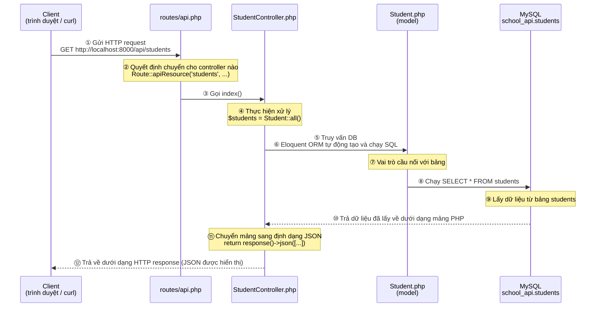
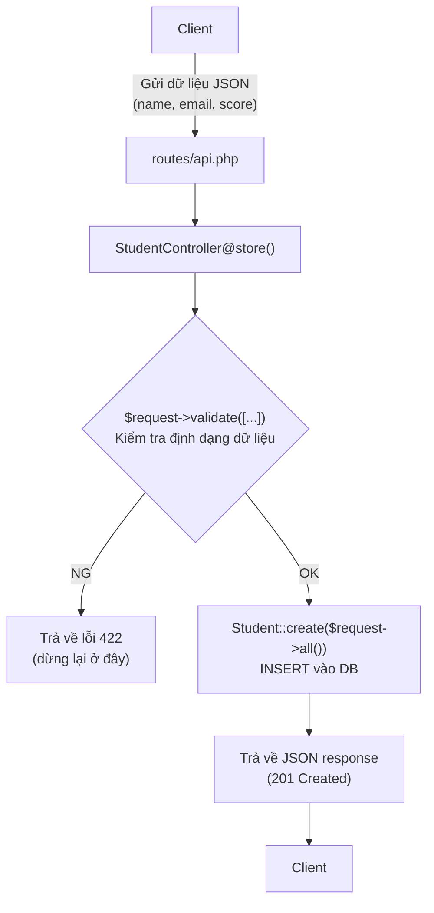

> 🇯🇵 Bản gốc (tiếng Nhật): [20260514.md](<../../../2年生_システム開発実践/前期/2026_05_14/20260514.md>) <!-- original-ja-link -->


## Chuyển ứng dụng Blade thành API

### Mục tiêu hôm nay
- Giải thích được REST API là gì
- Viết được controller trả về response JSON
- Hiểu cách định tuyến (routing) trong `api.php`

---

### REST API là gì

#### Nói ngắn gọn thì "API là gì?"

**API = "Đầu mối chỉ trả về dữ liệu"**

Ở năm 1, khi truy cập một URL bằng trình duyệt, chúng ta nhận về HTML (một trang web có cả phần giao diện).  
API cũng dùng cơ chế đó, nhưng thay vì HTML, nó **chỉ trả về dữ liệu (JSON)**.

```
【Ứng dụng Blade (đã làm ở năm 1)】
Trình duyệt → GET /students → Server → trả về trang HTML
                                      ↑ có đủ cả bảng, nút bấm, thiết kế...

【REST API (bắt đầu làm từ hôm nay)】
Trình duyệt hoặc ứng dụng khác → GET /api/students → Server → chỉ trả về dữ liệu JSON
                                                      ↑ không có giao diện, chỉ có dữ liệu
```

> **Tại sao chỉ trả về JSON?**  
> Các frontend như React hay Vue "tự xây dựng giao diện",  
> nên chúng chỉ muốn server gửi "dữ liệu" thôi.  
> Khi làm API, cùng một dữ liệu có thể dùng lại cho nhiều giao diện khác nhau như "ứng dụng chạy bằng React", "ứng dụng điện thoại"...

---

#### JSON trông như thế nào?

**JSON (đọc là "Jây-sơn")** là một định dạng văn bản để biểu diễn dữ liệu.  
Nó có cách viết cố định để trình duyệt và các ứng dụng khác dễ đọc.

```json
{
    "status": "ok",
    "data": [
        {
            "id": 1,
            "name": "田中太郎",
            "email": "tanaka@example.com",
            "score": 85
        },
        {
            "id": 2,
            "name": "山田花子",
            "email": "yamada@example.com",
            "score": 72
        }
    ]
}
```

> **Cách đọc:**  
> - Bên trong `{ }` viết theo dạng "khóa": "giá trị"  
> - `[ ]` là danh sách (gom nhiều dữ liệu lại với nhau)  
> - Chuỗi ký tự thì bọc trong `"`. Số thì không bọc  
> - Không đặt dấu phẩy `,` sau mục cuối cùng

---

#### Tư duy của REST: kết hợp URL và HTTP method

REST API quyết định việc cần làm bằng "**URL (ở đâu)** × **HTTP method (làm gì)**".  
HTTP method là từ dùng để chỉ loại của request.

| HTTP method | Ý nghĩa | Ví dụ trong thao tác hằng ngày |
|-------------|------|-------------------|
| `GET`       | Lấy dữ liệu | Xem trang, tìm kiếm |
| `POST`      | Tạo mới | Gửi form |
| `PUT/PATCH` | Cập nhật | Sửa lại nội dung |
| `DELETE`    | Xóa | Bấm nút xóa |

Danh sách API học sinh sẽ làm trong buổi học này:

| URL                  | Method      | Ý nghĩa   | Làm gì           |
| -------------------- | --------- | ---- | --------------- |
| `/api/students`      | GET       | Lấy danh sách | Trả về dữ liệu của tất cả học sinh      |
| `/api/students`      | POST      | Tạo mới | Đăng ký một học sinh mới      |
| `/api/students/{id}` | GET       | Lấy chi tiết | Trả về một học sinh được chỉ định    |
| `/api/students/{id}` | PUT/PATCH | Cập nhật   | Sửa thông tin của học sinh được chỉ định |
| `/api/students/{id}` | DELETE    | Xóa   | Xóa học sinh được chỉ định     |

> `{id}` sẽ là một con số. Ví dụ `GET /api/students/3` có nghĩa là "lấy học sinh có id là 3".

---

### Về HTTP status code

Response của API luôn kèm theo một **status code** (một con số).  
Trình duyệt hay React sẽ nhìn con số này để biết "thành công hay thất bại".

| Mã | Ý nghĩa | Khi nào dùng |
|-------|------|---------|
| `200 OK` | Thành công | Lấy, cập nhật, xóa thành công |
| `201 Created` | Tạo thành công | Khi tạo mới bằng POST |
| `404 Not Found` | Không tìm thấy | Khi id được chỉ định không tồn tại |
| `422 Unprocessable Entity` | Lỗi validation | Khi dữ liệu nhập vào không hợp lệ |
| `500 Internal Server Error` | Lỗi server | Khi chương trình có bug |

> Ví dụ, khi gọi `GET /api/students/999` mà không có học sinh nào có id=999,  
> server trả về "404" để báo rằng "không tìm thấy".

---

### Step 10｜Tạo API controller

#### 10-1. Tạo file controller

Chạy lệnh sau trong terminal (hãy mở **một tab khác** với terminal đang chạy `php artisan serve`).

```bash
php artisan make:controller Api/StudentController --api
```

**Ý nghĩa của lệnh:**
- `make:controller` → tạo file controller
- `Api/StudentController` → tạo `StudentController.php` bên trong thư mục `Api`
- `--api` → viết sẵn 5 method dành cho API (`index` `store` `show` `update` `destroy`)

Nếu sau khi chạy thấy hiển thị như sau là thành công:

```
   INFO  Controller [app/Http/Controllers/Api/StudentController.php] created successfully.
```

Kiểm tra vị trí của file vừa được tạo:

```
(tên repository)/
└── app/
    └── Http/
        └── Controllers/
            └── Api/                     ← thư mục mới được tạo
                └── StudentController.php  ← file này được tạo ra
```

---

#### 10-2. Mở file controller

Mở `app/Http/Controllers/Api/StudentController.php` bằng VSCode.  
File được tạo bằng tùy chọn `--api` ngay từ đầu sẽ có nội dung như sau:

```php
<?php

namespace App\Http\Controllers\Api;

use Illuminate\Http\Request;
use App\Http\Controllers\Controller;

class StudentController extends Controller
{
    public function index()
    {
        //
    }

    public function store(Request $request)
    {
        //
    }

    public function show(string $id)
    {
        //
    }

    public function update(Request $request, string $id)
    {
        //
    }

    public function destroy(string $id)
    {
        //
    }
}
```

> **`namespace` và `use` là gì?**  
> - `namespace` giống như "địa chỉ" của file này. Nó cho biết file đang nằm trong thư mục `Api`.  
> - `use` là "khai báo để gọi" file khác. Lát nữa chúng ta sẽ thêm nó để dùng model `Student`.

---

#### 10-3. Viết xử lý cho controller

Hãy thay **toàn bộ** nội dung file bằng đoạn code dưới đây.  
(Ctrl+A để chọn tất cả → dán vào, hoặc xóa nội dung cũ rồi viết lại)

```php
<?php

namespace App\Http\Controllers\Api;

use App\Http\Controllers\Controller;
use App\Models\Student;           // ← để có thể dùng model Student
use Illuminate\Http\Request;

class StudentController extends Controller
{
    // -------------------------------------------------------
    // GET /api/students  → trả về danh sách tất cả học sinh
    // -------------------------------------------------------
    public function index()
    {
        $students = Student::all();  // lấy toàn bộ bản ghi từ database

        return response()->json([
            'status' => 'ok',
            'data'   => $students,   // cho dữ liệu vừa lấy vào JSON rồi trả về
        ]);
    }

    // -------------------------------------------------------
    // POST /api/students  → đăng ký một học sinh mới
    // -------------------------------------------------------
    public function store(Request $request)
    {
        // Validation: kiểm tra định dạng của dữ liệu được gửi lên
        $request->validate([
            'name'  => 'required|max:100',          // bắt buộc, tối đa 100 ký tự
            'email' => 'required|email|unique:students', // bắt buộc, đúng định dạng email, không được trùng
            'score' => 'required|integer|min:0|max:100', // bắt buộc, số nguyên, từ 0 đến 100
        ]);

        $student = Student::create($request->all()); // lưu vào DB

        // trả về với status code 201 Created (tạo thành công)
        return response()->json([
            'status' => 'ok',
            'data'   => $student,
        ], 201);
    }

    // -------------------------------------------------------
    // GET /api/students/{id}  → trả về một học sinh theo id
    // -------------------------------------------------------
    public function show($id)
    {
        $student = Student::find($id); // tìm 1 bản ghi theo id

        if (!$student) {
            // nếu không tìm thấy → trả về 404 Not Found
            return response()->json([
                'status'  => 'error',
                'message' => 'Student not found',
            ], 404);
        }

        return response()->json([
            'status' => 'ok',
            'data'   => $student,
        ]);
    }

    // -------------------------------------------------------
    // PUT /api/students/{id}  → cập nhật học sinh theo id
    // -------------------------------------------------------
    public function update(Request $request, $id)
    {
        $student = Student::findOrFail($id); // nếu không tìm thấy sẽ tự động trả về 404

        $request->validate([
            'name'  => 'sometimes|max:100',          // sometimes = chỉ kiểm tra khi trường này được gửi lên
            'score' => 'sometimes|integer|min:0|max:100',
        ]);

        $student->update($request->all()); // cập nhật DB

        return response()->json([
            'status' => 'ok',
            'data'   => $student,
        ]);
    }

    // -------------------------------------------------------
    // DELETE /api/students/{id}  → xóa học sinh theo id
    // -------------------------------------------------------
    public function destroy($id)
    {
        Student::findOrFail($id)->delete(); // tìm rồi xóa

        return response()->json([
            'status'  => 'ok',
            'message' => 'Deleted',
        ]);
    }
}
```

**Sau khi sửa xong, nhấn Ctrl+S (Mac là Cmd+S) để lưu.**

---

#### Tóm tắt vai trò của từng method

| Tên method | URL tương ứng | Việc cần làm |
|-----------|------------|---------|
| `index()` | GET /api/students | Lấy toàn bộ rồi trả về dạng JSON |
| `store()` | POST /api/students | Validation → lưu DB → trả về với mã 201 |
| `show($id)` | GET /api/students/{id} | Tìm 1 bản ghi → không có thì 404 → trả về JSON |
| `update($request, $id)` | PUT /api/students/{id} | Tìm 1 bản ghi → validation → cập nhật DB |
| `destroy($id)` | DELETE /api/students/{id} | Tìm 1 bản ghi → xóa |

---

### Step 11｜Bật API routing

Chỉ tạo controller thôi thì URL và controller vẫn chưa được kết nối với nhau.  
Chúng ta sẽ thiết lập **routing**, tức là "khi truy cập URL này thì gọi method này".

#### 11-1. Tạo `routes/api.php`

> **⚠️ Từ Laravel 11 trở đi, `routes/api.php` không có sẵn từ đầu.**  
> File này chỉ được tạo ra khi bạn chạy lệnh dưới đây.

```bash
php artisan install:api
```

Khi chạy, giữa chừng sẽ có 2 lần hỏi xác nhận. Cả hai lần hãy chọn `yes` (hoặc nhấn Enter) để tiếp tục.

---

**【Xác nhận 1】Có chạy migration không?**

```
   INFO  Published API routes file.

 One new database migration has been published. Would you like to run all pending database migrations? (yes/no) [yes]:
 > yes
```

> Sau khi `routes/api.php` được tạo, bạn sẽ được hỏi có muốn chạy migration ngay bây giờ không.  
> Nhập `yes` hoặc nhấn Enter để tiếp tục.

---

**【Xác nhận 2】Xác nhận chạy trên môi trường production**

```
                                                                    
                         APPLICATION IN PRODUCTION.                 
                                                                    

 ┌ Are you sure you want to run this command? ──────────────────┐
 │ Yes                                                          │
 └──────────────────────────────────────────────────────────────┘
```

> **Có thể bạn sẽ giật mình khi thấy dòng "APPLICATION IN PRODUCTION (đây là môi trường production)", nhưng không cần lo lắng.**  
> Đây là bước xác nhận an toàn của Laravel, hỏi rằng "Bạn có chắc muốn chạy không?".  
> Hãy chọn "Yes" để tiếp tục.

---

**Migration được chạy**

```
   INFO  Running migrations.

  2026_xx_xx_xxxxxx_create_personal_access_tokens_table .......... DONE
```

> Bảng `personal_access_tokens` (personal access token) sẽ được tạo ra.  
> Đây là **bảng để Sanctum lưu token dùng cho xác thực**.  
> Chúng ta sẽ dùng nó khi làm chức năng xác thực ở buổi 07. Bây giờ chỉ cần nhớ là "nó được tạo tự động" là đủ.

---

**Cuối cùng, nếu hiển thị thông báo này là thành công:**

```
   INFO  API scaffolding installed. Please add the [Laravel\Sanctum\HasApiTokens] trait to your User model.
```

> Phần `Please add the [Laravel\Sanctum\HasApiTokens] trait...` ở cuối  
> là lời nhắc "hãy thêm thiết lập vào model User", nhưng **việc này sẽ làm ở buổi 07. Bây giờ cứ bỏ qua cũng không sao.**

---

Những việc lệnh này đã làm:
- Tạo file `routes/api.php`
- Đăng ký API routing vào `bootstrap/app.php`
- Cài đặt Laravel Sanctum (package xác thực sẽ dùng ở buổi 07)
- Chạy migration cho bảng `personal_access_tokens`

Cấu trúc thư mục sau khi chạy:

```
(tên repository)/
└── routes/
    ├── api.php   ← file này được tạo ra (routing cho API)
    └── web.php   ← file này dành cho Blade (lần này không động đến)
```

> **Sự khác nhau giữa `api.php` và `web.php`**  
> - `web.php` … viết các route trả về HTML  
> - `api.php` … dành cho API trả về JSON. `/api/` sẽ tự động được thêm vào đầu URL

#### 11-2. Thêm route

Mở `routes/api.php` bằng VSCode. Ban đầu file gần như trống. Hãy sửa lại như sau:

```php
<?php

use Illuminate\Support\Facades\Route;
use App\Http\Controllers\Api\StudentController;  // ← thêm dòng này

Route::apiResource('students', StudentController::class);
// ↑ chỉ với 1 dòng này, 5 route sẽ được đăng ký tự động
```

**Sau khi sửa xong, nhấn Ctrl+S (Mac là Cmd+S) để lưu.**

---

#### Kiểm tra các route mà `Route::apiResource` đăng ký

`Route::apiResource('students', StudentController::class)` đăng ký gộp 5 route dưới đây **chỉ trong 1 dòng**.

Lệnh kiểm tra:

```bash
php artisan route:list --path=api/students
```

```
  GET|HEAD   api/students ............. students.index  › Api\StudentController@index
  POST       api/students ............. students.store  › Api\StudentController@store
  GET|HEAD   api/students/{student} ... students.show   › Api\StudentController@show
  PUT|PATCH  api/students/{student} ... students.update › Api\StudentController@update
  DELETE     api/students/{student} ... students.destroy› Api\StudentController@destroy
```

> Nếu tự viết tay từng dòng thì sẽ mất 5 dòng, nhưng dùng `apiResource` thì chỉ cần 1 dòng.

---

### Step 12｜Kiểm tra API hoạt động trên trình duyệt

Nếu server phát triển chưa chạy thì hãy khởi động nó:

```bash
php artisan serve
```

#### 12-1. Kiểm tra lấy danh sách (GET /api/students) trên trình duyệt

Truy cập URL sau bằng trình duyệt:

```
http://localhost:8000/api/students
```

Nếu hiển thị JSON như dưới đây là thành công:

```json
{
    "status": "ok",
    "data": [
        {
            "id": 1,
            "name": "Tanaka Taro",
            "email": "tanaka@example.com",
            "score": 72,
            "created_at": "2024-xx-xx ...",
            "updated_at": "2024-xx-xx ..."
        },
        ...
    ]
}
```

> **Nếu không thấy JSON mà lại xuất hiện lỗi, hãy kiểm tra những điểm sau.**

**Các lỗi thường gặp và cách xử lý:**

| Nội dung lỗi | Nguyên nhân | Cách xử lý |
|-----------|------|-------|
| `Class "App\Http\Controllers\Api\StudentController" not found` | Viết sai dòng use | Kiểm tra dòng `use` trong `api.php` |
| `SQLSTATE[HY000] [2002] Connection refused` | MySQL chưa được khởi động | Khởi động MySQL (XAMPP hoặc `brew services start mysql`) |
| Trang trắng, lỗi 500 | Lỗi cú pháp PHP | Mở `.storage/logs/laravel.log` để xem lỗi |
| Chỉ hiển thị `{"message":""}` | Đã tìm thấy route nhưng xử lý bị lỗi | Kiểm tra nội dung của controller |

---

#### 12-2. Kiểm tra lấy 1 bản ghi (GET /api/students/{id}) trên trình duyệt

Truy cập URL sau bằng trình duyệt (hãy đổi số id cho khớp với dữ liệu thực tế đang có):

```
http://localhost:8000/api/students/1
```

```json
{
    "status": "ok",
    "data": {
        "id": 1,
        "name": "Tanaka Taro",
        "email": "tanaka@example.com",
        "score": 72,
        "created_at": "2024-xx-xx ...",
        "updated_at": "2024-xx-xx ..."
    }
}
```

Khi truy cập bằng một id không tồn tại:

```
http://localhost:8000/api/students/999
```

```json
{
    "status": "error",
    "message": "Student not found"
}
```

Nếu hiển thị như trên thì API đang hoạt động đúng.

---

#### 12-3. Kiểm tra POST, PUT, DELETE bằng lệnh curl

Thanh địa chỉ của trình duyệt chỉ gửi được request GET.  
POST (tạo mới), PUT (cập nhật), DELETE (xóa) sẽ được kiểm tra bằng lệnh **curl (đọc là /kɜːrl/)**.

> **curl là gì?**  
> Đây là lệnh dùng để gửi HTTP request từ terminal. Cả Mac và Windows đều có sẵn.  
> Hãy chạy trong **một tab khác** với terminal đang chạy `php artisan serve`.

---

**Cách đọc các tùy chọn của lệnh curl:**

| Tùy chọn | Ý nghĩa |
|-----------|------|
| `-X POST` | Chỉ định HTTP method (POST / PUT / DELETE...) |
| `-H "Content-Type: application/json"` | Khai báo "tôi sẽ gửi JSON" |
| `-d '{...}'` | Dữ liệu gửi đi (định dạng JSON) |

---

**① Tạo mới (POST /api/students)**

**Với Mac:**
```bash
curl -X POST http://localhost:8000/api/students \
  -H "Content-Type: application/json" \
  -d '{"name": "新しい生徒", "email": "new@example.com", "score": 90}'
```

**Với Windows (Command Prompt):**
```cmd
curl -X POST http://localhost:8000/api/students -H "Content-Type: application/json" -d "{\"name\": \"新しい生徒\", \"email\": \"new@example.com\", \"score\": 90}"
```

> Trên Windows cần escape `"` thành `\"`.

Response khi thành công (status code `201 Created`):

```json
{"status":"ok","data":{"id":11,"name":"新しい生徒","email":"new@example.com","score":90,...}}
```

---

**② Cập nhật (PUT /api/students/{id})**

Ví dụ đổi score của học sinh có id là `1` thành `95`:

**Với Mac:**
```bash
curl -X PUT http://localhost:8000/api/students/1 \
  -H "Content-Type: application/json" \
  -d '{"score": 95}'
```

**Với Windows (Command Prompt):**
```cmd
curl -X PUT http://localhost:8000/api/students/1 -H "Content-Type: application/json" -d "{\"score\": 95}"
```

Response khi thành công (status code `200 OK`):

```json
{"status":"ok","data":{"id":1,"name":"Tanaka Taro","email":"tanaka@example.com","score":95,...}}
```

---

**③ Xóa (DELETE /api/students/{id})**

Ví dụ xóa học sinh có id là `1`:

**Với Mac:**
```bash
curl -X DELETE http://localhost:8000/api/students/1
```

**Với Windows (Command Prompt):**
```cmd
curl -X DELETE http://localhost:8000/api/students/1
```

Response khi thành công (status code `200 OK`):

```json
{"status":"ok","message":"Deleted"}
```

---

**Sau khi xóa, kiểm tra lại danh sách, nếu số lượng giảm đi là thành công:**

```bash
curl http://localhost:8000/api/students
```

---

### Request đi qua những file nào

Chúng ta sẽ xem khi gửi `GET /api/students` bằng trình duyệt hoặc curl, bên trong có những file nào lần lượt hoạt động.

---

#### Sơ đồ luồng tổng thể

Các sự kiện diễn ra theo thứ tự từ trên xuống dưới. Mũi tên nét liền là "chiều đi (request)", mũi tên nét đứt là "chiều về (response)".



---

#### Tóm tắt vai trò của từng file

| File | Vai trò | Bước phụ trách |
|---------|------|---------------|
| `routes/api.php` | Liên kết "URL nào → controller nào" | ② |
| `app/Http/Controllers/Api/StudentController.php` | Nhận request, xử lý và trả về response | ④⑥⑪ |
| `app/Models/Student.php` | Cầu nối giữa bảng trong DB và code PHP | ⑦ |
| `Database (MySQL)` | Thực sự lưu trữ và tìm kiếm dữ liệu | ⑨ |

---

#### Eloquent ORM là gì (bổ sung cho ⑥⑦)

Chỉ cần viết `Student::all()`, Laravel sẽ tự động tạo và chạy câu SQL `SELECT * FROM students;`.  
Cơ chế này được gọi là **Eloquent ORM**.

```php
// Code viết bằng PHP     →  SQL thực sự được chạy
Student::all()           →  SELECT * FROM students;
Student::find(1)         →  SELECT * FROM students WHERE id = 1 LIMIT 1;
Student::create([...])   →  INSERT INTO students (...) VALUES (...);
$student->update([...])  →  UPDATE students SET ... WHERE id = ?;
$student->delete()       →  DELETE FROM students WHERE id = ?;
```

> Ưu điểm của ORM là **không cần viết SQL trực tiếp**.  
> Tên class của model (`Student`) sẽ tự động tương ứng với tên bảng (`students`).

---

#### Khác biệt so với luồng khi dùng POST

Với `POST /api/students` (tạo mới), luồng cơ bản cũng giống vậy, nhưng ở giữa sẽ có thêm bước **validation**.



---

### Danh sách kiểm tra đến đây

| Mục cần kiểm tra | Đánh dấu |
|---------|---------|
| Giải thích được REST API là "cơ chế chỉ trả về dữ liệu" | □ |
| Hiểu cách viết JSON cơ bản (`{}` `[]` `"key": "value"`) | □ |
| Đã chạy `php artisan make:controller Api/StudentController --api` | □ |
| Đã viết code cho 5 method trong `StudentController.php` | □ |
| Đã chạy `php artisan install:api` để tạo `routes/api.php` | □ |
| Đã thêm `Route::apiResource` vào `routes/api.php` | □ |
| `php artisan route:list` đã hiển thị 5 route | □ |
| Truy cập `http://localhost:8000/api/students` bằng trình duyệt và nhận được JSON | □ |
| Truy cập `http://localhost:8000/api/students/1` và nhận được JSON của 1 bản ghi | □ |
| Truy cập `http://localhost:8000/api/students/999` và nhận được JSON lỗi 404 | □ |
