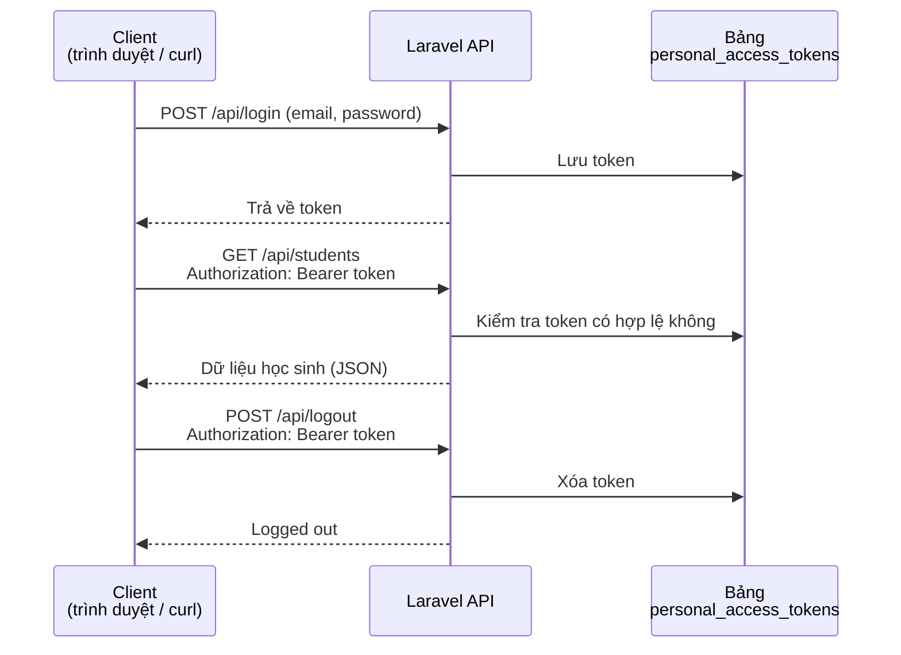
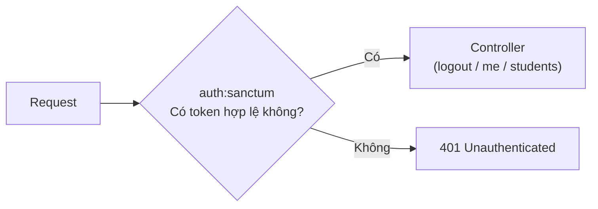

# Chuyển Laravel sang REST API

> 🇯🇵 Bản gốc (tiếng Nhật): [20260521.md](<../../../2年生_システム開発実践/前期/2026_05_21/20260521.md>) <!-- original-ja-link -->

---

## Buổi 05: Sắp xếp CRUD API bằng resource controller

### API Resource — Chuẩn hóa cấu trúc response

```bash
php artisan make:resource StudentResource
```

```php
// app/Http/Resources/StudentResource.php
class StudentResource extends JsonResource
{
    public function toArray(Request $request): array
    {
        return [
            'id'         => $this->id,
            'name'       => $this->name,
            'email'      => $this->email,
            'score'      => $this->score,
            'evaluation' => $this->score >= 80 ? 'A' : 'B',  // có thể thêm cả giá trị tính toán
            'created_at' => $this->created_at->format('Y/m/d'),
            // không đưa vào các trường không cần thiết (như password)
        ];
    }
}
```

**Dùng trong controller:**

```php
use App\Http\Resources\StudentResource;
use App\Http\Resources\StudentCollection;

public function index()
{
    $students = Student::all();
    return StudentResource::collection($students);
    // → bọc toàn bộ bản ghi bằng Resource rồi trả về
}

public function show($id)
{
    return new StudentResource(Student::findOrFail($id));
}
```

---

## Buổi 06: Thống nhất cấu trúc response của API

### Best practice cho cấu trúc response của API

```json
// Khi thành công
{
    "status": "ok",
    "data": { ... }
}

// Khi có lỗi
{
    "status": "error",
    "message": "Not found",
    "errors": {
        "email": ["このメールアドレスは既に使われています"]
    }
}
```

---

## Buổi 07: Xác thực bằng token với Sanctum

### Sanctum là gì

Đây là **package xác thực API** của Laravel.  
Nó quản lý trạng thái đăng nhập bằng token (một dạng ám hiệu).

Quá trình trao đổi từ lúc đăng nhập đến lúc đăng xuất diễn ra theo luồng như sau.



```bash
composer require laravel/sanctum
php artisan vendor:publish --provider="Laravel\Sanctum\SanctumServiceProvider"
php artisan migrate
```

**Triển khai API xác thực:**

```php
// app/Http/Controllers/Api/AuthController.php
class AuthController extends Controller
{
    // POST /api/login
    public function login(Request $request)
    {
        $request->validate([
            'email'    => 'required|email',
            'password' => 'required',
        ]);
        
        // kiểm tra email và mật khẩu
        if (!Auth::attempt($request->only('email', 'password'))) {
            return response()->json([
                'status'  => 'error',
                'message' => 'メールアドレスまたはパスワードが違います',
            ], 401);
        }
        
        $user = Auth::user();
        
        // phát hành token
        $token = $user->createToken('api-token')->plainTextToken;
        
        return response()->json([
            'status' => 'ok',
            'token'  => $token,
            'user'   => $user,
        ]);
    }
    
    // POST /api/logout
    public function logout(Request $request)
    {
        // xóa token hiện tại
        $request->user()->currentAccessToken()->delete();
        
        return response()->json(['status' => 'ok', 'message' => 'Logged out']);
    }
    
    // GET /api/me
    public function me(Request $request)
    {
        return response()->json(['status' => 'ok', 'user' => $request->user()]);
    }
}
```

---

## Buổi 08: Middleware xác thực và quản lý quyền

Middleware `auth:sanctum` là "người gác cổng" đứng trước controller để kiểm tra "request có token hay không".



```php
// routes/api.php

// các route không cần xác thực
Route::post('/login', [AuthController::class, 'login']);
Route::post('/register', [AuthController::class, 'register']);

// các route cần xác thực (auth:sanctum)
Route::middleware('auth:sanctum')->group(function () {
    Route::post('/logout', [AuthController::class, 'logout']);
    Route::get('/me', [AuthController::class, 'me']);
    Route::apiResource('students', StudentController::class);
});
```

**Cách test API (lệnh curl):**

```bash
# đăng nhập
curl -X POST http://localhost:8000/api/login \
  -H "Content-Type: application/json" \
  -d '{"email":"test@example.com","password":"password"}'
# → {"token": "1|abc123..."}

# gọi API cần xác thực
curl http://localhost:8000/api/students \
  -H "Authorization: Bearer 1|abc123..."
```

---

## Tổng kết

| Khái niệm | Blade (năm 1) | API (năm 2) |
|------|-------------|------------|
| Response | HTML (view) | JSON (response()->json()) |
| Routing | routes/web.php | routes/api.php |
| Xác thực | Session | Token của Sanctum |
| Giao diện | Blade trả về | Được xây dựng ở phía frontend |
