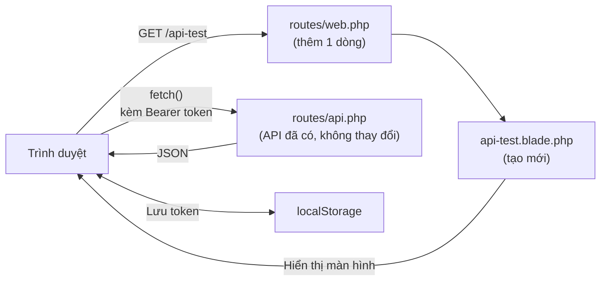

> 🇯🇵 Bản gốc (tiếng Nhật): [20260528.md](<../../../2年生_システム開発実践/前期/2026_05_28/20260528.md>) <!-- original-ja-link -->

## Kiểm tra xác thực bằng token trên trình duyệt (bổ sung)

Không chỉ dùng curl, chúng ta sẽ chuẩn bị một trang để có thể kiểm tra trực quan hoạt động của xác thực bằng token ngay trên trình duyệt.

### Tổng quan

Khi truy cập `/api-test`, màn hình đăng nhập sẽ mở ra.  
Sau khi đăng nhập, danh sách học sinh lấy từ API sẽ được hiển thị, và bạn cũng có thể thêm hoặc xóa học sinh.

```
【Trước khi đăng nhập】
┌──────────────────────────────────┐
│  Test API token                  │
│                                  │
│   Đăng nhập để hiển thị          │
│   danh sách học sinh             │
│                                  │
│   [Địa chỉ email        ]        │
│   [Mật khẩu             ]        │
│   [Đăng nhập (POST /api/login)]  │
└──────────────────────────────────┘

【Sau khi đăng nhập】
┌──────────────────────────────────────────────────────────────┐
│  Test API token  ● Đang đăng nhập: テストユーザー [Đăng xuất]│
├──────────────────────────────────────────────────────────────┤
│  Danh sách học sinh  GET /api/students  HTTP 200             │
│  ┌────┬──────────┬────────────────────┬──────┬──────┐        │
│  │ ID │  Tên     │  Email             │ Điểm │      │        │
│  ├────┼──────────┼────────────────────┼──────┼──────┤        │
│  │  1 │ 田中太郎 │ tanaka@example.com │  85  │ Xóa  │        │
│  │  2 │ 山田花子 │ yamada@example.com │  72  │ Xóa  │        │
│  └────┴──────────┴────────────────────┴──────┴──────┘        │
│                                                              │
│  Thêm mới (POST /api/students)                               │
│  [Tên] [Địa chỉ email] [Điểm] [Thêm]                         │
│                                                              │
│  ▶ Code mà trang này đang dùng (React cũng viết giống vậy)   │
└──────────────────────────────────────────────────────────────┘
```

> **Hoàn toàn không sửa code API đã có.**  
> Thứ cần thêm chỉ là 1 dòng trong `routes/web.php` và 1 file view.

Quan hệ giữa file được thêm và API đã có như sau. `web.php` phụ trách hiển thị màn hình, còn việc trao đổi dữ liệu vẫn do `api.php` đảm nhận như trước.



---

### Step 1｜Thêm route vào `routes/web.php`

Mở `routes/web.php` của project bằng VSCode.

```
(tên repository)/
└── routes/
    └── web.php   ← mở file này
```

Thêm 1 dòng sau vào cuối file:

```php
Route::get('/api-test', fn() => view('api-test'));
```

> **Không cần thêm `use`.**  
> Route này dùng closure (hàm ẩn danh) nên không gọi đến class controller nào.  
> Dù không thêm dòng `use App\Http\Controllers\...` thì vẫn chạy được.

Sau khi thêm, `routes/web.php` sẽ trông như sau:

```php
<?php

use Illuminate\Support\Facades\Route;

Route::get('/', function () {
    return view('welcome');
});

Route::get('/api-test', fn() => view('api-test'));  // ← thêm dòng này
```

**Sau khi thêm xong, nhấn Ctrl+S (Mac là Cmd+S) để lưu.**

---

### Step 2｜Tạo `resources/views/api-test.blade.php`

Tạo một file mới tên là `api-test.blade.php` bên trong thư mục `resources/views/`.

#### 2-1. Tạo file mới

Trong Explorer của VSCode, nhấp chuột phải vào thư mục `resources/views/`  
→ chọn "New File" → nhập tên file `api-test.blade.php` rồi nhấn Enter.

```
(tên repository)/
└── resources/
    └── views/
        ├── welcome.blade.php   ← file có sẵn từ đầu
        └── api-test.blade.php  ← file cần tạo mới
```

#### 2-2. Sao chép toàn bộ code dưới đây và dán vào

Mở file vừa tạo, sao chép **toàn bộ** code dưới đây rồi dán vào:

```html
<!DOCTYPE html>
<html lang="ja">
<head>
    <meta charset="UTF-8">
    <title>API トークンテスター</title>
    <style>
        * { box-sizing: border-box; margin: 0; padding: 0; }
        body { font-family: sans-serif; background: #f4f6f8; color: #333; }

        .header {
            background: #1565C0; color: white;
            padding: 16px 32px;
            display: flex; align-items: center; gap: 16px;
        }
        .header h1 { font-size: 1.2em; font-weight: bold; }
        .header .sub { font-size: 0.85em; opacity: 0.85; }

        .layout { display: grid; grid-template-columns: 340px 1fr; gap: 0; min-height: calc(100vh - 56px); }

        /* Khung bên trái */
        .left { background: white; border-right: 1px solid #e0e0e0; padding: 24px; display: flex; flex-direction: column; gap: 24px; }

        .section-title {
            font-size: 0.75em; font-weight: bold; letter-spacing: .05em;
            color: #888; text-transform: uppercase; margin-bottom: 10px;
        }

        /* Badge trạng thái đăng nhập */
        .status-badge {
            display: flex; align-items: center; gap: 8px;
            padding: 10px 14px; border-radius: 8px; font-size: 0.88em;
        }
        .status-badge.logged-out { background: #fff3e0; color: #e65100; }
        .status-badge.logged-in  { background: #e8f5e9; color: #2e7d32; }
        .dot { width: 9px; height: 9px; border-radius: 50%; flex-shrink: 0; }
        .dot-red   { background: #e53935; }
        .dot-green { background: #43a047; }

        /* Hiển thị token */
        .token-box {
            background: #f5f5f5; border: 1px solid #ddd;
            border-radius: 6px; padding: 8px 10px;
            font-family: monospace; font-size: 0.8em;
            word-break: break-all; color: #555;
            max-height: 70px; overflow-y: auto;
        }

        /* Form */
        label { display: block; font-size: 0.85em; font-weight: bold; margin-bottom: 4px; }
        input[type="email"], input[type="password"] {
            width: 100%; padding: 8px 10px;
            border: 1px solid #ccc; border-radius: 6px;
            font-size: 0.95em; margin-bottom: 10px;
        }
        input:focus { outline: 2px solid #1976D2; border-color: transparent; }

        /* Nút bấm */
        .btn {
            width: 100%; padding: 9px; border: none; border-radius: 6px;
            font-size: 0.95em; cursor: pointer; font-weight: bold;
        }
        .btn-primary { background: #1976D2; color: white; }
        .btn-primary:hover { background: #1565C0; }
        .btn-danger  { background: #D32F2F; color: white; }
        .btn-danger:hover  { background: #B71C1C; }
        .btn:disabled { opacity: 0.45; cursor: not-allowed; }

        /* Nhóm nút test API */
        .api-btn-group { display: flex; flex-direction: column; gap: 8px; }
        .api-btn {
            width: 100%; padding: 9px 12px; border-radius: 6px;
            font-size: 0.88em; cursor: pointer; font-weight: bold;
            text-align: left; border: 1.5px solid;
        }
        .api-btn .method { font-size: 0.75em; letter-spacing: .05em; opacity: 0.8; }
        .api-btn .path   { font-family: monospace; }
        .api-btn-noauth  { background: #fff8e1; border-color: #FFA000; color: #E65100; }
        .api-btn-noauth:hover  { background: #fff3e0; }
        .api-btn-auth    { background: #e3f2fd; border-color: #1976D2; color: #0d47a1; }
        .api-btn-auth:hover    { background: #bbdefb; }
        .api-btn-auth:disabled { opacity: 0.45; cursor: not-allowed; }

        /* Khung bên phải: response */
        .right { padding: 24px; display: flex; flex-direction: column; gap: 16px; }

        .res-header {
            display: flex; align-items: center; gap: 12px; flex-wrap: wrap;
        }
        .res-title { font-size: 0.75em; font-weight: bold; color: #888; letter-spacing: .05em; text-transform: uppercase; }
        .res-meta  { display: flex; gap: 10px; align-items: center; }

        .status-pill {
            padding: 3px 12px; border-radius: 99px;
            font-weight: bold; font-size: 0.85em;
        }
        .status-200 { background: #e8f5e9; color: #2e7d32; }
        .status-201 { background: #e8f5e9; color: #2e7d32; }
        .status-401 { background: #fff3e0; color: #e65100; }
        .status-422 { background: #fce4ec; color: #880e4f; }
        .status-4xx { background: #fce4ec; color: #880e4f; }
        .status-5xx { background: #fce4ec; color: #880e4f; }
        .status-0   { background: #f5f5f5; color: #888; }

        .endpoint-label {
            font-family: monospace; font-size: 0.85em; color: #555;
            background: #f5f5f5; padding: 3px 10px; border-radius: 4px;
        }

        .res-body {
            flex: 1;
            background: #1e1e1e; color: #d4d4d4;
            border-radius: 8px; padding: 20px;
            font-family: 'Courier New', monospace; font-size: 0.9em;
            line-height: 1.6; white-space: pre-wrap;
            min-height: 300px; overflow: auto;
        }
        .res-body.empty { color: #555; font-style: italic; }

        /* Màu cú pháp JSON */
        .jk { color: #9cdcfe; }   /* key */
        .js { color: #ce9178; }   /* string value */
        .jn { color: #b5cea8; }   /* number */
        .jb { color: #569cd6; }   /* boolean/null */

        /* Vùng giải thích */
        .hint-box {
            background: #e8f5e9; border: 1px solid #a5d6a7;
            border-radius: 6px; padding: 10px 14px;
            font-size: 0.83em; line-height: 1.6; color: #1b5e20;
        }
        .hint-box.warn { background: #fff8e1; border-color: #ffe082; color: #6d4c00; }
        .hint-box.info { background: #e3f2fd; border-color: #90caf9; color: #0d47a1; }

        /* Link điều hướng */
        .nav { font-size: 0.82em; }
        .nav a { color: #1976D2; text-decoration: none; }
        .nav a:hover { text-decoration: underline; }

        .divider { border: none; border-top: 1px solid #eee; }
    </style>
</head>
<body>

<div class="header">
    <div>
        <div class="header h1">API トークンテスター</div>
        <div class="sub">コマ07〜08 Sanctum トークン認証の動作確認ツール</div>
    </div>
    <div style="margin-left:auto; font-size:0.82em; opacity:0.8;">
        <a href="/students" style="color:white;">← Blade管理画面</a>
    </div>
</div>

<div class="layout">

    <!-- Khung bên trái: bảng thao tác -->
    <div class="left">

        <!-- ① Trạng thái xác thực -->
        <div>
            <div class="section-title">① 認証状態</div>
            <div id="badge-logged-out" class="status-badge logged-out">
                <span class="dot dot-red"></span>
                <span>ログアウト中（トークンなし）</span>
            </div>
            <div id="badge-logged-in" class="status-badge logged-in" style="display:none;">
                <span class="dot dot-green"></span>
                <span id="badge-username">ログイン中</span>
            </div>
            <div id="token-area" style="margin-top:10px; display:none;">
                <div class="section-title" style="margin-bottom:4px;">現在のトークン</div>
                <div id="token-display" class="token-box">—</div>
            </div>
        </div>

        <hr class="divider">

        <!-- ② Đăng nhập -->
        <div id="login-section">
            <div class="section-title">② ログイン</div>
            <label>メールアドレス</label>
            <input type="email" id="email" value="test@example.com" placeholder="test@example.com">
            <label>パスワード</label>
            <input type="password" id="password" value="password" placeholder="password">
            <button class="btn btn-primary" onclick="doLogin()">POST /api/login</button>
        </div>

        <!-- ② Đăng xuất (hiển thị khi đã đăng nhập) -->
        <div id="logout-section" style="display:none;">
            <div class="section-title">② ログアウト</div>
            <button class="btn btn-danger" onclick="doLogout()">POST /api/logout</button>
        </div>

        <hr class="divider">

        <!-- ③ Test API -->
        <div>
            <div class="section-title">③ API を叩いてみる</div>
            <div class="api-btn-group">
                <button class="api-btn api-btn-noauth" onclick="testNoToken()">
                    <div class="method">⚠ トークンなし</div>
                    <div class="path">GET /api/students</div>
                </button>
                <button class="api-btn api-btn-auth" id="btn-with-token" onclick="testWithToken()" disabled>
                    <div class="method">✓ トークンあり</div>
                    <div class="path">GET /api/students</div>
                </button>
                <button class="api-btn api-btn-auth" id="btn-me" onclick="testMe()" disabled>
                    <div class="method">✓ トークンあり</div>
                    <div class="path">GET /api/me</div>
                </button>
                <button class="api-btn api-btn-noauth" onclick="testBadPassword()">
                    <div class="method">✗ パスワード間違い</div>
                    <div class="path">POST /api/login</div>
                </button>
            </div>
        </div>

        <hr class="divider">

        <div class="nav">
            <a href="/students">Blade 管理画面 (/students)</a><br>
            <a href="/api/students" target="_blank">API JSON (/api/students) ↗</a>
        </div>

    </div>

    <!-- Khung bên phải: hiển thị response -->
    <div class="right">

        <div>
            <div class="res-header">
                <div class="res-title">レスポンス</div>
                <div class="res-meta">
                    <span id="res-status" class="status-pill status-0">—</span>
                    <span id="res-endpoint" class="endpoint-label">—</span>
                </div>
            </div>
        </div>

        <div id="hint" class="hint-box info">
            左のパネルでボタンを押すと、ここにレスポンス（サーバーからの返答）が表示されます。<br>
            まず「② ログイン」→ トークンを取得 → 「③ APIを叩いてみる」の順に試してみましょう。
        </div>

        <pre id="res-body" class="res-body empty">// ここにレスポンスが表示されます</pre>

    </div>
</div>

<script>
// ─── Quản lý trạng thái ───────────────────────────────────────────
let token = localStorage.getItem('api_token') || null;
let userName = localStorage.getItem('api_username') || null;

// Cập nhật UI khi khởi động
updateUI();

// ─── Cập nhật UI ─────────────────────────────────────────────
function updateUI() {
    const loggedIn = !!token;

    document.getElementById('badge-logged-out').style.display = loggedIn ? 'none' : 'flex';
    document.getElementById('badge-logged-in').style.display  = loggedIn ? 'flex' : 'none';
    document.getElementById('token-area').style.display       = loggedIn ? 'block' : 'none';
    document.getElementById('login-section').style.display    = loggedIn ? 'none' : 'block';
    document.getElementById('logout-section').style.display   = loggedIn ? 'block' : 'none';

    if (loggedIn) {
        document.getElementById('badge-username').textContent = `ログイン中：${userName || 'ユーザー'}`;
        document.getElementById('token-display').textContent  = token;
    }

    document.getElementById('btn-with-token').disabled = !loggedIn;
    document.getElementById('btn-me').disabled         = !loggedIn;
}

// ─── Hiển thị response ──────────────────────────────────────
function showResult(status, data, endpoint, method = 'GET') {
    // Badge trạng thái
    const pill = document.getElementById('res-status');
    const statusText = status === 0 ? 'ERROR' : String(status);
    pill.textContent = statusText;
    pill.className = 'status-pill ' + (
        status === 200 ? 'status-200' :
        status === 201 ? 'status-201' :
        status === 401 ? 'status-401' :
        status === 422 ? 'status-422' :
        status >= 400  ? 'status-4xx' :
        status >= 500  ? 'status-5xx' : 'status-0'
    );

    document.getElementById('res-endpoint').textContent = `${method} ${endpoint}`;

    // Tô màu cú pháp JSON
    const json = JSON.stringify(data, null, 2);
    document.getElementById('res-body').innerHTML = highlight(json);
    document.getElementById('res-body').classList.remove('empty');

    // Thông báo gợi ý
    const hint = document.getElementById('hint');
    if (status === 401) {
        hint.className = 'hint-box warn';
        hint.innerHTML = '🔒 <strong>401 Unauthenticated</strong><br>トークンがない（または無効な）リクエストは拒否されます。<br>ログインしてトークンを取得してから再度試してください。';
    } else if (status === 200 && data.data) {
        hint.className = 'hint-box';
        hint.innerHTML = '✅ <strong>200 OK</strong><br>有効なトークンを Bearer ヘッダーに付けたリクエストが成功しました。<br>React からも同じヘッダーを付けてデータを取得します。';
    } else if (status === 200 && data.token) {
        hint.className = 'hint-box';
        hint.innerHTML = '✅ <strong>ログイン成功</strong><br>トークンが発行されました。このトークンを <code>Authorization: Bearer &lt;token&gt;</code> ヘッダーに付けてAPIを呼びます。<br>右のパネルの <code>token</code> フィールドをコピーしてcurlでも使えます。';
    } else if (status === 200 && data.message === 'Logged out') {
        hint.className = 'hint-box warn';
        hint.innerHTML = '🔓 <strong>ログアウト成功</strong><br>サーバー側でトークンが削除されました。<br>このトークンは無効になり、以降のリクエストで 401 が返ります。';
    } else {
        hint.className = 'hint-box info';
        hint.innerHTML = `レスポンス受信：HTTP ${status}`;
    }
}

// ─── Gọi API ─────────────────────────────────────────
async function doLogin() {
    const email    = document.getElementById('email').value;
    const password = document.getElementById('password').value;

    const res = await fetch('/api/login', {
        method: 'POST',
        headers: {
            'Content-Type': 'application/json',
            'Accept':       'application/json',
        },
        body: JSON.stringify({ email, password }),
    });
    const data = await res.json();
    showResult(res.status, data, '/api/login', 'POST');

    if (res.ok && data.token) {
        token    = data.token;
        userName = data.user?.name || 'ユーザー';
        localStorage.setItem('api_token',    token);
        localStorage.setItem('api_username', userName);
        updateUI();
    }
}

async function doLogout() {
    const res = await fetch('/api/logout', {
        method: 'POST',
        headers: {
            'Accept':        'application/json',
            'Authorization': `Bearer ${token}`,
        },
    });
    const data = await res.json();
    showResult(res.status, data, '/api/logout', 'POST');

    token    = null;
    userName = null;
    localStorage.removeItem('api_token');
    localStorage.removeItem('api_username');
    updateUI();
}

async function testNoToken() {
    const res  = await fetch('/api/students', {
        headers: { 'Accept': 'application/json' },
    });
    const data = await res.json();
    showResult(res.status, data, '/api/students');
}

async function testWithToken() {
    const res  = await fetch('/api/students', {
        headers: {
            'Accept':        'application/json',
            'Authorization': `Bearer ${token}`,
        },
    });
    const data = await res.json();
    showResult(res.status, data, '/api/students');
}

async function testMe() {
    const res  = await fetch('/api/me', {
        headers: {
            'Accept':        'application/json',
            'Authorization': `Bearer ${token}`,
        },
    });
    const data = await res.json();
    showResult(res.status, data, '/api/me');
}

async function testBadPassword() {
    const email = document.getElementById('email').value || 'test@example.com';
    const res = await fetch('/api/login', {
        method: 'POST',
        headers: {
            'Content-Type': 'application/json',
            'Accept':       'application/json',
        },
        body: JSON.stringify({ email, password: 'wrong_password' }),
    });
    const data = await res.json();
    showResult(res.status, data, '/api/login (パスワード間違い)', 'POST');
}

// ─── Tô màu cú pháp JSON ──────────────────────────
function highlight(json) {
    return json
        .replace(/&/g, '&amp;').replace(/</g, '&lt;').replace(/>/g, '&gt;')
        .replace(
            /("(\\u[a-zA-Z0-9]{4}|\\[^u]|[^\\"])*"(\s*:)?|\b(true|false|null)\b|-?\d+(?:\.\d*)?(?:[eE][+\-]?\d+)?)/g,
            match => {
                if (/^"/.test(match)) {
                    return /:$/.test(match)
                        ? `<span class="jk">${match}</span>`
                        : `<span class="js">${match}</span>`;
                }
                if (/true|false|null/.test(match)) return `<span class="jb">${match}</span>`;
                return `<span class="jn">${match}</span>`;
            }
        );
}
</script>

</body>
</html>
```

**Sau khi dán xong, nhấn Ctrl+S (Mac là Cmd+S) để lưu.**

---

### Step 3｜Kiểm tra trên trình duyệt

Nếu server phát triển chưa chạy thì hãy khởi động nó:

```bash
php artisan serve
```

Truy cập URL sau bằng trình duyệt:

```
http://localhost:8000/api-test
```

Nếu tiêu đề 「API トークンテスター」(Công cụ test API token) hiển thị và bố cục chia thành 2 khung trái, phải là thành công.

**Các lỗi thường gặp và cách xử lý:**

|Nội dung lỗi|Nguyên nhân|Cách xử lý|
|---|---|---|
|`View [api-test] not found`|Tên file hoặc thư mục bị sai|Kiểm tra xem `resources/views/api-test.blade.php` có tồn tại không|
|Màn hình không hiển thị (404)|Chưa thêm route|Kiểm tra phần cuối của `routes/web.php`|
|Màn hình mở được nhưng bấm nút thì bị lỗi|Server phát triển chưa được khởi động|Khởi động bằng `php artisan serve`|

---

### Step 4｜Kiểm tra hoạt động

#### ① Đăng nhập

Thông tin tài khoản đã được nhập sẵn trên màn hình đăng nhập:

|Mục|Giá trị|Bước đã tạo|
|---|---|---|
|Địa chỉ email|`test@example.com`|Phần bổ sung ở cuối tài liệu này|
|Mật khẩu|`password`|Phần bổ sung ở cuối tài liệu này|

> **Nếu bạn chưa tạo tài khoản**  
> Hãy xem phần bổ sung ở cuối tài liệu này và chạy các lệnh sau để tạo user:
> ```bash
> php artisan tinker
> ```
> ```php
> \App\Models\User::create(['name' => 'テストユーザー', 'email' => 'test@example.com', 'password' => bcrypt('password')]);
> ```
> Sau khi thoát tinker bằng `exit`, hãy quay lại bước này.

1. Kiểm tra địa chỉ email và mật khẩu đã được nhập sẵn
2. Bấm nút 「ログイン（POST /api/login）」(Đăng nhập)
3. Nếu header hiển thị 「ログイン中：テストユーザー」(Đang đăng nhập: テストユーザー) và bảng danh sách học sinh xuất hiện là thành công

Token được phát hành sẽ hiển thị dạng rút gọn ở phía bên phải header.  
Token này sẽ được tự động gắn vào tất cả các request sau đó.

> **Đóng trang cũng không sao.**  
> Token được lưu trong `localStorage` của trình duyệt, nên khi mở lại thì trạng thái đăng nhập vẫn được giữ nguyên.

---

#### ② Kiểm tra danh sách học sinh

Ngay sau khi đăng nhập, danh sách học sinh sẽ được hiển thị.  
Hãy kiểm tra xem phía trên bảng có hiển thị "`GET /api/students` → `HTTP 200`" hay không.

> **Nếu chưa đăng nhập thì không thể lấy được dữ liệu này.**  
> Nếu gọi `GET /api/students` mà không có token, server sẽ trả về `401 Unauthenticated`.  
> Luồng "đăng nhập → hiển thị danh sách" chính là cách xác thực bằng token hoạt động.

---

#### ③ Thêm học sinh

Nhập vào form 「新規追加（POST /api/students）」(Thêm mới) rồi bấm nút 「追加」(Thêm).

| Mục      | Ví dụ nhập                       |
| ------- | ------------------------- |
| Tên      | `新しい生徒`                   |
| Địa chỉ email | `new-student@example.com` |
| Điểm      | `88`                      |

Khi thêm thành công, danh sách sẽ tự động được lấy lại và có thêm một dòng mới.

> **Nếu xuất hiện lỗi validation**  
> Địa chỉ email đó đã được đăng ký rồi. Hãy dùng một địa chỉ khác.

---

#### ④ Xóa học sinh

Bấm nút 「削除」(Xóa) ở dòng muốn xóa.  
Hộp thoại xác nhận sẽ hiện ra, bấm "OK" thì dữ liệu sẽ bị xóa và danh sách được lấy lại.

---

#### ⑤ Đăng xuất và kiểm tra token đã bị vô hiệu hóa

1. Bấm nút 「ログアウト（POST /api/logout）」(Đăng xuất) ở bên phải header
2. Nếu quay về màn hình đăng nhập là thành công

> **Tại sao không xem được danh sách nữa?**  
> Khi gọi `POST /api/logout`, bản ghi của token đó  
> sẽ bị xóa khỏi bảng `personal_access_tokens` trên server.  
> Token đã bị xóa thì gửi đi đâu cũng không được xác thực nữa, nên cũng không lấy được danh sách.

---

### fetch() là gì (bước chuẩn bị cho React)

Trang này dùng `fetch()` của JavaScript để gọi API.  
Bấm vào 「▶ このページが使っているコード」(Code mà trang này đang dùng) ở cuối trang để xem code thực tế.

```javascript
// gắn token vào header Authorization rồi gửi request
const res = await fetch('/api/students', {
    headers: {
        'Accept':        'application/json',
        'Authorization': `Bearer ${token}`,  // ← gắn token này vào header
    },
});
const data = await res.json();
// data.data chứa mảng học sinh
```

> Khi học React (từ buổi 17), lúc gặp lại đoạn code này,  
> bạn sẽ nhận ra: "À, đây là đoạn code đã chạy trên trang này."

---

### Danh sách kiểm tra (bổ sung)

|Mục cần kiểm tra|Đánh dấu|
|---|---|
|Đã thêm route vào cuối `routes/web.php`|□|
|Đã tạo mới `resources/views/api-test.blade.php`|□|
|Đã dán toàn bộ code và lưu lại|□|
|Truy cập `http://localhost:8000/api-test` thì màn hình đăng nhập hiển thị|□|
|Sau khi đăng nhập, bảng danh sách học sinh được hiển thị|□|
|Phía trên bảng hiển thị "HTTP 200"|□|
|Thêm học sinh từ form và danh sách được cập nhật|□|
|Xóa học sinh bằng nút xóa và học sinh biến mất khỏi danh sách|□|
|Sau khi đăng xuất thì quay về màn hình đăng nhập|□|

---

### Bổ sung: Tạo tài khoản để đăng nhập

Màn hình đăng nhập của `/api-test` đã được nhập sẵn `test@example.com` / `password`,  
nhưng tài khoản này cần được tạo bằng `php artisan tinker`.

**Nếu bạn chưa tạo tài khoản, hãy thực hiện các bước sau:**

```bash
php artisan tinker
```

```php
\App\Models\User::create(['name' => 'テストユーザー', 'email' => 'test@example.com', 'password' => bcrypt('password')]);
```

Sau khi thoát tinker bằng `exit`, hãy tiếp tục lại từ Step 3.
