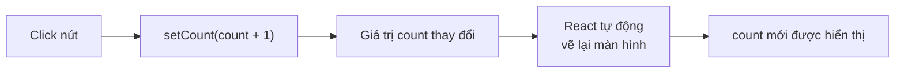
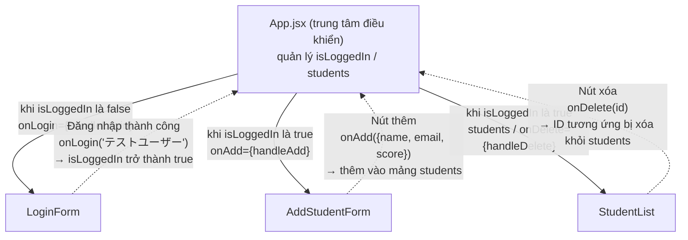

# Tiết 16｜React cơ bản — Component, JSX, props, useState

> 🇯🇵 Bản gốc (tiếng Nhật): [2026_06_11.md](<../../../2年生_システム開発実践/前期/2026_06_11/2026_06_11.md>) <!-- original-ja-link -->

## Mục tiêu hôm nay
- Hiểu cách viết JSX
- Tạo và sử dụng được component
- Truyền được dữ liệu bằng `props`
- Quản lý được state bằng `useState`

> **Vị trí của bài học:** Chúng ta học phần này như "nền móng" cho Next.js ở buổi sau.  
> Mục tiêu là hiểu "JSX là gì, và vì sao lại chia giao diện thành các component".

---

## 0. Cài đặt môi trường React (chỉ làm lần đầu!)

### 0-1. Kiểm tra đã cài Node.js chưa

Trước tiên, hãy kiểm tra xem **Node.js** đã được cài đặt hay chưa.  
Hãy chạy lệnh dưới đây trong terminal (terminal của VSCode).

```bash
node -v
```

Nếu hiện ra phiên bản là OK (ví dụ: `v20.11.0`).  
Nếu hiện `command not found` thì hãy cài Node.js trước.

> **Cài đặt Node.js:** Tải **bản LTS** (bản khuyến nghị) từ https://nodejs.org/

---

### 0-2. Tạo project React (dùng Vite)

Trong terminal, di chuyển đến **thư mục mà bạn muốn tạo project bên trong**, rồi chạy lệnh dưới đây.

```bash
npm create vite@latest my-app -- --template react
```

> Phần `my-app` là tên project. Bạn có thể đổi sang tên tùy thích (ví dụ: `react-practice`)

Khi chạy, các thông báo dưới đây sẽ hiện ra, hãy nhấn Enter để tiếp tục.

```
✔ Select a framework: › React
✔ Select a variant: › JavaScript
```

---

### 0-3. Cài các package cần thiết và khởi động

Sau khi tạo project, hãy chạy các lệnh theo thứ tự dưới đây.

```bash
# ① Di chuyển vào thư mục vừa tạo
cd my-app

# ② Cài đặt tất cả các package cần thiết
npm install

# ③ Khởi động server phát triển
npm run dev
```

Nếu terminal hiện ra như dưới đây là thành công!

```
  VITE v5.x.x  ready in xxx ms

  ➜  Local:   http://localhost:5173/
```

Mở `http://localhost:5173/` trên trình duyệt, màn hình mẫu của React sẽ hiện ra.

> **Để dừng server:** Nhấn `Ctrl + C` trong terminal

---

### 0-4. Cùng xem cấu trúc thư mục

```
my-app/
├── public/          # Nơi đặt các file tĩnh như hình ảnh
├── src/             # ← Chủ yếu chỉnh sửa ở đây!
│   ├── App.jsx      # Component chính (file đầu tiên bạn sẽ chỉnh)
│   ├── App.css      # Style của App.jsx
│   ├── main.jsx     # Điểm khởi động của ứng dụng (thường không cần đụng vào)
│   └── index.css    # Style cho toàn bộ ứng dụng
├── index.html       # Template HTML của ứng dụng
└── package.json     # Cấu hình project, danh sách package sử dụng
```

**Lúc đầu, bạn chỉ cần chỉnh sửa `src/App.jsx` là được!**

---

### 0-5. Thử sửa App.jsx

Mở `src/App.jsx`, xóa toàn bộ nội dung và thay bằng đoạn code dưới đây.

```jsx
function App() {
  return (
    <div>
      <h1>はじめての React！</h1>
      <p>環境構築できました！</p>
    </div>
  );
}

export default App;
```

Khi lưu lại, trình duyệt sẽ tự động cập nhật (hot reload).  
Nếu hiện ra 「はじめての React！」(React đầu tiên!) là đã sẵn sàng!

---

## 1. React là gì

**React = thư viện JavaScript để xây dựng UI bằng các "component (bộ phận)"**

```
HTML + JavaScript truyền thống:
  <div id="app"></div>
  document.getElementById("app").innerHTML = "...";
  → Khi số trang tăng lên thì rất khó quản lý

React:
  <Button label="送信" />  ← Bộ phận có thể tái sử dụng
  <Card title="タイトル" body="内容" />
  → Ghép các bộ phận lại để tạo trang
```

---

## 2. JSX — Viết HTML bên trong JavaScript

> **Khi nào dùng?** Chỉ với HTML thì không thể viết trực tiếp giá trị của biến. Với JSX, bạn có thể nhúng giá trị theo thời gian thực bằng `{tênBiến}`. Dùng khi muốn hiển thị các "giá trị động" như tên người dùng, ngày tháng hoặc kết quả tính toán.  
> **Điểm cần kiểm tra:** Đổi `namae` thành tên của bạn rồi lưu → kiểm tra màn hình có tự động cập nhật không. Kiểm tra `{1 + 1}` có hiển thị thành `2` không.

```jsx
// ▼ Hãy viết vào src/App.jsx (xóa toàn bộ nội dung file và thay bằng đoạn dưới đây)

// JSX = JavaScript + XML (cách viết giống HTML)

// Hàm thông thường (component)
function Hello() {
  // return JSX
  return (
    <div>
      <h1>こんにちは！</h1>
      <p>React を始めよう</p>
    </div>
  );
}

// Biểu thức JavaScript được nhúng bằng {}
function Greeting() {
  const namae = "田中太郎";
  const today = new Date().toLocaleDateString("ja-JP");
  
  return (
    <div>
      <h1>こんにちは、{namae}さん！</h1>
      <p>今日は {today} です</p>
      <p>1 + 1 = {1 + 1}</p>
    </div>
  );
}

export default Greeting;
```

**Những điểm cần chú ý khi viết JSX:**

> **Khi nào dùng?** Khi viết JSX mà gặp lỗi, nguyên nhân thường nằm ở 3 quy tắc này. Nếu thấy lỗi màu đỏ, hãy quay lại đây để đối chiếu.

```jsx
// ▼ Ghi chú tham khảo cách viết (đoạn này một mình không chạy được, hãy đọc và ghi nhớ)

// ① Class viết là className (class là từ khóa dành riêng của JS)
<div className="container">

// ② Mọi phần tử đều phải được đóng
<input type="text" />  // Thẻ tự đóng

// ③ Nhiều phần tử phải được bọc trong 1 phần tử cha
return (
  <div>
    <h1>タイトル</h1>
    <p>内容</p>
  </div>
);
// Hoặc dùng Fragment (<></>)
return (
  <>
    <h1>タイトル</h1>
    <p>内容</p>
  </>
);
```

---

## 3. props — Truyền dữ liệu cho component

> **Khi nào dùng?** Khi muốn hiển thị nhiều thẻ hoặc dòng có cùng thiết kế nhưng "chỉ khác dữ liệu". Chỉ cần viết 1 component, bạn có thể tái sử dụng bao nhiêu lần cũng được, chỉ bằng cách đổi dữ liệu truyền vào.  
> **Điểm cần kiểm tra:** Kiểm tra StudentCard có `passed={false}` có màu nền tông cam không. Hãy tự thêm `<StudentCard>` thứ 4.

```jsx
// ▼ Hãy viết vào src/App.jsx (xóa toàn bộ nội dung file và thay bằng đoạn dưới đây)

// props = "đối số" truyền vào component

// Định nghĩa component (nhận props)
function StudentCard({ name, score, passed }) {
  return (
    <div style={{
      border: "1px solid #ddd",
      padding: "16px",
      margin: "8px",
      backgroundColor: passed ? "#e3f2fd" : "#fbe9e7"
    }}>
      <h3>{name}</h3>
      <p>点数: {score}点</p>
      <span>{passed ? "✅ 合格" : "❌ 不合格"}</span>
    </div>
  );
}

// Cách sử dụng (component cha)
function App() {
  return (
    <div>
      <StudentCard name="田中太郎" score={85} passed={true} />
      <StudentCard name="鈴木花子" score={45} passed={false} />
      <StudentCard name="山田次郎" score={91} passed={true} />
    </div>
  );
}

export default App;
```

---

## 4. useState — Quản lý state

> **Khi nào dùng?** Khi muốn phản ánh ngay lên màn hình những "giá trị thay đổi theo thao tác của người dùng" như click nút, nhập liệu, lựa chọn. Những "giá trị thay đổi" như `count` thì nhất định phải quản lý bằng `useState`. Với biến thông thường (`let count = 0`) thì màn hình sẽ không được cập nhật.  
> **Điểm cần kiểm tra:** Nhấn `+1` 5 lần và kiểm tra số có tăng không. Kiểm tra nhấn `リセット` (Đặt lại) có về 0 không. Cũng kiểm tra rằng trang không bị tải lại.

```jsx
// ▼ Hãy viết vào src/App.jsx (xóa toàn bộ nội dung file và thay bằng đoạn dưới đây)
import { useState } from "react";

function Counter() {
  // useState(giá trị ban đầu) → [giá trị hiện tại, hàm để thay đổi giá trị]
  const [count, setCount] = useState(0);
  
  return (
    <div>
      <p>カウント: {count}</p>
      
      {/* Mỗi lần nhấn nút, count sẽ tăng lên */}
      <button onClick={() => setCount(count + 1)}>+1</button>
      <button onClick={() => setCount(count - 1)}>-1</button>
      <button onClick={() => setCount(0)}>リセット</button>
    </div>
  );
}

export default Counter;
```

Quá trình gọi `setCount` thì React vẽ lại màn hình có thể minh họa bằng sơ đồ như sau.



---

## 5. Render danh sách

> **Khi nào dùng?** Đây là mẫu luôn được dùng khi muốn "hiển thị lặp lại dữ liệu dạng mảng" như danh sách sản phẩm, danh sách học sinh, phần bình luận. Dữ liệu tăng thì phần hiển thị cũng tự động tăng theo.  
> **Điểm cần kiểm tra:** Thử thêm người thứ 4 vào mảng `students` → kiểm tra `<li>` có tự động tăng không. Thử xóa `key={student.id}` và kiểm tra xem console của trình duyệt (F12) có hiện cảnh báo không.

```jsx
// ▼ Hãy viết vào src/App.jsx (xóa toàn bộ nội dung file và thay bằng đoạn dưới đây)
function StudentList() {
  const students = [
    { id: 1, name: "田中太郎", score: 85 },
    { id: 2, name: "鈴木花子", score: 72 },
    { id: 3, name: "山田次郎", score: 91 },
  ];
  
  return (
    <ul>
      {/* Tạo các phần tử bằng map của mảng */}
      {/* key cần thiết để React nắm được sự khác biệt (luôn phải gắn trong vòng lặp) */}
      {students.map((student) => (
        <li key={student.id}>
          {student.name} - {student.score}点
        </li>
      ))}
    </ul>
  );
}

export default StudentList;
```

---

## 6. Form và sự kiện

> **Khi nào dùng?** Khi muốn "lấy giá trị người dùng nhập vào để xử lý" như tìm kiếm, đăng nhập, nhập dữ liệu. Dùng `onChange` để cập nhật state mỗi lần nhập, và `onSubmit` để xử lý khi nhấn nút.  
> **Điểm cần kiểm tra:** Nhập gì đó rồi nhấn 「検索」(Tìm kiếm), kiểm tra dòng kết quả có hiện ra không. Thử comment out `e.preventDefault()` (thêm `//`) và kiểm tra rằng trang bị tải lại khi gửi form.

```jsx
// ▼ Hãy viết vào src/App.jsx (xóa toàn bộ nội dung file và thay bằng đoạn dưới đây)
import { useState } from "react";

function SearchForm() {
  const [query, setQuery] = useState("");
  const [result, setResult] = useState(null);
  
  function handleSubmit(e) {
    e.preventDefault();  // Ngăn trang bị tải lại
    setResult(`"${query}" を検索しました`);
  }
  
  return (
    <form onSubmit={handleSubmit}>
      <input
        type="text"
        value={query}
        onChange={(e) => setQuery(e.target.value)}
        // onChange = mỗi lần nội dung nhập thay đổi thì cập nhật state bằng setQuery
        placeholder="検索キーワード"
      />
      <button type="submit">検索</button>
      {result && <p>{result}</p>}
    </form>
  );
}

export default SearchForm;
```

---

## 7. Bài tập thực hành — Tạo ứng dụng quản lý học sinh với dữ liệu Mock

Sử dụng tất cả JSX, component, props, useState đã học đến giờ,  
chúng ta sẽ tạo **"ứng dụng quản lý học sinh"**.

> **Mock là gì?**  
> Là việc dùng dữ liệu viết sẵn trong code thay cho API thật.  
> Đây là "bài luyện tập tạo màn hình mà không cần API".  
> Ở buổi sau (Next.js), chúng ta sẽ kết nối lại chính màn hình này với API thật.

---

### 7-1. Hình ảnh hoàn thành

```
【Trước khi đăng nhập】
┌──────────────────────────┐
│  ログイン                 │
│                          │
│  [メールアドレス        ] │
│  [パスワード            ] │
│  [    ログイン          ] │
│                          │
│  ※ test@example.com     │
│     / password           │
└──────────────────────────┘

【Sau khi đăng nhập】
┌──────────────────────────────────────────────────┐
│ 生徒管理アプリ（React Mock版） ● ログイン中  [ログアウト] │
├──────────────────────────────────────────────────┤
│ 新規追加                                          │
│ [名前] [メールアドレス] [点数] [追加]               │
├──────────────────────────────────────────────────┤
│ 生徒一覧（3件）                                    │
│ ID │ 名前     │ メール              │ 点数 │      │
│  1 │ 田中太郎 │ tanaka@example.com │  85  │ 削除 │
│  2 │ 山田花子 │ yamada@example.com │  72  │ 削除 │
└──────────────────────────────────────────────────┘
```

---

### 7-2. Cấu trúc file

Tạo thư mục `components/` bên trong `src/` và tách các component ra.

```
src/
├── App.jsx                      ← File chính (quản lý toàn bộ state)
├── components/
│   ├── LoginForm.jsx            ← Form đăng nhập
│   ├── StudentList.jsx          ← Bảng danh sách học sinh
│   └── AddStudentForm.jsx       ← Form thêm học sinh
└── main.jsx                     ← Không đụng vào
```

Trong VSCode, click chuột phải vào thư mục `src/` → `New Folder` → nhập `components` rồi nhấn Enter.

---

### 7-3. Step 1｜Tạo LoginForm.jsx

Tạo mới `src/components/LoginForm.jsx`, rồi copy và dán đoạn dưới đây.

```jsx
import { useState } from "react";

// Thông tin đăng nhập cố định dùng cho mock (thay cho API thật)
const MOCK_EMAIL = "test@example.com";
const MOCK_PASSWORD = "password";
const MOCK_NAME = "テストユーザー";

// onLogin = hàm được App.jsx truyền vào, gọi khi đăng nhập thành công
function LoginForm({ onLogin }) {
  const [email, setEmail] = useState("test@example.com");
  const [password, setPassword] = useState("password");
  const [error, setError] = useState("");

  function handleSubmit(e) {
    e.preventDefault(); // Ngăn trang bị tải lại

    // Nếu giá trị nhập khớp với thông tin mock thì đăng nhập thành công
    if (email === MOCK_EMAIL && password === MOCK_PASSWORD) {
      onLogin(MOCK_NAME); // Truyền tên người dùng cho component cha
    } else {
      setError("メールアドレスまたはパスワードが違います");
    }
  }

  return (
    <div style={{
      maxWidth: "400px", margin: "80px auto",
      background: "white", padding: "32px",
      borderRadius: "8px", boxShadow: "0 2px 8px rgba(0,0,0,0.1)"
    }}>
      <h2 style={{ marginBottom: "24px", textAlign: "center" }}>ログイン</h2>

      <form onSubmit={handleSubmit}>
        <div style={{ marginBottom: "16px" }}>
          <label style={{ display: "block", marginBottom: "6px", fontWeight: "bold" }}>
            メールアドレス
          </label>
          <input
            type="email"
            value={email}
            onChange={(e) => setEmail(e.target.value)}
            style={{ width: "100%", padding: "10px", border: "1px solid #ccc", borderRadius: "6px", fontSize: "1em", boxSizing: "border-box" }}
          />
        </div>

        <div style={{ marginBottom: "16px" }}>
          <label style={{ display: "block", marginBottom: "6px", fontWeight: "bold" }}>
            パスワード
          </label>
          <input
            type="password"
            value={password}
            onChange={(e) => setPassword(e.target.value)}
            style={{ width: "100%", padding: "10px", border: "1px solid #ccc", borderRadius: "6px", fontSize: "1em", boxSizing: "border-box" }}
          />
        </div>

        {/* Chỉ hiển thị lỗi khi error không rỗng */}
        {error && (
          <p style={{ color: "#D32F2F", fontSize: "0.9em", marginBottom: "12px" }}>
            {error}
          </p>
        )}

        <button
          type="submit"
          style={{ width: "100%", padding: "12px", background: "#1976D2", color: "white", border: "none", borderRadius: "6px", fontSize: "1em", fontWeight: "bold", cursor: "pointer" }}
        >
          ログイン
        </button>
      </form>

      <p style={{ marginTop: "16px", fontSize: "0.85em", color: "#888", textAlign: "center" }}>
        ※ Mock用: test@example.com / password
      </p>
    </div>
  );
}

export default LoginForm;
```

---

### 7-4. Step 2｜Tạo StudentList.jsx

Tạo mới `src/components/StudentList.jsx`, rồi copy và dán đoạn dưới đây.

```jsx
// StudentList: toàn bộ bảng danh sách học sinh
// students = mảng dữ liệu học sinh (được truyền từ component cha)
// onDelete = hàm gọi khi nhấn nút xóa (được truyền từ component cha)
function StudentList({ students, onDelete }) {
  return (
    <div style={{ background: "white", borderRadius: "8px", padding: "24px", boxShadow: "0 2px 8px rgba(0,0,0,0.05)" }}>
      <h2 style={{ marginBottom: "16px", fontSize: "1.1em" }}>
        生徒一覧
        <span style={{ color: "#888", fontWeight: "normal", fontSize: "0.85em" }}>
          （{students.length}件）
        </span>
      </h2>

      {/* Khi không có học sinh nào thì hiển thị thông báo "chưa có học sinh được đăng ký" */}
      {students.length === 0 ? (
        <p style={{ color: "#888", textAlign: "center", padding: "24px" }}>
          生徒が登録されていません
        </p>
      ) : (
        <table style={{ width: "100%", borderCollapse: "collapse" }}>
          <thead>
            <tr style={{ background: "#f5f5f5" }}>
              <th style={thStyle}>ID</th>
              <th style={thStyle}>名前</th>
              <th style={thStyle}>メール</th>
              <th style={thStyle}>点数</th>
              <th style={thStyle}></th>
            </tr>
          </thead>
          <tbody>
            {/* Hiển thị từng học sinh trong mảng bằng component StudentRow */}
            {students.map((student) => (
              <StudentRow
                key={student.id}
                student={student}
                onDelete={onDelete}
              />
            ))}
          </tbody>
        </table>
      )}
    </div>
  );
}

// StudentRow: 1 dòng của bảng
function StudentRow({ student, onDelete }) {
  function handleDelete() {
    // Hiển thị hộp thoại xác nhận rồi mới xóa
    if (window.confirm(`${student.name} を削除しますか？`)) {
      onDelete(student.id); // Báo cho component cha "hãy xóa ID này"
    }
  }

  return (
    <tr style={{ borderBottom: "1px solid #eee" }}>
      <td style={tdStyle}>{student.id}</td>
      <td style={tdStyle}>{student.name}</td>
      <td style={tdStyle}>{student.email}</td>
      <td style={tdStyle}>{student.score}</td>
      <td style={tdStyle}>
        <button
          onClick={handleDelete}
          style={{ background: "#D32F2F", color: "white", border: "none", borderRadius: "4px", padding: "4px 12px", cursor: "pointer", fontSize: "0.85em" }}
        >
          削除
        </button>
      </td>
    </tr>
  );
}

// Hằng số style (gom các style dùng lặp lại)
const thStyle = { padding: "10px 16px", textAlign: "left", fontWeight: "bold", fontSize: "0.9em" };
const tdStyle = { padding: "12px 16px", fontSize: "0.95em" };

export default StudentList;
```

---

### 7-5. Step 3｜Tạo AddStudentForm.jsx

Tạo mới `src/components/AddStudentForm.jsx`, rồi copy và dán đoạn dưới đây.

```jsx
import { useState } from "react";

// onAdd = hàm gọi khi nhấn nút thêm (được truyền từ component cha)
function AddStudentForm({ onAdd }) {
  const [name, setName] = useState("");
  const [email, setEmail] = useState("");
  const [score, setScore] = useState("");
  const [error, setError] = useState("");

  function handleSubmit(e) {
    e.preventDefault();
    setError(""); // Xóa lỗi

    // Validation (kiểm tra dữ liệu nhập)
    if (!name || !email || !score) {
      setError("すべての項目を入力してください");
      return;
    }
    if (Number(score) < 0 || Number(score) > 100) {
      setError("点数は0〜100の数値を入力してください");
      return;
    }

    // Truyền dữ liệu học sinh mới cho component cha
    onAdd({ name, email, score: Number(score) });

    // Reset form
    setName("");
    setEmail("");
    setScore("");
  }

  return (
    <div style={{ background: "white", borderRadius: "8px", padding: "24px", boxShadow: "0 2px 8px rgba(0,0,0,0.05)", marginBottom: "24px" }}>
      <h2 style={{ marginBottom: "16px", fontSize: "1.1em" }}>新規追加</h2>

      <form onSubmit={handleSubmit} style={{ display: "flex", gap: "12px", alignItems: "flex-end", flexWrap: "wrap" }}>
        <div>
          <label style={labelStyle}>名前</label>
          <input
            type="text"
            value={name}
            onChange={(e) => setName(e.target.value)}
            placeholder="田中太郎"
            style={inputStyle}
          />
        </div>
        <div>
          <label style={labelStyle}>メールアドレス</label>
          <input
            type="email"
            value={email}
            onChange={(e) => setEmail(e.target.value)}
            placeholder="tanaka@example.com"
            style={inputStyle}
          />
        </div>
        <div>
          <label style={labelStyle}>点数</label>
          <input
            type="number"
            value={score}
            onChange={(e) => setScore(e.target.value)}
            placeholder="85"
            min="0"
            max="100"
            style={{ ...inputStyle, width: "80px" }}
          />
        </div>
        <button
          type="submit"
          style={{ padding: "10px 20px", background: "#1976D2", color: "white", border: "none", borderRadius: "6px", fontWeight: "bold", cursor: "pointer", fontSize: "0.95em" }}
        >
          追加
        </button>
      </form>

      {error && (
        <p style={{ color: "#D32F2F", marginTop: "10px", fontSize: "0.9em" }}>{error}</p>
      )}
    </div>
  );
}

const labelStyle = { display: "block", marginBottom: "4px", fontSize: "0.85em", fontWeight: "bold" };
const inputStyle = { padding: "9px 12px", border: "1px solid #ccc", borderRadius: "6px", fontSize: "0.95em", width: "180px" };

export default AddStudentForm;
```

---

### 7-6. Step 4｜Kết nối tất cả trong App.jsx

Mở `src/App.jsx`, **xóa toàn bộ nội dung** và thay bằng đoạn dưới đây.

```jsx
import { useState } from "react";
import LoginForm from "./components/LoginForm";
import StudentList from "./components/StudentList";
import AddStudentForm from "./components/AddStudentForm";

// Dữ liệu mock hiển thị ngay từ đầu
const INITIAL_STUDENTS = [
  { id: 1, name: "田中太郎", email: "tanaka@example.com", score: 85 },
  { id: 2, name: "山田花子", email: "yamada@example.com", score: 72 },
  { id: 3, name: "山田次郎", email: "jiro@example.com", score: 91 },
];

function App() {
  // Quản lý trạng thái đăng nhập
  const [isLoggedIn, setIsLoggedIn] = useState(false);
  const [userName, setUserName] = useState("");

  // Quản lý danh sách học sinh
  const [students, setStudents] = useState(INITIAL_STUDENTS);
  const [nextId, setNextId] = useState(4); // ID của học sinh sẽ được thêm tiếp theo

  // Khi đăng nhập thành công: được gọi từ LoginForm
  function handleLogin(name) {
    setIsLoggedIn(true);
    setUserName(name);
  }

  // Khi đăng xuất
  function handleLogout() {
    setIsLoggedIn(false);
    setUserName("");
  }

  // Thêm học sinh: được gọi từ AddStudentForm
  function handleAdd(newStudent) {
    setStudents([...students, { ...newStudent, id: nextId }]);
    setNextId(nextId + 1);
  }

  // Xóa học sinh: được gọi từ StudentList
  function handleDelete(id) {
    setStudents(students.filter((s) => s.id !== id));
  }

  return (
    <div style={{ background: "#f4f6f8", minHeight: "100vh" }}>

      {/* Header */}
      <header style={{
        background: "#1565C0", color: "white",
        padding: "16px 32px",
        display: "flex", alignItems: "center"
      }}>
        <h1 style={{ fontSize: "1.2em" }}>生徒管理アプリ（React Mock版）</h1>

        {/* Chỉ khi đang đăng nhập mới hiển thị tên người dùng và nút đăng xuất ở bên phải header */}
        {isLoggedIn && (
          <div style={{ marginLeft: "auto", display: "flex", alignItems: "center", gap: "12px" }}>
            <span style={{ fontSize: "0.9em" }}>● ログイン中：{userName}</span>
            <button
              onClick={handleLogout}
              style={{ background: "#D32F2F", color: "white", border: "none", borderRadius: "6px", padding: "6px 14px", cursor: "pointer" }}
            >
              ログアウト
            </button>
          </div>
        )}
      </header>

      {/* Nội dung chính */}
      <main style={{ padding: "32px", maxWidth: "900px", margin: "0 auto" }}>
        {/* Nếu isLoggedIn là true thì hiển thị màn hình quản lý học sinh, nếu false thì hiển thị màn hình đăng nhập */}
        {isLoggedIn ? (
          <>
            <AddStudentForm onAdd={handleAdd} />
            <StudentList students={students} onDelete={handleDelete} />
          </>
        ) : (
          <LoginForm onLogin={handleLogin} />
        )}
      </main>

    </div>
  );
}

export default App;
```

---

### 7-7. Kiểm tra hoạt động

Khởi động server phát triển và kiểm tra trên trình duyệt.

```bash
npm run dev
```

Truy cập `http://localhost:5173/` và lần lượt thử các mục dưới đây.

| Mục kiểm tra | Thao tác | Kết quả mong đợi |
|---------|------|------------|
| Màn hình trước khi đăng nhập | Mở trang | Form đăng nhập được hiển thị |
| Đăng nhập thành công | Đăng nhập bằng `test@example.com` / `password` | Header hiện 「ログイン中」(Đang đăng nhập), danh sách học sinh được hiển thị |
| Đăng nhập thất bại | Đổi mật khẩu rồi đăng nhập | Thông báo lỗi được hiển thị |
| Thêm học sinh | Nhập vào form rồi nhấn 「追加」(Thêm) | Dòng mới được thêm vào bảng |
| Xóa học sinh | Nhấn nút 「削除」(Xóa) | Hộp thoại xác nhận → nhấn OK thì dòng đó biến mất |
| Khi không còn ai | Xóa hết tất cả | Hiển thị 「生徒が登録されていません」(Chưa có học sinh nào được đăng ký) |
| Đăng xuất | Nhấn nút 「ログアウト」(Đăng xuất) | Quay lại form đăng nhập |

---

### 7-8. Tìm hiểu luồng hoạt động của code

Trong sơ đồ dưới đây, nét liền là luồng "truyền props từ cha → con", nét đứt là luồng "con gọi hàm của cha để thay đổi state".



> **Điểm quan trọng:** Dữ liệu (state) được `App.jsx` quản lý tập trung,  
> còn các component con thì nhận "dữ liệu" và "hàm để thao tác" qua props. Đây là mẫu cơ bản của React.

---

### 7-9. Khác biệt với Next.js (chuẩn bị cho buổi sau)

| | React (buổi này) | Next.js (buổi sau) |
|--|--|--|
| Lấy dữ liệu | Mảng Mock trong code | Lấy từ Laravel API bằng `fetch('/api/students')` |
| Đăng nhập | Đối chiếu với giá trị cố định | Lấy token bằng `POST /api/login` |
| Xóa | Cập nhật mảng bằng filter | Gọi `DELETE /api/students/{id}` rồi lấy lại dữ liệu |
| Giao diện màn hình | **Hoàn toàn giống nhau** | **Hoàn toàn giống nhau** |

Buổi sau, chúng ta sẽ **dùng nguyên màn hình đã tạo hôm nay**, chỉ kết nối lại phần lấy dữ liệu sang API.

---

## Tổng kết

| Khái niệm | Giải thích |
|------|------|
| Component | Bộ phận UI có thể tái sử dụng. Được định nghĩa bằng hàm |
| JSX | Viết UI bên trong JavaScript bằng cách viết giống HTML |
| props | Truyền dữ liệu từ component cha sang component con |
| useState | Quản lý state bên trong component |
| key | Thuộc tính dùng để phân biệt từng phần tử khi hiển thị danh sách |

---

## Buổi sau (Tiết 17)

Nhập môn Next.js.  
Vận dụng kiến thức React, chúng ta sẽ học App Router, cấu trúc trang và định tuyến dựa trên file (file-based routing).
