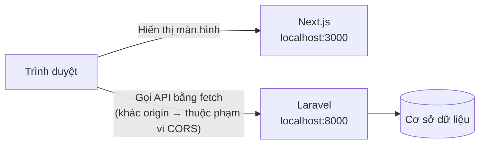
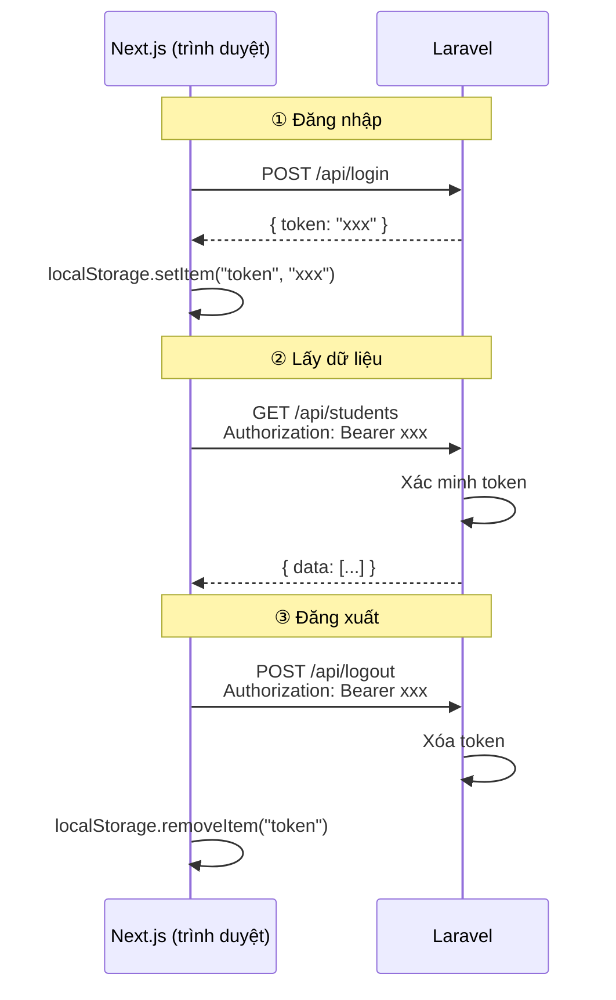

# Tiết 17〜22｜Nhập môn Next.js → Kết nối với Laravel API

> 🇯🇵 Bản gốc (tiếng Nhật): [2026_07_02.md](<../../../2年生_システム開発実践/前期/2026_07_02/2026_07_02.md>) <!-- original-ja-link -->

---

## Tiết 17: Chuyển bản Mock sang kết nối với API

### Mục tiêu hôm nay
- Tạo được project Next.js
- Hiểu cơ chế của App Router
- Chuyển được màn hình bản Mock đã làm ở Tiết 16 sang kết nối với Laravel API thật

> **Điểm chính hôm nay:**  
> Các component đã làm ở Tiết 16 (LoginForm, StudentList, AddStudentForm)  
> **gần như dùng lại được nguyên vẹn.** Thứ thay đổi chỉ là cách lấy dữ liệu.

---

### 0. Kiểm tra sự khác nhau giữa bản Mock và bản API

| | Tiết 16 (bản Mock, React) | Tiết 17 (bản API, Next.js) |
|--|--|--|
| Lấy dữ liệu | Mảng cố định trong code | Lấy từ Laravel API bằng `fetch()` |
| Đăng nhập | Đối chiếu với giá trị cố định | Lấy token bằng `POST /api/login` |
| Thêm học sinh | Thêm vào mảng | Gọi `POST /api/students` |
| Xóa học sinh | Loại khỏi mảng | Gọi `DELETE /api/students/{id}` |
| Giao diện màn hình | **Hoàn toàn giống nhau** | **Hoàn toàn giống nhau** |

---

### 1. Tạo project Next.js

#### 1-1. Cài đặt

Chạy lệnh dưới đây trong terminal (tạo ở **thư mục khác** với `my-app`).

```bash
npx create-next-app@latest school-frontend
```

Có thể sẽ có một vài câu hỏi hiện ra. Nếu có, hãy trả lời như dưới đây.

```
Would you like to use TypeScript?             → Yes  ← Dùng TypeScript
Would you like to use ESLint?                 → Yes
Would you like to use Tailwind CSS?           → Yes  ← Cứ cài sẵn
Would you like your code inside a src/ dir?   → No   ← Đặt thư mục app/ ngay dưới thư mục gốc
Would you like to use App Router?             → Yes
Would you like to use Turbopack?              → No
Would you like to customize the import alias? → No
```

> **Về TypeScript**  
> Phần mở rộng của file sẽ là `.tsx` (TypeScript). Code cơ bản gần như giống JavaScript.  
> Những chỗ cần khai báo kiểu sẽ được giải thích mỗi khi gặp.
>
> **Về Tailwind CSS**  
> Chúng ta sẽ cài đặt, nhưng lần này sẽ dùng inline style. Tailwind có thể dùng trong các bài học sau.

#### 1-2. Cài đặt và khởi động

```bash
# Di chuyển vào thư mục project
cd school-frontend

# Khởi động server phát triển (create-next-app đã tự động cài package)
npm run dev
```

Mở `http://localhost:3000`, nếu màn hình mẫu của Next.js hiện ra là thành công.

---

### 2. Kiểm tra cấu trúc thư mục

```
school-frontend/
├── app/                         ← Nơi đặt các file trang (routing)
│   ├── layout.tsx               ← Khung HTML dùng chung cho mọi trang
│   ├── page.tsx                 ← Trang hiển thị khi truy cập /
│   ├── login/
│   │   └── page.tsx             ← Trang /login
│   └── students/
│       └── page.tsx             ← Trang /students
├── components/                  ← Cùng vị trí với Tiết 16
│   ├── LoginForm.tsx
│   ├── StudentList.tsx
│   └── AddStudentForm.tsx
└── package.json
```

**Khác biệt so với Tiết 16:**

| Tiết 16 (React + Vite) | Tiết 17 (Next.js) |
|--|--|
| `src/App.jsx` là file chính | `app/page.tsx` là trang chủ |
| Chỉ có 1 trang (SPA) | Thư mục = URL (`login/page.tsx` → `/login`) |
| Khởi động bằng `index.html` | `layout.tsx` đảm nhận khung HTML |

---

### 3. Copy các component của Tiết 16

Trước tiên, tạo thư mục `src/components/` rồi copy các file đã làm ở Tiết 16 vào.

```
Copy các file sau vào school-frontend/components/:
  ├── LoginForm.tsx      ← Copy LoginForm.jsx của Tiết 16 (đổi phần mở rộng thành .tsx)
  ├── StudentList.tsx    ← Copy StudentList.jsx của Tiết 16 (đổi phần mở rộng thành .tsx)
  └── AddStudentForm.tsx ← Copy AddStudentForm.jsx của Tiết 16 (đổi phần mở rộng thành .tsx)
```

> **Về phần mở rộng**  
> Vì dùng TypeScript nên thống nhất phần mở rộng file là `.tsx` (file có chứa JSX).  
> Nội dung code có thể copy gần như nguyên vẹn từ file `.jsx` của Tiết 16.

Thêm `"use client";` vào **dòng đầu tiên** của từng file đã copy.

```js
"use client";  // ← Thêm dòng này!
import { useState } from "react";
// ... phần dưới giữ nguyên code của Tiết 16
```

> **`"use client"` là gì?**  
> Mặc định, Next.js chạy code ở phía server.  
> Với những component dùng "chức năng của trình duyệt" như `useState` hay `onClick`,  
> hãy viết `"use client"` ở đầu file để báo rằng "component này chạy trên trình duyệt".

---

### 4. Sửa layout.js

Mở `app/layout.tsx`, xóa toàn bộ nội dung và thay bằng đoạn dưới đây.

```tsx
export const metadata = {
  title: "生徒管理アプリ",
};

export default function RootLayout({
  children,
}: {
  children: React.ReactNode;
}) {
  return (
    <html lang="ja">
      <body style={{ margin: 0, fontFamily: "sans-serif", background: "#f4f6f8" }}>
        {children}
      </body>
    </html>
  );
}
```

> **`{ children }: { children: React.ReactNode }` là gì?**  
> Đây là khai báo kiểu của TypeScript. Nó cho biết "children sẽ chứa phần tử React".  
> `React.ReactNode` có nghĩa là "mọi thứ React có thể hiển thị, như JSX hay chuỗi ký tự".

---

### 5. Chuyển hướng trang chủ (/) sang trang đăng nhập

Mở `app/page.tsx`, xóa toàn bộ nội dung và thay bằng đoạn dưới đây.

```tsx
import { redirect } from "next/navigation";

// Khi truy cập / thì tự động chuyển sang /login
export default function Home() {
  redirect("/login");
}
```

---

### 6. Tạo trang đăng nhập (/login)

Tạo thư mục `app/login/`, rồi tạo mới file `page.tsx`.

```
app/login/page.tsx  ← Tạo mới
```

Copy và dán đoạn dưới đây.

```tsx
"use client";

import { useState } from "react";
import { useRouter } from "next/navigation";

export default function LoginPage() {
  const router = useRouter(); // Dùng để chuyển trang
  const [email, setEmail] = useState("test@example.com");
  const [password, setPassword] = useState("password");
  const [error, setError] = useState("");
  const [loading, setLoading] = useState(false);

  async function handleSubmit(e) {
    e.preventDefault();
    setError("");
    setLoading(true);

    // ★ Khác biệt với Tiết 16: kiểm tra giá trị cố định → gọi API thật
    const res = await fetch("http://localhost:8000/api/login", {
      method: "POST",
      headers: {
        "Content-Type": "application/json",
        "Accept": "application/json",
      },
      body: JSON.stringify({ email, password }),
    });

    const data = await res.json();
    setLoading(false);

    if (res.ok) {
      // ★ Lưu token vào trình duyệt
      localStorage.setItem("token", data.token);
      localStorage.setItem("userName", data.user?.name || "ユーザー");
      // Chuyển sang trang /students
      router.push("/students");
    } else {
      setError("メールアドレスまたはパスワードが違います");
    }
  }

  return (
    <div style={{
      maxWidth: "400px", margin: "80px auto",
      background: "white", padding: "32px",
      borderRadius: "8px", boxShadow: "0 2px 8px rgba(0,0,0,0.1)"
    }}>
      <h2 style={{ marginBottom: "24px", textAlign: "center" }}>ログイン</h2>

      <form onSubmit={handleSubmit}>
        <div style={{ marginBottom: "16px" }}>
          <label style={{ display: "block", marginBottom: "6px", fontWeight: "bold" }}>
            メールアドレス
          </label>
          <input
            type="email"
            value={email}
            onChange={(e) => setEmail(e.target.value)}
            style={{ width: "100%", padding: "10px", border: "1px solid #ccc", borderRadius: "6px", fontSize: "1em", boxSizing: "border-box" }}
          />
        </div>

        <div style={{ marginBottom: "16px" }}>
          <label style={{ display: "block", marginBottom: "6px", fontWeight: "bold" }}>
            パスワード
          </label>
          <input
            type="password"
            value={password}
            onChange={(e) => setPassword(e.target.value)}
            style={{ width: "100%", padding: "10px", border: "1px solid #ccc", borderRadius: "6px", fontSize: "1em", boxSizing: "border-box" }}
          />
        </div>

        {error && (
          <p style={{ color: "#D32F2F", fontSize: "0.9em", marginBottom: "12px" }}>
            {error}
          </p>
        )}

        <button
          type="submit"
          disabled={loading}
          style={{ width: "100%", padding: "12px", background: loading ? "#aaa" : "#1976D2", color: "white", border: "none", borderRadius: "6px", fontSize: "1em", fontWeight: "bold", cursor: loading ? "not-allowed" : "pointer" }}
        >
          {loading ? "ログイン中..." : "ログイン"}
        </button>
      </form>
    </div>
  );
}
```

**Khác biệt so với `LoginForm.tsx` của Tiết 16:**

| | Tiết 16 (Mock) | Tiết 17 (API) |
|--|--|--|
| Cách xác thực | Đối chiếu với giá trị cố định | `fetch("http://localhost:8000/api/login")` |
| Sau khi đăng nhập | `setIsLoggedIn(true)` | `localStorage.setItem("token", ...)` + chuyển trang |
| Chuyển trang | Đổi màn hình bằng rẽ nhánh điều kiện | `router.push("/students")` |

---

### 7. Tạo trang quản lý học sinh (/students)

Tạo thư mục `app/students/`, rồi tạo mới file `page.tsx`.

```
app/students/page.tsx  ← Tạo mới
```

Copy và dán đoạn dưới đây.

```tsx
"use client";

import { useState, useEffect } from "react";
import { useRouter } from "next/navigation";
import StudentList from "@/components/StudentList";
import AddStudentForm from "@/components/AddStudentForm";

export default function StudentsPage() {
  const router = useRouter();
  const [students, setStudents] = useState([]);
  const [userName, setUserName] = useState("");
  const [loading, setLoading] = useState(true);
  const [addError, setAddError] = useState(""); // ← Dùng để hiển thị lỗi khi thêm

  // ★ useEffect: chỉ chạy 1 lần khi trang được hiển thị
  useEffect(() => {
    const token = localStorage.getItem("token");

    // Nếu không có token thì quay về trang đăng nhập
    if (!token) {
      router.push("/login");
      return;
    }

    setUserName(localStorage.getItem("userName") || "ユーザー");
    loadStudents(token);
  }, []); // [] = chỉ chạy 1 lần đầu tiên

  // Lấy danh sách học sinh từ API
  async function loadStudents(token) {
    setLoading(true);

    const res = await fetch("http://localhost:8000/api/students", {
      headers: {
        "Accept": "application/json",
        "Authorization": `Bearer ${token}`, // ★ Gắn token vào header
      },
    });

    // 401 = token không hợp lệ → quay về trang đăng nhập
    if (res.status === 401) {
      router.push("/login");
      return;
    }

    const data = await res.json();
    setStudents(data.data); // Laravel API trả về theo dạng { data: [...] }
    setLoading(false);
  }

  // Thêm học sinh
  async function handleAdd(newStudent) {
    const token = localStorage.getItem("token");
    setAddError(""); // ← Xóa lỗi

    const res = await fetch("http://localhost:8000/api/students", {
      method: "POST",
      headers: {
        "Content-Type": "application/json",
        "Accept": "application/json",
        "Authorization": `Bearer ${token}`,
      },
      body: JSON.stringify(newStudent),
    });

    if (res.ok) {
      loadStudents(token); // ★ Sau khi thêm thì lấy lại danh sách để cập nhật màn hình
    } else {
      // ★ Khi thất bại thì hiển thị nội dung lỗi của API lên màn hình
      const data = await res.json();
      if (data.errors) {
        const messages = Object.values(data.errors).flat().join(" / ");
        setAddError(messages);
      } else {
        setAddError(`エラーが発生しました（HTTP ${res.status}）`);
      }
    }
  }

  // Xóa học sinh
  async function handleDelete(id) {
    const token = localStorage.getItem("token");

    const res = await fetch(`http://localhost:8000/api/students/${id}`, {
      method: "DELETE",
      headers: {
        "Accept": "application/json",
        "Authorization": `Bearer ${token}`,
      },
    });

    if (res.ok) {
      loadStudents(token); // ★ Sau khi xóa thì lấy lại danh sách để cập nhật màn hình
    }
  }

  // Đăng xuất
  async function handleLogout() {
    const token = localStorage.getItem("token");

    await fetch("http://localhost:8000/api/logout", {
      method: "POST",
      headers: {
        "Accept": "application/json",
        "Authorization": `Bearer ${token}`,
      },
    });

    localStorage.removeItem("token");
    localStorage.removeItem("userName");
    router.push("/login");
  }

  if (loading) {
    return (
      <div style={{ textAlign: "center", padding: "80px", color: "#888" }}>
        読み込み中...
      </div>
    );
  }

  return (
    <div style={{ background: "#f4f6f8", minHeight: "100vh" }}>

      {/* Header (giao diện giống Tiết 16) */}
      <header style={{
        background: "#1565C0", color: "white",
        padding: "16px 32px",
        display: "flex", alignItems: "center"
      }}>
        <h1 style={{ fontSize: "1.2em" }}>生徒管理アプリ（Next.js API版）</h1>
        <div style={{ marginLeft: "auto", display: "flex", alignItems: "center", gap: "12px" }}>
          <span style={{ fontSize: "0.9em" }}>● ログイン中：{userName}</span>
          <button
            onClick={handleLogout}
            style={{ background: "#D32F2F", color: "white", border: "none", borderRadius: "6px", padding: "6px 14px", cursor: "pointer" }}
          >
            ログアウト
          </button>
        </div>
      </header>

      {/* Nội dung chính (dùng cùng các component như Tiết 16) */}
      <main style={{ padding: "32px", maxWidth: "900px", margin: "0 auto" }}>
        <AddStudentForm onAdd={handleAdd} />
        {/* ★ Khi thêm thất bại thì hiển thị thông báo lỗi của API */}
        {addError && (
          <p style={{ color: "#D32F2F", marginBottom: "16px", fontWeight: "bold" }}>
            ⚠ {addError}
          </p>
        )}
        <StudentList students={students} onDelete={handleDelete} />
      </main>

    </div>
  );
}
```

**Khác biệt so với `App.tsx` của Tiết 16:**

|                            | Tiết 16 (Mock)            | Tiết 17 (API)                         |
| -------------------------- | --------------------- | --------------------------------- |
| Dữ liệu ban đầu                      | Mảng `INITIAL_STUDENTS` | Lấy bằng `useEffect` → `fetch`         |
| Thêm                         | Push vào mảng              | `POST /api/students` → lấy lại        |
| Xóa                         | Filter mảng            | `DELETE /api/students/{id}` → lấy lại |
| StudentList/AddStudentForm | **Hoàn toàn giống nhau**              | **Hoàn toàn giống nhau**                          |

---

### 8. Cấu hình CORS (phía Laravel)

Khi gọi Laravel (`http://localhost:8000`) từ Next.js (`http://localhost:3000`),  
thông thường việc giao tiếp sẽ bị chặn bởi **chức năng bảo mật của trình duyệt (CORS)**.

Hãy xác nhận rằng chúng ta đang truy cập vào 2 server có cổng khác nhau: màn hình ở cổng 3000, còn API ở cổng 8000.



**Ở Laravel 13, mặc định đã cho phép tất cả origin (`*`), nên trong lúc phát triển không cần thay đổi cấu hình.**

> **CORS là gì?**  
> Là cơ chế mà trình duyệt chặn "request gửi tới server khác (chỉ cần khác cổng cũng bị coi là khác)"  
> vì lý do bảo mật.  
> Có thể gỡ chặn bằng cách khai báo rõ ở phía Laravel rằng "truy cập từ origin này là OK".

---

#### (Tham khảo) Giới hạn nguồn kết nối ở môi trường production

Khi phát triển xong và công khai lên production, hãy thu hẹp các origin được phép truy cập.

Trước tiên, tạo file cấu hình:

```bash
php artisan config:publish cors
```

Mở file `config/cors.php` vừa được tạo và sửa lại:

```php
// Trước khi sửa (cho phép tất cả origin)
'allowed_origins' => ['*'],

// Sau khi sửa (chỉ cho phép URL của frontend production)
'allowed_origins' => ['https://your-frontend.com'],
```

Sau khi sửa, hãy xóa cache:

```bash
php artisan config:clear
```

---

### 8-2. Lỗi thường gặp khi cấu hình route (`routes/api.php`)

> **⚠ Điểm dễ mắc lỗi: Đăng ký `Route::apiResource` hai lần**  
>
> Nếu viết route `students` 2 lần như dưới đây, **route viết sau sẽ được ưu tiên**.  
> Khi bản không xác thực và bản có xác thực lẫn lộn với nhau, ứng dụng sẽ hoạt động không như mong muốn.
>
> ```php
> // ❌ NG: cùng một resource bị đăng ký 2 lần
> Route::apiResource('students', StudentController::class); // ← Xóa dòng này
>
> Route::middleware('auth:sanctum')->group(function () {
>     Route::apiResource('students', StudentController::class); // ← Chỉ giữ lại dòng này
> });
> ```
>
> ```php
> // ✅ OK: chỉ viết bên trong auth:sanctum
> Route::post('/login', [AuthController::class, 'login']);
>
> Route::middleware('auth:sanctum')->group(function () {
>     Route::post('/logout', [AuthController::class, 'logout']);
>     Route::get('/me',      [AuthController::class, 'me']);
>     Route::apiResource('students', StudentController::class);
> });
> ```
>
> Sau khi cấu hình, bạn có thể xem danh sách route bằng `php artisan route:list --path=api/students`.

---

### 9. Khởi động cả hai server và kiểm tra hoạt động

**Mở 2 terminal** và khởi động ở từng terminal.

```bash
# Terminal ① Laravel (backend)
cd (thư mục project Laravel)
php artisan serve
# → Khởi động tại http://localhost:8000

# Terminal ② Next.js (frontend)
cd school-frontend
npm run dev
# → Khởi động tại http://localhost:3000
```

Khi truy cập `http://localhost:3000` trên trình duyệt, bạn sẽ được chuyển hướng tới `/login`.

---

### 10. Checklist kiểm tra hoạt động

| Mục kiểm tra | Thao tác | Kết quả mong đợi |
|---------|------|------------|
| Chuyển hướng | Mở `http://localhost:3000` | Tự động chuyển tới `/login` |
| Đăng nhập thất bại | Đổi mật khẩu rồi đăng nhập | Thông báo lỗi được hiển thị |
| Đăng nhập thành công | Đăng nhập bằng thông tin đúng | Chuyển tới `/students` và danh sách học sinh được hiển thị |
| Kiểm tra lấy dữ liệu từ API | Xem danh sách học sinh | Dữ liệu thật trong DB của Laravel được hiển thị |
| Thêm học sinh | Nhập vào form rồi thêm | Dòng mới được thêm vào bảng |
| Xóa học sinh | Nhấn nút xóa | Sau khi xác nhận, dòng đó biến mất |
| Đăng xuất | Nhấn nút đăng xuất | Quay lại `/login` |
| Truy cập khi chưa xác thực | Sau khi đăng xuất, mở trực tiếp `/students` | Bị chuyển hướng tới `/login` |

---

### 11. Tổng kết thay đổi từ Tiết 16 → Tiết 17

```
Tiết 16 (bản Mock, React)       Tiết 17 (bản API, Next.js)
─────────────────────────────────────────────────────────
src/
├── App.jsx                →  app/students/page.tsx
│   (quản lý bằng useState)     (quản lý bằng useEffect + fetch)
│
├── components/
│   ├── LoginForm.jsx      →  app/login/page.tsx
│   │   (kiểm tra giá trị cố định)  (fetch POST /api/login)
│   │
│   ├── StudentList.jsx    →  components/StudentList.tsx
│   │                           (chỉ cần thêm "use client")
│   │
│   └── AddStudentForm.jsx →  components/AddStudentForm.tsx
│                               (chỉ cần thêm "use client")
│
└── main.jsx               →  app/layout.tsx
```

> **Điểm quan trọng:**  
> `StudentList` và `AddStudentForm` **hoàn toàn không bị thay đổi nội dung.**  
> Chỉ thêm đúng 1 dòng `"use client"`.  
> Component chỉ tập trung vào "việc hiển thị", còn "cách lấy dữ liệu" do Page đảm nhận —  
> đây là nguyên tắc cơ bản trong thiết kế component của React / Next.js.

---

## Tiết 18: Thiết kế component

### Mục tiêu hôm nay
- Tách được các component dùng chung
- Có ý thức về kiểu của props (dữ liệu nào sẽ được truyền vào)

---

### Tạo component có thể tái sử dụng

Khi xem lại ứng dụng đã làm ở Tiết 17, ta thấy có một số "component có thể dùng lại ở các trang khác".

```
components/
├── ui/                      ← Bộ phận UI dùng chung
│   ├── Button.tsx
│   ├── StatusBadge.tsx      ← Hiển thị badge như "Đang ○○"
│   └── LoadingSpinner.tsx
└── students/                ← Bộ phận chuyên dùng cho quản lý học sinh
    ├── StudentList.tsx
    └── AddStudentForm.tsx
```

---

### Ví dụ component Button

```tsx
"use client";

// variant = "primary" (xanh dương) hoặc "danger" (đỏ)
function Button({ children, onClick, variant = "primary", disabled = false }: {
  children: React.ReactNode;
  onClick?: () => void;
  variant?: "primary" | "danger";
  disabled?: boolean;
}) {
  const bgColor = variant === "danger" ? "#D32F2F" : "#1976D2";

  return (
    <button
      onClick={onClick}
      disabled={disabled}
      style={{
        padding: "9px 18px",
        background: disabled ? "#aaa" : bgColor,
        color: "white",
        border: "none",
        borderRadius: "6px",
        fontWeight: "bold",
        cursor: disabled ? "not-allowed" : "pointer",
        fontSize: "0.95em",
      }}
    >
      {children}
    </button>
  );
}

export default Button;

// Cách sử dụng
// <Button onClick={handleSave}>保存</Button>
// <Button variant="danger" onClick={handleDelete}>削除</Button>
// <Button disabled={loading}>{loading ? "送信中..." : "送信"}</Button>
```

---

### Ví dụ component LoadingSpinner

```tsx
function LoadingSpinner({ message = "読み込み中..." }: { message?: string }) {
  return (
    <div style={{ textAlign: "center", padding: "60px", color: "#888" }}>
      <p>{message}</p>
    </div>
  );
}

export default LoadingSpinner;
```

---

## Tiết 19: Tìm hiểu sâu về useEffect

### Mục tiêu hôm nay
- Giải thích được thời điểm `useEffect` chạy
- Hiểu ý nghĩa của mảng phụ thuộc (tham số thứ 2)

---

### useEffect là gì

```js
useEffect(() => {
  // Xử lý viết ở đây sẽ được chạy vào "thời điểm nhất định"
}, [mảng phụ thuộc]);
```

| Mảng phụ thuộc | Thời điểm chạy |
|---------|-------------|
| `[]` | **Chỉ 1 lần** khi component được hiển thị lần đầu |
| `[value]` | Chạy mỗi khi `value` thay đổi |
| Bỏ qua (không có) | Chạy sau mỗi lần render (hầu như không dùng) |

---

### Cách dùng thường gặp: lấy lại dữ liệu khi ID thay đổi

```tsx
"use client";

import { useState, useEffect } from "react";

export default function StudentDetailPage({ params }: { params: { id: string } }) {
  const [student, setStudent] = useState<any>(null);

  useEffect(() => {
    const token = localStorage.getItem("token");

    fetch(`http://localhost:8000/api/students/${params.id}`, {
      headers: {
        "Accept": "application/json",
        "Authorization": `Bearer ${token}`,
      },
    })
      .then((res) => res.json())
      .then((data) => setStudent(data.data));

  }, [params.id]); // ← Lấy lại dữ liệu mỗi khi params.id thay đổi

  if (!student) return <p>読み込み中...</p>;

  return (
    <div>
      <h1>{student.name}</h1>
      <p>メール: {student.email}</p>
      <p>点数: {student.score}</p>
    </div>
  );
}
```

---

## Tiết 20: Sắp xếp lại cơ chế xác thực

### Mục tiêu hôm nay
- Giải thích được luồng xác thực bằng token qua sơ đồ
- Cài đặt được việc chuyển hướng khi chưa đăng nhập

---

### Luồng xác thực bằng token

Sơ đồ dưới đây lần lượt minh họa cách token được trao đổi qua lại trong các bước đăng nhập → lấy dữ liệu → đăng xuất.



---

### Chuyển hướng khi chưa đăng nhập (custom hook)

Nếu dùng cùng một xử lý chuyển hướng ở nhiều trang, hãy gom lại thành **custom hook**.

```ts
// hooks/useAuth.ts
import { useEffect, useState } from "react";
import { useRouter } from "next/navigation";

export function useAuth() {
  const router = useRouter();
  const [token, setToken] = useState(null);
  const [userName, setUserName] = useState("");

  useEffect(() => {
    const savedToken = localStorage.getItem("token");
    if (!savedToken) {
      router.push("/login");
      return;
    }
    setToken(savedToken);
    setUserName(localStorage.getItem("userName") || "ユーザー");
  }, []);

  return { token, userName };
}

// Cách sử dụng (ở từng trang)
// const { token, userName } = useAuth();
// → Nếu không có token thì tự động chuyển tới /login
```

---

## Tiết 21: Sắp xếp lại validation cho form

### Mục tiêu hôm nay
- Cài đặt được validation (kiểm tra dữ liệu nhập) ở phía frontend
- Nhận và hiển thị được lỗi validation từ phía Laravel

---

### Nhận lỗi validation từ Laravel

Khi xảy ra lỗi 422, Laravel trả về trong response body các mục bị lỗi và lý do.

```json
{
  "message": "The email has already been taken.",
  "errors": {
    "email": ["The email has already been taken."]
  }
}
```

Để hiển thị các lỗi này lên màn hình, hãy duyệt qua `data.errors` để lấy các thông báo lỗi.

```tsx
if (res.ok) {
  loadStudents(token);
} else {
  const data = await res.json();
  if (data.errors) {
    // Nối tất cả giá trị (mảng) của errors thành 1 chuỗi
    const messages = Object.values(data.errors).flat().join(" / ");
    setAddError(messages);
  } else {
    setAddError(`エラーが発生しました（HTTP ${res.status}）`);
  }
}
```

> **⚠ Nguyên nhân 422 thường gặp: trùng địa chỉ email**  
> Do quy tắc `unique:students` của Laravel, mỗi địa chỉ email chỉ đăng ký được 1 lần.  
> Nếu hiện 「The email has already been taken.」 thì hãy dùng địa chỉ email khác.
>
> | Thông báo lỗi | Nguyên nhân |
> |--|--|
> | The email has already been taken. | Địa chỉ email đó đã tồn tại trong DB |
> | The score must be an integer. | Điểm được nhập là số thập phân (ví dụ: 80.5) |
> | The name field is required. | Tên bị để trống |

---

## Tiết 22: Bài tập giữa kỳ — Hoàn thành ứng dụng full-stack

Hoàn thiện ứng dụng full-stack với **API học kỳ 1 (Laravel) + màn hình Next.js**.

### Checklist

- [ ] Màn hình đăng nhập (`/login`)
- [ ] Trang danh sách học sinh (`/students`) — lấy dữ liệu từ API
- [ ] Chức năng thêm học sinh (form + validation)
- [ ] Chức năng xóa học sinh
- [ ] Chuyển hướng khi chưa đăng nhập
- [ ] Chức năng đăng xuất
- [ ] Cấu hình CORS (phía Laravel)
- [ ] Khởi động cả hai server cùng lúc và kiểm tra hoạt động

---

## Buổi sau (Tiết 23)

Chúng ta sẽ bắt đầu đồ án tốt nghiệp.  
Bắt đầu từ định nghĩa yêu cầu và thiết kế màn hình, cả nhóm sẽ cùng nhau xây dựng một ứng dụng Web hoàn chỉnh.
