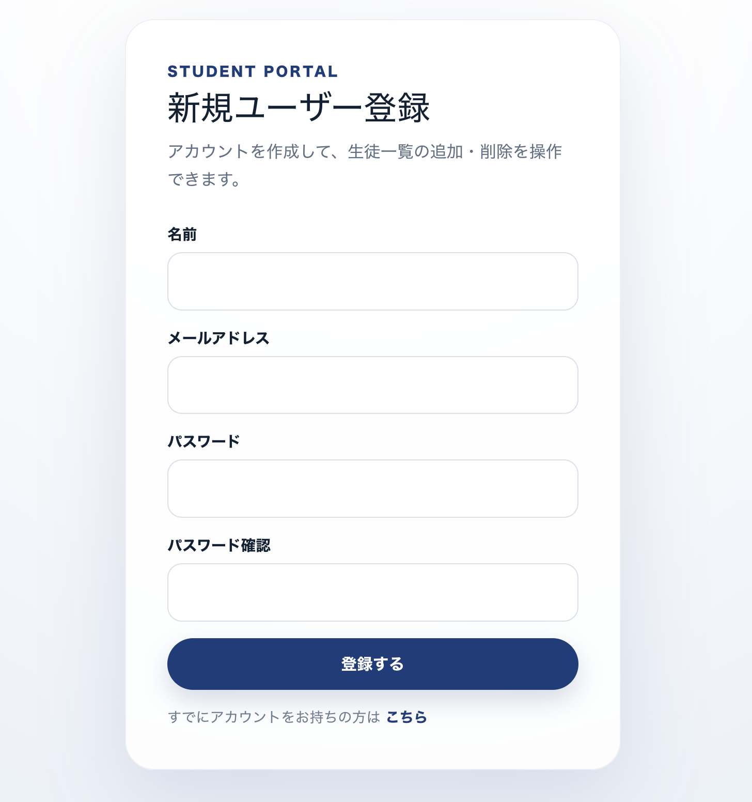
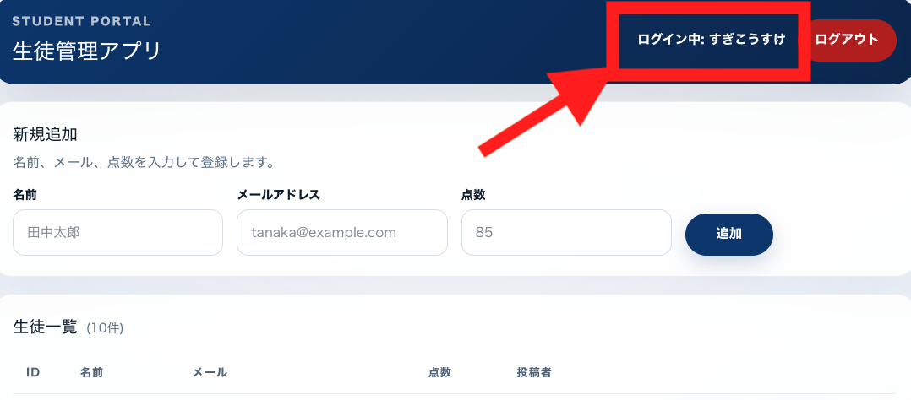
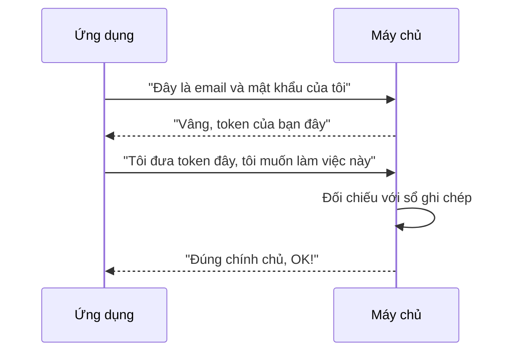
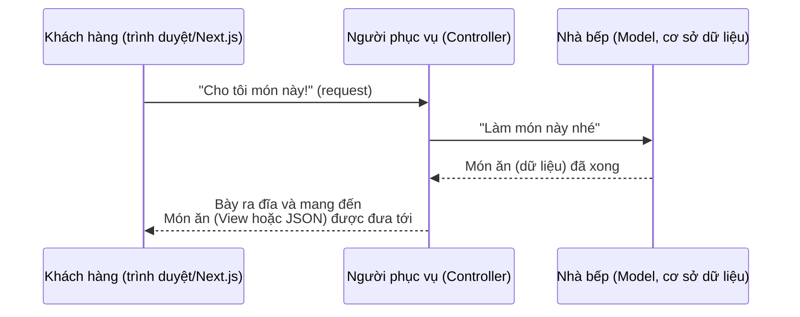

# Tiết 23｜Thêm chức năng đăng ký người dùng mới và ôn tập những gì đã học

> 🇯🇵 Bản gốc (tiếng Nhật): [2026_07_09.md](<../../../2年生_システム開発実践/前期/2026_07_09/2026_07_09.md>) <!-- original-ja-link -->

---

# Bạn nào đã làm xong đến đây thì hãy làm tiếp màn hình đăng ký người dùng mới nhé

Hiện tại ứng dụng mới chỉ có màn hình đăng nhập, nên người muốn thêm học sinh mới không thể vào màn hình.

## Chúng ta sẽ làm gì

Chúng ta sẽ làm màn hình "Đăng ký người dùng mới" như trong hình bên dưới. Nhờ chức năng tạo tài khoản mới, ngay cả người lần đầu sử dụng cũng có thể tự tạo tài khoản và đăng nhập.



Chỉ cần đăng nhập được bằng tài khoản người dùng vừa đăng ký là OK!!!



## Các thành phần cần có trên màn hình

- Ô nhập **tên**
- Ô nhập **địa chỉ email**
- Ô nhập **mật khẩu**
- Ô nhập **xác nhận mật khẩu** (nhập lại mật khẩu một lần nữa để tránh gõ nhầm)
- **Nút đăng ký**
- Đường link sang màn hình đăng nhập với nội dung "Nếu bạn đã có tài khoản, hãy bấm vào đây"

## Gợi ý triển khai (liên quan đến những gì đã học)

- Việc màn hình này làm tương ứng với **Create (tạo người dùng mới)** trong CRUD. Ở phía Laravel, đây là phần xử lý tương ứng với `store()`
- Dùng **form** của Next.js để gửi (POST) tên, email, mật khẩu mà người dùng nhập tới Laravel API
- **Controller** ở phía Laravel sẽ kiểm tra hợp lệ (validation) dữ liệu nhận được (mật khẩu và xác nhận mật khẩu có khớp nhau không, email có bị trùng không, v.v.), rồi lưu vào cơ sở dữ liệu thông qua **Model**
- Khi đăng ký thành công, sẽ tự nhiên hơn nếu chuyển thẳng sang màn hình đăng nhập (hoặc cho đăng nhập luôn và cấp **token**)

---

# Ôn tập những gì đã học (thầy/cô sẽ giải thích trên bảng!)

## 1. Cơ chế của token

Máy chủ của ứng dụng nhận request (yêu cầu) từ rất nhiều người. Khi đó, máy chủ phải xác nhận "Yêu cầu này có thật sự đến từ chính người đã đăng nhập không?". Thứ dùng để xác nhận việc này, giống như một "thẻ mật khẩu", chính là **token**.

### Thử nghĩ về chiếc vòng đeo tay ở công viên giải trí

Khi vào công viên giải trí, bạn đưa vé ra và được phát một chiếc "vòng đeo tay", đúng không? Sau đó, mỗi lần chơi một trò, bạn không cần đưa lại vé mà **chỉ cần giơ vòng đeo tay** là nhân viên biết "người này là khách đã vào cổng rồi".

Token cũng có vai trò giống như vậy.

```
   [Đăng ký ở quầy bán vé]
          ↓
   Nhân viên: "OK, vòng đeo tay của bạn đây"
          ↓
   ★ Đeo vòng lên tay ★
          ↓
   Từ đó về sau, mỗi lần chơi trò nào
   chỉ cần giơ vòng đeo tay là OK!
```

### Trong thế giới ứng dụng, luồng xử lý cũng giống vậy

1. **Đăng nhập**: gửi địa chỉ email và mật khẩu để báo "Tôi đây"
2. **Nhận token**: khi máy chủ xác nhận được "đúng là chính chủ", máy chủ sẽ cấp cho bạn thẻ mật khẩu (token)
3. **Giữ thẻ**: lưu token nhận được ở phía ứng dụng
4. **Đưa thẻ ra**: mỗi lần thực hiện thao tác nào đó, gửi kèm token đó
5. **Máy chủ kiểm tra**: đối chiếu "token này đúng là của người đã đăng nhập" rồi cho phép

Vẽ luồng này thành sơ đồ thì sẽ như sau.



### Những điều cần nhớ

- Token giống như mật khẩu. **Nếu để người khác nhìn thấy hoặc bị đánh cắp, kẻ xấu có thể giả mạo bạn**, nên phải giữ gìn cẩn thận
- "Đăng xuất" = ghi vào sổ ở phía máy chủ rằng "token này đã hết hiệu lực"
- Để con người làm việc kiểm tra này mỗi lần thì rất vất vả, nên trong Laravel có cơ chế `auth:sanctum` tự động kiểm tra giúp

### Có thể xem token bằng công cụ dành cho nhà phát triển

Thật ra, ứng dụng của bạn đang giữ token nào thì **chỉ cần mở công cụ dành cho nhà phát triển (DevTools) của trình duyệt là xem được**.

- **Tab Application (với Chrome)** → xem `Local Storage` sẽ thấy chuỗi token đang được lưu
- **Tab Network** → xem các request gửi tới API sẽ thấy token thật nằm trong header `Authorization: Bearer ○○○`

Khi không biết "đã nhận được token đúng chưa" hay "token đã được gắn đúng vào request chưa", hãy tập thói quen kiểm tra bằng công cụ dành cho nhà phát triển trước, như vậy sẽ dễ tìm ra nguyên nhân lỗi hơn.

### Code JavaScript thực tế

Đoạn code dưới đây là **code viết ở phía Next.js (frontend), không phải phía Laravel**. Hãy hình dung đây là code của bên nhờ người phục vụ (Controller), tức là code của "khách hàng".

#### 1. Đăng nhập để nhận token và lưu lại

```javascript
async function login(email, password) {
  const response = await fetch('http://localhost:8000/api/login', {
    method: 'POST',
    headers: {
      'Content-Type': 'application/json',
    },
    body: JSON.stringify({ email, password }),
  });

  const data = await response.json();

  // Lưu token nhận được từ máy chủ vào trình duyệt
  localStorage.setItem('token', data.token);
}
```

#### 2. Gắn token đã lưu để gọi API

```javascript
async function fetchMyProfile() {
  // Lấy ra token đã lưu lúc nãy
  const token = localStorage.getItem('token');

  const response = await fetch('http://localhost:8000/api/user', {
    method: 'GET',
    headers: {
      // Gắn token vào đây, giống như đưa "thẻ mật khẩu" ra
      Authorization: `Bearer ${token}`,
    },
  });

  const data = await response.json();
  console.log(data);
}
```

#### 3. Đăng xuất (làm token hết hiệu lực)

```javascript
async function logout() {
  const token = localStorage.getItem('token');

  await fetch('http://localhost:8000/api/logout', {
    method: 'POST',
    headers: {
      Authorization: `Bearer ${token}`,
    },
  });

  // Xóa luôn token còn lại ở phía trình duyệt
  localStorage.removeItem('token');
}
```

Phần `Authorization: Bearer ${token}` chính là động tác "giơ vòng đeo tay ra". Nếu không gắn header theo dạng này, máy chủ sẽ "không biết request này của ai", và sẽ trả về lỗi 401 (lỗi xác thực).

## 2. Về CRUD

CRUD là từ ghép các chữ cái đầu của **4 thao tác cơ bản** mà ứng dụng thực hiện với dữ liệu. Hãy thử tưởng tượng đến một cuốn vở, bạn sẽ dễ hiểu hơn.

| Chữ cái đầu | Thao tác | Ví dụ với cuốn vở |
|------|------|------------------|
| **C**reate (tạo) | Thêm dữ liệu mới | Viết một trang mới vào vở |
| **R**ead (đọc) | Xem dữ liệu | Đọc lại trang đã viết |
| **U**pdate (cập nhật) | Sửa đổi dữ liệu | Xóa nội dung đã viết rồi viết lại |
| **D**elete (xóa) | Xóa dữ liệu | Xé trang đó đi và vứt bỏ |

```
      ┌─────────── Cuốn vở (cơ sở dữ liệu) ───────────┐
      │                                                │
 Create│ Thêm trang mới   →  [ Trang 1 ]                │
      │                                                │
  Read │ Đọc              →  "À, ra là cái này"         │
      │                                                │
Update │ Viết lại         →  [ Trang 1 (bản đã sửa) ]   │
      │                                                │
Delete │ Xé và vứt đi     →  (trang biến mất)           │
      └────────────────────────────────────────────────┘
```

### Tại sao lại quan trọng?

- Bảng tin, cửa hàng online, mạng xã hội, ứng dụng quản lý công việc... hầu hết ứng dụng đều được tạo nên từ sự kết hợp "tạo, xem, sửa, xóa" dữ liệu
- Laravel có một tính năng tiện lợi là `Route::apiResource`, giúp chuẩn bị sẵn cả 4 thao tác này (thực tế là 5) cùng một lúc

```php
Route::apiResource('users', UserController::class);
// Chỉ với 1 dòng này, toàn bộ các đường "tạo, xem, sửa, xóa" đều được kết nối
```

Khi chú ý đến CRUD, mọi người trong nhóm sẽ dễ dàng hiểu được "nút này dùng để làm gì".

## 3. Về mô hình MVC của Laravel

Ứng dụng Laravel sẽ dễ hình dung hơn nếu ví như một **nhà hàng**. Vì vai trò được phân chia rõ ràng nên dù có nhiều người cùng làm việc cũng không bị rối.

### Thử nghĩ theo vai trò trong nhà hàng

- **Controller = người phục vụ**: người nhận yêu cầu gọi món từ khách (request), chuyển cho bếp, rồi mang món ăn đã làm xong đến cho khách
- **Model = nhà bếp, tủ lạnh**: nơi cất giữ nguyên liệu (dữ liệu) và thực sự nấu món ăn (lấy và lưu dữ liệu)
- **View = món ăn đã bày ra đĩa**: diện mạo cuối cùng được đặt trước mặt khách

Vẽ luồng từ lúc gọi món đến lúc món ăn được mang ra thành sơ đồ thì sẽ như sau.



### Chuyển sang API thì có gì thay đổi?

Trước khi chuyển sang API, người phục vụ (Controller) bày món ăn nhận từ bếp ra đĩa **ngay trong nhà hàng** rồi đặt trước mặt khách (tạo màn hình bằng Blade).

Sau khi chuyển sang API, người phục vụ (Controller) **không bày ra đĩa nữa mà chỉ đưa nguyên liệu và cách làm (dữ liệu JSON)** cho khách. Còn việc thực sự dựng nên diện mạo (bày ra đĩa) sẽ do phía Next.js đảm nhận.

Nói cách khác, công việc cơ bản của người phục vụ là "nhận yêu cầu gọi món và trao đổi với bếp" vẫn không thay đổi, **chỉ có khâu bày biện cuối cùng (tạo giao diện màn hình) là được chuyển sang phía Next.js**. Hình dung như vậy sẽ dễ hiểu hơn.

