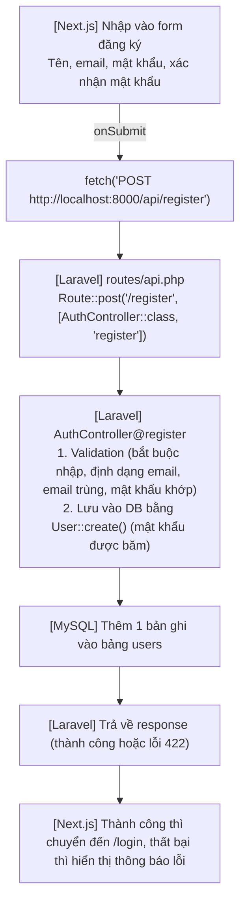

# Quy trình tạo màn hình đăng ký người dùng mới

> 🇯🇵 Bản gốc (tiếng Nhật): [2026_07_09_2.md](<../../../2年生_システム開発実践/前期/2026_07_09/2026_07_09_2.md>) <!-- original-ja-link -->

Tài liệu này là hướng dẫn từng bước để các bạn tự tay thực hiện bài tập "Tạo màn hình đăng ký người dùng mới" của Tiết 23.  
Chúng ta sẽ triển khai yêu cầu được đưa ra trong `2026_07_09.md` trên dự án `school-frontend` đã làm trong các buổi học trước (Tiết 17–22).

---

## 0. Tổng quan: các thành phần kết nối với nhau như thế nào

Màn hình đăng ký là chức năng "tạo mới 1 bản ghi", nên tương ứng với **Create** trong CRUD.  
Luồng xử lý gần như giống với màn hình đăng nhập (Tiết 17), chỉ khác URL gửi đến và nội dung validation.



Thật ra, trong `routes/api.php`, **route dùng cho đăng ký đã được viết sẵn từ Tiết 08 rồi.**

```php
// routes/api.php (chắc là đã được viết sẵn)
Route::post('/login', [AuthController::class, 'login']);
Route::post('/register', [AuthController::class, 'register']);
```

Tuy nhiên, bên trong `AuthController` mới chỉ triển khai `login` / `logout` / `me`,  
nên hiện tại **chưa có method `register()`**. Hôm nay chúng ta sẽ bắt đầu từ việc tạo method này.

---

## 1. Phía Laravel: triển khai `register()`

Mở `app/Http/Controllers/Api/AuthController.php` và thêm method vào gần method `login()`.

```php
// app/Http/Controllers/Api/AuthController.php
use App\Models\User;
use Illuminate\Support\Facades\Hash;

// POST /api/register
public function register(Request $request)
{
    // ① Kiểm tra dữ liệu nhập vào
    $validated = $request->validate([
        'name'     => 'required|string|max:255',
        'email'    => 'required|email|unique:users,email',
        'password' => 'required|min:8|confirmed',
    ]);

    // ② Tạo người dùng (mật khẩu nhất định phải được băm)
    $user = User::create([
        'name'     => $validated['name'],
        'email'    => $validated['email'],
        'password' => Hash::make($validated['password']),
    ]);

    // ③ Vì muốn cho đăng nhập luôn nên cũng cấp token và trả về
    $token = $user->createToken('api-token')->plainTextToken;

    return response()->json([
        'status' => 'ok',
        'token'  => $token,
        'user'   => $user,
    ], 201); // 201 = tạo mới thành công
}
```

### Những điểm chính của validation

| Quy tắc | Ý nghĩa |
|--------|------|
| `required` | Nếu không nhập thì trả về lỗi 422 |
| `email` | Kiểm tra có đúng định dạng email không |
| `unique:users,email` | Kiểm tra trong bảng `users` chưa có email giống vậy (chống đăng ký trùng) |
| `min:8` | Mật khẩu phải từ 8 ký tự trở lên |
| `confirmed` | Quy tắc đặc biệt tự động kiểm tra **giá trị có khớp với trường có tên "cùng tên + `_confirmation`" hay không** |

Khi dùng quy tắc `confirmed`, tên key gửi từ frontend bắt buộc phải như sau.

```json
{
  "name": "田中太郎",
  "email": "tanaka@example.com",
  "password": "password123",
  "password_confirmation": "password123"
}
```

Chỉ cần sai 1 ký tự trong tên `password_confirmation` là quy tắc `confirmed` sẽ không hoạt động đúng, gây ra lỗi "đã khớp rồi mà vẫn báo lỗi", nên hãy chú ý.

---

## 2. Phía Next.js: tạo trang `/register`

Tạo thư mục `app/register/` và tạo mới file `page.tsx`.

```
app/register/page.tsx  ← tạo mới
```

Chúng ta làm theo cùng cấu trúc với trang đăng nhập (Tiết 17). **Chỉ khác các ô nhập và nơi gửi dữ liệu đến.**

```tsx
"use client";

import { useState } from "react";
import { useRouter } from "next/navigation";

export default function RegisterPage() {
  const router = useRouter();
  const [name, setName] = useState("");
  const [email, setEmail] = useState("");
  const [password, setPassword] = useState("");
  const [passwordConfirmation, setPasswordConfirmation] = useState("");
  const [error, setError] = useState("");
  const [loading, setLoading] = useState(false);

  async function handleSubmit(e) {
    e.preventDefault();
    setError("");
    setLoading(true);

    const res = await fetch("http://localhost:8000/api/register", {
      method: "POST",
      headers: {
        "Content-Type": "application/json",
        "Accept": "application/json",
      },
      // ★ Tên key phải khớp với validation ở phía Laravel
      body: JSON.stringify({
        name,
        email,
        password,
        password_confirmation: passwordConfirmation,
      }),
    });

    const data = await res.json();
    setLoading(false);

    if (res.ok) {
      // ★ Cho vào trạng thái đăng nhập luôn (lưu token rồi chuyển đến /students)
      localStorage.setItem("token", data.token);
      localStorage.setItem("userName", data.user?.name || "ユーザー");
      router.push("/students");
    } else if (data.errors) {
      // Hiển thị lỗi validation của Laravel, giống như đã học ở Tiết 21
      const messages = Object.values(data.errors).flat().join(" / ");
      setError(messages);
    } else {
      setError(`エラーが発生しました（HTTP ${res.status}）`);
    }
  }

  return (
    <div style={{
      maxWidth: "400px", margin: "80px auto",
      background: "white", padding: "32px",
      borderRadius: "8px", boxShadow: "0 2px 8px rgba(0,0,0,0.1)"
    }}>
      <h2 style={{ marginBottom: "24px", textAlign: "center" }}>新規ユーザー登録</h2>

      <form onSubmit={handleSubmit}>
        <div style={{ marginBottom: "16px" }}>
          <label style={{ display: "block", marginBottom: "6px", fontWeight: "bold" }}>名前</label>
          <input
            type="text"
            value={name}
            onChange={(e) => setName(e.target.value)}
            style={{ width: "100%", padding: "10px", border: "1px solid #ccc", borderRadius: "6px", fontSize: "1em", boxSizing: "border-box" }}
          />
        </div>

        <div style={{ marginBottom: "16px" }}>
          <label style={{ display: "block", marginBottom: "6px", fontWeight: "bold" }}>メールアドレス</label>
          <input
            type="email"
            value={email}
            onChange={(e) => setEmail(e.target.value)}
            style={{ width: "100%", padding: "10px", border: "1px solid #ccc", borderRadius: "6px", fontSize: "1em", boxSizing: "border-box" }}
          />
        </div>

        <div style={{ marginBottom: "16px" }}>
          <label style={{ display: "block", marginBottom: "6px", fontWeight: "bold" }}>パスワード</label>
          <input
            type="password"
            value={password}
            onChange={(e) => setPassword(e.target.value)}
            style={{ width: "100%", padding: "10px", border: "1px solid #ccc", borderRadius: "6px", fontSize: "1em", boxSizing: "border-box" }}
          />
        </div>

        <div style={{ marginBottom: "16px" }}>
          <label style={{ display: "block", marginBottom: "6px", fontWeight: "bold" }}>パスワード確認</label>
          <input
            type="password"
            value={passwordConfirmation}
            onChange={(e) => setPasswordConfirmation(e.target.value)}
            style={{ width: "100%", padding: "10px", border: "1px solid #ccc", borderRadius: "6px", fontSize: "1em", boxSizing: "border-box" }}
          />
        </div>

        {error && (
          <p style={{ color: "#D32F2F", fontSize: "0.9em", marginBottom: "12px" }}>
            {error}
          </p>
        )}

        <button
          type="submit"
          disabled={loading}
          style={{ width: "100%", padding: "12px", background: loading ? "#aaa" : "#1976D2", color: "white", border: "none", borderRadius: "6px", fontSize: "1em", fontWeight: "bold", cursor: loading ? "not-allowed" : "pointer" }}
        >
          {loading ? "登録中..." : "登録する"}
        </button>

        <p style={{ textAlign: "center", marginTop: "16px", fontSize: "0.9em" }}>
          すでにアカウントをお持ちの方は{" "}
          <a href="/login" style={{ color: "#1976D2", fontWeight: "bold" }}>こちら</a>
        </p>
      </form>
    </div>
  );
}
```

### Khác biệt so với trang đăng nhập (Tiết 17)

| | `/login` (Tiết 17) | `/register` (lần này) |
|--|--|--|
| Các ô nhập | Email, mật khẩu | Tên, email, mật khẩu, xác nhận mật khẩu |
| Nơi gửi đến | `POST /api/login` | `POST /api/register` |
| Response khi thành công | `{ token, user }` | `{ token, user }` (cùng dạng) |
| Hiển thị khi thất bại | Thông báo cố định (401) | Thông báo validation của Laravel (422) |
| Chuyển trang sau khi thành công | `/students` | `/students` (coi như đã đăng nhập ngay khi đăng ký) |

---

## 3. Liên kết qua lại giữa màn hình đăng nhập và màn hình đăng ký

Đúng như yêu cầu của bài tập (`2026_07_09.md`), màn hình đăng ký cần có đường link sang màn hình đăng nhập với nội dung 「すでにアカウントをお持ちの方はこちら」 (Nếu bạn đã có tài khoản, hãy bấm vào đây) (đã được thêm sẵn ở cuối đoạn code trên).

Đồng thời, nếu thêm cả đường link sang màn hình đăng ký ở phía màn hình đăng nhập, người dùng có thể đi qua lại mà không bị lạc.

```tsx
// Thêm vào cuối cùng bên trong <form> của app/login/page.tsx
<p style={{ textAlign: "center", marginTop: "16px", fontSize: "0.9em" }}>
  アカウントをお持ちでない方は{" "}
  <a href="/register" style={{ color: "#1976D2", fontWeight: "bold" }}>こちら</a>
</p>
```

---

## 4. Khởi động cả hai server và kiểm tra hoạt động

```bash
# Terminal ① Laravel
cd （thư mục dự án Laravel）
php artisan serve

# Terminal ② Next.js
cd school-frontend
npm run dev
```

### Danh sách kiểm tra hoạt động

| Mục kiểm tra | Thao tác | Kết quả mong đợi |
|---------|------|------------|
| Hiển thị màn hình | Mở `http://localhost:3000/register` | Hiển thị các ô nhập tên, email, mật khẩu, xác nhận mật khẩu |
| Đăng ký bình thường | Nhập đúng tất cả rồi bấm 「登録する」 (Đăng ký) | Chuyển đến `/students` và ở trạng thái đã đăng nhập |
| Email trùng | Đăng ký bằng địa chỉ email đã được đăng ký | Hiển thị lỗi như "The email has already been taken." |
| Mật khẩu không khớp | Nhập mật khẩu và xác nhận mật khẩu khác nhau | Hiển thị "The password confirmation does not match." |
| Không nhập | Gửi mà không nhập gì | Hiển thị lỗi "required" của từng mục |
| Chuyển màn hình (đăng ký → đăng nhập) | Bấm 「すでにアカウントをお持ちの方はこちら」 (Nếu bạn đã có tài khoản, hãy bấm vào đây) | Chuyển đến `/login` |
| Chuyển màn hình (đăng nhập → đăng ký) | Bấm 「こちら」 (vào đây) trên màn hình đăng nhập | Chuyển đến `/register` |
| Kiểm tra đăng nhập | Đăng nhập lại bằng email và mật khẩu vừa đăng ký | Đăng nhập thành công |

---

## Tổng kết: nội dung bài này trong mạch kiến thức đã học

| Trước đây | Phần thêm vào lần này |
|--|--|
| Route `/register` đã được định nghĩa sẵn trong `routes/api.php` (Tiết 08) | Triển khai nội dung của `register()` (validation + `User::create`) trong `AuthController` |
| Trang `/login` đã có sẵn (Tiết 17) | Tạo mới trang `/register` theo cùng cách làm |
| Cách hiển thị lỗi 422 đã được học ở Tiết 21 | Áp dụng cùng cơ chế đó để hiển thị lỗi cho form đăng ký |

Điểm chính của bài tập này là hầu như không có khái niệm mới nào xuất hiện, mà **chỉ cần kết hợp các thành phần đã học trong các buổi trước như Create của CRUD, Controller/Model, validation, cấp token** là có thể làm được.
