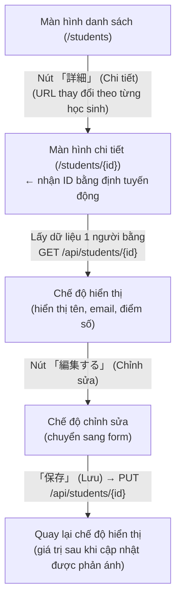
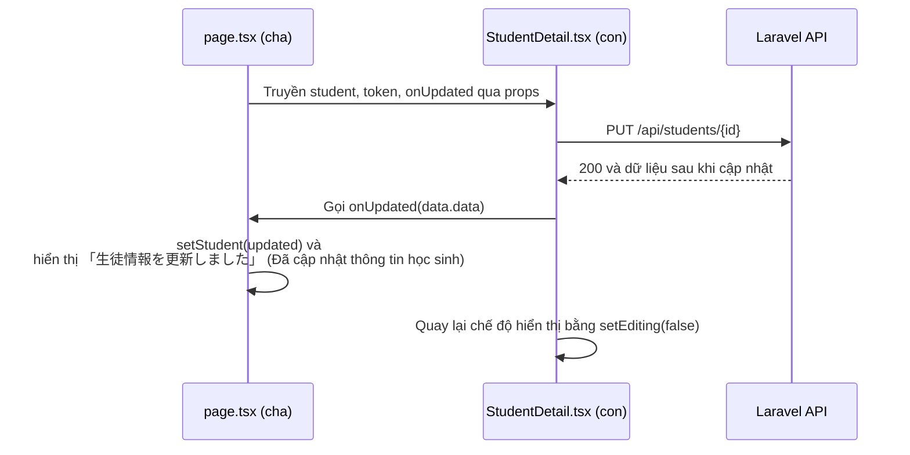

# Tiết 24｜Tạo màn hình chi tiết - Các bước triển khai

> 🇯🇵 Bản gốc (tiếng Nhật): [2026_07_16_実装.md](<../../../2年生_システム開発実践/前期/2026_07_16/2026_07_16_実装.md>) <!-- original-ja-link -->

## Mục tiêu hôm nay

- Từ nút 「詳細」 (Chi tiết) trên màn hình danh sách, có thể chuyển sang màn hình chỉ hiển thị thông tin của 1 học sinh đó
- Bằng nút 「編集する」 (Chỉnh sửa) trên màn hình chi tiết, có thể chuyển ngay sang form và cập nhật
- Có thể chuẩn bị endpoint API cập nhật (`PUT /api/students/{id}`) ở phía Laravel

> **Vị trí của bài học:** Trong khi màn hình danh sách (`GET /api/students`) dùng để "xem tất cả mọi người cùng lúc", thì màn hình chi tiết dùng để "chỉ xem và sửa 1 người được chỉ định bằng ID". Trong cùng một màn hình, chúng ta sẽ chuyển đổi qua lại giữa **Read (chỉ xem 1 bản ghi)** và **Update (cập nhật)** trong CRUD.

---

## Tổng quan: chúng ta sẽ làm gì



### Tại sao lại làm theo thứ tự này

> 💡 **Ví dụ như… "phiếu gọi món riêng" của một cửa hàng**
>
> Nếu màn hình danh sách là "danh sách đặt chỗ hôm nay", thì màn hình chi tiết là "phiếu gọi món riêng" của chỉ 1 vị khách. Để có thể sửa trực tiếp phiếu này (chỉnh sửa), trước hết phía cửa hàng (Laravel) phải có quầy "lấy phiếu này ra" (`GET /api/students/{id}`) và quầy "nhận yêu cầu sửa" (`PUT /api/students/{id}`), nếu không thì không thể bắt đầu.

Nếu backend chưa có API cập nhật, thì dù có làm form chỉnh sửa ở frontend cũng không có nơi để lưu, nên không thể kiểm tra hoạt động. Vì vậy, chúng ta sẽ làm theo thứ tự **backend (API) → đường dẫn từ danh sách → màn hình chi tiết (hiển thị) → chế độ chỉnh sửa**, làm từng phần nhỏ và chạy thử mỗi lần.

### Cấu trúc file (các file sẽ làm việc trong bài này)

| Ký hiệu | Ý nghĩa |
|---|---|
| 🆕 Tạo mới | Tạo file mới |
| ➕ Thêm | Viết thêm code vào file đã có |
| 👀 Kiểm tra | Không cần thay đổi. Chỉ kiểm tra xem đã làm xong chưa |

```
Laravel/
├── app/Http/Requests/UpdateStudentRequest.php      🆕 Tạo mới
├── app/Http/Controllers/Api/StudentController.php  ➕ Thêm update()
└── routes/api.php                                  👀 Chỉ kiểm tra

school-frontend/
├── components/students/StudentList.tsx             ➕ Thêm link chi tiết
├── components/students/StudentDetail.tsx           🆕 Tạo mới (hiển thị ⇔ chỉnh sửa)
└── app/students/[id]/page.tsx                       🆕 Tạo mới → phần sau ➕ viết thêm (định tuyến động)
```

---

## Step 1｜Backend: thêm API cập nhật

Các API danh sách, lấy chi tiết và xóa đã có sẵn, nhưng vẫn chưa có quầy "sửa 1 bản ghi". Chúng ta sẽ làm phần này đầu tiên.


### 1-3. Kiểm tra `routes/api.php`

**👀 Chỉ kiểm tra (thường không cần thay đổi)** — `Route::apiResource('students', StudentController::class)` ở trạng thái ban đầu đã bao gồm cả `update`. **Chỉ khi** bạn đang giới hạn bằng `->only([...])` thì mới cần thêm `update`.

```php
Route::middleware('auth:sanctum')->group(function () {
    Route::post('/logout', [AuthController::class, 'logout']);
    Route::get('/me', [AuthController::class, 'me']);
    Route::apiResource('students', StudentController::class);
    
    // Chỉ cần kiểm tra xem có đang dùng only hay không
    // Route::apiResource('students', StudentController::class)->only(['index', 'show']);
});
```

### 1-4. Kiểm tra hoạt động

```bash
cd Laravel && php artisan serve
```

Sau khi đăng nhập và lấy token, chúng ta thử gọi trực tiếp API cập nhật bằng `curl`.

⚠️ Lưu ý cho bạn nào đang dùng Windows (PowerShell)
Nếu dùng curl nguyên như vậy trong PowerShell sẽ bị lỗi. Nhất định phải viết curl.exe ở đầu lệnh, hoặc gõ cmd vào terminal để chuyển sang "Command Prompt" rồi mới chạy. Ngoài ra, cần escape dấu ngoặc kép (\") trong dữ liệu.
```bash
curl -X PUT http://localhost:8000/api/students/1 \
  -H "Authorization: Bearer <token đã lấy được>" \
  -H "Content-Type: application/json" \
  -H "Accept: application/json" \
  -d '{"name":"テスト太郎","email":"test-taro@example.com","score":80}'
```

| Mục kiểm tra | Thao tác | Kết quả mong đợi |
|---|---|---|
| Cập nhật thành công | Chạy lệnh curl ở trên | Trả về 200, JSON có chứa tên, email, điểm số sau khi cập nhật |
| Validation | Chạy với `score` là `200` | Trả về 422 |
| Bắt buộc xác thực | Chạy mà bỏ header `Authorization` | Trả về 401 |
| ID không tồn tại | Chạy với `/api/students/9999` | Trả về 404 |

---

## Step 2｜Frontend: đường dẫn từ danh sách đến chi tiết

Chỉnh sửa file `school-frontend/components/students/StudentList.tsx`.

### Tại sao cần làm

Nếu từ mỗi dòng của danh sách không thể đi đến "URL dành riêng cho học sinh này", thì dù có làm màn hình chi tiết cũng không có cách nào đến được. Điểm quan trọng là **nhúng nguyên ID của học sinh vào làm một phần của URL**.

**➕ Thêm (đầu file đã có)** — Thêm `import`.

```tsx
// ▼ Thêm vào đầu file StudentList.tsx
"use client";

import Link from "next/link";
```

**➕ Thêm (file đã có)** — Thêm style cho link chi tiết vào khoảng bên dưới `bodyCell`.

```tsx
// Hằng số style (gom các style dùng lặp lại)
const thStyle = { padding: "10px 16px", textAlign: "left", fontWeight: "bold", fontSize: "0.9em" };
const tdStyle = { padding: "12px 16px", fontSize: "0.95em" };

// ▼ Thêm vào khoảng bên dưới (style cho link chi tiết)
const detailLinkStyle = {
  display: "inline-flex",
  alignItems: "center",
  justifyContent: "center",
  minWidth: 104,
  padding: "0.85rem 1.25rem",
  borderRadius: 999,
  background: "#163D7A",
  color: "#fff",
  fontWeight: 700,
  fontSize: "0.95rem",
  letterSpacing: "0.01em",
  boxShadow: "0 10px 24px rgba(22, 61, 122, 0.18)",
};
```

**🔁 Thay thế (file đã có)** — Thay thẻ `<td>` cuối cùng (ô chứa các nút thao tác) của `StudentRow` bằng đoạn sau.

```tsx
// StudentRow: 1 dòng của bảng
function StudentRow({ student, onDelete }) {
  function handleDelete() {
    // Hiển thị hộp thoại xác nhận rồi mới xóa
    if (window.confirm(`${student.name} を削除しますか？`)) {
      onDelete(student.id); // Báo cho component cha "hãy xóa ID này"
    }
  }

  return (
    <tr style={{ borderBottom: "1px solid #eee" }}>
      <td style={tdStyle}>{student.id}</td>
      <td style={tdStyle}>{student.name}</td>
      <td style={tdStyle}>{student.email}</td>
      <td style={tdStyle}>{student.score}</td>
      <td style={tdStyle}>
      <div style={{ display: "flex", gap: "0.5rem", flexWrap: "wrap" }}>
        <Link href={`/students/${student.id}`} style={detailLinkStyle}>
          詳細
        </Link>
        <button
          onClick={handleDelete}
          style={{ background: "#D32F2F", color: "white", border: "none", borderRadius: "4px", padding: "4px 12px", cursor: "pointer", fontSize: "0.85em" }}
        >
          削除
        </button>
        </div >
      </td>
    </tr>
  );
}
```

### Kiểm tra hoạt động

```bash
cd school-frontend && npm run dev
```

| Mục kiểm tra | Thao tác | Kết quả mong đợi |
|---|---|---|
| Hiển thị đường dẫn | Mở `/students` | Mỗi dòng hiển thị nút 「詳細」 (Chi tiết) |
| Chuyển trang | Bấm nút 「詳細」 (Chi tiết) | Chuyển đến `/students/{ID của dòng đó}` (lúc này gặp lỗi 404 cũng không sao, vì màn hình sẽ được tạo ở Step 3) |

---

## Step 3｜Frontend: màn hình chi tiết (chế độ hiển thị)

**🆕 File mới** — Tạo mới `school-frontend/app/students/[id]/page.tsx` (cũng tạo mới thư mục có tên `[id]`).

### Tại sao lại đặt tên thư mục là `[id]`

Trong Next.js, nếu đặt tên thư mục trong dấu ngoặc vuông như `[id]`, nó sẽ trở thành **định tuyến động (dynamic routing)**, cho phép nhận phần đó của URL (số `3` trong `/students/3`) bên trong trang.

```tsx
"use client";

import { useState, useEffect } from "react";
import { useRouter, useParams } from "next/navigation";
import Link from "next/link";


export default function StudentDetailPage() {
  const router = useRouter();
  const params = useParams(); // Nhận phần {id} của URL
  const [student, setStudent] = useState(null);
  const [userName, setUserName] = useState("");
  const [loading, setLoading] = useState(true);
  const [notFound, setNotFound] = useState(false);
  const [token, setToken] = useState(null); // ★ Đã thêm "hộp" chứa token ở đây, vốn là nguyên nhân gây lỗi!

  // ★ useEffect: chỉ chạy 1 lần khi trang được hiển thị
  useEffect(() => {
    const savedToken = localStorage.getItem("token");

    // Nếu không có token thì quay về trang đăng nhập
    if (!savedToken) {
      router.push("/login");
      return;
    }

    setToken(savedToken); // ★ Lưu chắc chắn token đã lấy được vào state
    setUserName(localStorage.getItem("userName") || "ユーザー");
    loadStudent(savedToken);
  }, []); // [] = chỉ chạy 1 lần đầu tiên

  // Lấy dữ liệu của 1 học sinh cụ thể từ API
  async function loadStudent(currentToken) {
    setLoading(true);
    setNotFound(false);
  
    try {
      // Dùng tham số URL params.id để hỏi Laravel API
      const res = await fetch(`http://localhost:8000/api/students/${params.id}`, {
        headers: {
          "Accept": "application/json",
          "Authorization": `Bearer ${currentToken}`, // ★ Gắn token vào header
        },
      });

      // 401 = token không hợp lệ → quay về trang đăng nhập
      if (res.status === 401) {
        router.push("/login");
        return;
      }

      // 404 = không tìm thấy học sinh
      if (res.status === 404) {
        setStudent(null);
        setNotFound(true);
        return;
      }

      const data = await res.json();
      setStudent(data.data); // Laravel API trả về theo dạng { data: {...} }
    } catch (error) {
      console.error("データの取得に失敗しました", error);
    } finally {
      setLoading(false);
    }
  }

  // Đăng xuất
  async function handleLogout() {
    const currentToken = localStorage.getItem("token");

    await fetch("http://localhost:8000/api/logout", {
      method: "POST",
      headers: {
        "Accept": "application/json",
        "Authorization": `Bearer ${currentToken}`,
      },
    });

    localStorage.removeItem("token");
    localStorage.removeItem("userName");
    router.push("/login");
  }

  // ★ Chờ cho đến khi token sẵn sàng hoặc việc tải dữ liệu kết thúc
  if (!token || loading) {
    return (
      <div style={{ textAlign: "center", padding: "80px", color: "#888" }}>
        生徒データを読み込んでいます...
      </div>
    );
  }

  return (
    <div style={{ background: "#f4f6f8", minHeight: "100vh" }}>

      {/* Header (giao diện chung giống màn hình danh sách) */}
      <header style={{
        background: "#1565C0", color: "white",
        padding: "16px 32px",
        display: "flex", alignItems: "center"
      }}>
        <h1 style={{ fontSize: "1.2em" }}>生徒管理アプリ（Next.js API版）</h1>
        <div style={{ marginLeft: "auto", display: "flex", alignItems: "center", gap: "12px" }}>
          <span style={{ fontSize: "0.9em" }}>● ログイン中：{userName}</span>
          <button
            onClick={handleLogout}
            style={{ background: "#D32F2F", color: "white", border: "none", borderRadius: "6px", padding: "6px 14px", cursor: "pointer" }}
          >
            ログアウト
          </button>
        </div>
      </header>

      {/* Nội dung chính */}
      <main style={{ padding: "32px", maxWidth: "640px", margin: "0 auto", display: "grid", gap: "20px" }}>
        
        <Link href="/students" style={{ color: "#1565C0", fontWeight: "bold", textDecoration: "none" }}>
          ← 一覧に戻る
        </Link>


        {/* ★ Hiển thị khi không tìm thấy học sinh, hoặc khi dữ liệu trống */}
        {notFound || !student ? (
          <div style={{
            borderRadius: "8px",
            padding: "40px 24px",
            textAlign: "center",
            background: "white",
            border: "1px solid #ddd",
          }}>
            <p style={{ margin: 0, color: "#888" }}>生徒が見つかりません</p>
          </div>
        ) : (
          /* ★ Giờ đã có thể truyền token đúng cách cho component con */
          <section style={{
              background: "white", border: "1px solid #ddd", borderRadius: "8px",
              padding: "24px", boxShadow: "0 4px 12px rgba(0,0,0,0.05)"
            }}>
              <h2 style={{ margin: "0 0 20px 0", fontSize: "1.4em", borderBottom: "2px solid #1565C0", paddingBottom: "8px" }}>
                {student.name}
              </h2>
              
              <dl style={{ display: "grid", gap: "16px", margin: 0 }}>
                <div>
                  <dt style={{ fontSize: "0.9em", color: "#666", marginBottom: "4px" }}>メールアドレス</dt>
                  <dd style={{ margin: 0, fontWeight: "bold", fontSize: "1.1em" }}>{student.email}</dd>
                </div>
                <div>
                  <dt style={{ fontSize: "0.9em", color: "#666", marginBottom: "4px" }}>点数</dt>
                  <dd style={{ margin: 0, fontWeight: "bold", fontSize: "1.1em" }}>{student.score} 点</dd>
                </div>
              </dl>
            </section>
        )}

      </main>

    </div>
  );
}
```

### Kiểm tra hoạt động

| Mục kiểm tra | Thao tác | Kết quả mong đợi |
|---|---|---|
| Hiển thị | Sau khi đăng nhập, chuyển trang từ nút 「詳細」 (Chi tiết) trong danh sách | Chỉ hiển thị tên, email, điểm số của học sinh đó |
| ID không tồn tại | Mở trực tiếp `/students/99999` | Hiển thị 「生徒が見つかりません」 (Không tìm thấy học sinh) |
| Chưa xác thực | Mở `/students/1` khi đang ở trạng thái đã đăng xuất | Bị chuyển hướng (redirect) đến `/login` |

---

## Step 4｜Frontend: thêm chế độ chỉnh sửa

Thêm vào màn hình chi tiết (vốn chỉ để hiển thị) một form được chuyển sang bằng nút 「編集する」 (Chỉnh sửa). Có thể áp dụng nguyên cách nghĩ "nhận dữ liệu nhập vào bằng form rồi gửi đi" đã làm ở Tiết 17–21.

### 4-1. Tạo mới `school-frontend/components/students/StudentDetail.tsx`

**🆕 File mới** — Giữ `editing` bằng `useState` để chuyển đổi giữa "hiện đang ở chế độ hiển thị hay chế độ chỉnh sửa".

```tsx
"use client";

import { useState } from "react";

// Style chung cho form nhập liệu
const inputStyle = {
  width: "100%",
  borderRadius: "6px",
  border: "1px solid #ddd",
  padding: "10px 12px",
  fontSize: "1rem",
  outline: "none",
  background: "#fff",
  boxSizing: "border-box", // Cố định để viền không bị tràn ra ngoài
};

export default function StudentDetail({ student, token, onUpdated }) {
  const [editing, setEditing] = useState(false); // false = chế độ hiển thị, true = chế độ chỉnh sửa
  const [name, setName] = useState(student.name);
  const [email, setEmail] = useState(student.email);
  const [score, setScore] = useState(String(student.score));
  const [error, setError] = useState("");
  const [saving, setSaving] = useState(false);

  function startEditing() {
    // Khởi tạo form bằng giá trị hiện tại rồi chuyển sang chế độ chỉnh sửa
    setName(student.name);
    setEmail(student.email);
    setScore(String(student.score));
    setError("");
    setEditing(true);
  }

  function cancelEditing() {
    setError("");
    setEditing(false); // Bỏ nội dung đã nhập và quay lại chế độ hiển thị
  }

  async function handleSubmit(e) {
    e.preventDefault();
    setError("");

    if (!name || !email || !score) {
      setError("すべての項目を入力してください");
      return;
    }

    const scoreNumber = Number(score);
    if (Number.isNaN(scoreNumber) || scoreNumber < 0 || scoreNumber > 100) {
      setError("点数は0〜100の数値を入力してください");
      return;
    }

    setSaving(true);

    try {
      const res = await fetch(`http://localhost:8000/api/students/${student.id}`, {
        method: "PUT",
        headers: {
          "Content-Type": "application/json",
          "Accept": "application/json",
          "Authorization": `Bearer ${token}`,
        },
        body: JSON.stringify({ name, email, score: scoreNumber }),
      });

      if (res.status === 401) {
        window.location.href = "/login";
        return;
      }

      if (res.ok) {
        const data = await res.json();
        onUpdated(data.data); // Truyền dữ liệu mới nhất cho component cha (page.tsx) để cập nhật
        setEditing(false);
        return;
      }

      if (res.status === 422) {
        const data = await res.json();
        const details = Object.values(data.errors ?? {}).flat().join(" / ");
        setError(details || "入力内容をご確認ください");
        return;
      }

      setError("更新に失敗しました");
    } catch (err) {
      setError("更新に失敗しました");
    } finally {
      setSaving(false);
    }
  }

  // 【1】Chế độ hiển thị (khi chưa bấm nút chỉnh sửa)
  if (!editing) {
    return (
      <section style={{
        background: "white", border: "1px solid #ddd", borderRadius: "8px",
        padding: "24px", boxShadow: "0 4px 12px rgba(0,0,0,0.05)"
      }}>
        <h2 style={{ margin: "0 0 20px 0", fontSize: "1.4em", borderBottom: "2px solid #1565C0", paddingBottom: "8px" }}>
          {student.name}
        </h2>
        
        <dl style={{ display: "grid", gap: "16px", margin: 0 }}>
          <div>
            <dt style={{ fontSize: "0.9em", color: "#666", marginBottom: "4px" }}>メールアドレス</dt>
            <dd style={{ margin: 0, fontWeight: "bold", fontSize: "1.1em" }}>{student.email}</dd>
          </div>
          <div>
            <dt style={{ fontSize: "0.9em", color: "#666", marginBottom: "4px" }}>点数</dt>
            <dd style={{ margin: 0, fontWeight: "bold", fontSize: "1.1em" }}>{student.score} 点</dd>
          </div>
        </dl>

        <div style={{ marginTop: "20px" }}>
          <button 
            onClick={startEditing}
            style={{
              background: "#1565C0", color: "white", border: "none", 
              borderRadius: "6px", padding: "8px 20px", cursor: "pointer", fontWeight: "bold"
            }}
          >
            編集する
          </button>
        </div>
      </section>
    );
  }

  // 【2】Chế độ chỉnh sửa (khi đã bấm nút chỉnh sửa)
  return (
    <section style={{
      background: "white", border: "1px solid #ddd", borderRadius: "8px",
      padding: "24px", boxShadow: "0 4px 12px rgba(0,0,0,0.05)"
    }}>
      <h2 style={{ margin: "0 0 20px 0", fontSize: "1.3rem", color: "#1565C0", fontWeight: "bold" }}>
        生徒情報を編集
      </h2>

      <form onSubmit={handleSubmit} style={{ display: "grid", gap: "16px" }}>
        <label style={{ display: "grid", gap: "6px" }}>
          <span style={{ fontSize: "0.9em", fontWeight: "bold", color: "#444" }}>名前</span>
          <input
            type="text"
            value={name}
            onChange={(event) => setName(event.target.value)}
            style={inputStyle}
          />
        </label>

        <label style={{ display: "grid", gap: "6px" }}>
          <span style={{ fontSize: "0.9em", fontWeight: "bold", color: "#444" }}>メールアドレス</span>
          <input
            type="email"
            value={email}
            onChange={(event) => setEmail(event.target.value)}
            style={inputStyle}
          />
        </label>

        <label style={{ display: "grid", gap: "6px" }}>
          <span style={{ fontSize: "0.9em", fontWeight: "bold", color: "#444" }}>点数</span>
          <input
            type="number"
            value={score}
            onChange={(event) => setScore(event.target.value)}
            min="0"
            max="100"
            style={inputStyle}
          />
        </label>

        <div style={{ display: "flex", gap: "12px", marginTop: "8px" }}>
          <button
            type="submit"
            disabled={saving}
            style={{
              background: saving ? "#aaa" : "#2E7D32", color: "white", border: "none",
              borderRadius: "6px", padding: "8px 20px", cursor: saving ? "default" : "pointer", fontWeight: "bold"
            }}
          >
            {saving ? "保存中..." : "保存"}
          </button>
          
          <button
            type="button"
            onClick={cancelEditing}
            disabled={saving}
            style={{
              background: "#757575", color: "white", border: "none",
              borderRadius: "6px", padding: "8px 20px", cursor: saving ? "default" : "pointer", fontWeight: "bold"
            }}
          >
            キャンセル
          </button>
        </div>
      </form>

      {/* Hiển thị thông báo lỗi */}
      {error && (
        <p style={{
          margin: "16px 0 0 0", color: "#D32F2F", fontWeight: "bold",
          background: "#FFEBEE", borderRadius: "6px", padding: "10px 12px", fontSize: "0.9em"
        }}>
          ⚠ {error}
        </p>
      )}
    </section>
  );
}
```

### 4-2. Chỉnh sửa app/students/[id]/page.tsx để chèn StudentDetail vào

Trong file đã tạo ở Step 3, hãy thêm hoặc thay thế 4 chỗ sau.

**➕ Thêm (import)**

```tsx
import StudentDetail from "@/components/students/StudentDetail";
```

**➕ Thêm (thêm 1 dòng bên dưới state notFound)** — Đây là state để hiển thị thông báo sau khi cập nhật.

```tsx
  const [message, setMessage] = useState("");
```

**➕ Thêm (trong loadStudent, thêm 1 dòng ngay sau setNotFound(false);)**

```tsx
      setLoading(true);
      setNotFound(false);
      // Chỉ cần thêm dòng này↓↓
      setMessage("");
```

**➕ Thêm (ngay sau `<Link href="/students" ...>`)** — Thêm khối hiển thị thông báo.

```tsx
        {message ? (
          <div
            style={{
              borderRadius: 18,
              padding: "0.9rem 1rem",
              background: "rgba(255, 255, 255, 0.82)",
              border: "1px solid rgba(22, 61, 122, 0.08)",
              color: "#163D7A",
              fontWeight: 700,
            }}
          >
            {message}
          </div>
        ) : null}
```

**🔁 Thay thế** — Thay phần `<section>...</section>` chỉ để hiển thị đã làm ở Step 3 bằng lời gọi `StudentDetail`.

```tsx
        {/* ★ Hiển thị khi không tìm thấy học sinh, hoặc khi dữ liệu trống */}
        {notFound || !student ? (
          <div style={{
            borderRadius: "8px",
            padding: "40px 24px",
            textAlign: "center",
            background: "white",
            border: "1px solid #ddd",
          }}>
            <p style={{ margin: 0, color: "#888" }}>生徒が見つかりません</p>
          </div>
        ) : (
          /* ★ Giờ đã có thể truyền token đúng cách cho component con */
          <StudentDetail
            student={student}
            token={token}
            onUpdated={(updated) => {
              setStudent(updated);
              setMessage("生徒情報を更新しました");
            }}
          />
        )}
```

Khi bấm 「保存」 (Lưu), luồng dữ liệu giữa component con (`StudentDetail.tsx`), component cha (`page.tsx`) và Laravel được thể hiện như sau.



### Kiểm tra hoạt động

```bash
cd school-frontend && npm run dev
```

| Mục kiểm tra | Thao tác | Kết quả mong đợi |
|---|---|---|
| Chuyển sang chế độ chỉnh sửa | Bấm nút 「編集する」 (Chỉnh sửa) | Chuyển sang form với các giá trị hiện tại đã được điền sẵn |
| Lưu | Thay đổi giá trị rồi bấm 「保存」 (Lưu) | Quay lại chế độ hiển thị, hiển thị giá trị sau khi cập nhật và 「生徒情報を更新しました」 (Đã cập nhật thông tin học sinh) |
| Hủy | Thay đổi giá trị rồi bấm 「キャンセル」 (Hủy) | Thay đổi bị hủy bỏ, quay lại chế độ hiển thị với giá trị ban đầu |
| Validation điểm số | Nhập `200` vào điểm số rồi lưu | Hiển thị thông báo lỗi và vẫn ở chế độ chỉnh sửa |
| Email trùng | Nhập email mà học sinh khác đang dùng rồi lưu | Hiển thị thông báo lỗi 422 từ backend |

---

## Tổng kết

| Khái niệm | Phần tương ứng lần này |
|---|---|
| Read (chỉ xem 1 bản ghi) | `GET /api/students/{id}`, `app/students/[id]/page.tsx` |
| Update (cập nhật) | `PUT /api/students/{id}`, phần xử lý lưu trong `StudentDetail.tsx` |
| Định tuyến động | `app/students/[id]/page.tsx`, `useParams()` |
| Chuyển đổi hiển thị ⇔ chỉnh sửa | State `editing` của `StudentDetail.tsx` |

## Danh sách kiểm tra hoàn thành (Definition of Done)

- [ ] Mỗi dòng của `/students` có nút 「詳細」 (Chi tiết), bấm vào sẽ chuyển đến `/students/{id}`
- [ ] Tên, email, điểm số được hiển thị ở `/students/{id}`
- [ ] Nút 「編集する」 (Chỉnh sửa) chuyển sang form, thay đổi giá trị rồi lưu thì được phản ánh vào DB và màn hình
- [ ] Lỗi validation (mục bắt buộc, phạm vi điểm số, email trùng) được hiển thị trên màn hình
- [ ] Khi truy cập ID không tồn tại thì hiển thị 「生徒が見つかりません」 (Không tìm thấy học sinh)
- [ ] Truy cập khi chưa xác thực sẽ bị chuyển hướng đến `/login`

## Lệnh khởi động

```bash
# Backend
cd Laravel && php artisan serve   # http://localhost:8000

# Frontend
cd school-frontend && npm run dev # http://localhost:3000
```

Tài khoản test: `test@example.com` / `password`
