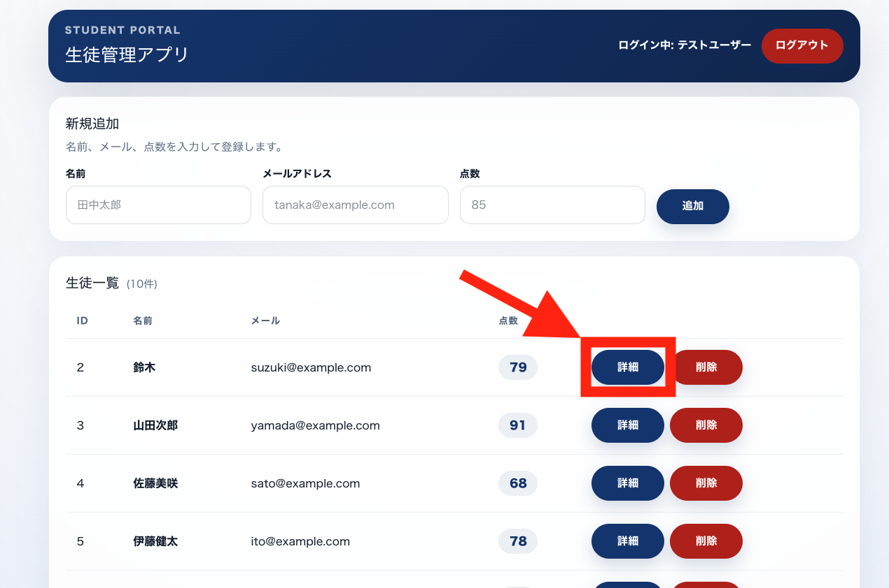
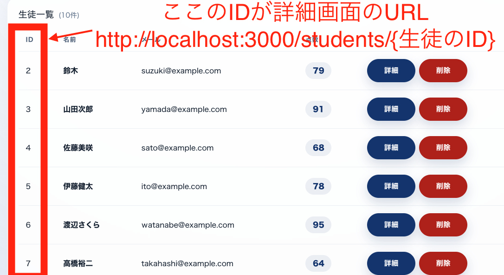
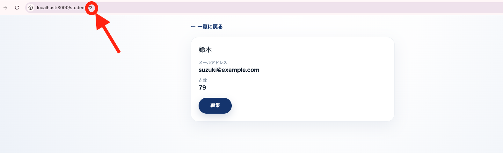
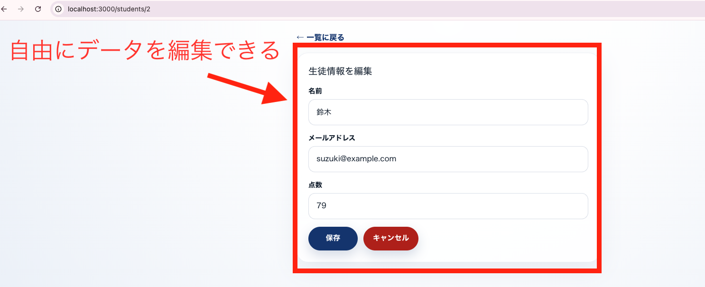
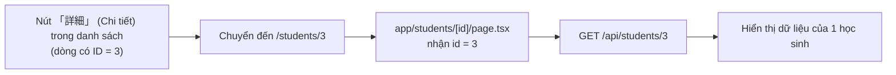

# Tiết 24｜Tạo màn hình chi tiết

> 🇯🇵 Bản gốc (tiếng Nhật): [2026_07_16_課題.md](<../../../2年生_システム開発実践/前期/2026_07_16/2026_07_16_課題.md>) <!-- original-ja-link -->

---

# Bạn nào đã làm xong đến đây thì hãy làm tiếp màn hình chi tiết nhé

Ở trạng thái hiện tại, màn hình danh sách cho phép nhìn nhanh tên, email và điểm số, nhưng chưa có màn hình để xem kỹ thông tin của từng học sinh hoặc chỉnh sửa từ đó. Chúng ta sẽ làm màn hình hiển thị thông tin chỉ của riêng học sinh đó khi bấm nút 「詳細」 (Chi tiết) trong danh sách.

## Chúng ta sẽ làm gì

Khi bấm nút 「詳細」 (Chi tiết) ở mỗi dòng của màn hình danh sách, ứng dụng sẽ chuyển sang màn hình chỉ hiển thị thông tin của học sinh đó.

Điểm quan trọng là **URL đích sẽ thay đổi tùy theo bạn bấm 「詳細」 (Chi tiết) ở dòng nào trong danh sách**. ID của học sinh sẽ trở thành một phần của URL.

Khi bấm nút, chỉ cần chuyển được sang màn hình chỉ hiển thị tên, địa chỉ email và điểm số của học sinh đó như hình bên dưới là OK.

Ngoài ra, khi bấm nút "Chỉnh sửa" trên màn hình chi tiết, màn hình sẽ chuyển ngay sang form để có thể sửa nội dung (áp dụng cùng cách làm với chức năng cập nhật đã tạo ở Tiết 21).

## Màn hình chi tiết là gì?

Màn hình chi tiết tương ứng với **Read (chỉ xem 1 bản ghi)** trong CRUD. Trong khi màn hình danh sách là màn hình "xem tất cả mọi người cùng lúc", thì màn hình chi tiết là màn hình "chỉ xem 1 người được chỉ định bằng ID".

- Màn hình danh sách: `GET /api/students` → trả về dữ liệu của tất cả mọi người
- Màn hình chi tiết: `GET /api/students/{id}` → chỉ trả về dữ liệu của 1 học sinh có ID được chỉ định

Ví dụ, khi bấm 「詳細」 (Chi tiết) của học sinh có ID là 3, quá trình truyền ID qua URL được thể hiện trong sơ đồ sau.

Ngoài ra, phần chỉnh sửa và lưu từ màn hình chi tiết tương ứng với **Update (cập nhật)** trong CRUD. Người dùng có thể chuyển đổi giữa chế độ hiển thị (Read) và cập nhật (Update) ngay trên cùng một màn hình.

## Các thành phần cần có trên màn hình

- Hiển thị **tên** của học sinh
- Hiển thị **địa chỉ email** của học sinh
- Hiển thị **điểm số** của học sinh
- Nút "**Chỉnh sửa**" (bấm vào sẽ chuyển thành form)
- Trong form chỉnh sửa có các ô nhập tên, địa chỉ email, điểm số và các nút "**Lưu**", "**Hủy**"
- Đường link "**Quay lại danh sách**"

## Gợi ý triển khai (liên quan đến những gì đã học)

- Nút 「詳細」 (Chi tiết) ở màn hình danh sách cần trở thành đường link `/students/{ID của học sinh}` cho từng học sinh (tạo URL có nhúng ID như `` <Link href={`/students/${student.id}`}> ``)
- Trong Next.js, chúng ta dùng **định tuyến động (dynamic routing)** để nhận một phần của URL (ID). Nếu tổ chức thư mục và file như `app/students/[id]/page.tsx`, bạn có thể nhận giá trị của phần `{id}` trong URL bên trong trang
- Khi trang được hiển thị, dùng ID nhận được để gửi request tới Laravel API như `` fetch(`http://localhost:8000/api/students/${id}`) `` và chỉ lấy dữ liệu của 1 học sinh đó
- Ở phía Laravel, nhờ có `Route::apiResource('students', StudentController::class)` trong `routes/api.php`, thật ra route cho `show($id)` (lấy 1 bản ghi) và `update($id)` (cập nhật) cũng đã được chuẩn bị sẵn. Hãy kiểm tra xem 2 method này đã được triển khai trong `StudentController` chưa
- Để chuyển đổi hiển thị khi bấm nút "Chỉnh sửa", bạn có thể dùng `useState` để lưu trạng thái "hiện đang ở chế độ hiển thị hay chế độ chỉnh sửa", rồi áp dụng cách làm form đã học ở Tiết 17–21
- Khi bấm nút lưu, dùng `fetch` với `PUT` (hoặc `PATCH`) để gửi tới `http://localhost:8000/api/students/{id}`. Đừng quên gắn token bằng `Authorization: Bearer ${token}` nhé
