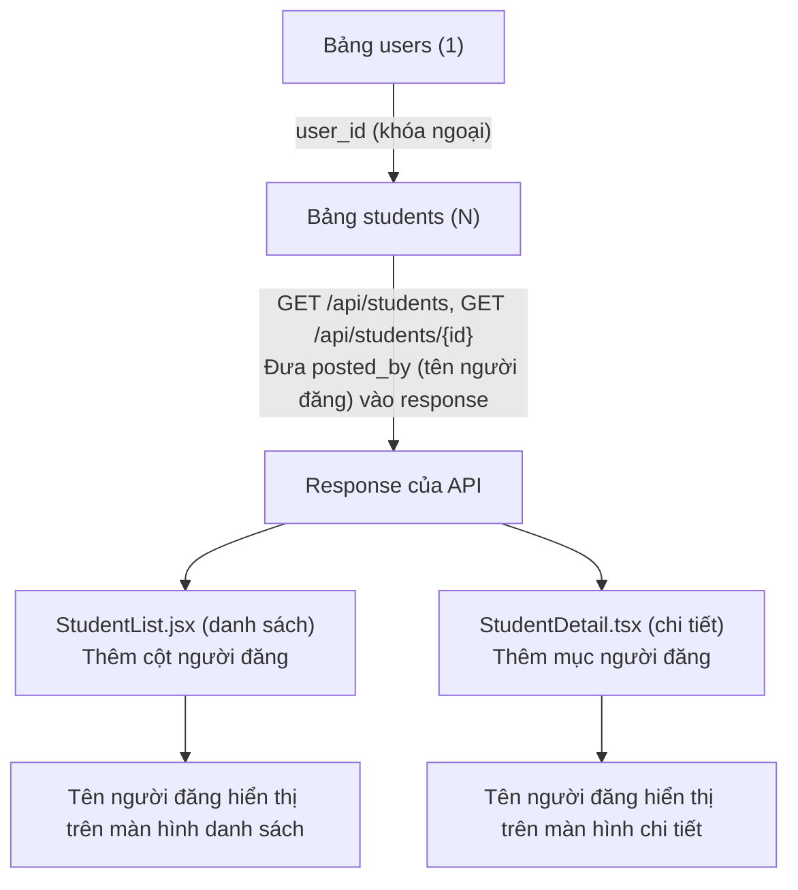
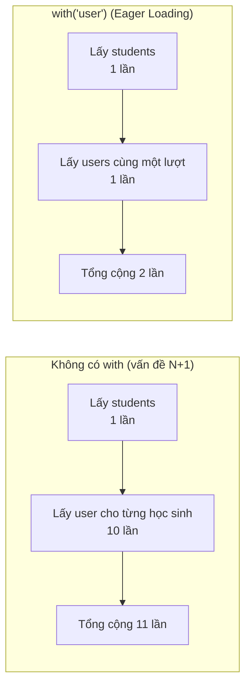

# Tiết 25｜Tạo quan hệ Users ⇔ Students và hiển thị người đăng - Các bước triển khai

> 🇯🇵 Bản gốc (tiếng Nhật): [2026_07_23_実装 .md](<../../../2年生_システム開発実践/前期/2026_07_23/2026_07_23_実装 .md>) <!-- original-ja-link -->

## Mục tiêu hôm nay

- Thêm `user_id` vào bảng `students` để biết "dữ liệu này do ai đăng ký"
- Liên kết `User` và `Student` bằng quan hệ (relation) của Eloquent (một người dùng có nhiều học sinh)
- Đưa "tên người đăng (`posted_by`)" vào response của API danh sách và API chi tiết học sinh
- Khi đăng ký học sinh mới, tự động gắn và lưu học sinh đó với người dùng đang đăng nhập
- Hiển thị "người đăng" ở cả màn hình danh sách lẫn màn hình chi tiết

> **Vị trí của bài này:** Cho đến giờ, bảng `students` chưa có thông tin "ai đã đăng ký". Hôm nay chúng ta sẽ thêm quan hệ khóa ngoại với bảng `users`, rồi đưa thông tin đó qua API đến frontend và hiển thị lên màn hình — tức là xây dựng trọn một luồng từ đầu đến cuối.

---

## Bức tranh tổng thể: chúng ta sẽ làm gì



> 💡 **Ví dụ dễ hiểu… thẻ mượn sách ở thư viện**
>
> Nếu mỗi bản ghi trong bảng `students` là một "cuốn sách", thì `user_id` giống như tấm thẻ mượn ghi "cuốn sách này do ai mượn (đăng ký)". Không có thẻ thì nhìn cuốn sách cũng không biết "ai phụ trách". Trước tiên ta tạo chỗ để kẹp thẻ (cột `user_id`) vào sách (`students`), sau đó biểu diễn quan hệ "một người có thể mượn nhiều cuốn" bằng code (Eloquent), và cuối cùng hiển thị thông tin đó lên màn hình.

Trong Eloquent, quan hệ này tương ứng như sau.

| Class | Method | Ý nghĩa |
|---|---|---|
| `User` | `students()` | Một người dùng có nhiều học sinh (`hasMany`) |
| `Student` | `user()` | Một học sinh thuộc về một người dùng (`belongsTo`) |

### Vì sao làm theo thứ tự này

Nếu backend chưa chuẩn bị `user_id` và quan hệ để API có thể trả về `posted_by`, thì frontend sẽ không có dữ liệu để hiển thị. Vì vậy, chúng ta sẽ đi theo thứ tự **backend (migration → model → Controller/Seeder) → frontend (danh sách → chi tiết)**, làm từng phần nhỏ và chạy thử sau mỗi bước.

### Cấu trúc file (những file sẽ chỉnh lần này)

| Ký hiệu | Ý nghĩa |
|---|---|
| 🆕 Mới | Tạo file mới |
| ➕ Thêm | Viết thêm code vào file đã có |
| 🔁 Thay thế | Viết lại phần xử lý đã có |
| 👀 Kiểm tra | Không cần sửa. Chỉ kiểm tra xem đã làm xong chưa |

```
Laravel/
├── database/migrations/xxxx_add_user_id_to_students_table.php  🆕 Mới (thêm cột user_id)
├── app/Models/User.php                                     ➕ Thêm quan hệ students()
├── app/Models/Student.php                                  ➕ Thêm quan hệ user()
├── app/Http/Controllers/Api/StudentController.php          🔁 Sửa index(), store()
├── app/Http/Resources/StudentResource.php                  ➕ Thêm posted_by
└── database/seeders/StudentSeeder.php                       🔁 Tạo học sinh thông qua người dùng

school-frontend/
├── components/students/StudentList.tsx     ➕ Thêm cột người đăng (header, ô)
└── components/students/StudentDetail.tsx   ➕ Thêm mục người đăng
```

---

## Step 1｜Backend: thêm `user_id` bằng migration

**🆕 File mới** — Chúng ta không sửa trực tiếp migration `create_students_table` đã có. Viết lại một migration đã từng chạy rất dễ gây sự cố, nên ta sẽ tạo một migration mới chỉ dùng để thêm cột `user_id`.

```bash
cd Laravel
php artisan make:migration add_user_id_to_students_table --table=students
```

Trong `Laravel/database/migrations/` sẽ có một file được tạo với tên như bên dưới (phần đầu là ngày giờ chạy lệnh).

```
2026_07_16_000001_add_user_id_to_students_table.php
```

Hãy viết nội dung file vừa được tạo như sau.

```php
<?php
// ▼ database/migrations/2026_07_16_000001_add_user_id_to_students_table.php

use Illuminate\Database\Migrations\Migration;
use Illuminate\Database\Schema\Blueprint;
use Illuminate\Support\Facades\Schema;

return new class extends Migration
{
    public function up(): void
    {
        // Thêm cột user_id vào bảng students đã có
        Schema::table('students', function (Blueprint $table) {
            $table->foreignId('user_id') // Tạo cột khóa ngoại tham chiếu đến users.id
                ->after('id')             // Đặt ngay sau cột id (cho dễ nhìn)
                ->constrained()           // Tự suy ra đối tượng được tham chiếu (id của bảng users) và tạo ràng buộc khóa ngoại
                ->cascadeOnDelete();      // Khi người dùng bị xóa, dữ liệu học sinh của người đó cũng bị xóa theo
        });
    }

    public function down(): void
    {
        // Khi chạy migrate:rollback, hoàn tác việc thêm khóa ngoại và cột
        Schema::table('students', function (Blueprint $table) {
            $table->dropForeign(['user_id']); // Gỡ ràng buộc khóa ngoại trước
            $table->dropColumn('user_id');    // Xóa chính cột đó
        });
    }
};
```

- `Schema::table('students', ...)` … Đây là thay đổi "thêm cột" vào bảng đã có, nên dùng `table` chứ không dùng `create`
- `foreignId('user_id')` … Tạo cột khóa ngoại tham chiếu đến `users.id`
- `->after('id')` … Đặt cột `user_id` ngay sau `id` (cho dễ nhìn)
- `->constrained()` … Tự suy ra đối tượng được tham chiếu (`id` của bảng `users`) và tạo ràng buộc khóa ngoại
- `->cascadeOnDelete()` … Khi người dùng bị xóa, dữ liệu học sinh mà người đó sở hữu cũng bị xóa theo
- `down()` … Cho phép hoàn tác việc thêm khóa ngoại và cột khi chạy `migrate:rollback`

> ⚠️ Khi thêm `user_id` giữa chừng, dữ liệu đã có sẽ không có người dùng nào để liên kết. Nếu đang trong giai đoạn phát triển, cách đơn giản nhất là chạy `php artisan migrate:fresh --seed` để tạo lại bảng và dùng seeder nạp lại dữ liệu có sẵn người dùng ngay từ đầu (nếu muốn giữ lại dữ liệu tương đương môi trường production, bạn cần làm theo 2 giai đoạn: trước tiên thêm cột với `nullable()`, backfill dữ liệu, rồi dùng một migration tiếp theo để gắn ràng buộc `NOT NULL`).

---

## Step 2｜Backend: định nghĩa quan hệ trong model

### 2-1. `app/Models/User.php`

**➕ Thêm** — Thêm câu lệnh `use` cho `HasMany` và method `students()`.

```php
use Illuminate\Database\Eloquent\Relations\HasMany; // ← Cho phép dùng kiểu quan hệ HasMany

// ...

// Method biểu diễn quan hệ "một người dùng có nhiều học sinh" (một-nhiều)
// Khi định nghĩa method này, có thể lấy "danh sách học sinh do người dùng này đăng ký" bằng $user->students
public function students(): HasMany
{
    // hasMany(Student::class) … nghĩa là "có nhiều model Student"
    return $this->hasMany(Student::class);
}
```

### 2-2. `app/Models/Student.php`

**➕ Thêm** — Thêm câu lệnh `use` cho `BelongsTo` và method `user()`.

```php
use Illuminate\Database\Eloquent\Relations\BelongsTo; // ← Cho phép dùng kiểu quan hệ BelongsTo

// ...

// Method biểu diễn quan hệ "một học sinh thuộc về một người dùng" (nhiều-một)
// Khi định nghĩa method này, có thể lấy "người dùng đã đăng ký học sinh này" bằng $student->user
public function user(): BelongsTo
{
    // belongsTo(User::class) … nghĩa là "thuộc về model User"
    // ※ Laravel sẽ xem cột user_id của bảng này rồi đi tìm bản ghi users tương ứng
    return $this->belongsTo(User::class);
}
```

Như vậy là có thể truy cập theo cả hai chiều: `$user->students` (lấy nhiều học sinh) và `$student->user` (lấy người đăng của học sinh đó).

---

## Step 3｜Backend: trả về tên người đăng trong Controller

### 3-1. Sửa `index()`

**🔁 Thay thế** — Thay vì lấy dữ liệu đơn giản như `Student::all()`, ta dùng `with('user')` để tải luôn dữ liệu của bảng quan hệ (Eager Loading), rồi chuyển thành response thông qua `StudentResource`. Vì `show()` đã dùng `StudentResource` rồi, nên nếu cho `index()` theo cùng cách đó thì cách xuất thông tin người đăng sẽ được gom về một chỗ (`StudentResource`).

```php
public function index()
{
    // Khi lấy dữ liệu học sinh, tải luôn cả thông tin người đăng (user)
    // → Nếu không làm vậy, sẽ có số câu SQL "lấy tên người đăng" bằng đúng số học sinh (vấn đề N+1)
    $students = Student::with('user')->get();

    // Chuyển dữ liệu học sinh đã lấy sang dạng dùng cho response (StudentResource) rồi trả về
    return StudentResource::collection($students);
}
```

> 💡 **Vấn đề N+1 là gì?**
>
> Nếu không thêm `with('user')` mà viết `Student::all()` hoặc `Student::get()`, các câu SQL sau sẽ được chạy.
>
> 1. Câu SQL lấy toàn bộ học sinh từ bảng `students` (1 lần)
> 2. Trên màn hình hoặc trong response, **mỗi lần truy cập `$student->user->name` cho từng học sinh**, sẽ có một câu SQL "lấy 1 người đăng (user) của học sinh này" (bằng số học sinh = N lần)
>
> Nói cách khác, nếu có 10 học sinh thì sẽ chạy "1 lần lấy danh sách học sinh" + "10 lần lấy người đăng" = **tổng cộng 11 lần** SQL. Số học sinh tăng lên 100, 1000 người thì số câu SQL cũng tăng theo tỷ lệ, và API sẽ ngày càng chậm. Đây chính là **vấn đề N+1** (lẽ ra chỉ cần 1 lần, nhưng với N bản ghi lại phải chạy thêm N truy vấn).
>
> Nếu thêm `with('user')` ở đầu, Laravel sẽ chỉ cần
>
> 1. Câu SQL lấy bảng `students` (1 lần)
> 2. Câu SQL gom các `user_id` xuất hiện trong đó và lấy một lượt các `users` tương ứng (1 lần)
>
> tức **tổng cộng 2 lần** là xong (cách này gọi là **Eager Loading** = tải trước một lượt). Dù số học sinh tăng bao nhiêu, số câu SQL vẫn luôn là 2. Điểm mấu chốt là "lấy gom trước ngay từ đầu (Eager Loading)" thay vì "sau đó mới đi lấy từng cái một (N+1)".
>
> So sánh số lần chạy SQL khi có 10 học sinh, ta được như sau.



> ⚠️ Có thể bạn muốn ghi kiểu trả về là `: JsonResponse`, nhưng khi đó cần import `use Illuminate\Http\JsonResponse;`. Các method khác như `store()`/`show()`/`update()`/`destroy()` cũng không ghi kiểu, nên ở đây ta để không ghi kiểu cho thống nhất.

### 3-2. Thêm `posted_by` vào `app/Http/Resources/StudentResource.php`

**➕ Thêm** — Chỉ sửa `index()` thì `posted_by` vẫn chưa xuất hiện trong response. Nơi thực sự chuyển dữ liệu sang JSON là `StudentResource`, nên ta thêm vào đây. `show()` (API chi tiết) cũng đi qua cùng `StudentResource` này, nên chỉ cần sửa một lần là cả danh sách lẫn chi tiết đều được cập nhật.

```php
public function toArray($request): array
{
    // Lấy trước tên của người đăng (người dùng) đã đăng ký dữ liệu học sinh này vào một biến
    $postedByName = $this->user->name;

    return [
        'id'         => $this->id,
        'name'       => $this->name,
        'email'      => $this->email,
        'score'      => $this->score,
        'evaluation' => $this->score >= 80 ? 'A' : 'B',
        'created_at' => $this->created_at->format('Y/m/d'),
        'posted_by'  => $postedByName, // ★ Thêm: tên người đăng
    ];
}
```

### 3-3. Sửa `store()`

**🔁 Thay thế** — Thay vì dùng `Student::create()`, ta tạo học sinh thông qua người dùng đang đăng nhập để `user_id` được gán tự động. Phần validation vẫn giữ nguyên `$request->validate(...)` như cũ, và truyền thẳng kết quả của nó (`$validated`) vào bước tạo học sinh.

```php
public function store(Request $request)
{
    // Validation: kiểm tra định dạng dữ liệu được gửi lên
    $validated = $request->validate([
        'name'  => 'required|max:100',          // Bắt buộc, tối đa 100 ký tự
        'email' => 'required|email|unique:students', // Bắt buộc, đúng định dạng email, không được trùng
        'score' => 'required|integer|min:0|max:100', // Bắt buộc, số nguyên, từ 0 đến 100
    ]);

    // $request->user() … người dùng đang đăng nhập (đã được Sanctum xác thực)
    // ->students()->create(...) … tạo mới dưới dạng học sinh của người dùng đó
    //   → Eloquent tự động điền ID của người dùng đang đăng nhập vào user_id
    $student = $request->user()->students()->create($validated);

    // Trả về với status code 201 Created (tạo thành công)
    return response()->json([
        'status' => 'ok',
        'data'   => $student,
    ], 201);
}
```

`$request->user()` là người dùng đã được Sanctum xác thực (= giảng viên đang đăng nhập). Bằng cách viết `->students()->create(...)`, Eloquent sẽ tự động điền ID của người dùng đó vào `user_id`. Hãy chú ý thêm một điểm: ta không truyền "toàn bộ tham số" như `Student::create($request->all())`, mà chỉ truyền `$validated` — dữ liệu đã qua validation.

---

## Step 4｜Backend: đổi seeder sang tạo dữ liệu thông qua người dùng

Dự án này không có file `StudentSeeder.php`; dữ liệu học sinh đang được tạo trực tiếp bằng `Student::factory(10)->create()` bên trong `database/seeders/DatabaseSeeder.php`.

```php
// database/seeders/DatabaseSeeder.php (nội dung hiện tại)
public function run(): void
{
    \App\Models\Student::factory(10)->create(); // Tạo 10 bản ghi học sinh
}
```

Để nguyên như vậy thì dữ liệu học sinh sẽ không có `user_id` (ngay từ đầu đã không có người dùng nào để liên kết), nên ta viết lại thành 2 bước: **① tạo người dùng test trước → ② tạo học sinh thông qua người dùng đó**. Không cần tạo file mới, chỉ cần sửa trực tiếp `DatabaseSeeder.php` là được.

**🔁 Thay thế**

```php
// database/seeders/DatabaseSeeder.php (sau khi sửa)
public function run(): void
{
    // ① Tạo 1 người dùng test để đăng nhập
    // User::factory() … tạo bằng dữ liệu mẫu được định nghĩa trong UserFactory
    //   password trong UserFactory vốn đã là giá trị băm của "password",
    //   nên ở đây chỉ cần ghi đè name và email là có thể đăng nhập bằng test@example.com / password
    $user = \App\Models\User::factory()->create([
        'name'  => 'テストユーザー',
        'email' => 'test@example.com',
    ]);

    // ② Khi tạo dữ liệu học sinh, chèn thêm ->for($user),
    //   thông qua quan hệ Student::user() (belongsTo), $user->id sẽ tự động được điền vào user_id
    \App\Models\Student::factory(10)->for($user)->create();
}
```

`for()` trong `Student::factory(10)->for($user)` là một tính năng của Factory, có nghĩa là "tạo và liên kết với model này ($user)". Vì model `Student` đã định nghĩa `user()` (`belongsTo(User::class)`), Laravel sẽ tự động đặt `user_id` bằng `$user->id`. Có thể hình dung Factory thực hiện việc này hàng loạt, cho kết quả giống như gọi `$user->students()->create(...)` cho từng bản ghi.

### Kiểm tra hoạt động (backend)

```bash
cd Laravel
php artisan migrate:fresh --seed
php artisan serve
```

Sau khi đăng nhập và lấy token, hãy gọi API danh sách để kiểm tra xem có `posted_by` hay không.

```bash
curl http://localhost:8000/api/students \
  -H "Authorization: Bearer <token đã lấy được>" \
  -H "Accept: application/json"
```

| Mục kiểm tra | Thao tác | Kết quả mong đợi |
|---|---|---|
| Quan hệ | Gọi API danh sách | JSON của mỗi học sinh có chứa `posted_by` (tên người dùng đã đăng ký) |
| Đăng ký mới | Thêm học sinh bằng `POST /api/students` | ID của người dùng đang đăng nhập được lưu vào `students.user_id` trong DB |
| Xóa dây chuyền (cascade) | Xóa người dùng tương ứng khỏi DB (thử trên DB phát triển) | Dữ liệu học sinh do người dùng đó đăng ký cũng bị xóa theo |
| Xử lý N+1 | Gắn query log vào `index()` để kiểm tra | Chỉ khoảng 1 lần lấy `students` + 1 lần lấy `users` (không chạy theo số lượng học sinh) |

---

## Step 5｜Frontend: thêm cột người đăng vào màn hình danh sách

Chỉnh sửa `school-frontend/components/StudentList.jsx`. Dự án này được viết bằng JSX thuần (`.jsx`), không dùng kiểu của TypeScript, nên không có định nghĩa kiểu nào như `type Student` cả. Một khi backend đã trả về `posted_by`, phía frontend chỉ cần viết `student.posted_by` là lấy được giá trị. Không cần bước kiểm tra hay sửa kiểu.

**➕ Thêm (header của bảng)** — Thêm header 「投稿者」 (người đăng) vào sau cột `点数` (điểm).

```jsx
<thead>
  <tr style={{ background: "#f5f5f5" }}>
    <th style={thStyle}>ID</th>
    <th style={thStyle}>名前</th>
    <th style={thStyle}>メール</th>
    <th style={thStyle}>点数</th>
    <th style={thStyle}>投稿者</th> {/* ★ Thêm: cột tên người dùng đã đăng ký học sinh này */}
    <th style={thStyle}></th>
  </tr>
</thead>
```

**➕ Thêm (bên trong `StudentRow`)** — Thêm một ô hiển thị tên người đăng vào sau ô điểm.

```jsx
<td style={tdStyle}>{student.score}</td>
{/* ★ Thêm: ô tương ứng với cột 「投稿者」 đã chuẩn bị ở header. Nội dung chỉ cần là chuỗi tên người đăng */}
<td style={tdStyle}>{student.posted_by}</td>
<td style={tdStyle}>
  <div style={{ display: "flex", gap: "0.5rem", flexWrap: "wrap" }}>
    {/* Nút chi tiết, xóa (giữ nguyên như cũ) */}
  </div>
</td>
```

Điểm quan trọng là thêm cả header lẫn ô cùng lúc, để số cột của chúng không bị lệch nhau.

---

## Step 6｜Frontend: thêm mục người đăng vào màn hình chi tiết

Chỉnh sửa `school-frontend/components/students/StudentDetail.tsx`. File này tuy có đuôi `.tsx` nhưng `props` không có chú thích kiểu (được viết như `export default function StudentDetail({ student, token, onUpdated })`), nên không cần bước kiểm tra hay sửa kiểu. Chỉ cần backend trả về `posted_by` là có thể tham chiếu luôn bằng `student.posted_by`.

**➕ Thêm (bên trong `<dl>` của chế độ hiển thị)** — Thêm mục 「投稿者」 (người đăng) vào sau mục 「点数」 (điểm). Dùng cùng style với các `<dt>`/`<dd>` đã có.

```tsx
<dl style={{ display: "grid", gap: "16px", margin: 0 }}>
  <div>
    <dt style={{ fontSize: "0.9em", color: "#666", marginBottom: "4px" }}>メールアドレス</dt>
    <dd style={{ margin: 0, fontWeight: "bold", fontSize: "1.1em" }}>{student.email}</dd>
  </div>
  <div>
    <dt style={{ fontSize: "0.9em", color: "#666", marginBottom: "4px" }}>点数</dt>
    <dd style={{ margin: 0, fontWeight: "bold", fontSize: "1.1em" }}>{student.score} 点</dd>
  </div>
  <div>
    {/* ★ Thêm: mục hiển thị ai đã đăng ký dữ liệu học sinh này (chỉ để hiển thị, không thêm vào form chỉnh sửa) */}
    <dt style={{ fontSize: "0.9em", color: "#666", marginBottom: "4px" }}>投稿者</dt>
    <dd style={{ margin: 0, fontWeight: "bold", fontSize: "1.1em" }}>{student.posted_by}</dd>
  </div>
</dl>
```

Phía chế độ chỉnh sửa (form) vẫn giữ đặc tả chỉ sửa tên, email và điểm là được. 「投稿者」 (người đăng) là thông tin chỉ để hiển thị, cho biết ai đã đăng ký, nên không thêm vào form chỉnh sửa.

### Kiểm tra hoạt động (frontend)

```bash
cd school-frontend && npm run dev
```

Khởi động backend (`php artisan serve`) trước, rồi kiểm tra trong trạng thái đã đăng nhập.

| Mục kiểm tra | Thao tác | Kết quả mong đợi |
|---|---|---|
| Hiển thị danh sách | Mở `/students` | Bên phải cột 「点数」 (điểm) ở mỗi dòng có cột 「投稿者」 (người đăng), hiển thị tên người dùng đã đăng ký |
| Hiển thị chi tiết | Mở 「詳細」 (chi tiết) của một dòng bất kỳ | Ngoài tên, email, điểm còn hiển thị thêm 「投稿者」 (người đăng) |
| Không có lỗi kiểu | Chạy `npx tsc --noEmit` | Không có lỗi (vì `posted_by` đã nằm trong kiểu hiện có) |
| Không vỡ bố cục | So sánh số cột của header và ô trong danh sách | Số header và số ô khớp nhau, bảng không bị lệch |

---

## Tổng kết

| Khái niệm | Phần xử lý lần này |
|---|---|
| Quan hệ một-nhiều | `students.user_id`, `User::students()`, `Student::user()` |
| Eager Loading (xử lý N+1) | `Student::with('user')` trong `StudentController@index` |
| Tự động liên kết với người dùng đăng nhập | `$request->user()->students()->create(...)` trong `StudentController@store` |
| Thêm thông tin người đăng vào response của API | Trường `posted_by` |
| Hiển thị ở frontend | `StudentList.tsx`／`StudentDetail.tsx` |

## Checklist hoàn thành (Definition of Done)

- [ ] Bảng `students` có cột `user_id`, và đã có ràng buộc khóa ngoại tới `users.id`
- [ ] Đã định nghĩa quan hệ hai chiều `User::students()` / `Student::user()`
- [ ] Response của `GET /api/students` có chứa `posted_by` (tên người đăng)
- [ ] Khi tạo học sinh bằng `POST /api/students`, học sinh tự động được liên kết với người dùng đang đăng nhập
- [ ] Dù chạy lại seeder, `posted_by` vẫn chứa tên người dùng test
- [ ] Bảng danh sách ở `/students` có cột 「投稿者」 (người đăng), hiển thị tên người dùng đã đăng ký
- [ ] Màn hình chi tiết ở `/students/{id}` có mục 「投稿者」 (người đăng), hiển thị tên người dùng đã đăng ký
- [ ] Không thêm ô người đăng vào form chỉnh sửa (vì chỉ để hiển thị)
- [ ] `npx tsc --noEmit` chạy qua mà không có lỗi

## Lệnh khởi động

```bash
# Backend
cd Laravel && php artisan serve   # http://localhost:8000

# Frontend
cd school-frontend && npm run dev # http://localhost:3000
```

Tài khoản test: `test@example.com` / `password`
