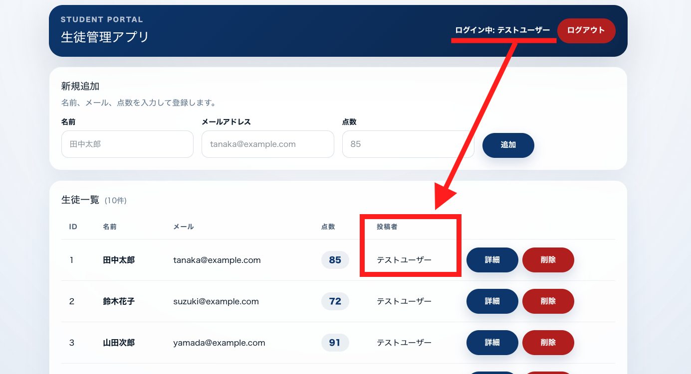
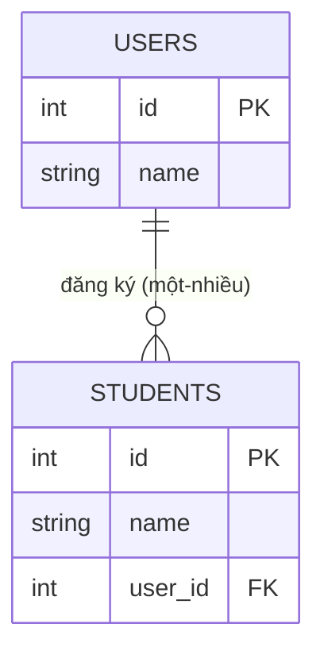

# Tiết 25｜Tạo quan hệ giữa Users ⇔ Students

> 🇯🇵 Bản gốc (tiếng Nhật): [2026_07_23_課題.md](<../../../2年生_システム開発実践/前期/2026_07_23/2026_07_23_課題.md>) <!-- original-ja-link -->

---

# Bạn nào đã làm được đến đây thì tiếp theo hãy tạo quan hệ giữa bảng Users và bảng Students nhé

[Về cơ sở dữ liệu quan hệ](./リレーショナルデータベース入門.md)

Ở trạng thái hiện tại, bảng `students` không có thông tin "ai đã đăng ký dữ liệu học sinh đó". Ai cũng chỉ xem được cùng một danh sách, và ứng dụng không cho biết được "dữ liệu này là do chính mình (người dùng đang đăng nhập) đăng ký".

Chúng ta sẽ tạo quan hệ (liên kết) giữa bảng `users` và bảng `students`, để tên của người dùng đã đăng ký được hiển thị dưới dạng "người đăng" trên màn hình danh sách và màn hình chi tiết.

## Sẽ làm gì

Khi đăng ký một học sinh mới, dữ liệu học sinh đó sẽ tự động được liên kết với "người dùng đang đăng nhập". Sau đó, hiển thị tên người dùng đã đăng ký học sinh đó (người đăng) ở cả màn hình danh sách lẫn màn hình chi tiết.

Điểm quan trọng là **tên người dùng đang đăng nhập (góc trên bên phải) phải trùng với tên hiển thị ở cột "người đăng" trong danh sách**. Với người dùng test lần này, dù nhìn vào dòng của học sinh nào thì cũng sẽ hiển thị 「投稿者：テストユーザー」 (người đăng: người dùng test) (vì toàn bộ dữ liệu seed hiện tại đều được xem là do cùng một người dùng đăng ký).

## Quan hệ (relation) là gì?

Hiện tại, bảng `users` và bảng `students` đang tồn tại hoàn toàn tách biệt. Lần này, ta sẽ nối hai bảng bằng quan hệ "một người dùng có thể đăng ký nhiều học sinh" — đó chính là relation.

- Bảng `users`: 1 bản ghi = 1 người dùng (giảng viên)
- Bảng `students`: 1 bản ghi = 1 học sinh

Ta nối hai bảng này bằng cách cho phía `students` có một cột (**khóa ngoại**) cho biết "người dùng nào đã đăng ký". Nhờ vậy,

- Một người dùng có thể có nhiều học sinh (quan hệ **một-nhiều**)
- Một bản ghi học sinh luôn thuộc về đúng một người dùng

có thể biểu diễn quan hệ như trên ngay trong cơ sở dữ liệu. Vẽ thành sơ đồ thì như sau (`user_id` là khóa ngoại).

Trong Laravel, dựa vào khóa ngoại này, ta định nghĩa quan hệ trong model `User` và model `Student`; nhờ đó có thể dễ dàng lấy được "danh sách học sinh do người dùng này đăng ký" hoặc "người dùng đã đăng ký học sinh này".

## Các thành phần cần có trên màn hình

- Ở mỗi dòng của màn hình danh sách học sinh (`/students`), có cột hiển thị **người đăng** (tên người dùng đã đăng ký)
- Màn hình chi tiết học sinh (`/students/{id}`) cũng có mục hiển thị **người đăng** tương tự
- Khi đăng ký học sinh mới, dữ liệu học sinh đó phải tự động được liên kết với "người dùng đang đăng nhập" (không bị tính là do người dùng khác đăng ký)

## Gợi ý triển khai (liên quan đến những gì đã học)

- Ở phía cơ sở dữ liệu, thêm vào bảng `students` một cột khóa ngoại (ví dụ: `user_id`) tham chiếu đến bảng `users`. Cách an toàn là tạo một **migration mới** để thêm cột, thay vì sửa trực tiếp migration của bảng đang hoạt động
- Khi thêm khóa ngoại, bạn cũng cần quyết định "làm gì khi người dùng được tham chiếu bị xóa" (ví dụ: xóa luôn dữ liệu học sinh theo)
- Trong Laravel, định nghĩa cho model `User` quan hệ "một người dùng có nhiều học sinh" (`hasMany`), và cho model `Student` quan hệ "một học sinh thuộc về một người dùng" (`belongsTo`)
- Ở API trả về danh sách học sinh (`index()`), hãy lấy cả thông tin người dùng đã đăng ký cùng với dữ liệu học sinh, và đưa tên người đăng vào response. Cũng hãy lưu ý rằng nếu đi lấy thông tin người dùng từng bản ghi một thì số lần truy vấn (SQL) sẽ tăng lên một cách lãng phí (tải trước bằng `with()` sẽ giúp ích)
- Ở API đăng ký học sinh mới (`store()`), hãy tạo dữ liệu thông qua `$request->user()` (người dùng đang đăng nhập) để khóa ngoại tự động trở thành ID của người dùng đó
- Ở phía frontend, thêm trường tên người đăng vào kiểu của response API (`type Student`), rồi thêm JSX hiển thị nó vào bảng danh sách và màn hình chi tiết

## Trình tự triển khai

**1. Thêm khóa ngoại ở phía DB**

Thêm cột `user_id` vào bảng `students`. Cách an toàn là không sửa migration đã có mà tạo một file migration mới để thêm cột (đây là cách làm chuẩn khi cần thay đổi cấu trúc của một bảng đang hoạt động trên môi trường production).

**↓**

**2. Quyết định cách xử lý khi xóa**

Khi tạo khóa ngoại, cần thiết lập luôn việc nếu `users` được tham chiếu bị xóa thì xử lý thế nào (ví dụ: dùng `onDelete('cascade')` để xóa luôn dữ liệu học sinh).

**↓**

**3. Định nghĩa quan hệ trong model**

- Model `User` → `hasMany(Student::class)` (một người dùng có thể có nhiều học sinh)
- Model `Student` → `belongsTo(User::class)` (một học sinh thuộc về một người dùng)

**↓**

**4. Sửa API danh sách (`index()`)**

Khi lấy dữ liệu học sinh, lấy luôn cả thông tin người đăng (người dùng). Nếu ở đây gửi truy vấn cho từng bản ghi một thì sẽ gặp vấn đề N+1 làm số câu SQL tăng lên lãng phí, vì vậy hãy dùng Eager Loading như `with('user')`.

**↓**

**5. Sửa API đăng ký (`store()`)**

Khi tạo học sinh mới, tạo bản ghi thông qua "người dùng đang đăng nhập" lấy từ `$request->user()`. Làm như vậy thì `user_id` sẽ tự động là ID của người dùng đó, và tránh được gian lận kiểu ai cũng có thể chỉ định ID của người khác.

**↓**

**6. Sửa phía frontend**

Thêm trường tên người đăng vào định nghĩa kiểu `type Student` → thêm phần hiển thị 「投稿者：〇〇」 (người đăng: 〇〇) vào JSX của các dòng trong bảng danh sách và màn hình chi tiết.
