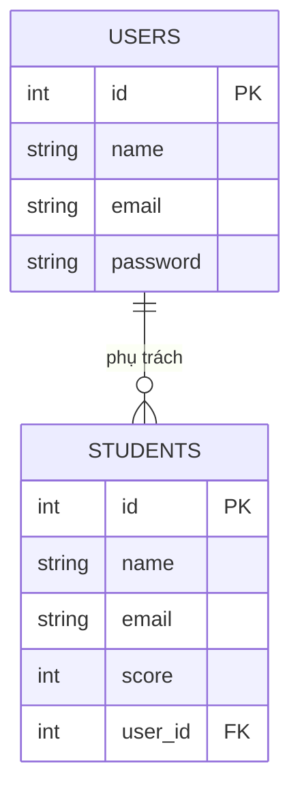

> 🇯🇵 Bản gốc (tiếng Nhật): [リレーショナルデータベース入門.md](<../../../2年生_システム開発実践/前期/2026_07_23/リレーショナルデータベース入門.md>) <!-- original-ja-link -->

## Bài viết này giúp bạn hiểu

- Bảng, hàng, cột
- Khóa chính
- Khóa ngoại và sự liên kết giữa các bảng
- Lý do tách bảng

## Cơ sở dữ liệu = tập hợp các bảng được sắp xếp gọn gàng

Thay vì ghi chép rời rạc ra giấy, "cơ sở dữ liệu" là cơ chế sắp xếp và lưu dữ liệu dưới dạng bảng. RDB (cơ sở dữ liệu quan hệ) có đặc điểm là có thể nối nhiều bảng (table) như vậy với nhau (= tạo quan hệ) để xử lý.

## Bảng, hàng, cột

Ứng dụng này có 2 bảng với vai trò khác nhau. Ta sẽ lấy từng bảng làm ví dụ để xem tên gọi của từng thành phần.

### 🎓 Bảng students (dữ liệu học sinh)

| id | name | email | score |
|----|------|-------|-------|
| 1  | 田中太郎 | tanaka@example.com | 80 |
| 2  | 佐藤花子 | sato@example.com | 95 |

- **Bảng (table)**: chính cái bảng này (tạo nhiều bảng theo từng mục đích)
- **Cột (column)**: các mục theo chiều dọc như `id` `name` `email` `score`
- **Hàng (record)**: dữ liệu của 1 bản ghi (ở đây là thông tin của 1 học sinh)

### 🔑 Bảng users (thông tin đăng nhập của giáo viên, quản trị viên)

| id | name | email | password |
|----|------|-------|----------|
| 1  | 小山先生 | koyama@example.com | $2y$10$abcdefGhIjKlmn...(đã băm) |
| 2  | 田中先生 | tanaka-t@example.com | $2y$10$OpQrStUvWxYz...(đã băm) |

- **Bảng (table)**: `users` (thông tin tài khoản để đăng nhập; vai trò khác với students)
- **Cột (column)**: `id` `name` `email` `password`
- **Hàng (record)**: dữ liệu của 1 bản ghi (ở đây là thông tin đăng nhập của 1 giáo viên/quản trị viên)

> 💡 `password` không được lưu nguyên chuỗi đã nhập (mật khẩu dạng rõ), mà được lưu sau khi qua một phép biến đổi không thể đảo ngược gọi là băm (hash). Mục đích là để dù nội dung cơ sở dữ liệu có bị lộ, người khác cũng không biết được mật khẩu gốc.

## Khóa chính: ID giúp xác định duy nhất từng bản ghi

Nếu chỉ tìm theo `name` (tên), khi có người trùng họ tên thì không xác định được là ai. Vì vậy ta dùng một con số tuyệt đối không trùng với các hàng khác (**khóa chính**). Cột `id` ở bảng trên chính là khóa chính; chỉ cần nói "cho tôi dữ liệu có id = 1" là có thể lọc ra đúng 1 bản ghi của bạn 田中太郎. Hãy hình dung khóa chính giống như số định danh cá nhân hay mã số thành viên là dễ hiểu.

## Khóa ngoại: sự liên kết giữa các bảng

Bản chất của RDB là có thể liên kết nhiều bảng với nhau bằng ID (= nguồn gốc của từ "quan hệ").

Ứng dụng này có 2 bảng: bảng `users` để đăng nhập (tài khoản giáo viên/quản trị viên) và bảng `students` chứa dữ liệu học sinh. Hiện tại, hai bảng này là độc lập, chưa được nối với nhau bằng ID.

Nếu muốn ghi lại "giáo viên (user) nào đã đăng ký/phụ trách học sinh (student) nào", ta thêm cột `user_id` vào bảng `students` để nối hai bảng.

Nếu để `STUDENTS.user_id` (khóa ngoại) tham chiếu đến `USERS.id` (khóa chính), ta có thể biểu diễn quan hệ một giáo viên (user) phụ trách nhiều học sinh (student) (một-nhiều).

## Vì sao phải tách bảng

Nếu không tách mà gộp tất cả vào một bảng, tên và địa chỉ email của cùng một giáo viên phụ trách sẽ bị lặp lại đúng bằng số học sinh mà giáo viên đó phụ trách.

| student_id | student_name | staff_name | staff_email |
|-----------|-------|-------------|---------------|
| 101 | 田中花子 | 小山先生 | koyama@example.com |
| 103 | 田中次郎 | 小山先生 | koyama@example.com |

Như vậy, khi thầy 小山 đổi địa chỉ email, ta phải tìm và sửa tất cả các hàng liên quan, rất dễ sót. Nếu tách thành bảng users và bảng students rồi liên kết bằng ID, thông tin của thầy 小山 chỉ nằm ở 1 chỗ và cũng chỉ cần sửa ở 1 chỗ. Cách nghĩ "tách bảng để tránh trùng lặp" này được gọi là **chuẩn hóa (normalization)**.

## Tổng kết

- Cơ sở dữ liệu là cơ chế sắp xếp và lưu trữ dữ liệu
- RDB quản lý dữ liệu dưới dạng "bảng", và bảng được tạo nên từ "cột (mục)" và "hàng (dữ liệu của 1 bản ghi)"
- Khóa chính là dấu hiệu (ID) để phân biệt từng bản ghi mà không bị trùng
- Khóa ngoại là cơ chế tham chiếu đến khóa chính của bảng khác để liên kết các bảng với nhau
- Tách bảng rồi liên kết với nhau giúp tránh trùng lặp thông tin và giúp dữ liệu dễ sắp xếp hơn

Về sau sẽ còn xuất hiện "SQL", "chỉ mục (index)", "giao dịch (transaction)"..., nhưng trước mắt chỉ cần hình dung được phần nền tảng này là được.
