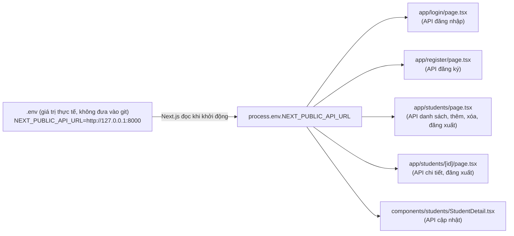
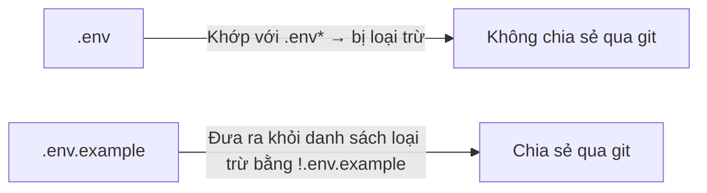

# Tiết 26｜Tách URL của API thành biến môi trường (.env) - Các bước triển khai

> 🇯🇵 Bản gốc (tiếng Nhật): [2026_07_30_実装.md](<../../../2年生_システム開発実践/前期/2026_07_30/2026_07_30_実装.md>) <!-- original-ja-link -->

## Mục tiêu hôm nay

- Gom `http://localhost:8000` / `http://127.0.0.1:8000` đang được viết cứng ở từng trang của `school-frontend` về một chỗ
- Tạo file `.env` và quản lý URL của API dưới dạng biến môi trường `NEXT_PUBLIC_API_URL`
- Chia sẻ `.env.example` (template không chứa giá trị) qua git, còn `.env` (giá trị thực tế) thì loại khỏi sự quản lý của git
- Viết lại toàn bộ những chỗ dùng fetch để đi qua `process.env.NEXT_PUBLIC_API_URL`

> **Vị trí của bài này:** Cho đến giờ, chúng ta viết trực tiếp URL của API trong từng file, ví dụ `fetch("http://127.0.0.1:8000/api/students")`. Với cách viết này, khi URL ở môi trường phát triển và môi trường production khác nhau, ta phải sửa ở rất nhiều chỗ trong các file, và việc quên sửa cũng dễ gây ra bug. Lần này, chúng ta sẽ học cách nghĩ "những giá trị có thể thay đổi (URL, API key, v.v.) thì không nhúng vào code, mà đưa ra ngoài dưới dạng biến môi trường".

---

## Bức tranh tổng thể: chúng ta sẽ làm gì



> 💡 **Ví dụ dễ hiểu… cuốn sổ danh bạ ghi địa chỉ ở một chỗ**
>
> Cách làm từ trước đến giờ giống như mỗi lần gửi thư cho bạn, bạn lại tự tay viết địa chỉ "nhà bạn Tanaka ở số 3-1 phường ◯◯". Nếu bạn Tanaka chuyển nhà, bạn phải viết lại toàn bộ những lá thư đã viết. `.env` giống như một "cuốn sổ danh bạ": chỉ ghi địa chỉ (URL của API) ở một chỗ duy nhất, còn các lá thư (fetch trong từng file) thì tham chiếu đến "địa chỉ của bạn Tanaka trong sổ danh bạ". Dù có chuyển nhà (thay đổi URL), chỉ cần sửa sổ danh bạ một lần là xong.

### Vì sao phải tách `.env` và `.env.example`

Trong ứng dụng này, `.env` không chứa giá trị bí mật nào, nhưng thông thường nó sẽ chứa những giá trị không muốn người khác thấy, như mật khẩu của cơ sở dữ liệu mà ứng dụng kết nối tới hay API key. Vì vậy, bản thân `.env` sẽ bị loại trừ bằng `.gitignore` và không được chia sẻ qua git. Mặt khác, "cần những tên biến nào" là điều cả nhóm muốn chia sẻ, nên ta chỉ commit `.env.example` với các giá trị để trống (hoặc giá trị giả). Người mới tham gia dự án sẽ sao chép `.env.example` để tạo `.env`, rồi điền giá trị phù hợp với môi trường của mình.

### Cấu trúc file (những file sẽ chỉnh lần này)

| Ký hiệu | Ý nghĩa |
|---|---|
| 🆕 Mới | Tạo file mới |
| ➕ Thêm | Viết thêm code vào file đã có |
| 🔁 Thay thế | Viết lại phần xử lý đã có |

```
school-frontend/
├── .env                                       🆕 Mới (giá trị thực tế, không đưa vào git)
├── .env.example                               🆕 Mới (template, đưa vào git)
├── .gitignore                                 ➕ Chỉ đưa .env.example ra khỏi danh sách loại trừ
├── app/login/page.tsx                         🔁 Thay URL của fetch bằng biến môi trường
├── app/register/page.tsx                      🔁 Thay URL của fetch bằng biến môi trường
├── app/students/page.tsx                      🔁 Thay URL của fetch bằng biến môi trường (4 chỗ)
├── app/students/[id]/page.tsx                 🔁 Thay URL của fetch bằng biến môi trường (2 chỗ)
└── components/students/StudentDetail.tsx      🔁 Thay URL của fetch bằng biến môi trường
```

---

## Step 1｜Tạo `.env`

**🆕 File mới** — Tạo `.env` ngay trong thư mục `school-frontend`.

```bash
# ▼ school-frontend/.env
NEXT_PUBLIC_API_URL=http://127.0.0.1:8000
```

- Điểm quan trọng là thêm `NEXT_PUBLIC_` vào đầu tên key. Next.js chỉ nhúng những biến môi trường có tiền tố `NEXT_PUBLIC_` vào bản build để phía trình duyệt (client component) cũng đọc được. Tất cả các `fetch` sẽ viết lại lần này đều nằm trong component có `"use client"`, nên bắt buộc phải có tiền tố này.
- Các biến môi trường không có `NEXT_PUBLIC_` (ví dụ: mật khẩu DB, v.v.) chỉ đọc được từ code phía server. Không thêm tiền tố này cho những giá trị không muốn trình duyệt nhìn thấy.

---

## Step 2｜Tạo `.env.example`

**🆕 File mới** — Tạo một file có cùng nội dung để làm template chia sẻ trong nhóm. Lần này giá trị là URL không chứa thông tin bí mật, nên cứ ghi nguyên giá trị đó.

```bash
# ▼ school-frontend/.env.example
NEXT_PUBLIC_API_URL=http://127.0.0.1:8000
```

> ⚠️ Khi làm việc với những giá trị thực sự bí mật như mật khẩu hay API key, đừng ghi giá trị thực vào `.env.example`, mà hãy để trống như `DB_PASSWORD=` hoặc dùng giá trị giả như `your-api-key-here`.

---

## Step 3｜Dùng `.gitignore` để đưa riêng `.env.example` ra khỏi danh sách loại trừ

Trong `.gitignore` mà `create-next-app` tạo sẵn từ đầu, có một quy tắc dùng ký tự đại diện (wildcard) `.env*` như sau.

```
# env files (can opt-in for committing if needed)
.env*
```

Quy tắc này loại trừ "tất cả các file bắt đầu bằng `.env`", không chỉ `.env` mà cả `.env.example`. Đây là thiết lập đúng như một biện pháp an toàn để không vô tình commit thông tin bí mật, nhưng như vậy thì ngay cả `.env.example` — file mà ta muốn chia sẻ — cũng bị loại khỏi git. Vì thế, ta thêm 1 dòng thiết lập để riêng `.env.example` được ngoại lệ, không bị loại trừ.

**➕ Thêm**

```
# env files (can opt-in for committing if needed)
.env*
!.env.example
```

Thêm `!` vào đầu có nghĩa là "không loại trừ mẫu này (= quản lý bằng git)". Thứ tự rất quan trọng: trước tiên loại trừ tất cả bằng `.env*`, sau đó dùng `!.env.example` để "khôi phục" riêng `.env.example` (nếu đảo ngược thứ tự thì sẽ không có tác dụng).

Với thiết lập này, hai file được xử lý như sau.



---

## Step 4｜Thay URL của fetch bằng biến môi trường

Đến đây `.env` đã được chuẩn bị xong, nhưng code thực tế vẫn đang trỏ thẳng đến `http://127.0.0.1:8000`. Ta sẽ sửa URL trong các lời gọi fetch ở từng file thành template literal dùng `process.env.NEXT_PUBLIC_API_URL`.

### 4-1. `app/login/page.tsx`

**🔁 Thay thế**

```tsx
// Before
const res = await fetch("http://127.0.0.1:8000/api/login", {

// After
const res = await fetch(`${process.env.NEXT_PUBLIC_API_URL}/api/login`, {
```

### 4-2. `app/register/page.tsx`

**🔁 Thay thế**

```tsx
// Before
const res = await fetch("http://127.0.0.1:8000/api/register", {

// After
const res = await fetch(`${process.env.NEXT_PUBLIC_API_URL}/api/register`, {
```

### 4-3. `app/students/page.tsx` (4 chỗ)

**🔁 Thay thế** — Viết lại lần lượt 4 lời gọi fetch: lấy danh sách, thêm học sinh, xóa học sinh và đăng xuất.

```tsx
// Lấy danh sách (Before → After)
const res = await fetch("http://127.0.0.1:8000/api/students", {
const res = await fetch(`${process.env.NEXT_PUBLIC_API_URL}/api/students`, {

// Thêm học sinh (Before → After)
const res = await fetch("http://127.0.0.1:8000/api/students", {
const res = await fetch(`${process.env.NEXT_PUBLIC_API_URL}/api/students`, {

// Xóa học sinh (Before → After)
const res = await fetch(`http://127.0.0.1:8000/api/students/${id}`, {
const res = await fetch(`${process.env.NEXT_PUBLIC_API_URL}/api/students/${id}`, {

// Đăng xuất (Before → After)
await fetch("http://127.0.0.1:8000/api/logout", {
await fetch(`${process.env.NEXT_PUBLIC_API_URL}/api/logout`, {
```

### 4-4. `app/students/[id]/page.tsx` (2 chỗ)

**🔁 Thay thế** — File này vốn được viết với `http://localhost:8000` (ghi là `localhost` chứ không phải `127.0.0.1`). Chính việc cách ghi không thống nhất như vậy đã cho thấy sự cần thiết của việc "gom URL về một chỗ".

```tsx
// Lấy chi tiết (Before → After)
const res = await fetch(`http://localhost:8000/api/students/${params.id}`, {
const res = await fetch(`${process.env.NEXT_PUBLIC_API_URL}/api/students/${params.id}`, {

// Đăng xuất (Before → After)
await fetch("http://localhost:8000/api/logout", {
await fetch(`${process.env.NEXT_PUBLIC_API_URL}/api/logout`, {
```

### 4-5. `components/students/StudentDetail.tsx`

**🔁 Thay thế**

```tsx
// Before
const res = await fetch(`http://localhost:8000/api/students/${student.id}`, {

// After
const res = await fetch(`${process.env.NEXT_PUBLIC_API_URL}/api/students/${student.id}`, {
```

> 💡 Những chỗ mà chuỗi ban đầu dùng dấu ngoặc kép `"http://..."` (chuỗi thông thường) cũng cần đổi thành template literal dùng dấu backtick (\` \`) để có thể nhúng `${...}` vào. Những chỗ vốn đã là template literal (như `` `http://127.0.0.1:8000/api/students/${id}` ``) thì giữ nguyên backtick, chỉ thay phần chuỗi bên trong.

---

## Kiểm tra hoạt động

```bash
# Backend
cd Laravel && php artisan serve   # http://localhost:8000

# Frontend
cd school-frontend && npm run dev # http://localhost:3000
```

> ⚠️ Khi mới tạo `.env` hoặc thay đổi giá trị trong đó, hãy dừng `npm run dev` một lần rồi khởi động lại. Next.js đọc biến môi trường vào thời điểm build/khởi động, nên nếu sửa `.env` trong lúc server vẫn đang chạy thì hot reload cũng không cập nhật thay đổi đó.

| Mục kiểm tra | Thao tác | Kết quả mong đợi |
|---|---|---|
| Còn URL viết cứng trong code không | Chạy `grep -rn "localhost:8000\|127.0.0.1:8000" app components` | Không có gì được in ra (tất cả đã được thay bằng cách đi qua `process.env`) |
| Đăng nhập | Đăng nhập từ `/login` | Đăng nhập được như trước và chuyển sang `/students` |
| Danh sách, chi tiết, thêm, xóa | Thực hiện lần lượt các thao tác ở `/students` | Mọi thứ hoạt động như trước (chỉ cách viết URL thay đổi, hành vi không đổi) |
| Chuyển đổi biến môi trường | Tạm đổi giá trị trong `.env` sang một cổng khác (ví dụ: cổng không tồn tại) rồi khởi động lại | Kết nối tới API thất bại = xác nhận được rằng giá trị trong `.env` thực sự đang được dùng (sau khi kiểm tra xong thì trả về giá trị cũ) |
| Trạng thái trong git | Chạy `git status` | `.env` không hiển thị (đã bị loại trừ), `.env.example` hiển thị là file chưa được theo dõi (untracked) |

---

## Tổng kết

| Khái niệm | Phần xử lý lần này |
|---|---|
| Tách thành biến môi trường | `NEXT_PUBLIC_API_URL` trong `.env` |
| Điều kiện để đọc biến môi trường ở phía client | Tiền tố `NEXT_PUBLIC_` |
| Cách để không đưa thông tin bí mật vào git | `.env*` trong `.gitignore` |
| Cách chỉ chia sẻ template cho nhóm | `.env.example` ＋ đưa ra khỏi danh sách loại trừ bằng `!.env.example` |
| Thời điểm biến môi trường có hiệu lực | Sau khi đổi `.env` cần khởi động lại server phát triển |

## Checklist hoàn thành (Definition of Done)

- [ ] Đã thiết lập `NEXT_PUBLIC_API_URL=http://127.0.0.1:8000` trong `school-frontend/.env`
- [ ] Đã tạo `school-frontend/.env.example`, trong đó ghi cùng tên biến làm template
- [ ] Đã thêm `!.env.example` vào `.gitignore`, và chỉ riêng `.env.example` được quản lý bằng git
- [ ] Tất cả fetch trong `app/login/page.tsx` / `app/register/page.tsx` / `app/students/page.tsx` / `app/students/[id]/page.tsx` / `components/students/StudentDetail.tsx` đều đi qua `process.env.NEXT_PUBLIC_API_URL`
- [ ] Chạy `grep -rn "localhost:8000\|127.0.0.1:8000" app components` không tìm thấy kết quả nào
- [ ] Sau khi khởi động lại `npm run dev`, các thao tác từ đăng nhập → danh sách → chi tiết → thêm → xóa đều hoạt động như trước
- [ ] Khi chạy `git status`, `.env` không hiển thị, chỉ có `.env.example` là đối tượng được quản lý

## Lệnh khởi động

```bash
# Backend
cd Laravel && php artisan serve   # http://localhost:8000

# Frontend
cd school-frontend && npm run dev # http://localhost:3000
```
