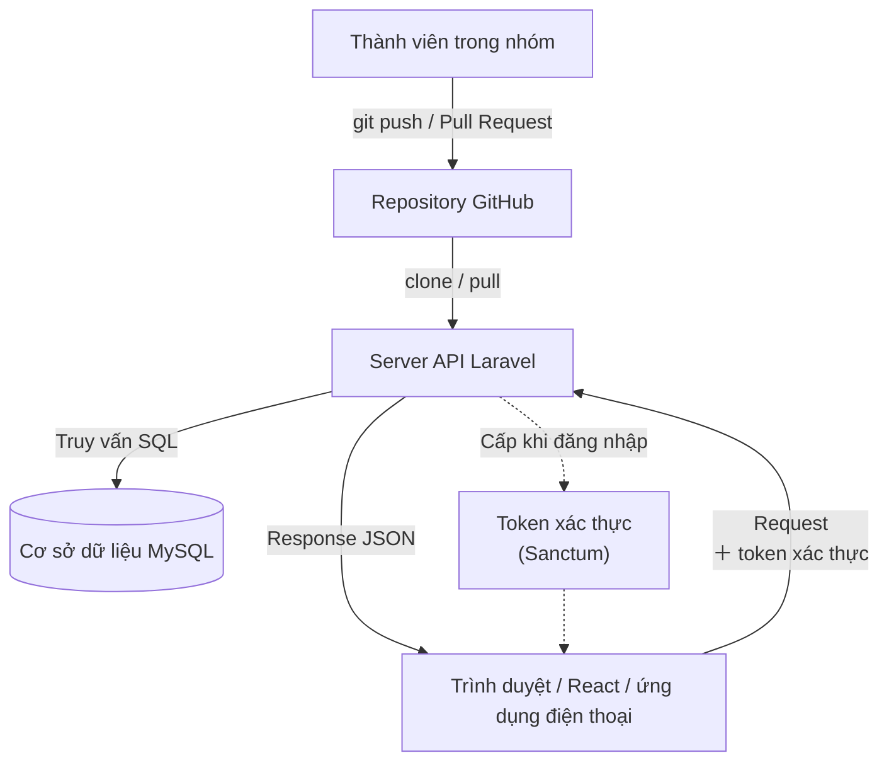
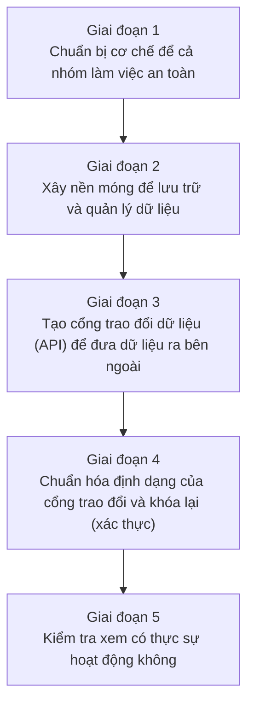

# Quy trình phát triển: từ con số 0 đến khi tạo xong API

> 🇯🇵 Bản gốc (tiếng Nhật): [開発の流れ_まとめ.md](<../../2年生_システム開発実践/前期/開発の流れ_まとめ.md>) <!-- original-ja-link -->

---

## Lời mở đầu

Tài liệu này không chỉ giải thích "đã làm gì" mà còn giải thích "**vì sao lại theo thứ tự đó**".

---

## Bức tranh tổng thể: chúng ta đã làm ra cái gì

### Sơ đồ tổng thể của hệ thống đã hoàn thành



### 5 giai đoạn

| Giai đoạn | Chủ đề | Từ khóa | Buổi học |
|---------|--------|-----------|---------|
| 1 | Chuẩn bị cho phát triển theo nhóm | Branch, PR, review | 04/30 |
| 2 | Xây nền móng cho ứng dụng | Laravel, DB, migration | 05/06 |
| 3 | Tạo cổng trao đổi dữ liệu | REST API, JSON, routing | 05/14 |
| 4 | Chuẩn hóa định dạng và tăng cường bảo vệ | Resource, validation, Sanctum | 05/21 |
| 5 | Kiểm tra xem có hoạt động không | curl, kiểm thử trên trình duyệt | 05/28 |

---

## Giai đoạn 1: Chuẩn bị cho phát triển theo nhóm

### Đã làm gì

Chúng ta đã học về branch, merge, Pull Request (PR) và code review của Git,
rồi đưa ứng dụng của nhóm lên GitHub để mọi người đều chạy được.

### Vì sao cần thiết

> 💡 **Ví dụ dễ hiểu… quản lý bản vẽ ở công trường**
>
> Khi nhiều nhà thầu cùng xây một tòa nhà lớn, nếu tất cả cùng viết trực tiếp lên
> "bản gốc của cùng một bản vẽ" thì sẽ rối tung. Vì vậy, mỗi nhà thầu viết lên "bản sao của riêng mình (branch)",
> khi xong thì đối chiếu chung (review) rồi mới cập nhật vào bản gốc.

Trong phát triển theo nhóm, nhiều người cùng chỉnh sửa một file vào cùng lúc.
Nhờ tạo branch, ta có thể "phát triển tính năng mới mà không làm hỏng code chính".
PR là một yêu cầu kiểu "Cho mình đưa code này vào nhánh chính được không?",
còn review là dịp để cả nhóm kiểm tra xem code đó có đúng và dễ đọc hay không.

> ⚠️ **Nếu không có cái này thì…** code của người này sẽ ghi đè lên code của người kia và làm mất nó.
> Tình trạng "vừa nãy còn chạy được mà giờ lại không chạy" sẽ xảy ra liên tục.

### Những gì làm được sau giai đoạn này

- Tạo branch bằng `git switch -c feature/xxxx` và làm việc trên đó
- Chia sẻ cho nhóm bằng `git push origin feature/xxxx`
- Tạo PR trên GitHub và nhờ review
- Sửa code dựa trên các comment review

### Các bước chi tiết

→ [`2026_04_30/2026_04_30.md`](2026_04_30/2026_04_30.md)

---

## Giai đoạn 2: Xây nền móng cho ứng dụng

### Đã làm gì

Chúng ta đã tạo project Laravel, chuẩn bị cơ sở dữ liệu (`school_api`),
định nghĩa và tạo bảng `students`. Sau đó nạp 10 bản ghi dữ liệu test và khởi động server.

### Vì sao cần thiết

> 💡 **Ví dụ dễ hiểu… xây bếp cho nhà hàng**
>
> Để mang món ăn (response của API) ra cho khách,
> trước hết cần có bếp (Laravel) và nơi để nguyên liệu (cơ sở dữ liệu).
> Nếu làm sẵn bản thiết kế của bếp (migration) trước,
> thì bất kỳ ai trong nhóm cũng có thể tái tạo lại cùng một môi trường.

Laravel là "một chiếc hộp có sẵn các tính năng hay dùng (routing, thao tác DB, xác thực, v.v.) ngay từ đầu".
Migration là bản thiết kế của cơ sở dữ liệu; chỉ cần chạy `php artisan migrate` là
cả nhóm có thể tái tạo cùng một cấu trúc bảng trên máy của mình.
Seeder dùng để tự động tạo dữ liệu test, giúp tiết kiệm công sức nhập dữ liệu bằng tay.

> ⚠️ **Nếu không có cái này thì…** dù có viết code API thì cũng không có nơi lưu dữ liệu,
> nên cứ mỗi lần gửi request là dữ liệu lại mất.

### Những gì làm được sau giai đoạn này

- Tạo project bằng `composer create-project laravel/laravel`
- Thiết lập thông tin kết nối DB trong `.env`
- Tạo cùng lúc model, migration, factory bằng `php artisan make:model Student -mf`
- Tạo bảng bằng `php artisan migrate`
- Nạp dữ liệu test bằng `php artisan db:seed`
- Khởi động server local bằng `php artisan serve`

### Các bước chi tiết

→ [`2026_05_06/20260506.md`](2026_05_06/20260506.md)

---

## Giai đoạn 3: Tạo cổng trao đổi dữ liệu

### Đã làm gì

Chúng ta đã học khái niệm REST API (URL × HTTP method, response JSON, status code),
rồi tạo `StudentController` và triển khai 5 endpoint như `GET /api/students`.

### Vì sao cần thiết

> 💡 **Ví dụ dễ hiểu… các nút trên máy bán hàng tự động**
>
> Máy bán hàng tự động có các nút như "Cola", "Trà", "Nước",
> bấm vào thì sản phẩm tương ứng sẽ rơi ra.
> Endpoint của API cũng vậy:
> việc cần làm được quyết định bởi tổ hợp URL × HTTP method, ví dụ
> "`GET /api/students` (cho tôi tất cả)", "`DELETE /api/students/3` (xóa số 3)".

Ứng dụng Blade làm ở năm nhất trả về trang HTML.
Còn API thì thay vào đó chỉ trả về dữ liệu JSON.
Nhờ dùng JSON, các giao diện khác nhau như React, Vue hay ứng dụng điện thoại
**đều có thể dùng lại cùng một dữ liệu**.

> ⚠️ **Nếu không có cái này thì…** frontend và server không thể "nói chuyện" với nhau.
> Dù có gọi API từ React thì cũng rơi vào tình trạng "không biết phải gửi đến đâu".

### Những gì làm được sau giai đoạn này

- Hiểu cách thiết kế URL của REST API (tên resource, HTTP method)
- Tạo API controller bằng `php artisan make:controller Api/StudentController --api`
- Thêm routing vào `routes/api.php`
- Trả về response JSON bằng `response()->json()`
- Hiểu ý nghĩa của các HTTP status code (200, 201, 404, 422)

### Các bước chi tiết

→ [`2026_05_14/20260514.md`](2026_05_14/20260514.md)

---

## Giai đoạn 4: Chuẩn hóa định dạng và tăng cường bảo vệ

### Đã làm gì

Chúng ta đã thống nhất định dạng của response bằng `StudentResource`, và thêm validation để kiểm tra dữ liệu nhập vào.
Sau đó triển khai chức năng xác thực (đăng nhập, cấp token, đăng xuất) bằng Laravel Sanctum.

### Vì sao cần thiết

> 💡 **Ví dụ dễ hiểu… mẫu phiếu gửi hàng chuyển phát + thẻ ra vào tòa nhà**
>
> Trên phiếu chuyển phát, "người gửi, địa chỉ nhận, tên hàng" được ghi ở những vị trí cố định.
> Nhờ định dạng thống nhất nên bên nhận có thể xử lý mà không bị lúng túng.
> `StudentResource` chính là "mẫu phiếu" quyết định định dạng của response.
>
> Token của Sanctum là "thẻ ra vào".
> Chỉ những người có thẻ ra vào (token) được cấp khi đăng nhập
> mới được vào bên trong tòa nhà (API).

Sau giai đoạn 3, API đã chạy được, nhưng vẫn ở trạng thái ai cũng truy cập được.
Nếu không có xác thực, người lạ có thể tùy ý lấy và xóa dữ liệu.
Ngoài ra, nếu định dạng response của API mỗi chỗ một kiểu thì frontend sẽ khó xử lý dữ liệu.

> ⚠️ **Nếu không có cái này thì…** bất kỳ ai trên Internet cũng có thể sửa hoặc xóa dữ liệu.
> Còn có nguy cơ thông tin cá nhân như mật khẩu hay địa chỉ email bị lộ hoàn toàn.

### Những gì làm được sau giai đoạn này

- Tạo class định dạng response bằng `php artisan make:resource StudentResource`
- Viết validation bằng `$request->validate()`
- Cài package xác thực bằng `composer require laravel/sanctum`
- Lấy token bằng `POST /api/login`
- Bảo vệ các route cần xác thực bằng middleware `auth:sanctum`

### Các bước chi tiết

→ [`2026_05_21/20260521.md`](2026_05_21/20260521.md)

---

## Giai đoạn 5: Kiểm tra xem có hoạt động không

### Đã làm gì

Chúng ta đã dùng lệnh `curl` để gửi request đến API và kiểm tra hoạt động,
sau đó tạo thêm một màn hình test có thể thao tác trên trình duyệt (`/api-test`)
để kiểm tra toàn bộ luồng từ đăng nhập → lấy danh sách học sinh → thêm → xóa.

### Vì sao cần thiết

> 💡 **Ví dụ dễ hiểu… thử bỏ tiền thật vào chiếc máy bán hàng tự động vừa hoàn thành**
>
> Dù đã thiết kế và chế tạo máy bán hàng tự động, nhưng nếu chưa thực sự bỏ tiền vào và bấm nút
> thì vẫn chưa biết "sản phẩm có thật sự rơi ra hay không".
> API cũng vậy, chỉ viết code thôi thì chưa biết nó có chạy đúng hay không.
> Cần thực sự gửi request và kiểm tra xem JSON trả về có đúng như mong đợi không.

`curl` là "lệnh gửi HTTP request từ terminal".
Không cần mở trình duyệt cũng có thể kiểm tra ngay hoạt động của API.
Màn hình test trên trình duyệt là trang cho phép làm điều tương tự như curl nhưng bằng giao diện đồ họa,
và cũng giúp ta hình dung "khi nhìn từ React thì sẽ trông như thế này".

> ⚠️ **Nếu không có cái này thì…** bug sẽ lọt ra môi trường production mà không ai nhận ra.
> Để tránh tình trạng "ở môi trường phát triển thì chạy được mà lên production lại hỏng", việc kiểm tra hoạt động là bắt buộc.

### Những gì làm được sau giai đoạn này

- Gửi request GET, POST, DELETE bằng `curl`
- Gửi request có xác thực bằng header `Authorization: Bearer <token>`
- Thực hiện các thao tác đăng nhập, lấy danh sách, thêm và xóa thông qua API từ trình duyệt
- Đọc HTTP status code và JSON của response để đánh giá "có đang chạy đúng không"

### Các bước chi tiết

→ [`2026_05_28/20260528.md`](2026_05_28/20260528.md)

---

## Tổng kết: 5 giai đoạn đã kết nối với nhau

Nhìn lại 5 giai đoạn, ta thấy mỗi giai đoạn đều được xây dựng trên nền tảng của giai đoạn trước.



Nghĩa là giai đoạn nào cũng "cần thiết cho giai đoạn tiếp theo".
Nếu thay đổi thứ tự, quy trình sẽ không thể thực hiện được.

### Bước tiếp theo

API này đã ở **trạng thái có thể được gọi từ frontend như React**.
```javascript
fetch('/api/students', { headers: { Authorization: 'Bearer ' + token } })
```
Chỉ cần viết như trên là có thể lấy và hiển thị dữ liệu trên trình duyệt.

Trong các buổi học sắp tới, chúng ta sẽ chuyển sang phát triển frontend — "dùng API này để tạo giao diện".
