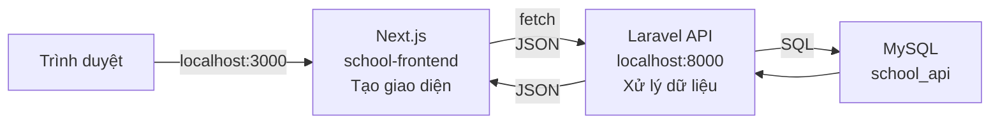
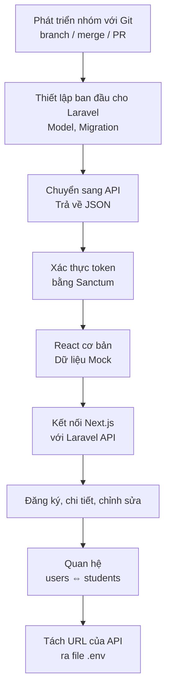
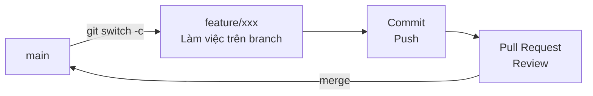
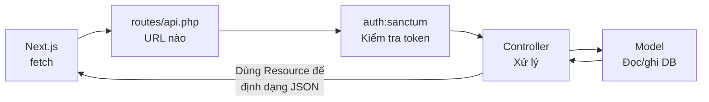
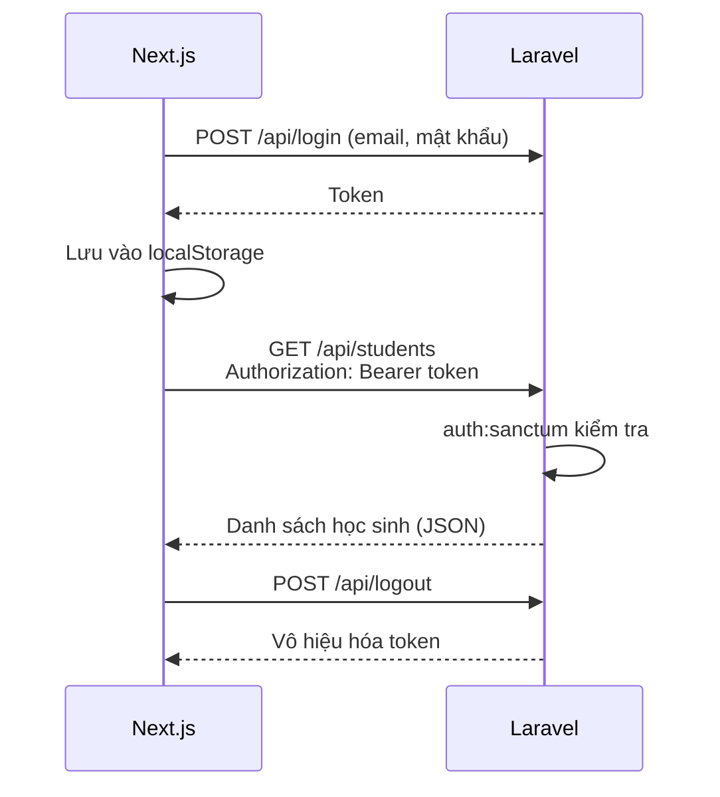
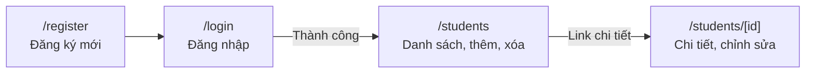
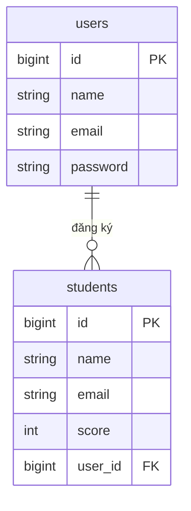
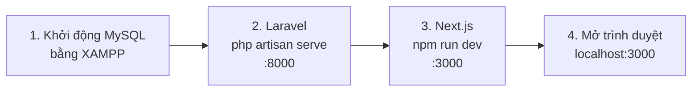

# Nhìn lại học kỳ 1 (ôn tập)

> 🇯🇵 Bản gốc (tiếng Nhật): [2026_10_02_資料1.md](<../../../2年生_システム開発実践/後期/2026_10_02/2026_10_02_資料1.md>) <!-- original-ja-link -->

Trước khi bước vào học kỳ 2, chúng ta hãy cùng nhớ lại toàn cảnh **ứng dụng quản lý học sinh** đã làm ở học kỳ 1.
Ở học kỳ 1, chúng ta đã làm phần giao diện (frontend) và phần xử lý dữ liệu (backend) thành **hai ứng dụng riêng biệt**, rồi kết nối chúng với nhau bằng API.



- **Next.js**: phụ trách tạo giao diện. Khi người dùng nhấn nút, Next.js gửi yêu cầu (request) tới Laravel
- **Laravel**: phụ trách nhận yêu cầu, đọc/ghi cơ sở dữ liệu và trả kết quả về dưới dạng **JSON**
- **MySQL**: phụ trách lưu trữ dữ liệu

---

## 1. Quá trình ở học kỳ 1

Ở học kỳ 1, chúng ta đã phát triển ứng dụng theo thứ tự sau.



| Buổi | Nội dung | Tài liệu |
|----|------|------|
| 4/30 | Phát triển nhóm với Git (branch, merge, Pull Request) | [Tài liệu](../../前期/2026_04_30/2026_04_30.md) |
| 5/6 | Thiết lập ban đầu cho dự án Laravel | [Tài liệu](../../前期/2026_05_06/20260506.md) |
| 5/14 | Chuyển ứng dụng Blade sang API | [Tài liệu](../../前期/2026_05_14/20260514.md) |
| 5/21 | Resource controller, xác thực token bằng Sanctum | [Tài liệu](../../前期/2026_05_21/20260521.md) |
| 5/28 | Kiểm tra xác thực token trên trình duyệt | [Tài liệu](../../前期/2026_05_28/20260528.md) |
| 6/11 | React cơ bản (component, JSX, props, useState) | [Tài liệu](../../前期/2026_06_11/2026_06_11.md) |
| 7/2 | Nhập môn Next.js → kết nối với Laravel API | [Tài liệu](../../前期/2026_07_02/2026_07_02.md) |
| 7/9 | Đăng ký người dùng mới + ôn tập token, CRUD, MVC | [Tài liệu](../../前期/2026_07_09/2026_07_09.md) |
| 7/16 | Màn hình chi tiết, chức năng chỉnh sửa | [Tài liệu](../../前期/2026_07_16/2026_07_16_実装.md) |
| 7/23 | Quan hệ users ⇔ students | [Tài liệu](../../前期/2026_07_23/2026_07_23_実装%20.md) |
| 7/30 | Tách URL của API ra file .env | [Tài liệu](../../前期/2026_07_30/2026_07_30_実装.md) |

---

## 2. Phát triển nhóm với Git

Khi cả nhóm cùng làm việc trên một repository, chúng ta tạo **branch** để làm việc, rồi review qua **Pull Request (PR)** trước khi đưa vào main (GitHub Flow).



- **Không sửa trực tiếp trên main**: luôn giữ main ở trạng thái chạy được
- Khi 2 người cùng sửa một dòng sẽ xảy ra **conflict** → mở file, sửa bằng tay rồi mới commit

---

## 3. Laravel API

### MVC (ví dụ về nhà hàng)

| Vai trò | Ví dụ file | Ví như |
|------|------------|-----------|
| **Model** | `app/Models/Student.php` | Nhà bếp, tủ lạnh (xử lý dữ liệu) |
| **Controller** | `app/Http/Controllers/Api/StudentController.php` | Người phục vụ (nhận order và mang món ra) |
| **View** | → Sau khi chuyển sang API thì **chuyển sang Next.js** | Bày món (phần hiển thị) |

Nhờ chuyển sang API, Laravel không còn tạo giao diện nữa mà chỉ trả về **JSON (chỉ dữ liệu)**.

### Đường đi của request



### Các API đã tạo

Chỉ với một dòng `Route::apiResource('students', ...)`, chúng ta đã có ngay 5 route cho CRUD.

| CRUD | Method | URL | Controller | Xác thực |
|------|---------|-----|-----------|:----:|
| — | POST | `/api/register` | `AuthController@register` | Không cần |
| — | POST | `/api/login` | `AuthController@login` | Không cần |
| — | POST | `/api/logout` | `AuthController@logout` | 🔒 |
| Read | GET | `/api/students` | `index` (danh sách) | 🔒 |
| Create | POST | `/api/students` | `store` (thêm) | 🔒 |
| Read | GET | `/api/students/{id}` | `show` (chi tiết) | 🔒 |
| Update | PUT | `/api/students/{id}` | `update` (cập nhật) | 🔒 |
| Delete | DELETE | `/api/students/{id}` | `destroy` (xóa) | 🔒 |

Các route có 🔒 nằm trong `auth:sanctum`, nên **nếu không có token sẽ bị lỗi 401**.

---

## 4. Xác thực token

Khi đăng nhập, Laravel sẽ cấp một **token** (giống như vòng đeo tay ở công viên giải trí).
Next.js lưu token đó lại và gửi kèm token mỗi khi gọi API.



Khi có lỗi, hãy kiểm tra bằng **Developer Tools** của trình duyệt.

- Tab `Application` → `Local Storage`: token đã được lưu chưa
- Tab `Network`: request có kèm `Authorization: Bearer ...` không

---

## 5. Giao diện Next.js

Các thư mục bên trong `app/` trở thành **URL** đúng như tên của chúng.



| URL | File | API sử dụng |
|-----|---------|--------|
| `/login` | `app/login/page.tsx` | `POST /api/login` |
| `/register` | `app/register/page.tsx` | `POST /api/register` |
| `/students` | `app/students/page.tsx` | Danh sách, thêm, xóa, đăng xuất |
| `/students/[id]` | `app/students/[id]/page.tsx` + `components/students/StudentDetail.tsx` | Chi tiết, cập nhật |

Khi đặt tên thư mục trong dấu `[ ]` như `[id]`, ta có thể **nhận một phần của URL như một biến**, ví dụ `/students/1`, `/students/2`...

Chúng ta cũng hãy nhớ lại những kiến thức cơ bản của React.

| Tên | Vai trò |
|------|------|
| **Component** | Các thành phần của giao diện (`LoginForm`, `StudentList`...) |
| **props** | Truyền dữ liệu từ component cha sang component con |
| **useState** | Giữ các giá trị thay đổi trên giao diện (nội dung nhập, dữ liệu danh sách...) |
| **useEffect** | Gọi API để lấy dữ liệu, chẳng hạn khi màn hình vừa hiển thị |

---

## 6. Bảng và quan hệ

Để biết "ai đã đăng ký" học sinh, chúng ta đã thêm `user_id` (khóa ngoại) vào `students`.



- Một người dùng có thể đăng ký nhiều học sinh (**một-nhiều**)
- Khi viết `hasMany` / `belongsTo` trong model, ta có thể lấy tên người đã đăng ký học sinh bằng `$student->user->name`

---

## 7. Hai file .env

Laravel và Next.js mỗi bên có **một file `.env` riêng**.

| File | Nội dung | Ví dụ |
|---------|--------------|----|
| `.env` của Laravel | Thông tin kết nối cơ sở dữ liệu | `DB_DATABASE=school_api` |
| `.env` của Next.js | URL của API | `NEXT_PUBLIC_API_URL=http://127.0.0.1:8000` |

- **Không đưa `.env` vào Git** (vì có thể chứa mật khẩu...)
- Thay vào đó, chia sẻ file `.env.example` với các giá trị để trống
- Sau khi sửa `.env`, hãy **khởi động lại development server**

---

## 8. Thứ tự khởi động ứng dụng

Nếu cả 3 thành phần không cùng chạy thì ứng dụng sẽ không hoạt động. Hãy khởi động theo thứ tự sau.



Chúng ta mở **2** cửa sổ terminal.

```bash
# Terminal ① Backend
cd Laravel
php artisan serve        # → http://localhost:8000

# Terminal ② Frontend
cd school-frontend
npm run dev              # → http://localhost:3000
```

---

## Câu hỏi kiểm tra

Hãy kiểm tra xem mình có giải thích được không nhé.

- [ ] Next.js và Laravel mỗi bên phụ trách việc gì?
- [ ] `GET /api/students` và `POST /api/students` khác nhau thế nào?
- [ ] Nếu gọi `/api/students` mà không kèm token thì sẽ nhận được gì?
- [ ] `user_id` trong bảng `students` dùng để làm gì?
- [ ] Tại sao không đưa `.env` vào Git? Thay vào đó ta chia sẻ gì?
- [ ] Để chạy ứng dụng, cần khởi động những gì và theo thứ tự nào?
