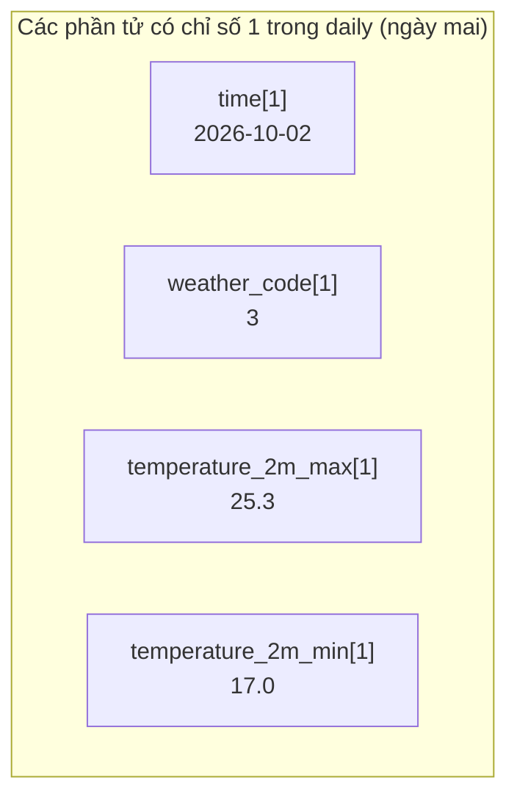
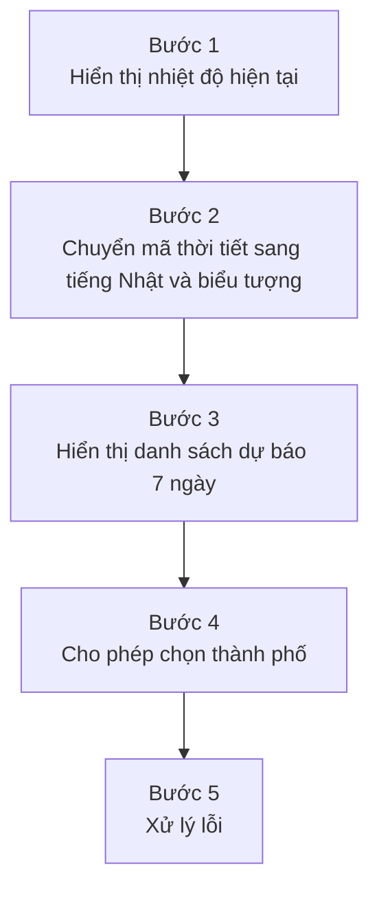

# Bài tập nâng cao: Làm ứng dụng dự báo thời tiết với API thời tiết

> 🇯🇵 Bản gốc (tiếng Nhật): [2026_10_02_資料2.md](<../../../2年生_システム開発実践/後期/2026_10_02/2026_10_02_資料2.md>) <!-- original-ja-link -->

**Bạn nào đã hoàn thành ứng dụng quản lý học sinh** thì hãy chuyển sang bài tập này nhé.
Ở học kỳ 1, chúng ta đã nhận JSON từ "Laravel API do chính mình làm" và hiển thị lên màn hình.
Lần này, chúng ta sẽ nhận JSON từ **một API thời tiết được công khai trên Internet (Open-Meteo)** và làm ứng dụng dự báo thời tiết bằng **một dự án Next.js mới**.


### Hình dung sản phẩm hoàn thành

```
┌─────────────────────────────────────────┐
│ 天気予報（東京）              [ 東京 ▼ ]  │  ← Có thể chọn thành phố
├─────────────────────────────────────────┤
│        ☀️                                │
│      晴れ   28℃                          │  ← Thời tiết hiện tại
│      風速 0.7 km/h                       │
├─────────────────────────────────────────┤
│ 10/1(木)  ☀️ 晴れ    29℃ / 18℃  ☔ 0%    │
│ 10/2(金)  ☁️ くもり  25℃ / 17℃  ☔ 20%   │  ← Dự báo 7 ngày
│ 10/3(土)  🌧️ 雨      21℃ / 16℃  ☔ 80%   │
│   …                                     │
└─────────────────────────────────────────┘
```

### Mục tiêu hôm nay

- Có thể **tạo một dự án Next.js từ đầu**
- Có thể gọi một **API bên ngoài** được công khai và hiển thị JSON lên màn hình
- Có thể **lấy ra những giá trị cần thiết** từ trong JSON
- Khi giá trị được chọn (thành phố) thay đổi, có thể **gọi lại API**

> Tài liệu này **không có sẵn code đáp án.**
> Hãy tham khảo code của ứng dụng quản lý học sinh ở học kỳ 1 (`school-frontend`), rồi tự suy nghĩ và viết nhé.

---

## 1. API sử dụng: Open-Meteo

[Open-Meteo](https://open-meteo.com/) là một API thời tiết dùng miễn phí.

- **Không cần đăng ký hay API key** (chỉ cần mở URL là dùng được)
- Vị trí được chỉ định bằng **vĩ độ (latitude) và kinh độ (longitude)**
- Có thể nhận dự báo **tối đa 16 ngày** (lần này chúng ta dùng 7 ngày)

Hãy so sánh với ứng dụng quản lý học sinh.

| | Ứng dụng quản lý học sinh | Ứng dụng dự báo thời tiết |
|---|---|---|
| Người làm ra API | Chính mình (Laravel) | Open-Meteo |
| URL | `http://localhost:8000/api/students` | `https://api.open-meteo.com/v1/forecast?...` |
| Xác thực | Cần token (🔒) | **Không cần** |
| Method sử dụng | GET / POST / PUT / DELETE | Chỉ GET (chỉ đọc) |

> Đây là API được công khai miễn phí. **Đừng nhấn nút liên tục hoặc gọi API nhiều lần trong vòng lặp nhé.**

---

## 2. Trước tiên, hãy xem API trên trình duyệt

Trước khi viết code, điều quan trọng là phải kiểm tra **API trả về JSON như thế nào**.
Hãy dán URL sau vào thanh địa chỉ của trình duyệt và mở thử (đây là thời tiết ở Tokyo).

```
https://api.open-meteo.com/v1/forecast?latitude=35.68&longitude=139.77&current=temperature_2m,weather_code,wind_speed_10m&daily=weather_code,temperature_2m_max,temperature_2m_min,precipitation_probability_max&timezone=Asia%2FTokyo
```

> Trên Chrome, nếu đánh dấu vào "Pretty-print" thì JSON sẽ dễ đọc hơn.

### Cách đọc URL

Phần sau dấu `?` là **query parameter** (nội dung "đặt hàng" gửi tới API). Các tham số được nối với nhau bằng dấu `&`.

| Tham số | Ý nghĩa |
|-----------|------|
| `latitude=35.68` | Vĩ độ |
| `longitude=139.77` | Kinh độ |
| `current=temperature_2m,weather_code,wind_speed_10m` | Muốn lấy nhiệt độ, mã thời tiết, tốc độ gió **hiện tại** |
| `daily=weather_code,temperature_2m_max,...` | Muốn lấy mã thời tiết, nhiệt độ cao nhất, nhiệt độ thấp nhất, xác suất mưa **theo từng ngày** |
| `timezone=Asia%2FTokyo` | Muốn nhận kết quả theo giờ Nhật Bản (`%2F` nghĩa là `/`) |

> Nếu bớt hoặc thêm các mục sau `current=` hay `daily=`, JSON trả về cũng sẽ thay đổi. Hãy thử xem.
> Có những mục nào thì bạn có thể tra trong [tài liệu của Open-Meteo](https://open-meteo.com/en/docs).

### JSON trả về (một phần)

```json
{
  "current": {
    "time": "2026-10-01T17:00",
    "temperature_2m": 28.2,
    "weather_code": 0,
    "wind_speed_10m": 0.7
  },
  "daily": {
    "time": ["2026-10-01", "2026-10-02", "2026-10-03", ...],
    "weather_code": [0, 3, 61, ...],
    "temperature_2m_max": [29.1, 25.3, 21.0, ...],
    "temperature_2m_min": [18.2, 17.0, 16.4, ...],
    "precipitation_probability_max": [0, 20, 80, ...]
  }
}
```

### Cái gì nằm ở đâu?

| Thứ muốn hiển thị | Nằm ở đâu trong JSON? |
|--------------|-------------|
| Nhiệt độ hiện tại | `current.temperature_2m` |
| Mã thời tiết hiện tại | `current.weather_code` |
| Tốc độ gió hiện tại | `current.wind_speed_10m` (km/h) |
| Ngày (7 ngày) | `daily.time` ← **mảng** |
| Mã thời tiết theo từng ngày | `daily.weather_code` ← **mảng** |
| Nhiệt độ cao nhất, thấp nhất theo từng ngày | `daily.temperature_2m_max`, `daily.temperature_2m_min` ← **mảng** |
| Xác suất mưa theo từng ngày (%) | `daily.precipitation_probability_max` ← **mảng** |

Đây là điểm quan trọng.

- `current` chứa **một giá trị duy nhất**
- Trong `daily`, **mỗi mục là một mảng**, và **các phần tử có cùng chỉ số (index) là dữ liệu của cùng một ngày**



### Mã thời tiết (weather_code)

Thời tiết không được trả về dưới dạng chữ như "trời nắng", mà dưới dạng **số (mã WMO)**.
Khi hiển thị lên màn hình, bạn phải tự chuyển nó sang tiếng Nhật.

| Mã | Thời tiết | Ví dụ biểu tượng |
|-------|------|-----------|
| 0 | 晴れ (trời nắng) | ☀️ |
| 1, 2 | 晴れ時々くもり (nắng, đôi lúc có mây) | 🌤️ |
| 3 | くもり (nhiều mây) | ☁️ |
| 45, 48 | 霧 (sương mù) | 🌫️ |
| 51〜57 | 霧雨 (mưa phùn) | 🌦️ |
| 61〜67 | 雨 (mưa) | 🌧️ |
| 71〜77 | 雪 (tuyết) | ❄️ |
| 80〜82 | にわか雨 (mưa rào) | 🌦️ |
| 85, 86 | にわか雪 (tuyết rơi từng đợt) | 🌨️ |
| 95〜99 | 雷雨 (mưa giông) | ⛈️ |

---

## 3. Tạo dự án Next.js

Hãy tạo dự án trong **một thư mục khác** với ứng dụng quản lý học sinh (`school-frontend`).
Chú ý đừng tạo bên trong `school-frontend`.

```bash
npx create-next-app@latest weather-app
```

Trả lời các câu hỏi giống như ở học kỳ 1.

```
Would you like to use TypeScript?             → Yes
Would you like to use ESLint?                 → Yes
Would you like to use Tailwind CSS?           → Yes
Would you like your code inside a src/ dir?   → No
Would you like to use App Router?             → Yes
Would you like to use Turbopack?              → No
Would you like to customize the import alias? → No
```

```bash
cd weather-app
npm run dev
```

Mở http://localhost:3000, nếu thấy màn hình mẫu của Next.js là thành công.

### Những việc cần làm ngay sau khi tạo dự án

| File | Việc cần làm | Tham khảo |
|---------|---------|------|
| `app/layout.tsx` | Đổi `lang="en"` thành `lang="ja"`, đổi `title` thành "天気予報アプリ" (ứng dụng dự báo thời tiết) | `school-frontend/app/layout.tsx` |
| `app/globals.css` | Xóa hết mọi thứ trừ `@import "tailwindcss";`, rồi tự quyết định màu nền và màu chữ của `body` | — |
| `app/page.tsx` | Xóa toàn bộ nội dung mẫu, rồi viết màn hình dự báo thời tiết vào đây | — |

> **Lý do phải sửa globals.css**
> File `globals.css` ban đầu có thiết lập khiến **chữ chuyển sang màu trắng** khi máy tính đang ở chế độ tối (dark mode).
> Nếu đặt chữ trên thẻ (card) màu trắng thì sẽ không nhìn thấy, nên hãy tự quyết định màu sắc trước nhé.

> Lần này không cần API key nên không cần tạo `.env`.
> Ngoài ra, vì không dùng Laravel nên cũng không cần khởi động XAMPP hay `php artisan serve`.

---

## 4. Thứ tự thực hiện

Đừng cố làm tất cả một lúc, hãy tiến hành **từng bước một, chạy thử và kiểm tra** nhé.



### Bước 1: Hiển thị nhiệt độ hiện tại

**Việc cần làm**
- Trong `app/page.tsx`, gọi API khi trang được hiển thị, rồi hiển thị **nhiệt độ, mã thời tiết và tốc độ gió hiện tại** của Tokyo

**Gợi ý**
- Viết `"use client";` ở dòng đầu tiên (vì dùng `useState` và `useEffect`)
- Có thể tham khảo trực tiếp cách viết **`useEffect` và `loadStudents`** trong `app/students/page.tsx` của ứng dụng quản lý học sinh
- Lần này **không cần token (header `Authorization`)**. Chỉ cần `fetch` URL là được
- Lúc đầu URL chỉ cần có `current=` (sẽ thêm `daily=` ở bước 3)
- Trước khi nhận được dữ liệu thì dữ liệu đang trống (`null`), nên hãy hiển thị "読み込み中..." (đang tải...) trước
- Trong TypeScript, nếu viết `useState(null)` thì sau đó `weather.current` sẽ bị lỗi → hãy viết `useState<any>(null)`

**✅ Kiểm tra**: Nhiệt độ, mã thời tiết (số) và tốc độ gió đã được hiển thị

### Bước 2: Chuyển mã thời tiết sang tiếng Nhật và biểu tượng

**Việc cần làm**
- Tạo một **hàm** nhận mã thời tiết và trả về chữ tiếng Nhật như "晴れ" (trời nắng) cùng biểu tượng emoji
- Hiển thị thời tiết hiện tại trong một thẻ màu trắng gồm **biểu tượng, thời tiết, nhiệt độ, tốc độ gió**

**Gợi ý**
- Nên tạo hàm ở **bên ngoài (phía trên)** `export default function ...`
- Vừa xem bảng mã thời tiết ở mục 2, vừa dùng `if` để kiểm tra lần lượt từ mã nhỏ đến mã lớn
- Khi muốn trả về 2 thứ là chữ tiếng Nhật và biểu tượng, hãy trả về một **object** như `{ label: "晴れ", icon: "☀️" }`
- Nhiệt độ được trả về dưới dạng số thập phân như `28.2` → dùng `Math.round()` để làm tròn cho dễ nhìn

**✅ Kiểm tra**: Biểu tượng và chữ tiếng Nhật như "晴れ" (trời nắng) đã được hiển thị

### Bước 3: Hiển thị danh sách dự báo 7 ngày

**Việc cần làm**
- Thêm `daily=...` vào URL, rồi hiển thị danh sách dự báo 7 ngày
- Trên mỗi dòng, xếp "ngày, biểu tượng, thời tiết, nhiệt độ cao nhất, nhiệt độ thấp nhất, xác suất mưa"

**Gợi ý**
- Để hiển thị danh sách, dùng `map` giống như danh sách học sinh. Với `key`, hãy dùng giá trị không bị trùng (ngày)
- Khi duyệt `daily.time` bằng `map`, tham số thứ 2 cho biết **chỉ số `i`** → `(date, i) => ...`
- Dùng `i` để lấy dữ liệu có **cùng chỉ số** từ các mảng khác, ví dụ `daily.weather_code[i]`
- Bạn nào muốn đổi ngày `2026-10-02` thành dạng `10/2(金)` thì tạo `new Date(date)`, rồi dùng `getMonth()` (vì **bắt đầu từ 0** nên phải +1), `getDate()`, `getDay()` (0 là Chủ nhật)

**✅ Kiểm tra**: Dự báo 7 ngày đã được xếp thành danh sách

### Bước 4: Cho phép chọn thành phố

**Việc cần làm**
- Khi chọn thành phố trong select box, thời tiết và dự báo sẽ chuyển sang thành phố đó

Hãy dùng bảng sau cho vĩ độ và kinh độ của các thành phố.

| Thành phố | Vĩ độ (latitude) | Kinh độ (longitude) |
|-----|---------------|----------------|
| 東京 (Tokyo) | 35.68 | 139.77 |
| 大阪 (Osaka) | 34.69 | 135.50 |
| 札幌 (Sapporo) | 43.06 | 141.35 |
| 那覇 (Naha) | 26.21 | 127.68 |

**Gợi ý**
- Hãy để danh sách thành phố thành một **mảng** các object như `{ name: "東京", latitude: 35.68, longitude: 139.77 }`
- Giữ "thành phố đang được chọn" bằng `useState`
- Thay phần `latitude=` và `longitude=` trong URL bằng giá trị của thành phố đang được chọn (template string `` `...${ }...` `` rất tiện)
- Hãy nhớ lại dependency array của `useEffect`


| Cách viết dependency array | Được chạy khi nào? |
|----------------|----------------|
| `[]` | **Chỉ 1 lần** khi trang được hiển thị (đã dùng ở danh sách học sinh) |
| `[city]` | Lần đầu tiên + **mỗi khi city thay đổi** |

**✅ Kiểm tra**: Khi đổi thành phố, thời tiết và dự báo đã thay đổi (hãy thử so sánh nhiệt độ giữa Sapporo và Naha)

### Bước 5: Xử lý lỗi

**Việc cần làm**
- Khi gọi API thất bại, màn hình không bị trắng trơn mà sẽ hiển thị **thông báo lỗi**

**Gợi ý**
- Ở ứng dụng quản lý học sinh, chúng ta cũng đã dùng `res.ok` để kiểm tra xem yêu cầu có thất bại hay không
- Khi không có kết nối mạng, bản thân `fetch` sẽ thất bại → bắt lỗi bằng `try` / `catch`
- Dù thành công hay thất bại thì cũng phải kết thúc trạng thái "đang tải" → `finally`

**✅ Kiểm tra**: Khi cố tình đổi `latitude=` trong URL thành `latitude=999`, thông báo lỗi đã được hiển thị (kiểm tra xong thì sửa lại như cũ)

---

## 5. Khi gặp lỗi

| Triệu chứng | Điều cần kiểm tra |
|------|-------------|
| `useState is not defined` | Dòng đầu tiên có `"use client";` và bên dưới có `import { useState, useEffect } from "react";` chưa |
| `Cannot read properties of null` | Đang cố hiển thị trước khi dữ liệu tới → có đang dùng dữ liệu ở **bên dưới** đoạn kiểm tra "đang tải" không |
| `Cannot read properties of undefined` | Cách lấy dữ liệu từ JSON bị sai / có quên thêm `daily=` vào URL không → so sánh với bảng ở mục 2 |
| Giờ hoặc ngày bị lệch 9 tiếng | URL đã có `timezone=Asia%2FTokyo` chưa |
| Không nhìn thấy chữ (chữ màu trắng) | Đã xóa thiết lập dark mode trong `globals.css` chưa |
| Giá trị bị sai / không hiển thị | Kiểm tra response (JSON) của API trong tab `Network` của Developer Tools |

---

## 6. Thử thách thêm (dành cho bạn nào đã làm xong)

- [ ] **Chia thành component**: Tách "thời tiết hiện tại" và "danh sách dự báo" ra các file riêng trong `components/`, rồi truyền dữ liệu bằng `props`
- [ ] **Thêm thành phố**: Thêm quê hương của mình vào (vĩ độ và kinh độ sẽ hiện ra khi bạn nhấp chuột phải vào vị trí đó trên Google Maps)
- [ ] **Tìm kiếm theo tên thành phố**: Cho phép nhập tên thành phố vào ô nhập để tìm kiếm ([Geocoding API](https://open-meteo.com/en/docs/geocoding-api) có thể chuyển tên thành phố → vĩ độ, kinh độ. API này cũng không cần key)
- [ ] **Dự báo theo giờ**: Thêm `hourly=temperature_2m&forecast_days=1` vào URL, rồi hiển thị nhiệt độ theo từng giờ của hôm nay
- [ ] **Thời tiết ở vị trí hiện tại**: Dùng `navigator.geolocation.getCurrentPosition()` để lấy vĩ độ và kinh độ của mình, rồi hiển thị thời tiết ở nơi đó
- [ ] **Thay đổi giao diện**: Đổi màu nền theo thời tiết (nắng thì màu cam, mưa thì màu xanh dương...) / thử viết bằng Tailwind CSS

> Bạn nào còn dư thời gian thì hãy thử thách với **tạo biểu tượng thời tiết của riêng mình bằng Gemini** và **deploy miễn phí lên Vercel** ở [Tài liệu 3](./2026_10_02_資料3.md) nhé.

---

## Câu hỏi kiểm tra

- [ ] API của ứng dụng quản lý học sinh và API của Open-Meteo khác nhau thế nào? (người làm ra, xác thực)
- [ ] Phần `latitude=35.68&longitude=139.77` sau dấu `?` trong URL thể hiện điều gì?
- [ ] Trong `daily`, làm thế nào để tìm dữ liệu của cùng một ngày?
- [ ] Mã thời tiết `3` là thời tiết gì? Làm thế nào để hiển thị nó lên màn hình là "くもり" (nhiều mây)?
- [ ] `useEffect(() => { ... }, [city])` được chạy khi nào?
- [ ] Trong `try` / `catch` / `finally`, `finally` được chạy khi nào?
