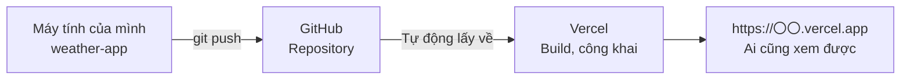

# Bài tập nâng cao: Nâng cấp ứng dụng dự báo thời tiết

> 🇯🇵 Bản gốc (tiếng Nhật): [2026_10_02_資料3.md](<../../../2年生_システム開発実践/後期/2026_10_02/2026_10_02_資料3.md>) <!-- original-ja-link -->

**Bạn nào đã hoàn thành** ứng dụng dự báo thời tiết (`weather-app`) ở [Tài liệu 2](./2026_10_02_資料2.md) thì hãy chuyển sang tài liệu này nhé.

| | Việc cần làm |
|---|---|
| 1. | Tạo biểu tượng thời tiết của riêng mình bằng Gemini và hiển thị thay cho emoji |
| 2. | Deploy miễn phí lên Vercel để có thể xem cả trên điện thoại |

---

## 1. Tạo biểu tượng thời tiết của riêng mình bằng Gemini

Open-Meteo **không gửi kèm hình ảnh biểu tượng** (chỉ trả về mã thời tiết dưới dạng số).
Vì vậy, hãy **tạo hình ảnh bằng Gemini**, đặt vào thư mục `public/`, rồi hiển thị theo mã thời tiết nhé.


### 1-1. Tạo hình ảnh bằng Gemini

Mở [Gemini](https://gemini.google.com/) và nhờ Gemini tạo hình ảnh cho từng loại thời tiết.

| Thời tiết | Ví dụ tên file |
|-----|-------------|
| Trời nắng | `sunny.png` |
| Nắng, đôi lúc có mây | `partly-cloudy.png` |
| Nhiều mây | `cloudy.png` |
| Sương mù | `fog.png` |
| Mưa (bao gồm cả mưa phùn và mưa rào) | `rainy.png` |
| Tuyết | `snowy.png` |
| Mưa giông | `thunder.png` |

Ví dụ về prompt (câu lệnh yêu cầu):

```
Hãy tạo biểu tượng "trời nắng" để dùng trong ứng dụng dự báo thời tiết.
Hình minh họa đơn giản, dễ thương, hình vuông, nền trắng, không có chữ.
```

> **Điểm quan trọng**
> - Sau khi có hình đầu tiên, nếu tiếp tục nhờ "Hãy tạo thêm biểu tượng 'nhiều mây' **với cùng phong cách**" thì các hình sẽ đồng bộ với nhau
> - Tải các hình đã tạo về và đổi tên theo bảng ở trên
> - Tên file dùng **chữ cái và chữ số ASCII** (tránh đặt tên file bằng tiếng Nhật)

### 1-2. Đặt vào thư mục public

```
weather-app/
└── public/
    └── icons/          ← Tạo mới
        ├── sunny.png
        ├── cloudy.png
        └── ...
```

File đặt trong `public/` có thể hiển thị bằng **đường dẫn bắt đầu từ `/`**.
Ví dụ, `public/icons/sunny.png` có thể hiển thị bằng ``.

> Trước tiên, hãy mở http://localhost:3000/icons/sunny.png trên trình duyệt để kiểm tra xem hình ảnh có hiện ra không.

### 1-3. Hiển thị theo mã thời tiết

**Việc cần làm**
- Sửa lại hàm đã tạo ở bước 2 của Tài liệu 2, để ngoài chữ tiếng Nhật và emoji, hàm còn trả về **đường dẫn hình ảnh** (`/icons/sunny.png`...)
- Ở phần thời tiết hiện tại và dự báo 7 ngày, hiển thị hình ảnh bằng `` thay cho emoji

**Gợi ý**
- Thêm vào object trả về một mục như `image: "/icons/sunny.png"`
- Kích thước hình ảnh được quyết định bằng `width` hoặc `style` của `` (danh sách dự báo thì để nhỏ hơn)
- Nếu đặt chữ tiếng Nhật như "晴れ" (trời nắng) vào `alt`, thì kể cả khi hình ảnh không tải được, người xem vẫn biết thời tiết

**✅ Kiểm tra**: Khi đổi thành phố, biểu tượng tự tạo phù hợp với thời tiết được hiển thị

---

## 2. Deploy miễn phí lên Vercel

Ứng dụng hiện tại chạy ở `localhost:3000`, nên **chỉ xem được trên máy tính của chính mình.**
Nếu dùng [Vercel](https://vercel.com/) (dịch vụ của công ty làm ra Next.js), bạn có thể công khai ứng dụng lên Internet miễn phí.
Sau khi công khai, bạn sẽ nhận được một URL như `https://weather-app-xxxx.vercel.app`, và **có thể xem cả từ điện thoại hay máy tính của bạn bè**.



> **Deploy** là việc đặt ứng dụng đã làm lên server để có thể sử dụng từ Internet.

### 2-1. Kiểm tra xem có build được trên máy mình không

Trên Vercel cũng sẽ chạy cùng lệnh `npm run build`. Hãy kiểm tra trước trên máy mình xem có lỗi không.

```bash
# Dừng npm run dev bằng Ctrl + C trước
npm run build
```

- Nếu cuối cùng hiện ra `✓ Compiled successfully` hoặc tương tự, và không bị dừng vì lỗi là OK
- Nếu có **lỗi màu đỏ**, hãy sửa file và dòng được ghi trong thông báo, rồi chạy lại `npm run build`
- Sau khi kiểm tra xong, bạn có thể tiếp tục phát triển bằng `npm run dev`

### 2-2. Push lên GitHub

Dự án tạo bằng `create-next-app` **ngay từ đầu đã là một Git repository**.

1. Tạo **repository mới** trên GitHub (tên là `weather-app`, **không thêm README hay các file khác**)
2. Tham khảo các lệnh hiện ra trên trang của repository vừa tạo, rồi kết nối bằng `git remote add origin ...`
3. Push code từ đầu đến giờ bằng `git add` → `git commit` → `git push`

> Về cách dùng Git, hãy xem lại tài liệu ngày 30/4 ở học kỳ 1.
> Kiểm tra trên giao diện GitHub xem các hình ảnh trong `public/icons/` cũng đã được push lên chưa.

### 2-3. Công khai trên Vercel

1. Mở https://vercel.com/, chọn **Sign Up** → chọn gói **Hobby (miễn phí)**
2. Đăng nhập bằng tài khoản GitHub với **Continue with GitHub**
3. Chọn **Add New...** → **Project**
4. Nhấn **Import** ở `weather-app` trong danh sách (nếu không thấy, hãy cấp quyền truy cập GitHub)
5. Phần thiết lập **cứ để nguyên là OK** (với Next.js, Vercel sẽ tự động nhận diện) → nhấn **Deploy**
6. Chờ 1–2 phút, khi màn hình chúc mừng hiện ra là hoàn thành! Hãy mở thử URL được hiển thị

> Lần này không dùng API key nên không cần thiết lập biến môi trường trên Vercel.

### 2-4. Sau khi sửa, chỉ cần push để cập nhật

Một khi đã kết nối, từ đó về sau **mỗi lần bạn `git push` lên GitHub, Vercel sẽ tự động deploy lại**.


> **Chú ý**
> - URL đã công khai thì **ai cũng xem được**. Đừng đưa thông tin cá nhân như họ tên lên màn hình
> - Gói Hobby là **dành cho cá nhân và học tập** (không dùng được cho trang web kiếm tiền)
> - Khi deploy thất bại, lỗi sẽ hiện trong **Build Logs** trên giao diện Vercel. Hãy kiểm tra xem lệnh `npm run build` trên máy mình có ra cùng lỗi đó không

**✅ Kiểm tra**: Mở URL của Vercel trên điện thoại và thấy dự báo thời tiết được hiển thị
