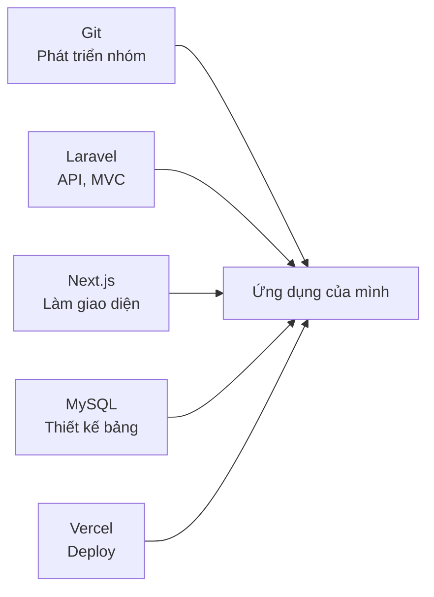
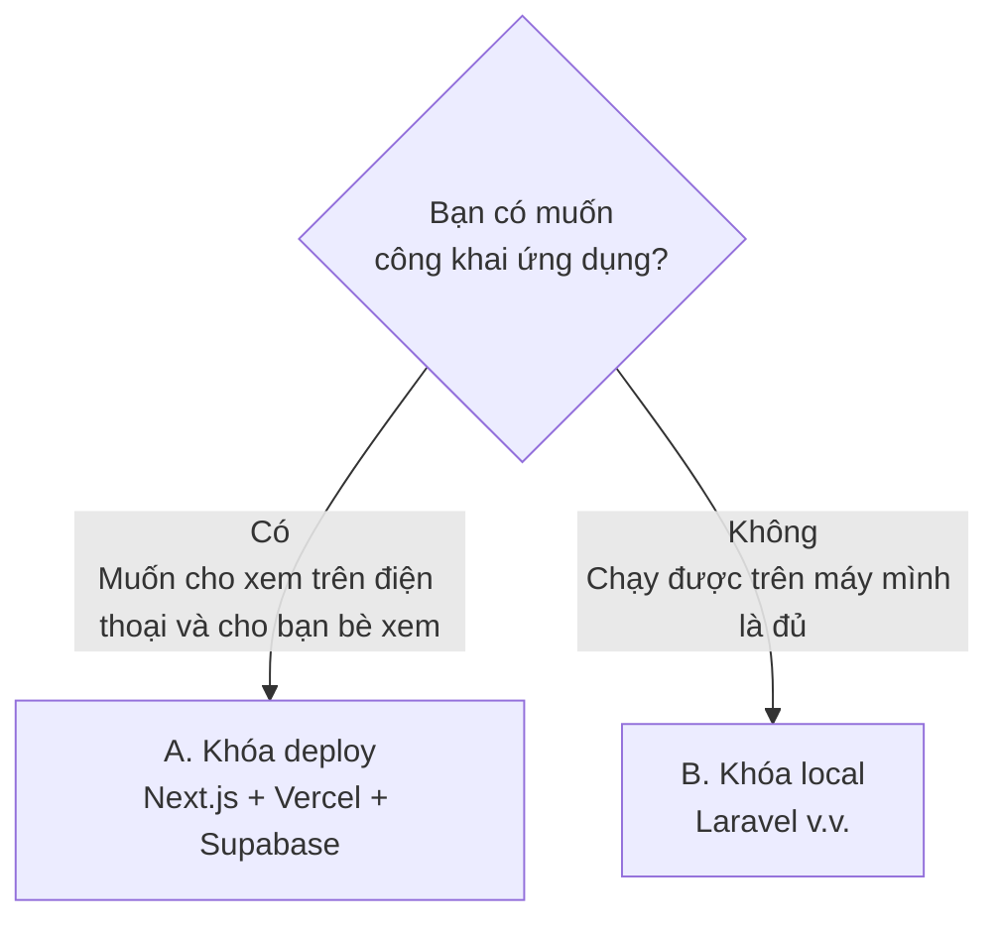
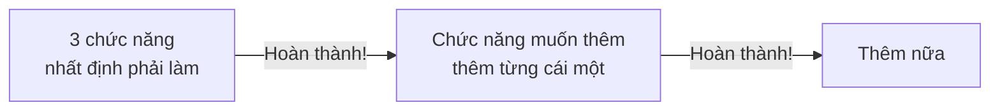
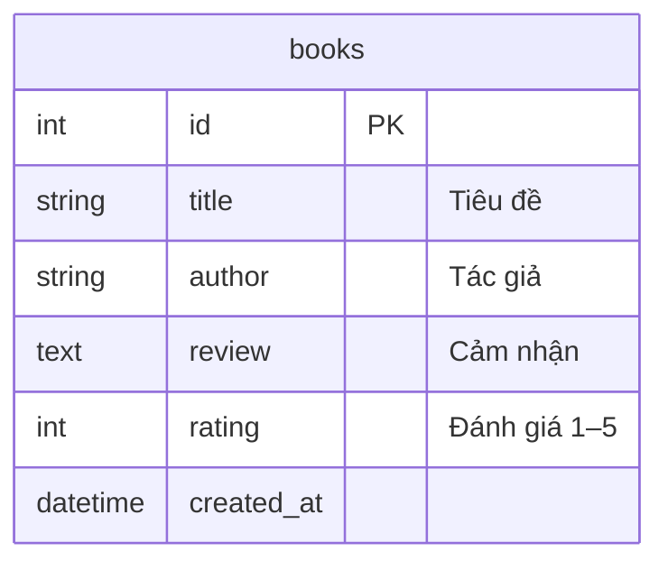
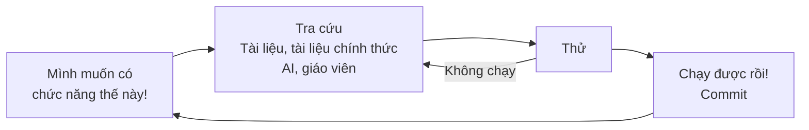
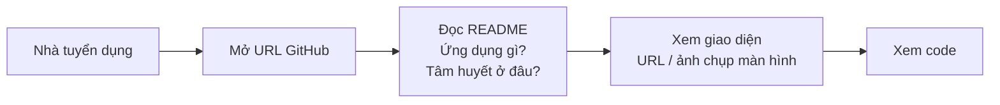
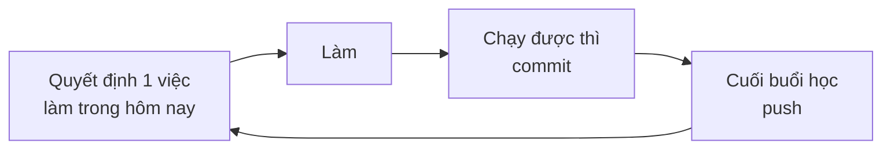

# Sản phẩm tự do: Đã học xong phần cơ bản, từ đây vừa làm thứ mình muốn làm vừa học

> 🇯🇵 Bản gốc (tiếng Nhật): [2026_10_09_資料1.md](<../../../2年生_システム開発実践/後期/2026_10_09/2026_10_09_資料1.md>) <!-- original-ja-link -->

## Mục tiêu hôm nay
- Có thể quyết định ứng dụng mình muốn làm
- Đặt mục tiêu là ứng dụng hoàn thành có thể **nộp như một portfolio** khi đi xin việc
- Có thể chọn khóa phù hợp với mình (deploy / chỉ chạy local)
- Có thể chuẩn bị để bắt đầu phát triển (tạo repository, tạo dự án)
- Có thể ý thức được 2 điều: "vừa làm vừa học" và "trân trọng những điểm mình tâm huyết"

---

## 1. Sản phẩm tự do là gì

Vận dụng những gì đã học đến giờ, chúng ta sẽ làm **thứ mình thích**.
Chủ đề hoàn toàn tự do. Hãy hiện thực hóa những thứ "có thì tiện" xuất phát từ sở thích, hoạt động câu lạc bộ, việc làm thêm hoặc cuộc sống quanh mình.

> 🎯 **Mục tiêu: Làm một ứng dụng có thể nộp cho công ty như một portfolio khi đi xin việc**
> Dù chọn khóa nào, ứng dụng hoàn thành cũng phải **có thể cho công ty xem như "sản phẩm do chính mình phát triển"**.
> Để biết cách nộp, hãy xem [5. Nộp như một portfolio](#5-nộp-như-một-portfolio).



### Tại sao lại tự làm thứ mình muốn làm?

Chúng ta đã học kiến thức cơ bản trong những buổi học trước. Từ đây, chúng ta sẽ **vận dụng** những kiến thức đó.
Có 3 lý do để **tự quyết định và làm thứ mình muốn làm**, thay vì làm bài tập do giáo viên đưa ra.

#### ① Nếu là thứ mình muốn làm, động lực sẽ dễ duy trì hơn

Trong quá trình hoàn thành ứng dụng, bạn sẽ gặp rất nhiều lỗi và những chỗ "không hiểu".
Nếu đó là **thứ mình thật sự muốn có**, bạn sẽ cố gắng được đến cùng với suy nghĩ "mình muốn hoàn thành nó!".

#### ② Trong thời đại AI có thể viết code, "làm cái gì" sẽ được đánh giá

Ngày nay, chỉ cần nhờ là AI có thể viết code cho bạn.
Chính vì vậy, **"làm cái gì", "muốn giúp việc gì trở nên thuận tiện hơn", "tại sao lại làm nó"** trở nên quan trọng.
Không chỉ việc viết được code, mà **năng lực tự tìm ra vấn đề và biến nó thành sản phẩm** cũng sẽ được đánh giá.

#### ③ Có thể nộp cho công ty như một portfolio

Ứng dụng hoàn thành có thể **nộp cho công ty như một portfolio** khi đi xin việc.
Tuy nhiên, nếu ai cũng làm những thứ giống nhau thì sẽ không để lại ấn tượng với nhà tuyển dụng.
Hãy làm **một sản phẩm của riêng mình, khiến nhà tuyển dụng ở công ty bạn ứng tuyển phải trầm trồ "Ồ!"**.

### Ví dụ về chủ đề

| Thể loại | Ví dụ |
|---------|-----|
| Ghi chép | Ghi chép sách đã đọc, ghi chép tập gym, sổ thu chi, ghi chú thành tích chơi game |
| Sưu tầm, trưng bày | Tổng hợp thông tin về idol yêu thích, danh sách quán ăn nên thử, thư viện tác phẩm |
| Hữu ích | Bảng điểm danh câu lạc bộ, quản lý hạn nộp bài tập, vòng quay chọn thực đơn |
| Dùng API | Thời tiết + gợi ý trang phục, Pokédex (từ điển Pokémon), tìm kiếm phim |

---

## 2. Chọn khóa

Chọn khóa dựa trên việc bạn có **muốn công khai ứng dụng lên Internet** hay không.



| | A. Khóa deploy | B. Khóa local |
|---|---|---|
| Tài liệu | [Tài liệu 2](./2026_10_09_資料2.md) | [Tài liệu 3](./2026_10_09_資料3.md) |
| Công nghệ sử dụng | Next.js + **Vercel** + **Supabase** | Laravel + MySQL (+ Next.js) |
| Nơi có thể xem | Internet (`https://〇〇.vercel.app`) | Máy tính của mình (`localhost`) |
| Cơ sở dữ liệu | Supabase (cơ sở dữ liệu trên mạng) | MySQL (trên máy mình) |
| Kiến thức mới cần học | Cách dùng Supabase | Ít (vận dụng kiến thức học kỳ 1) |
| Phù hợp với ai | Muốn thử sức với công nghệ mới | Muốn củng cố chắc nội dung học kỳ 1 |
| Cách nộp portfolio | **URL** + GitHub | **GitHub** (README, ảnh chụp màn hình) |

> Dù chọn khóa nào thì cách đánh giá cũng không thay đổi. **Với khóa nào, bạn cũng có thể nộp ứng dụng như một portfolio.**
> Nếu phân vân, hãy trao đổi với giáo viên nhé.

---

## 3. Trước khi bắt đầu làm

### Trước tiên hãy làm nhỏ

Nếu nhồi nhét quá nhiều chức năng ngay từ đầu, bạn có thể sẽ không hoàn thành được ứng dụng.
Bí quyết là **trước tiên hoàn thành một phiên bản nhỏ, rồi thêm dần sau**.



### Xác định các bảng cần thiết

Dùng kiến thức thiết kế bảng đã học ở học kỳ 1, hãy viết ra các bảng và cột cần thiết.



---

## 4. Vừa làm vừa học

Từ đây, giáo viên sẽ không chuẩn bị sẵn toàn bộ các bước, mà **các bạn sẽ vừa làm thứ mình muốn làm vừa học.**



- Khi cần thì tra cứu những gì cần. **Không cần phải hiểu hết rồi mới bắt đầu làm**
- Lỗi không phải là thất bại, mà là **gợi ý cho biết tiếp theo nên tra cứu gì**
- Bạn có thể xem lại tài liệu và code phiên bản hoàn chỉnh của học kỳ 1 bất cứ lúc nào

### Điểm quan trọng: Trân trọng những điểm mình tâm huyết

Điều quan trọng nhất trong sản phẩm tự do là **sự tâm huyết của bản thân, kiểu "riêng chỗ này mình muốn làm thế này"**.

| Ví dụ về điểm tâm huyết |
|------------|
| Muốn thống nhất giao diện theo màu của idol yêu thích |
| Muốn dễ dùng bằng một tay trên điện thoại |
| Muốn làm một ứng dụng mà chính mình thật sự dùng mỗi ngày |
| Muốn chuyển động khi nhấn nút thật mượt mà, dễ chịu |

Khi có điểm tâm huyết thì

- Bạn sẽ **tự muốn tra cứu** "làm thế nào để làm được?"
- Khi hoàn thành, bạn sẽ **muốn cho người khác xem** (trở thành portfolio)
- Khi phỏng vấn, bạn có thể **nói bằng lời của chính mình "tại sao lại làm cái này"**

Hãy coi trọng việc **truyền tải được sự tâm huyết** hơn là số lượng chức năng.

---

## 5. Nộp như một portfolio

**Portfolio** là sản phẩm để cho công ty thấy "mình có thể làm được những thứ như thế này".
Khi đi xin việc, có những lúc bạn sẽ nộp ứng dụng mình đã làm cùng với hồ sơ ứng tuyển (entry sheet) hoặc khi phỏng vấn.

### Những chỗ nhà tuyển dụng sẽ xem

Nhà tuyển dụng rất bận nên chỉ xem trong **thời gian ngắn**. Điều quan trọng là "xem được ngay" và "hiểu được ngay".



### Cách nộp theo từng khóa

| | A. Khóa deploy | B. Khóa local |
|---|---|---|
| Thứ cần nộp | **URL công khai** + URL GitHub | URL GitHub |
| Cách nhà tuyển dụng xem giao diện | Mở URL là dùng được ngay | Xem bằng **ảnh chụp màn hình, video** trong README |

Ứng dụng của khóa local không thể chạy trên máy tính của nhà tuyển dụng.
Vì vậy, hãy **đưa ảnh chụp màn hình hoặc video màn hình (GIF) vào README, để người xem thấy được ứng dụng đang hoạt động như thế nào**.

### Những gì cần viết trong README

Dù là khóa nào, `README.md` trên GitHub cũng là **bộ mặt** của ứng dụng.

```markdown
# Tên ứng dụng


## Ứng dụng gì?
Đây là ứng dụng ghi lại những cuốn sách đã đọc cùng cảm nhận, để có thể xem lại như một kệ sách.

## Những điểm tâm huyết
- Bìa sách được xếp cạnh nhau để trông giống như một kệ sách
- Bố cục dễ nhìn cả trên điện thoại

## Công nghệ sử dụng
- Next.js / Supabase / Vercel

## URL (chỉ khóa deploy)
https://〇〇.vercel.app
```

- **Những điểm tâm huyết** sẽ trở thành câu trả lời khi bạn bị hỏi "tại sao lại làm cái này?" trong buổi phỏng vấn
- Nếu viết dần từng chút ngay từ giữa quá trình phát triển, đến cuối bạn sẽ không bị cuống

### Kiểm tra trước khi nộp

| Kiểm tra | ✅ |
|---------|---|
| Repository trên GitHub đang ở chế độ **Public (công khai)** | |
| README có phần giải thích ứng dụng, điểm tâm huyết, công nghệ sử dụng, giao diện | |
| API key hay mật khẩu không bị đưa lên GitHub | |
| (Khóa deploy) Mở URL công khai và ứng dụng chạy bình thường | |

> ⚠️ **Khi để Public, bất kỳ ai trên thế giới cũng có thể xem**
> Trước khi nộp, hãy kiểm tra xem có chứa họ tên thật, địa chỉ, thông tin nội bộ của trường... hay không.

---

## 6. Cách tiến hành phát triển

Dù là khóa nào, mỗi buổi học sẽ tiến hành theo trình tự sau.



- **Tạo repository trên GitHub**: Tạo repository mang tên ứng dụng bằng tài khoản của mình
- **Commit thường xuyên**: Khi nghĩ "đến đây đã chạy được" thì lưu lại
- **Push vào cuối buổi học**: Để có thể làm tiếp trên máy ở nhà hoặc máy khác
- **Viết README dần dần**: Khi nộp như một portfolio thì có thể dùng luôn
- **Gặp khó thì áp dụng quy tắc 15 phút**: Nếu tra cứu 15 phút mà vẫn không hiểu thì hỏi giáo viên hoặc bạn bè

> ⚠️ **Không đưa API key hay mật khẩu lên GitHub**
> Hãy viết vào `.env` hoặc `.env.local`, rồi kiểm tra trên giao diện GitHub xem chúng có bị push lên không.

---

## 7. Việc cần làm hôm nay

| Việc cần làm | Xong thì ✅ |
|---------|-----------|
| Quyết định ứng dụng muốn làm và chọn khóa | |
| Xác định các bảng cần thiết | |
| Tạo repository trên GitHub | |
| Chuẩn bị theo tài liệu của khóa đã chọn ([Tài liệu 2](./2026_10_09_資料2.md) / [Tài liệu 3](./2026_10_09_資料3.md)) | |
| Push lần đầu tiên | |
